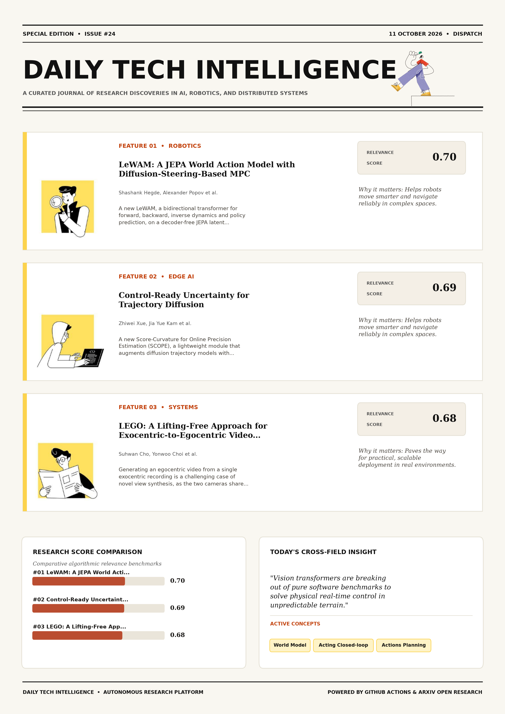

# Daily Tech Intelligence

## 11 October 2026

### Today's Overview

10 research papers analyzed.

Topics:

* Artificial Intelligence
* Machine Learning
* Robotics

### Visual Intelligence Templates

* **Template 3: Gen-Z Spotlight Broadside (Primary)**: [View High-Res](infographic_spotlight.png)
* **Template 2: Modern Tech Studio**: [View High-Res](infographic_modern.png)
* **Template 1: Editorial Research Journal**: [View High-Res](infographic_editorial.png)

---

## 1. LeWAM: A JEPA World Action Model with Diffusion-Steering-Based MPC

Authors: Shashank Hegde, Alexander Popov, Elie Aljalbout, Nikolai Smolyanskiy

Publication: 2026-10-08T17:46:03Z

Category: cs.RO, cs.AI, cs.CV

Relevance Score: 0.70

Paper: [arXiv:2610.12407](https://arxiv.org/abs/2610.12407v1) | [PDF](https://arxiv.org/pdf/2610.12407v1)

### Summary

Addressing critical demands in Artificial Intelligence, this research investigates world action models (wams) predict actions and future observations, typically from a reconstruction-based representation that carries noisy, redundant information which can complicate downstream predictions. We introduce LeWAM, a bidirectional transformer for forward, backward, inverse dynamics and policy prediction, on a decoder-free JEPA latent trained end-to-end through all four modes. We see the following benefits: 1) Alignment: linear probes read robot and object state from LeWAM's latent better than from a regular Le World Model (a forward-only JEPA world model), while the latent ignores visual distractors as well as LeWM does and far better than a reconstruction-based WAM. 3) Planning: Sampling raw actions when planning with WAMs lets MPC exploit dynamics-model inaccuracies; planning in the noise space of the policy head instead improves the closed-loop performance of these WAMs.

### Key Concepts

* World Model
* Acting Closed-loop
* Actions Planning
* Alignment Linear
* Backward Inverse
* Benefits Alignment

### Technical Insights

**Problem**

Addresses foundational constraints in Artificial Intelligence and existing computational workflows.

**Approach**

We introduce LeWAM, a bidirectional transformer for forward, backward, inverse dynamics and policy prediction, on a decoder-free JEPA latent trained end-to-end through all four modes.

**Key Innovation**

Formulates an integrated mechanism leveraging World Model, Acting Closed-loop.

**Results**

Not specified in the available abstract.

**Applications**

Autonomous robotic manipulation, sim-to-real transfer, and agile mobile navigation systems. High-resolution real-time visual perception, automated 3D reconstruction, and embodied vision.

**Limitations**

Not specified in the available abstract.

---

## 2. Control-Ready Uncertainty for Trajectory Diffusion

Authors: Zhiwei Xue, Jia Yue Kam, Jinhang Qiu, Yifeng Cheng, Ege Gursoy, Jiaming Wang, Vincent Bonnet, Harold Soh

Publication: 2026-10-08T17:57:01Z

Category: cs.RO

Relevance Score: 0.69

Paper: [arXiv:2610.12431](https://arxiv.org/abs/2610.12431v1) | [PDF](https://arxiv.org/pdf/2610.12431v1)

### Summary

Diffusion models can represent complex, multimodal trajectory distributions, but extracting uncertainty from them typically requires costly Monte Carlo sampling. We introduce Score-Curvature for Online Precision Estimation (SCOPE), a lightweight module that augments diffusion trajectory models with control-ready uncertainty. Project page: https://zackaxue.github.io/SCOPE-project-page/ This limits their use in real-time control, where robots must rapidly assess risk and maintain safety margins. SCOPE learns a structured precision matrix around each nominal trajectory by distilling score-curvature information and producing calibrated Gaussian tubes with low overhead and without repeated Monte Carlo sampling. These tubes provide per-timestep covariance estimates that can be used both as predicted occupancy for moving agents and as adaptive exploration guides for robot control.

### Key Concepts

* Manipulation
* Adaptive Exploration
* Assess Risk
* Augments Diffusion
* Backbones Pedestrian
* Better Closed-loop

### Technical Insights

**Problem**

Diffusion models can represent complex, multimodal trajectory distributions, but extracting uncertainty from them typically requires costly Monte Carlo sampling.

**Approach**

We introduce Score-Curvature for Online Precision Estimation (SCOPE), a lightweight module that augments diffusion trajectory models with control-ready uncertainty.

**Key Innovation**

Formulates an integrated mechanism leveraging Manipulation, Adaptive Exploration.

**Results**

Not specified in the available abstract.

**Applications**

Autonomous robotic manipulation, sim-to-real transfer, and agile mobile navigation systems.

**Limitations**

SCOPE learns a structured precision matrix around each nominal trajectory by distilling score-curvature information and producing calibrated Gaussian tubes with low overhead and without repeated Monte Carlo sampling.

---

## 3. LEGO: A Lifting-Free Approach for Exocentric-to-Egocentric Video Generation

Authors: Suhwan Cho, Yonwoo Choi, Soongjin Kim, Jicheol Park, Taegyu Lim

Publication: 2026-10-08T17:58:03Z

Category: cs.CV

Relevance Score: 0.68

Paper: [arXiv:2610.12442](https://arxiv.org/abs/2610.12442v1) | [PDF](https://arxiv.org/pdf/2610.12442v1)

### Summary

Addressing critical demands in Machine Learning, this research investigates generating an egocentric video from a single exocentric recording is a challenging case of novel view synthesis, as the two cameras share little overlap and much of the target view is unobserved. Our approach consistently outperforms the state-of-the-art explicit pipeline and generalizes to other datasets without retraining. Generating an egocentric video from a single exocentric recording is a challenging case of novel view synthesis, as the two cameras share little overlap and much of the target view is unobserved. Our approach consistently outperforms the state-of-the-art explicit pipeline and generalizes to other datasets without retraining. The synthesizer thus supplies view structure, and the diffusion model its detail.

### Key Concepts

* Diffusion Model
* Point Cloud
* Suits Diffusion Generator
* Supplies View
* Synthesis Cameras
* Synthesizer Lvsm-style

### Technical Insights

**Problem**

Addresses foundational constraints in Machine Learning and existing computational workflows.

**Approach**

Our approach consistently outperforms the state-of-the-art explicit pipeline and generalizes to other datasets without retraining.

**Key Innovation**

Generating an egocentric video from a single exocentric recording is a challenging case of novel view synthesis, as the two cameras share little overlap and much of the target view is unobserved.

**Results**

Our approach consistently outperforms the state-of-the-art explicit pipeline and generalizes to other datasets without retraining.

**Applications**

High-resolution real-time visual perception, automated 3D reconstruction, and embodied vision.

**Limitations**

We argue that this trade-off suits a diffusion generator, whose denoising training excels at restoring detail, so an effective condition should prioritize structural alignment over sharpness.

---

## 4. SpaceCast-Bench: Evaluating Predictive Spatial Reasoning in Vision-Language Models

Authors: Hongxing Li, Jinyue Su, Dingming Li, Wenqi Zhang, Weiming Lu, Jun Xiao, Yueting Zhuang, Yongliang Shen

Publication: 2026-10-08T17:44:17Z

Category: cs.CV, cs.CL

Relevance Score: 0.67

Paper: [arXiv:2610.12402](https://arxiv.org/abs/2610.12402v1) | [PDF](https://arxiv.org/pdf/2610.12402v1)

### Summary

Addressing critical demands in Artificial Intelligence, this research investigates existing spatial reasoning benchmarks mainly test spatial perception: reading off relations already visible in the input. We introduce SpaceCast-Bench, the first benchmark to directly and diagnostically evaluate this capability. Controlled analyses further reveal that bridge views are critical for integrating distributed observations, and that explicit 3D evidence benefits models more reliably than generated outcome images or videos. Existing spatial reasoning benchmarks mainly test spatial perception: reading off relations already visible in the input. Yet real-world spatial intelligence demands predictive spatial reasoning: constructing a scene from observations, anticipating how an intervention changes it, and reasoning about the unseen outcome.

### Key Concepts

* Spatial Reasoning
* Analyses Reveal
* Anticipating Intervention
* Bridge Views
* Built Observe-transform-infer
* Capability Built

### Technical Insights

**Problem**

Addresses foundational constraints in Artificial Intelligence and existing computational workflows.

**Approach**

We introduce SpaceCast-Bench, the first benchmark to directly and diagnostically evaluate this capability.

**Key Innovation**

Formulates an integrated mechanism leveraging Spatial Reasoning, Analyses Reveal.

**Results**

Not specified in the available abstract.

**Applications**

High-resolution real-time visual perception, automated 3D reconstruction, and embodied vision. Next-generation large language model workflows, retrieval-augmented intelligence, and structured document parsing.

**Limitations**

Not specified in the available abstract.

---

## 5. VersaCamVLA: Camera-Configurable VLA Policies for Robotic Manipulation

Authors: Boyao Han, Chen Shi, Jingjing Qian, ZhuoTan Tian, Li Jiang

Publication: 2026-10-08T17:58:47Z

Category: cs.CV, cs.RO

Relevance Score: 0.66

Paper: [arXiv:2610.12451](https://arxiv.org/abs/2610.12451v1) | [PDF](https://arxiv.org/pdf/2610.12451v1)

### Summary

Addressing critical demands in Robotics, this research investigates vision-language-action (vla) models have emerged as powerful foundations for robotic manipulation, but their reliance on fixed camera configurations during training makes them brittle to changes in camera count or pose during deployment. To overcome these limitations, we propose VersaCamVLA, a camera-configurable framework that decouples camera-set representation from action learning. At deployment, a lightweight spatial encoder injects these compact scene tokens into a pretrained base VLA as a supplementary visual condition, requiring no explicit 3D sensing or novel-view rendering. Experiments on RoboTwin, LIBERO, and a real-robot platform demonstrate that VersaCamVLA consistently outperforms prior VLA methods and direct multi-view baselines, maintaining robust performance across varying camera counts and unseen camera poses.

### Key Concepts

* Manipulation
* Achieved Multi-signal
* Action Learning
* Arbitrary Variable
* Base Vla
* Baselines Maintaining

### Technical Insights

**Problem**

Addresses foundational constraints in Robotics and existing computational workflows.

**Approach**

To overcome these limitations, we propose VersaCamVLA, a camera-configurable framework that decouples camera-set representation from action learning.

**Key Innovation**

At deployment, a lightweight spatial encoder injects these compact scene tokens into a pretrained base VLA as a supplementary visual condition, requiring no explicit 3D sensing or novel-view rendering.

**Results**

Experiments on RoboTwin, LIBERO, and a real-robot platform demonstrate that VersaCamVLA consistently outperforms prior VLA methods and direct multi-view baselines, maintaining robust performance across varying camera counts and unseen camera poses.

**Applications**

Autonomous robotic manipulation, sim-to-real transfer, and agile mobile navigation systems. High-resolution real-time visual perception, automated 3D reconstruction, and embodied vision.

**Limitations**

To overcome these limitations, we propose VersaCamVLA, a camera-configurable framework that decouples camera-set representation from action learning.

---

## 6. Embodied Turing Machines: Stateful Code for Robot Recursive Self-Improvement

Authors: Kairui Hu, Siyuan Hu, Fangzhou Hong, Zhaoxi Chen, Ziwei Liu

Publication: 2026-10-08T17:29:08Z

Category: cs.RO, cs.CV

Relevance Score: 0.66

Paper: [arXiv:2610.12369](https://arxiv.org/abs/2610.12369v1) | [PDF](https://arxiv.org/pdf/2610.12369v1)

### Summary

Addressing critical demands in Robotics, this research investigates most robot policies keep a model in the control loop: a vla maps observations to actions, and an agent harness, such as agent-as-policy or harness vla queries a vlm for decision making at run time. We propose a different view: the embodied world is an Embodied Turing Machine, whose tape is the robot and environment state and rules are the policy. We thus propose COAP as a new paradigm for embodied tasks; since it applies across episodes, it can also serve as an efficient data engine for VLAs and Agent Harnesses. If this state can be represented accurately, the decision making can be written entirely in code.

### Key Concepts

* Turing Machine
* Agent Harnesses
* Applies Episodes
* Makes Decision
* Robot Environment
* State Represented

### Technical Insights

**Problem**

Addresses foundational constraints in Robotics and existing computational workflows.

**Approach**

We propose a different view: the embodied world is an Embodied Turing Machine, whose tape is the robot and environment state and rules are the policy.

**Key Innovation**

We thus propose COAP as a new paradigm for embodied tasks; since it applies across episodes, it can also serve as an efficient data engine for VLAs and Agent Harnesses.

**Results**

Not specified in the available abstract.

**Applications**

Autonomous robotic manipulation, sim-to-real transfer, and agile mobile navigation systems. High-resolution real-time visual perception, automated 3D reconstruction, and embodied vision.

**Limitations**

Not specified in the available abstract.

---

## 7. OmniCapBench: A Deep-Structured Evaluation Framework for Fine-Grained Audio-Visual Captioning

Authors: Zhongyu Yang, Jiale Tao, Ruitao Chen, Zuhao Yang, Yingfang Yuan, Xueliang Zhao, Auden, Kai Wang, Shuai Shao, Biao Wang, Steve Yves, Qinglin Lu

Publication: 2026-10-08T17:59:21Z

Category: cs.CV

Relevance Score: 0.65

Paper: [arXiv:2610.12458](https://arxiv.org/abs/2610.12458v1) | [PDF](https://arxiv.org/pdf/2610.12458v1)

### Summary

Addressing critical demands in Artificial Intelligence, this research investigates multimodal large language models (mllms) are rapidly evolving toward continuous audio--visual reasoning, creating an urgent need for evaluations that expose their capability limits. We introduce OmniCapBench (Omni-Video Caption Benchmark), a benchmark that reframes audio--visual caption evaluation as a deep-structured diagnostic framework. Evaluating frontier MLLMs reveals strong local perception but weak long-horizon audio--visual reasoning, particularly in identity drift and cross-modal misalignment, providing a fine-grained roadmap for omnimodal development. Multimodal large language models (MLLMs) are rapidly evolving toward continuous audio--visual reasoning, creating an urgent need for evaluations that expose their capability limits. Audio--visual captioning is an ideal diagnostic task, yet current benchmarks face a coupled trade-off: whole-caption scores provide coverage without localization, local probes provide localization without coverage, and unconstrained LLM judges introduce instability.

### Key Concepts

* Annotated Videos
* Atomic Verifiable
* Audio Events
* Audio--visual Captioning
* Audio--visual Reasoning
* Capability Limits

### Technical Insights

**Problem**

Addresses foundational constraints in Artificial Intelligence and existing computational workflows.

**Approach**

We introduce OmniCapBench (Omni-Video Caption Benchmark), a benchmark that reframes audio--visual caption evaluation as a deep-structured diagnostic framework.

**Key Innovation**

Formulates an integrated mechanism leveraging Annotated Videos, Atomic Verifiable.

**Results**

Not specified in the available abstract.

**Applications**

High-resolution real-time visual perception, automated 3D reconstruction, and embodied vision.

**Limitations**

Audio--visual captioning is an ideal diagnostic task, yet current benchmarks face a coupled trade-off: whole-caption scores provide coverage without localization, local probes provide localization without coverage, and unconstrained LLM judges introduce instability.

---

## 8. FAITH: Feasibility-Aware Safety-Filtered RL for High-Dimensional Systems

Authors: Songyuan Zhang, Baljeet Singh, Sarthak Ranjeet Kaingade, Chuchu Fan, Bryan Trinh

Publication: 2026-10-08T17:57:06Z

Category: cs.RO, cs.LG, eess.SY

Relevance Score: 0.65

Paper: [arXiv:2610.12432](https://arxiv.org/abs/2610.12432v1) | [PDF](https://arxiv.org/pdf/2610.12432v1)

### Summary

The task policy optimizes the task return through the filtered dynamics, which recovers the feasible constrained problem without a competing safety term in the task-policy update. We present FAITH, a feasibility-aware, model-free framework that approximates the optimal state-action safety value and amortizes minimal-intervention filtering with a feedforward network. Hard projections are also undefined when no safe action exists. The same policies are also demonstrated on a real-world Unitree G1 humanoid. Safe reinforcement learning commonly places safety and task performance in the same policy objective, where they can introduce competing updates. Safety filters separate them at action execution, but classical designs require an analytic safety function and dynamics model, and standard minimal-intervention filters are myopic to long-horizon task return because they minimize only instantaneous action deviation.

### Key Concepts

* Reinforcement Learning
* Safety Rate
* Task-policy Update
* Term Task-policy
* Undefined Safe
* Unfiltered Return

### Technical Insights

**Problem**

The task policy optimizes the task return through the filtered dynamics, which recovers the feasible constrained problem without a competing safety term in the task-policy update.

**Approach**

We present FAITH, a feasibility-aware, model-free framework that approximates the optimal state-action safety value and amortizes minimal-intervention filtering with a feedforward network.

**Key Innovation**

Formulates an integrated mechanism leveraging Reinforcement Learning, Safety Rate.

**Results**

Not specified in the available abstract.

**Applications**

Autonomous robotic manipulation, sim-to-real transfer, and agile mobile navigation systems.

**Limitations**

Not specified in the available abstract.

---

## 9. HRIL: Learning Multimodal Synergy via Higher-Order Tensor Modeling

Authors: Qun Dai, Liangjian Wen, Jiang Duan, Yong Dai, Dongkai Wang, Maolin Wang, Mingjie Wang, Jianzhuang Liu, He Yan, Zhao Kang

Publication: 2026-10-08T17:39:45Z

Category: cs.AI, cs.LG

Relevance Score: 0.65

Paper: [arXiv:2610.12393](https://arxiv.org/abs/2610.12393v1) | [PDF](https://arxiv.org/pdf/2610.12393v1)

### Summary

Addressing critical demands in Machine Learning, this research investigates self-supervised multimodal representation learning has achieved remarkable success across diverse domains, yet capturing synergistic information remains challenging due to the complexity of cross-modal interactions. Motivated by this insight, we propose Higher-order Representation and Information Learning (HRIL), which constructs an empirical cross-moment tensor over modality embeddings to represent multi-way interactions. This work focuses on how to preserve the information capacity for such synergistic signals in multimodal representations. Code is released at https://github.com/brightest66/HRIL. Self-supervised multimodal representation learning has achieved remarkable success across diverse domains, yet capturing synergistic information remains challenging due to the complexity of cross-modal interactions.

### Key Concepts

* Representation Learning
* Achieved Remarkable
* Arises Task-relevant
* Capacity Synergistic
* Capturing Synergistic
* Challenging Complexity

### Technical Insights

**Problem**

Addresses foundational constraints in Machine Learning and existing computational workflows.

**Approach**

Motivated by this insight, we propose Higher-order Representation and Information Learning (HRIL), which constructs an empirical cross-moment tensor over modality embeddings to represent multi-way interactions.

**Key Innovation**

Formulates an integrated mechanism leveraging Representation Learning, Achieved Remarkable.

**Results**

Not specified in the available abstract.

**Applications**

Autonomous agentic reasoning, multi-agent coordination, and decision-support platforms.

**Limitations**

Not specified in the available abstract.

---

## 10. Which Skill to Distill? SGUID: Selecting a Compact Skill Bank for Model-Skill Co-Evolution

Authors: Yuhan Liu, Xiyao Ma, Zhongkai Sun, Xu Han, Chengyuan Ma, Benjamin Z. Yao, Chenlei Guo

Publication: 2026-10-08T17:27:53Z

Category: cs.CL

Relevance Score: 0.65

Paper: [arXiv:2610.12367](https://arxiv.org/abs/2610.12367v1) | [PDF](https://arxiv.org/pdf/2610.12367v1)

### Summary

The individual utility of each skill, however, is largely neglected. Prior work retrieves skills from a bank by semantic relevance, then uses them as inference-time patches or for model distillation. Our results show that not all skills are worth distilling. These results identify skill selection as the key mechanism for stable model-skill co-evolution. Skills, reusable procedural guidance added at inference, can substantially improve LLM downstream performance (Li et al., 2026). We first show that, in on-policy distillation where skill-conditioned policies serve as teachers, fewer than 25% of retrieved skills provide useful distillation signals. We then propose SGUID, a method for selecting a compact subset of skills for distillation.

### Key Concepts

* Model-skill Co-evolution
* Selected Skills
* Skills Distillation
* Skills Distilled
* Skills Improves
* Skills Matches

### Technical Insights

**Problem**

The individual utility of each skill, however, is largely neglected.

**Approach**

Prior work retrieves skills from a bank by semantic relevance, then uses them as inference-time patches or for model distillation.

**Key Innovation**

Formulates an integrated mechanism leveraging Model-skill Co-evolution, Selected Skills.

**Results**

Our results show that not all skills are worth distilling.

**Applications**

Next-generation large language model workflows, retrieval-augmented intelligence, and structured document parsing.

**Limitations**

Not specified in the available abstract.

---
