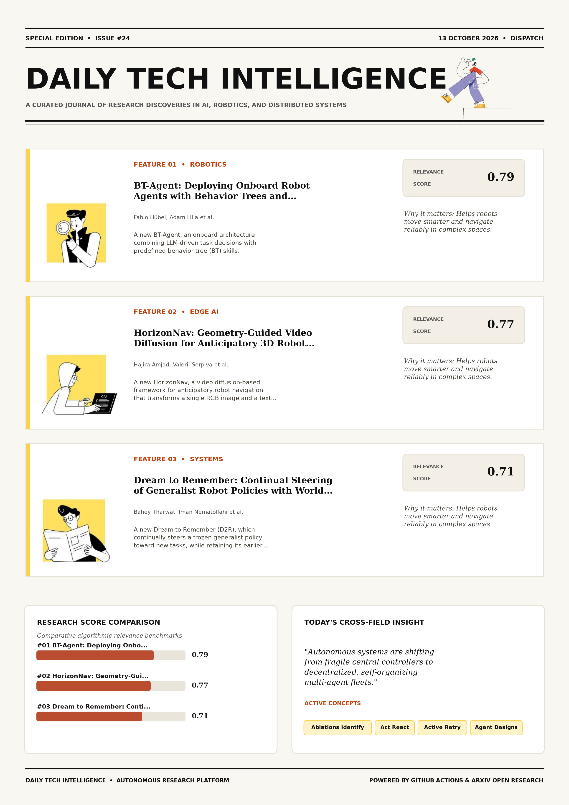

# Daily Tech Intelligence

## 13 October 2026

### Today's Overview

10 research papers analyzed.

Topics:

* Artificial Intelligence
* Computer Vision
* Machine Learning
* Robotics

### Visual Intelligence Templates

* **Template 3: Gen-Z Spotlight Broadside (Primary)**: [View High-Res](infographic_spotlight.png)
* **Template 2: Modern Tech Studio**: [View High-Res](infographic_modern.png)
* **Template 1: Editorial Research Journal**: [View High-Res](infographic_editorial.png)

---

## 1. BT-Agent: Deploying Onboard Robot Agents with Behavior Trees and Multi-Fidelity Evaluation

Authors: Fabio Hübel, Adam Lilja, Yue Yin, Siming He, Claire Tomlin, Shankar Sastry, Jonas Frey, Marco Pavone

Publication: 2026-10-09T17:08:45Z

Category: cs.RO

Relevance Score: 0.79

Paper: [arXiv:2610.13862](https://arxiv.org/abs/2610.13862v1) | [PDF](https://arxiv.org/pdf/2610.13862v1)

### Summary

Addressing critical demands in Robotics, this research investigates deploying language-model agents onboard mobile robots requires task reasoning and responsive execution within limited compute and memory. We propose BT-Agent, an onboard architecture combining LLM-driven task decisions with predefined behavior-tree (BT) skills. These skills enforce execution conditions and return structured failure feedback. Ablations identify structured tool calls and informative failure feedback as the most useful components. Deploying language-model agents onboard mobile robots requires task reasoning and responsive execution within limited compute and memory. We demonstrate fully onboard operation with a 9B model on a quadruped across five task categories. Intervention tests show that local checks stop ongoing navigation without waiting for another model decision, while the agent remains active to retry or report constraints.

### Key Concepts

* Ablations Identify
* Act React
* Active Retry
* Agent Designs
* Approximately Percentage
* Behavior-tree Skills

### Technical Insights

**Problem**

Addresses foundational constraints in Robotics and existing computational workflows.

**Approach**

We propose BT-Agent, an onboard architecture combining LLM-driven task decisions with predefined behavior-tree (BT) skills.

**Key Innovation**

Formulates an integrated mechanism leveraging Ablations Identify, Act React.

**Results**

Not specified in the available abstract.

**Applications**

Autonomous robotic manipulation, sim-to-real transfer, and agile mobile navigation systems.

**Limitations**

Intervention tests show that local checks stop ongoing navigation without waiting for another model decision, while the agent remains active to retry or report constraints.

---

## 2. HorizonNav: Geometry-Guided Video Diffusion for Anticipatory 3D Robot Navigation

Authors: Hajira Amjad, Valerii Serpiva, Viacheslav Liubimov, Didar Seyidov, Dzmitry Tsetserukou

Publication: 2026-10-09T16:57:08Z

Category: cs.RO

Relevance Score: 0.77

Paper: [arXiv:2610.13849](https://arxiv.org/abs/2610.13849v1) | [PDF](https://arxiv.org/pdf/2610.13849v1)

### Summary

Addressing critical demands in Robotics, this research investigates we present horizonnav, a video diffusion-based framework for anticipatory robot navigation that transforms a single rgb image and a text prompt into a geometrically aligned representation of plausible surrounding 3d space. We present HorizonNav, a video diffusion-based framework for anticipatory robot navigation that transforms a single RGB image and a text prompt into a geometrically aligned representation of plausible surrounding 3D space. The resulting video sequence provides plausible future observations of the environment, which are subsequently processed using monocular ORB-SLAM3 for camera pose estimation and Video Depth Anything for dense depth prediction. Across 15 corridor reconstructions, the mean reconstruction error is approximately 0.30 m at matched structural landmarks.

### Key Concepts

* Robot Navigation
* Diffusion Model
* Video Diffusion
* Alternatives Cases
* Anticipatory Robot
* Approximately Matched

### Technical Insights

**Problem**

Addresses foundational constraints in Robotics and existing computational workflows.

**Approach**

We present HorizonNav, a video diffusion-based framework for anticipatory robot navigation that transforms a single RGB image and a text prompt into a geometrically aligned representation of plausible surrounding 3D space.

**Key Innovation**

Formulates an integrated mechanism leveraging Robot Navigation, Diffusion Model.

**Results**

Not specified in the available abstract.

**Applications**

Autonomous robotic manipulation, sim-to-real transfer, and agile mobile navigation systems.

**Limitations**

In a separate corridor study, 6 of 25 evaluable generated-camera trajectories violate the reconstructed collision constraints; RRT planner recovers feasible alternatives in 5 of those 6 cases.

---

## 3. Dream to Remember: Continual Steering of Generalist Robot Policies with World Models

Authors: Bahey Tharwat, Iman Nematollahi, Marvin Alles, Xingyuan Zhang, Akshay L Chandra, Abhinav Valada

Publication: 2026-10-09T16:28:01Z

Category: cs.RO, cs.CV, cs.LG

Relevance Score: 0.71

Paper: [arXiv:2610.13816](https://arxiv.org/abs/2610.13816v1) | [PDF](https://arxiv.org/pdf/2610.13816v1)

### Summary

When tasks arrive sequentially, both approaches suffer from catastrophic forgetting. We propose Dream to Remember (D2R), which continually steers a frozen generalist policy toward new tasks, while retaining its earlier skills. Finally, on a real Franka robot, D2R improves three tasks in sequence entirely in imagination while retaining the earlier improvements. Generalist robot policies are trained with imitation learning and are bounded by the quality and coverage of their demonstrations. Reinforcement learning can improve and extend them, either by fine-tuning the policy weights or by training a small module to steer the input noise of a frozen generative policy. Fine-tuning on a task degrades prior tasks, and steering only shifts forgetting to the shared steering module.

### Key Concepts

* World Model
* Imitation Learning
* Reinforcement Learning
* Entirely Imagination
* Generalist Policy
* Retaining Earlier

### Technical Insights

**Problem**

When tasks arrive sequentially, both approaches suffer from catastrophic forgetting.

**Approach**

We propose Dream to Remember (D2R), which continually steers a frozen generalist policy toward new tasks, while retaining its earlier skills.

**Key Innovation**

Formulates an integrated mechanism leveraging World Model, Imitation Learning.

**Results**

Not specified in the available abstract.

**Applications**

Autonomous robotic manipulation, sim-to-real transfer, and agile mobile navigation systems. High-resolution real-time visual perception, automated 3D reconstruction, and embodied vision.

**Limitations**

Not specified in the available abstract.

---

## 4. Splat2Act: From Captured Scenes to Personalized VLA Manipulation

Authors: Xiaomeng Ye, Krishna Jaganathan, Gyubeum Lim, Gunjan Chhablani, Muhammad Zubair Irshad, Zsolt Kira

Publication: 2026-10-09T17:59:06Z

Category: cs.RO, cs.CV

Relevance Score: 0.68

Paper: [arXiv:2610.13945](https://arxiv.org/abs/2610.13945v1) | [PDF](https://arxiv.org/pdf/2610.13945v1)

### Summary

Addressing critical demands in Robotics, this research investigates a user who brings a generalist manipulation policy into their home or office wants it to pick up their objects from their shelves, counters, and tables. We present Splat2Act, an automated real-to-sim-to-real pipeline that personalizes a pretrained vision-language-action (VLA) policy to a specific scene and object set using only a handheld phone scan and images of the user's objects. These results suggest that automated real-to-sim-to-real training can personalize VLA manipulation policies using only simulation-oracle data. A user who brings a generalist manipulation policy into their home or office wants it to pick up their objects from their shelves, counters, and tables.

### Key Concepts

* Sim-to-Real Transfer
* Manipulation
* Gaussian Splatting
* Applied Scanned Campus
* Area Receptacles
* Assets Drawn

### Technical Insights

**Problem**

Addresses foundational constraints in Robotics and existing computational workflows.

**Approach**

We present Splat2Act, an automated real-to-sim-to-real pipeline that personalizes a pretrained vision-language-action (VLA) policy to a specific scene and object set using only a handheld phone scan and images of the user's objects.

**Key Innovation**

Formulates an integrated mechanism leveraging Sim-to-Real Transfer, Manipulation.

**Results**

Not specified in the available abstract.

**Applications**

Autonomous robotic manipulation, sim-to-real transfer, and agile mobile navigation systems. High-resolution real-time visual perception, automated 3D reconstruction, and embodied vision.

**Limitations**

Not specified in the available abstract.

---

## 5. Where to Look Matters: Rethinking Sub-Volume Sampling in 3D Medical Self-supervised Learning

Authors: Junkai Liu, Le Zhang

Publication: 2026-10-09T17:51:47Z

Category: cs.CV

Relevance Score: 0.67

Paper: [arXiv:2610.13915](https://arxiv.org/abs/2610.13915v1) | [PDF](https://arxiv.org/pdf/2610.13915v1)

### Summary

However, random cropping implicitly treats all spatial regions as equally worth observing, despite anatomical priors and spatial redundancy that make regions inherently unequal in their value for representation learning. We propose \textbf{\method}, a plug-and-play framework that replaces random cropping with an offline coarse-to-fine probe bank guided by \textit{anatomy-awareness}, \textit{informativeness}, and \textit{diversity}. To this end, we first show through controlled crop-quality manipulations that better sub-volumes lead to better downstream transfer, revealing the observation policy as an overlooked bottleneck in 3D medical SSL. Mechanistic analyses further attribute these gains to more anatomically plausible and informative observations, reduced spatial redundancy, more efficient learning dynamics, and more structured representations.

### Key Concepts

* Representation Learning
* Self-supervised Learning
* Sub-volume Sampling
* Attribute Gains Anatomically
* Backbones Downstream
* Bank Guided

### Technical Insights

**Problem**

However, random cropping implicitly treats all spatial regions as equally worth observing, despite anatomical priors and spatial redundancy that make regions inherently unequal in their value for representation learning.

**Approach**

We propose \textbf{\method}, a plug-and-play framework that replaces random cropping with an offline coarse-to-fine probe bank guided by \textit{anatomy-awareness}, \textit{informativeness}, and \textit{diversity}.

**Key Innovation**

Formulates an integrated mechanism leveraging Representation Learning, Self-supervised Learning.

**Results**

Not specified in the available abstract.

**Applications**

High-resolution real-time visual perception, automated 3D reconstruction, and embodied vision.

**Limitations**

Not specified in the available abstract.

---

## 6. Revisiting the Task of Building Damage Assessment by Satellite Imaging

Authors: Anthony Cioppa, Virgile Blua, Sébastien Piérard, Pietro Ceccato, Marc Van Droogenbroeck

Publication: 2026-10-09T17:07:03Z

Category: cs.CV

Relevance Score: 0.67

Paper: [arXiv:2610.13857](https://arxiv.org/abs/2610.13857v1) | [PDF](https://arxiv.org/pdf/2610.13857v1)

### Summary

Yet, despite a decade of intense activity and the release of several large-scale datasets, the field lacks a shared foundation. Automating this task, referred to as building damage assessment (BDA), from satellite imagery, has become an active research topic at the intersection of remote sensing, computer vision, and machine learning, particularly since supervised deep learning methods were shown to outperform earlier handcrafted approaches. Finally, we discuss how these elements can inform the organization of a BDA challenge, including cross-validation, challenge, and private data-sharing setups designed to build trust between developers and users. Natural disasters such as earthquakes, tropical storms, and floods cause extensive damage to buildings, and rapid, reliable damage maps are essential to guide emergency response.

### Key Concepts

* Active Research
* Activity Release
* Aggregate Score
* Approaches Despite
* Argue Sensor-agnostic
* Assessment Bda

### Technical Insights

**Problem**

Yet, despite a decade of intense activity and the release of several large-scale datasets, the field lacks a shared foundation.

**Approach**

Automating this task, referred to as building damage assessment (BDA), from satellite imagery, has become an active research topic at the intersection of remote sensing, computer vision, and machine learning, particularly since supervised deep learning methods were shown to outperform earlier handcrafted approaches.

**Key Innovation**

Formulates an integrated mechanism leveraging Active Research, Activity Release.

**Results**

Not specified in the available abstract.

**Applications**

High-resolution real-time visual perception, automated 3D reconstruction, and embodied vision.

**Limitations**

Not specified in the available abstract.

---

## 7. Towards Physically Grounded Articulated 3D Assets: A Multi-Agent Pipeline and Benchmark

Authors: Xudong Cai, Ruijie Zhu, Haoliang Shang, Ruining Li, Marc Pollefeys, Shangzhe Wu, Andrea Vedaldi, Chuanxia Zheng

Publication: 2026-10-09T17:59:41Z

Category: cs.CV

Relevance Score: 0.66

Paper: [arXiv:2610.13947](https://arxiv.org/abs/2610.13947v1) | [PDF](https://arxiv.org/pdf/2610.13947v1)

### Summary

Addressing critical demands in Artificial Intelligence, this research investigates in this paper, we study physically grounded articulated 3d asset generation---moving the goal from reproducing how objects look to capturing how they move and function. Inspired by the literature on procedural and agentic generation, we present Artisan, a system that extends the latest method Articraft by introducing a multi-agent pipeline with physical simulation feedback, enabling comprehensive attributes beyond geometry, appearance, and physically plausible articulation, such as collision-free motion, stability under gravity, and accurate mass and material properties. Furthermore, we construct a unified benchmark spanning four key aspects: spatial fidelity, physical plausibility, downstream task performance, and overall quality. Together, our system and benchmark establish insights for advancing 3D generation towards physically plausible, functionally usable assets.

### Key Concepts

* Abo Objects
* Accurate Mass
* Achieves Competitive
* Advancing Generation
* Agentic Generation
* Appearance Physically

### Technical Insights

**Problem**

Addresses foundational constraints in Artificial Intelligence and existing computational workflows.

**Approach**

Inspired by the literature on procedural and agentic generation, we present Artisan, a system that extends the latest method Articraft by introducing a multi-agent pipeline with physical simulation feedback, enabling comprehensive attributes beyond geometry, appearance, and physically plausible articulation, such as collision-free motion, stability under gravity, and accurate mass and material properties.

**Key Innovation**

Formulates an integrated mechanism leveraging Abo Objects, Accurate Mass.

**Results**

Not specified in the available abstract.

**Applications**

High-resolution real-time visual perception, automated 3D reconstruction, and embodied vision.

**Limitations**

Not specified in the available abstract.

---

## 8. Chronos Policy: Learning Robot Policies on Physical Time

Authors: Changhao Wang, Jaden Clark, Shuran Song

Publication: 2026-10-09T17:55:20Z

Category: cs.RO, cs.CV

Relevance Score: 0.65

Paper: [arXiv:2610.13929](https://arxiv.org/abs/2610.13929v1) | [PDF](https://arxiv.org/pdf/2610.13929v1)

### Summary

Addressing critical demands in Robotics, this research investigates robot policies often convert sensing and control into fixed-rate observation-action sequences, leaving physical time implicit in sequence position. We introduce Chronos Policy, which makes physical time explicit by conditioning on observation capture times and desired action execution times. On standard quasi-static tasks, it preserves nominal performance while improving robustness to changes in sensing and inference timing. Robot policies often convert sensing and control into fixed-rate observation-action sequences, leaving physical time implicit in sequence position. This assumption breaks when observation rates or delays vary, or when inference latency changes. We study two ways to incorporate time into a diffusion transformer: adding timestamp embeddings to token features, or encoding physical time in positional encoding through time-aware rotary positional encodings (time-aware RoPE).

### Key Concepts

* Chronos Policy
* Physical Time
* Action Chunk
* Action Execution
* Adding Timestamp
* Assumption Breaks

### Technical Insights

**Problem**

Addresses foundational constraints in Robotics and existing computational workflows.

**Approach**

We introduce Chronos Policy, which makes physical time explicit by conditioning on observation capture times and desired action execution times.

**Key Innovation**

Formulates an integrated mechanism leveraging Chronos Policy, Physical Time.

**Results**

Not specified in the available abstract.

**Applications**

Autonomous robotic manipulation, sim-to-real transfer, and agile mobile navigation systems. High-resolution real-time visual perception, automated 3D reconstruction, and embodied vision.

**Limitations**

Not specified in the available abstract.

---

## 9. Make It Flow: Animating Water in 3D Gaussian Splatting Scenes

Authors: Kjell Keune, Florian Hahlbohm, Jannis Möller, Susana Castillo, Martin Eisemann, Marcus Magnor

Publication: 2026-10-09T17:08:02Z

Category: cs.CV, cs.GR

Relevance Score: 0.64

Paper: [arXiv:2610.13860](https://arxiv.org/abs/2610.13860v1) | [PDF](https://arxiv.org/pdf/2610.13860v1)

### Summary

However, these methods assume static scenes, limiting realism in the presence of dynamic phenomena ubiquitous in real-world environments. We present a method to animate water in static 3DGS scenes, enabling visually plausible motion without requiring dynamic capture or physical simulation. Explicit 3D scene representations such as 3D Gaussian Splatting (3DGS) have recently enabled high-quality, real-time novel view synthesis. While coherent motion (e.g., humans or vehicles) can be captured and reconstructed, high-frequency effects such as flowing water remain intractable under casual capture conditions, where dense multi-view, high-speed acquisition is not feasible. We evaluate our method on a newly captured dataset of in-the-wild waterfall scenes and demonstrate clear improvements over prior work in dynamic Gaussian splatting and 3D cinemagraph generation in visual quality and computational efficiency.

### Key Concepts

* Gaussian Splatting
* Acquisition Feasible
* Algorithm Applies
* Animate Water
* Animations Resulting
* Applies Motion

### Technical Insights

**Problem**

However, these methods assume static scenes, limiting realism in the presence of dynamic phenomena ubiquitous in real-world environments.

**Approach**

We present a method to animate water in static 3DGS scenes, enabling visually plausible motion without requiring dynamic capture or physical simulation.

**Key Innovation**

Explicit 3D scene representations such as 3D Gaussian Splatting (3DGS) have recently enabled high-quality, real-time novel view synthesis.

**Results**

Not specified in the available abstract.

**Applications**

High-resolution real-time visual perception, automated 3D reconstruction, and embodied vision.

**Limitations**

However, these methods assume static scenes, limiting realism in the presence of dynamic phenomena ubiquitous in real-world environments.

---

## 10. Hide and Seek: HIDE Concepts to SEEK explanations for black box models

Authors: Bhanu Tokas, Rahul Nair, Rockwell Jackson, Hannah Kerner

Publication: 2026-10-09T17:56:59Z

Category: cs.CV, cs.AI, cs.LG

Relevance Score: 0.64

Paper: [arXiv:2610.13935](https://arxiv.org/abs/2610.13935v1) | [PDF](https://arxiv.org/pdf/2610.13935v1)

### Summary

Interpreting machine learning model predictions is a central challenge, particularly for black-box vision models. We propose Hide and Seek (HnS), a new method for concept-level attribution that does not require access to model weights or labeled concept datasets. Existing concept-based methods can only interpret classification and regression models. We provided our anonymous code in the supplementary material. Concept-based attribution methods interpret models using human-understandable concepts. They require access to model weights or large concept-annotated datasets, and most methods cannot provide image-level attribution. HnS can interpret a wide range of vision models. Given a concept and image set, HnS retrieves concept-aligned images using a vision-language model, localizes the concept within each image, masks the localized region, and measures attribution from the change in the black-box model's output between the original and masked images.

### Key Concepts

* Agreement Ground-truth
* Anonymous Code
* Applicability Hns
* Attribution Change
* Attribution Directly
* Attribution Methods

### Technical Insights

**Problem**

Interpreting machine learning model predictions is a central challenge, particularly for black-box vision models.

**Approach**

We propose Hide and Seek (HnS), a new method for concept-level attribution that does not require access to model weights or labeled concept datasets.

**Key Innovation**

Formulates an integrated mechanism leveraging Agreement Ground-truth, Anonymous Code.

**Results**

Not specified in the available abstract.

**Applications**

High-resolution real-time visual perception, automated 3D reconstruction, and embodied vision.

**Limitations**

Not specified in the available abstract.

---
