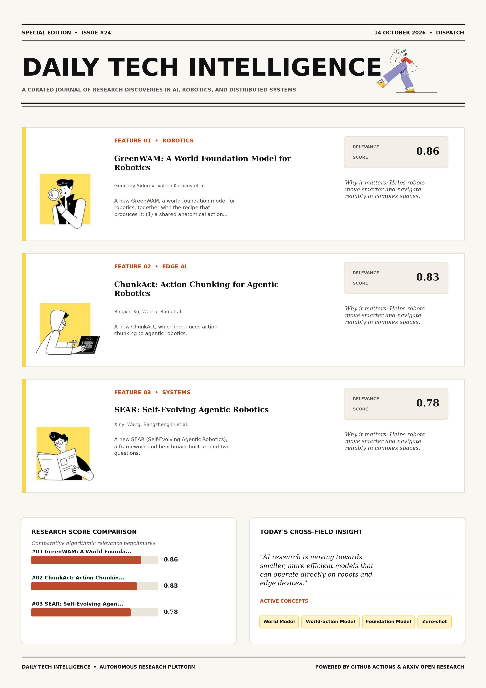

# Daily Tech Intelligence

## 14 October 2026

### Today's Overview

10 research papers analyzed.

Topics:

* Artificial Intelligence
* Machine Learning
* Robotics

### Visual Intelligence Templates

* **Template 3: Gen-Z Spotlight Broadside (Primary)**: [View High-Res](infographic_spotlight.png)
* **Template 2: Modern Tech Studio**: [View High-Res](infographic_modern.png)
* **Template 1: Editorial Research Journal**: [View High-Res](infographic_editorial.png)

---

## 1. GreenWAM: A World Foundation Model for Robotics

Authors: Gennady Sidorov, Valerii Kornilov, Denis Grankin, Polina Fedotova, Aleksey Postnikov

Publication: 2026-10-13T17:31:29Z

Category: cs.RO

Relevance Score: 0.86

Paper: [arXiv:2610.18774](https://arxiv.org/abs/2610.18774v1) | [PDF](https://arxiv.org/pdf/2610.18774v1)

### Summary

Addressing critical demands in Robotics, this research investigates a robot needs a world model that predicts how its actions will change the scene and a policy that chooses those actions. We present GreenWAM, a world foundation model for robotics, together with the recipe that produces it: (1) a shared anatomical action space that describes 20 robot families, from bimanual arms to dexterous humanoids, in common joint coordinates; (2) joint training on these families in visual, action-conditioned and world-action modes; and (3) policies that split an action expert off the generator. We ask whether one robot world model can serve both roles across different bodies, and what makes this work. Controlled experiments yield three findings: robot specialization improves world prediction and control together; an action expert helps when split off at the start of adaptation; and keeping world-model modes during policy adaptation preserves robustness to scene changes.

### Key Concepts

* World Model
* World-action Model
* Foundation Model
* Zero-shot
* World Foundation
* Action Expert

### Technical Insights

**Problem**

Addresses foundational constraints in Robotics and existing computational workflows.

**Approach**

We present GreenWAM, a world foundation model for robotics, together with the recipe that produces it: (1) a shared anatomical action space that describes 20 robot families, from bimanual arms to dexterous humanoids, in common joint coordinates; (2) joint training on these families in visual, action-conditioned and world-action modes; and (3) policies that split an action expert off the generator.

**Key Innovation**

Formulates an integrated mechanism leveraging World Model, World-action Model.

**Results**

Not specified in the available abstract.

**Applications**

Autonomous robotic manipulation, sim-to-real transfer, and agile mobile navigation systems.

**Limitations**

Not specified in the available abstract.

---

## 2. ChunkAct: Action Chunking for Agentic Robotics

Authors: Bingxin Xu, Wenrui Bao, Xinxin Liu, Jiawei Zhou, Yuzhang Shang, Emilio Ferrara

Publication: 2026-10-13T17:59:57Z

Category: cs.RO, cs.AI, cs.CL, cs.CV

Relevance Score: 0.83

Paper: [arXiv:2610.18874](https://arxiv.org/abs/2610.18874v1) | [PDF](https://arxiv.org/pdf/2610.18874v1)

### Summary

Addressing critical demands in Artificial Intelligence, this research investigates agentic robotics places a large language model (llm) agent in the robot control loop, where it composes perception, motion, and vision-language-action (vla) tools under the guidance of a memory and thereby generalizes to new tasks without retraining. We present ChunkAct, which introduces action chunking to agentic robotics. Every primitive requires a round of LLM reasoning over the full interaction history, so the cost of an episode grows with the number of primitives. On LIBERO-Pro, ChunkAct improves task success by 5.0 points over the state of the art in agentic robotics while requiring 2.9x fewer LLM calls, 4.4x fewer input tokens, and 2.3x fewer output tokens.

### Key Concepts

* Large Language Model
* Action Chunking
* Agentic Robotics
* Agent Robot
* Art Agentic
* Autonomously Returns

### Technical Insights

**Problem**

Addresses foundational constraints in Artificial Intelligence and existing computational workflows.

**Approach**

We present ChunkAct, which introduces action chunking to agentic robotics.

**Key Innovation**

Formulates an integrated mechanism leveraging Large Language Model, Action Chunking.

**Results**

Not specified in the available abstract.

**Applications**

Autonomous robotic manipulation, sim-to-real transfer, and agile mobile navigation systems. High-resolution real-time visual perception, automated 3D reconstruction, and embodied vision. Next-generation large language model workflows, retrieval-augmented intelligence, and structured document parsing.

**Limitations**

Not specified in the available abstract.

---

## 3. SEAR: Self-Evolving Agentic Robotics

Authors: Xinyi Wang, Bangzheng Li, Hanyu Wang, Lin Zhang, Andrea Yaoyun Cui, Zhenggang Tang, Shyamal Buch, Dejia Xu

Publication: 2026-10-13T17:40:20Z

Category: cs.RO, cs.AI, cs.CL

Relevance Score: 0.78

Paper: [arXiv:2610.18792](https://arxiv.org/abs/2610.18792v1) | [PDF](https://arxiv.org/pdf/2610.18792v1)

### Summary

Addressing critical demands in Artificial Intelligence, this research investigates frontier language-model agents can now improve robots on their own: they write control code, test it, and keep what works as skills and memories for the next task. We introduce SEAR (Self-Evolving Agentic Robotics), a framework and benchmark built around two questions. On a real robot, we observe a performance gap between agent-designed practice and novel human-designed scenes. Is the agent really learning, or just trying more often? We release the benchmark and codebase to support future research. Frontier language-model agents can now improve robots on their own: they write control code, test it, and keep what works as skills and memories for the next task.

### Key Concepts

* Control Code
* Real Robot
* State Larger Budgets
* Task-specific Solutions Real
* Test Works

### Technical Insights

**Problem**

Addresses foundational constraints in Artificial Intelligence and existing computational workflows.

**Approach**

We introduce SEAR (Self-Evolving Agentic Robotics), a framework and benchmark built around two questions.

**Key Innovation**

On a real robot, we observe a performance gap between agent-designed practice and novel human-designed scenes.

**Results**

Not specified in the available abstract.

**Applications**

Autonomous robotic manipulation, sim-to-real transfer, and agile mobile navigation systems. Next-generation large language model workflows, retrieval-augmented intelligence, and structured document parsing.

**Limitations**

Not specified in the available abstract.

---

## 4. BLADE: Auditing Information Use for Failure Attribution in LLM Multi-Agent Systems

Authors: Xiaoguang Guo, Yaohao Long, Chuxu Zhang

Publication: 2026-10-13T17:34:34Z

Category: cs.AI, cs.CL

Relevance Score: 0.78

Paper: [arXiv:2610.18780](https://arxiv.org/abs/2610.18780v1) | [PDF](https://arxiv.org/pdf/2610.18780v1)

### Summary

Addressing critical demands in Artificial Intelligence, this research investigates large language model multi-agent systems extend individual agents' capabilities through collaboration across specialized roles, tools, and workflows. We introduce BLADE (Blame Localization via Audited Dependency Evidence), a training-free framework that moves beyond tracing information to auditing its use. Failure attribution therefore seeks to identify the responsible agent and decisive error step. Making responsibility evidence explicit offers a path toward more interpretable and reliable agentic systems. Large language model multi-agent systems extend individual agents' capabilities through collaboration across specialized roles, tools, and workflows. Yet collaboration makes failures harder to diagnose: one agent may misinterpret a correct result while others carry the mistake forward.

### Key Concepts

* Large Language Model
* Accuracy Strategies
* Achieves Best
* Agent Decisive
* Agent Misinterpret
* All-at-once Percentage

### Technical Insights

**Problem**

Addresses foundational constraints in Artificial Intelligence and existing computational workflows.

**Approach**

We introduce BLADE (Blame Localization via Audited Dependency Evidence), a training-free framework that moves beyond tracing information to auditing its use.

**Key Innovation**

Formulates an integrated mechanism leveraging Large Language Model, Accuracy Strategies.

**Results**

Not specified in the available abstract.

**Applications**

Next-generation large language model workflows, retrieval-augmented intelligence, and structured document parsing.

**Limitations**

Not specified in the available abstract.

---

## 5. EgoMatrix: Physically Faithful Dexterous Robot Demonstrations from Egocentric Human Videos

Authors: Ziheng Wang, Yanming Shao, Ting Mao, Kaihan Chen, Yiqun Wang, Xuanye Wu, Yao Mu

Publication: 2026-10-13T17:51:46Z

Category: cs.RO

Relevance Score: 0.78

Paper: [arXiv:2610.18822](https://arxiv.org/abs/2610.18822v1) | [PDF](https://arxiv.org/pdf/2610.18822v1)

### Summary

However, two challenges limit their use as reliable training data: accurate hand-object interaction (HOI) reconstruction from monocular RGB and high-quality robot demonstrations, especially visual observations. We present EgoMatrix, an end-to-end data engine that converts monocular egocentric human videos into bimanual dexterous trajectories and paired robot observation videos, with the trajectories directly replayable on real robots. Qualitative results show more faithful hand-object interactions than prior methods, while feature-space analysis shows closer alignment with real-robot observations than GPT-6 Astra.Our project page is available at https://spikew726.github.io/EgoMatrix/. Egocentric human videos offer a scalable alternative to robot teleoperation for collecting dexterous manipulation data. It reconstructs HOI with emphasis on relative geometry and contact rather than exact metric scene recovery, then uses retargeting and reinforcement learning (RL) to reproduce the demonstrated tasks in simulation.

### Key Concepts

* Reinforcement Learning
* Dexterous Manipulation
* Manipulation
* Success Simulation
* Synchronized State
* Task-compatible Backgrounds

### Technical Insights

**Problem**

However, two challenges limit their use as reliable training data: accurate hand-object interaction (HOI) reconstruction from monocular RGB and high-quality robot demonstrations, especially visual observations.

**Approach**

We present EgoMatrix, an end-to-end data engine that converts monocular egocentric human videos into bimanual dexterous trajectories and paired robot observation videos, with the trajectories directly replayable on real robots.

**Key Innovation**

Formulates an integrated mechanism leveraging Reinforcement Learning, Dexterous Manipulation.

**Results**

Qualitative results show more faithful hand-object interactions than prior methods, while feature-space analysis shows closer alignment with real-robot observations than GPT-6 Astra.Our project page is available at https://spikew726.github.io/EgoMatrix/.

**Applications**

Autonomous robotic manipulation, sim-to-real transfer, and agile mobile navigation systems.

**Limitations**

Not specified in the available abstract.

---

## 6. Back-Translation Still Matters: Leveraging Monolingual Data for Low-Resource Machine Translation with LLMs

Authors: Divyanshu Bathla, Parag Singla, Jitin Singla

Publication: 2026-10-13T17:50:18Z

Category: cs.CL, cs.AI

Relevance Score: 0.77

Paper: [arXiv:2610.18818](https://arxiv.org/abs/2610.18818v1) | [PDF](https://arxiv.org/pdf/2610.18818v1)

### Summary

Addressing critical demands in Machine Learning, this research investigates pre-trained large language model (llms) are effective on many tasks in zero-shot and few-shot settings. For machine translation of low-resource languages, the obvious options are few-shot prompting and fine-tuning on a small parallel set. We ask: what if moderate amounts of low-resource monolingual data are also available? Blind human evaluation on Odia and Sanskrit agrees with the automatic metrics. Pre-trained Large Language Model (LLMs) are effective on many tasks in zero-shot and few-shot settings. We argue that, rather than continued pretraining, a more effective use of this data is the pre-LLM era technique of back-translation (BT).

### Key Concepts

* Zero-shot
* Large Language Model
* Agrees Automatic
* Amounts Low-resource
* Analyze Source
* Ask Moderate

### Technical Insights

**Problem**

Addresses foundational constraints in Machine Learning and existing computational workflows.

**Approach**

For machine translation of low-resource languages, the obvious options are few-shot prompting and fine-tuning on a small parallel set.

**Key Innovation**

Formulates an integrated mechanism leveraging Zero-shot, Large Language Model.

**Results**

Not specified in the available abstract.

**Applications**

Next-generation large language model workflows, retrieval-augmented intelligence, and structured document parsing.

**Limitations**

Not specified in the available abstract.

---

## 7. EgoExplorer: A Vision-Motion-Touch Observatory for Human Loco-Manipulation In Situ

Authors: Yunsong Zhou, Xuekun Jiang, Haiqi Shen, Hangxu Liu, Chaojian Shi, Yujie Liu, Jingyuan Li, Haoran Yang, Jiafei Cao, Dongzhan Zhou, Dong Wang, Yao Mu, Chunhua Shen, Weinan Zhang

Publication: 2026-10-13T17:59:55Z

Category: cs.RO, cs.CV

Relevance Score: 0.74

Paper: [arXiv:2610.18872](https://arxiv.org/abs/2610.18872v1) | [PDF](https://arxiv.org/pdf/2610.18872v1)

### Summary

Addressing critical demands in Robotics, this research investigates learning humanoid loco-manipulation from human demonstrations rests on observing how locomotion, posture, and object interaction evolve together as tasks unfold. Thus, we introduce EgoExplorer, a 100-hour vision-motion-touch observatory of human loco-manipulation built with a wearable system. Yet, existing datasets provide only partial views of this coordination. Preliminary studies explore multimodal generation and conditioning alongside humanoid retargeting with whole-body control in simulation. Learning humanoid loco-manipulation from human demonstrations rests on observing how locomotion, posture, and object interaction evolve together as tasks unfold. Scaling collection across diverse environments, in turn, favors lightweight, portable capture systems.

### Key Concepts

* Manipulation
* Accompanied Step-level
* Achieve Coverage
* Activities Continuous
* Agreement Temporal
* Align Egocentric

### Technical Insights

**Problem**

Addresses foundational constraints in Robotics and existing computational workflows.

**Approach**

Thus, we introduce EgoExplorer, a 100-hour vision-motion-touch observatory of human loco-manipulation built with a wearable system.

**Key Innovation**

Formulates an integrated mechanism leveraging Manipulation, Accompanied Step-level.

**Results**

Not specified in the available abstract.

**Applications**

Autonomous robotic manipulation, sim-to-real transfer, and agile mobile navigation systems. High-resolution real-time visual perception, automated 3D reconstruction, and embodied vision.

**Limitations**

A temporal prior then completes unobserved joint motion, while layered constraints promote measurement agreement, temporal continuity, and geometric consistency, properties that motion plausibility alone does not guarantee.

---

## 8. EqC: Equilibrium Energy Control for Introspective Lifelong Robot Learning

Authors: Haodong Yang, Runhan Huang, Bowen Zhang, Iofai Lei, Zunzhe Zhang, Xiangcheng Zhang, Shaoting Zhu, Linzhan Mou, Yicheng Liu, Hang Zhao

Publication: 2026-10-13T17:39:36Z

Category: cs.RO

Relevance Score: 0.74

Paper: [arXiv:2610.18790](https://arxiv.org/abs/2610.18790v1) | [PDF](https://arxiv.org/pdf/2610.18790v1)

### Summary

Addressing critical demands in Robotics, this research investigates long-term robot autonomy depends on more than effective action generation: a policy must recognize when its behavior is no longer sufficiently supported and use assistance to improve. We introduce Equilibrium Energy Control (EqC), a framework for introspective lifelong robot learning built around an explicit conditional energy landscape. EqC casts generative action refinement as equilibrium-seeking optimization, while the geometry of the refinement process reveals whether the generated behavior remains consistent with the learned landscape. A real-world study further shows how these interventions progressively expand the range of situations handled autonomously, providing a practical path from static generative controllers toward self-improving robot systems.

### Key Concepts

* Manipulation
* Action Generation
* Action Refinement
* Aggregated Subsequent
* Assistance Improve
* Autonomy Depends

### Technical Insights

**Problem**

Addresses foundational constraints in Robotics and existing computational workflows.

**Approach**

We introduce Equilibrium Energy Control (EqC), a framework for introspective lifelong robot learning built around an explicit conditional energy landscape.

**Key Innovation**

Formulates an integrated mechanism leveraging Manipulation, Action Generation.

**Results**

Not specified in the available abstract.

**Applications**

Autonomous robotic manipulation, sim-to-real transfer, and agile mobile navigation systems.

**Limitations**

Not specified in the available abstract.

---

## 9. RoboSimStudio: An Interactive Toolkit for Rapid Real2Sim of Robot Manipulation Tasks

Authors: Kaiyuan Chen, Shuangyu Xie, Uksang Yoo, Xinyue Zhu, Cael Magner, Alvin Zhu, Daehwa Kim, Eric Heiden, Erwin Coumans, Miles Macklin, Spencer Huang, Ken Goldberg

Publication: 2026-10-13T17:55:14Z

Category: cs.RO, cs.AI, cs.GR, cs.LG

Relevance Score: 0.73

Paper: [arXiv:2610.18835](https://arxiv.org/abs/2610.18835v1) | [PDF](https://arxiv.org/pdf/2610.18835v1)

### Summary

It is difficult to accurately model the physics of the interaction between a robot and the objects it manipulates, including contact mechanics, coupled contact dynamics, deformations, stiffness and friction. We present RoboSimStudio (RSS), an interactive toolkit that makes choices of solver, contact model, and physical parameters explicit and editable, allowing both humans and coding agents to iteratively refine simulations based on observed physical behavior. We implement RSS with the open Newton physics simulation system and describe experiments with human-guided real2sim using (1) visual evaluation, (2) force-feedback and (3) agentic Real2Sim2Real. Code, video and additional information can be found on the project website.

### Key Concepts

* Manipulation
* Additional Information
* Agentic Code
* Behavior Implement
* Choices Solver
* Code Video

### Technical Insights

**Problem**

It is difficult to accurately model the physics of the interaction between a robot and the objects it manipulates, including contact mechanics, coupled contact dynamics, deformations, stiffness and friction.

**Approach**

We present RoboSimStudio (RSS), an interactive toolkit that makes choices of solver, contact model, and physical parameters explicit and editable, allowing both humans and coding agents to iteratively refine simulations based on observed physical behavior.

**Key Innovation**

Formulates an integrated mechanism leveraging Manipulation, Additional Information.

**Results**

Not specified in the available abstract.

**Applications**

Autonomous robotic manipulation, sim-to-real transfer, and agile mobile navigation systems.

**Limitations**

Not specified in the available abstract.

---

## 10. Hybrid Reasoning Agents

Authors: Jiaru Zou, Yunzhe Qi, Sirui Chen, Federico Bianchi, Shang Zhu, Pan Lu, Jingrui He, James Zou

Publication: 2026-10-13T17:59:31Z

Category: cs.CL, cs.AI, cs.LG

Relevance Score: 0.72

Paper: [arXiv:2610.18861](https://arxiv.org/abs/2610.18861v1) | [PDF](https://arxiv.org/pdf/2610.18861v1)

### Summary

Addressing critical demands in Artificial Intelligence, this research investigates how can we build an agent that thinks beyond human language, yet still acts through it in the external environment?. How can we build an agent that thinks beyond human language, yet still acts through it in the external environment? We bridge these two directions with Hybrid Reasoning Agents (HybridAgents), which dynamically navigate between latent reasoning and text-based interaction throughout a unified generation process. Code and data are available at https://github.com/togethercomputer/HybridAgent. Modern LLM agents still reason and interact through text, while latent reasoning offers an efficient internal medium but lacks native tool access and reasoning transparency.

### Key Concepts

* Hybrid Reasoning
* Latent Reasoning
* Teaching Backbone Coordinate
* Text Evaluate
* Text Latent
* Text-based Latent

### Technical Insights

**Problem**

Addresses foundational constraints in Artificial Intelligence and existing computational workflows.

**Approach**

How can we build an agent that thinks beyond human language, yet still acts through it in the external environment?

**Key Innovation**

Formulates an integrated mechanism leveraging Hybrid Reasoning, Latent Reasoning.

**Results**

Not specified in the available abstract.

**Applications**

Next-generation large language model workflows, retrieval-augmented intelligence, and structured document parsing.

**Limitations**

Not specified in the available abstract.

---
