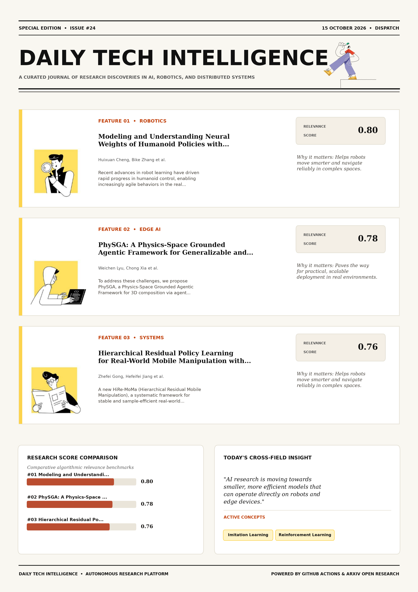

# Daily Tech Intelligence

## 15 October 2026

### Today's Overview

10 research papers analyzed.

Topics:

* Artificial Intelligence
* Machine Learning
* Natural Language Processing
* Robotics

### Visual Intelligence Templates

* **Template 3: Gen-Z Spotlight Broadside (Primary)**: [View High-Res](infographic_spotlight.png)
* **Template 2: Modern Tech Studio**: [View High-Res](infographic_modern.png)
* **Template 1: Editorial Research Journal**: [View High-Res](infographic_editorial.png)

---

## 1. Modeling and Understanding Neural Weights of Humanoid Policies with Diffusion

Authors: Huixuan Cheng, Bike Zhang, Shankar Sastry, Koushil Sreenath

Publication: 2026-10-14T17:59:52Z

Category: cs.RO, cs.AI, cs.LG

Relevance Score: 0.80

Paper: [arXiv:2610.20606](https://arxiv.org/abs/2610.20606v1) | [PDF](https://arxiv.org/pdf/2610.20606v1)

### Summary

However, humanoid control networks are typically obtained through conventional training procedures, while comparatively little attention has been given to directly modeling the distribution of their learned weights and generating functional networks in weight space. In this work, we investigate whether high-performing humanoid control networks can be generatively modeled directly through their weights. Additional results are available on our project website: https://humanoid-weight-diffusion.github.io/ Recent advances in robot learning have driven rapid progress in humanoid control, enabling increasingly agile behaviors in the real world. We adopt a latent diffusion framework that couples a linear autoencoder with a Diffusion Transformer. The autoencoder compresses actor network parameters into a compact latent space, and the Diffusion Transformer models the distribution of these latents.

### Key Concepts

* Imitation Learning
* Reinforcement Learning
* Attention Given Directly
* Control Networks
* Diffusion Transformer
* Humanoid Control

### Technical Insights

**Problem**

However, humanoid control networks are typically obtained through conventional training procedures, while comparatively little attention has been given to directly modeling the distribution of their learned weights and generating functional networks in weight space.

**Approach**

In this work, we investigate whether high-performing humanoid control networks can be generatively modeled directly through their weights.

**Key Innovation**

Formulates an integrated mechanism leveraging Imitation Learning, Reinforcement Learning.

**Results**

Not specified in the available abstract.

**Applications**

Autonomous robotic manipulation, sim-to-real transfer, and agile mobile navigation systems.

**Limitations**

Not specified in the available abstract.

---

## 2. PhySGA: A Physics-Space Grounded Agentic Framework for Generalizable and Interactive 3D Composition

Authors: Weichen Lyu, Chong Xia, Mingyu Dong, Long Xu, Shengjun Zhang, Yueqi Duan

Publication: 2026-10-14T17:47:24Z

Category: cs.AI, cs.CV

Relevance Score: 0.78

Paper: [arXiv:2610.20560](https://arxiv.org/abs/2610.20560v1) | [PDF](https://arxiv.org/pdf/2610.20560v1)

### Summary

However, these methods consistently struggle with complex compositions such as precise hanging, gravity-driven settling and hidden containment, as these tasks require interactive construction processes involving global planning, fine-grained alignment, and physical simulation. To address these challenges, we propose PhySGA, a Physics-Space Grounded Agentic Framework for 3D composition via agent exploration and physical simulation, enabling the universal interactive assembly of rigid, articulated, and deformable objects. Extensive experiments within Isaac Sim demonstrate that PhySGA significantly surpasses existing methods in relation fidelity, physical plausibility, and visual quality. 3D object composition is pivotal to digital content creation and robot simulation, while also serving as a critical testbed for physical intelligence in foundation models.

### Key Concepts

* Agent Focuses Geometric
* Agent Reasons
* Alignment Physical
* Interactive Construction
* Physical Simulation
* Testbed Physical

### Technical Insights

**Problem**

However, these methods consistently struggle with complex compositions such as precise hanging, gravity-driven settling and hidden containment, as these tasks require interactive construction processes involving global planning, fine-grained alignment, and physical simulation.

**Approach**

To address these challenges, we propose PhySGA, a Physics-Space Grounded Agentic Framework for 3D composition via agent exploration and physical simulation, enabling the universal interactive assembly of rigid, articulated, and deformable objects.

**Key Innovation**

Formulates an integrated mechanism leveraging Agent Focuses Geometric, Agent Reasons.

**Results**

Extensive experiments within Isaac Sim demonstrate that PhySGA significantly surpasses existing methods in relation fidelity, physical plausibility, and visual quality.

**Applications**

High-resolution real-time visual perception, automated 3D reconstruction, and embodied vision.

**Limitations**

To overcome this limitation, we design a collaborative feedforward-feedback architecture: an Assembly Agent focuses on geometric and kinematic reasoning for global step planning and coarse adjustment, while a Critic Agent reasons over contact dynamics for simulator state diagnosis and fine-grained closed-loop correction.

---

## 3. Hierarchical Residual Policy Learning for Real-World Mobile Manipulation with Sparse Human Guidance

Authors: Zhefei Gong, Hefeifei Jiang, Zehao Wang, Jiachen Li

Publication: 2026-10-14T17:59:52Z

Category: cs.RO, cs.AI, cs.LG

Relevance Score: 0.76

Paper: [arXiv:2610.20607](https://arxiv.org/abs/2610.20607v1) | [PDF](https://arxiv.org/pdf/2610.20607v1)

### Summary

Mobile Manipulation (MoMa) is a cornerstone of autonomous robotic systems, yet real-world fine-tuning remains a formidable challenge because of high-dimensional action spaces and intricate coupling between heterogeneous modules. In this paper, we propose HiRe-MoMa (Hierarchical Residual Mobile Manipulation), a systematic framework for stable and sample-efficient real-world fine-tuning of complex MoMa systems. At its core, HiRe-MoMa adopts a Hierarchical Residual Architecture that fine-tunes a frozen base policy. Further details can be found on our project website: https://hire-moma.github.io/ A Policy-Agnostic Residual learns additive corrections atop the base policy, while Hierarchical Decoupling splits the residual into mobile-base and manipulator-arm heads with unidirectional conditioning, mitigating gradient interference and aligning corrections with the platform's physical hierarchy.

### Key Concepts

* Manipulation
* Hierarchical Residual
* Atop Base
* Base Policy
* Real-world Fine-tuning
* Splits Residual

### Technical Insights

**Problem**

Mobile Manipulation (MoMa) is a cornerstone of autonomous robotic systems, yet real-world fine-tuning remains a formidable challenge because of high-dimensional action spaces and intricate coupling between heterogeneous modules.

**Approach**

In this paper, we propose HiRe-MoMa (Hierarchical Residual Mobile Manipulation), a systematic framework for stable and sample-efficient real-world fine-tuning of complex MoMa systems.

**Key Innovation**

Formulates an integrated mechanism leveraging Manipulation, Hierarchical Residual.

**Results**

Not specified in the available abstract.

**Applications**

Autonomous robotic manipulation, sim-to-real transfer, and agile mobile navigation systems.

**Limitations**

Not specified in the available abstract.

---

## 4. KinoGen: Customizable Humanoid Loco-Manipulation References via Kinematically Grounded Video Generation

Authors: Qi Wu, Lulu Zhao, Sanghyun Hahn, Rishi Yennu, Emmy Yang, Dingqi Zhang, Tao Pang, Jiuguang Wang, Kuan Fang

Publication: 2026-10-14T17:43:32Z

Category: cs.RO

Relevance Score: 0.76

Paper: [arXiv:2610.20552](https://arxiv.org/abs/2610.20552v1) | [PDF](https://arxiv.org/pdf/2610.20552v1)

### Summary

Addressing critical demands in Robotics, this research investigates we present kinogen, a framework that synthesizes customizable humanoid loco-manipulation references through kinematically grounded video generation. We present KinoGen, a framework that synthesizes customizable humanoid loco-manipulation references through kinematically grounded video generation. Body, hand, and object priors initialize the reconstruction, and direct optimization against cross-view evidence refines it. Project webpage: https://kinogen-humanoid.github.io/. KinoGen conditions a pretrained video generator on calibrated renders of the target robot and object in a simulated task instance and recovers the reference by fitting the same models to the generated two-view video, so that the reference lies in the robot configuration space by construction without a human body proxy or retargeting.

### Key Concepts

* Manipulation
* Customizable Humanoid
* Annotated Contacts
* Baselines Preserves
* Body Hand
* Body Proxy

### Technical Insights

**Problem**

Addresses foundational constraints in Robotics and existing computational workflows.

**Approach**

We present KinoGen, a framework that synthesizes customizable humanoid loco-manipulation references through kinematically grounded video generation.

**Key Innovation**

Formulates an integrated mechanism leveraging Manipulation, Customizable Humanoid.

**Results**

Not specified in the available abstract.

**Applications**

Autonomous robotic manipulation, sim-to-real transfer, and agile mobile navigation systems.

**Limitations**

Not specified in the available abstract.

---

## 5. Generative Representation Learning for Scalable Latent Tokenization

Authors: Alan Baade, Kyle Sargent, Vincent Sitzmann, Eric Ryan Chan, Justin Johnson, Li Fei-Fei, Gordon Wetzstein

Publication: 2026-10-14T17:29:09Z

Category: cs.LG, cs.CV

Relevance Score: 0.72

Paper: [arXiv:2610.20533](https://arxiv.org/abs/2610.20533v1) | [PDF](https://arxiv.org/pdf/2610.20533v1)

### Summary

Addressing critical demands in Machine Learning, this research investigates we introduce an approach for self-supervised representation learning designed to be used as a tokenizer for generative modeling. We introduce an approach for self-supervised representation learning designed to be used as a tokenizer for generative modeling. For the first time, we perform a careful analysis of the combined flop efficiency of tokenizer and generative model and demonstrate that our approach is a compute-optimal improvement over direct diffusion for pixel-space generation, obtaining an FID-50K of 2.18 with JiT-L. We justify our algorithm theoretically and empirically, demonstrating that our generative approach to representation learning avoids dimensional collapse and feature suppression in cases where commonly used methods like DINO and LeJEPA fail. Applied to ImageNet and the text-to-image dataset GPIC, we show tokenizer encoder scaling laws for diffusability, where extrapolating our approach achieves representations in 7x fewer FLOPs than DINOv2 on ImageNet and 8x fewer FLOPs than WebSSL on GPIC.

### Key Concepts

* Scaling Laws
* Representation Learning
* Achieves Representations
* Algorithm Theoretically
* Avoids Dimensional
* Better Latent

### Technical Insights

**Problem**

Addresses foundational constraints in Machine Learning and existing computational workflows.

**Approach**

We introduce an approach for self-supervised representation learning designed to be used as a tokenizer for generative modeling.

**Key Innovation**

For the first time, we perform a careful analysis of the combined flop efficiency of tokenizer and generative model and demonstrate that our approach is a compute-optimal improvement over direct diffusion for pixel-space generation, obtaining an FID-50K of 2.18 with JiT-L.

**Results**

Not specified in the available abstract.

**Applications**

High-resolution real-time visual perception, automated 3D reconstruction, and embodied vision.

**Limitations**

Not specified in the available abstract.

---

## 6. One Task, Many Interfaces: Simple Cross-Interface Consistency Training Improves LLM Agent Robustness

Authors: Artin Tajdini, Manpreet Kaur, Peng Qi

Publication: 2026-10-14T17:56:06Z

Category: cs.LG, cs.AI, cs.CL

Relevance Score: 0.72

Paper: [arXiv:2610.20576](https://arxiv.org/abs/2610.20576v1) | [PDF](https://arxiv.org/pdf/2610.20576v1)

### Summary

Addressing critical demands in Natural Language Processing, this research investigates post-training binds the competence of an llm agent to the interface it was trained on. We propose Cross-Interface Policy Regularization (CIPR), a self-supervised objective that replaces action names with uninformative identifiers and presents each training sample under two interfaces in which equivalent actions are identified by construction. Scoring each sample independently means interface randomization only broadens this dependence from a single interface to the training interface distribution, so out-of-distribution perturbations still degrade the agent. On agentic function calling, held-out interface perturbations reduce the accuracy of a post-trained agent by nearly 25%, and CIPR recovers 10.5% while leaving accuracy on the unchanged interface intact.

### Key Concepts

* Accuracy Post-trained
* Accuracy Unchanged
* Action Changing
* Action Distributions
* Action Names
* Actions Identified

### Technical Insights

**Problem**

Addresses foundational constraints in Natural Language Processing and existing computational workflows.

**Approach**

We propose Cross-Interface Policy Regularization (CIPR), a self-supervised objective that replaces action names with uninformative identifiers and presents each training sample under two interfaces in which equivalent actions are identified by construction.

**Key Innovation**

Formulates an integrated mechanism leveraging Accuracy Post-trained, Accuracy Unchanged.

**Results**

Not specified in the available abstract.

**Applications**

Next-generation large language model workflows, retrieval-augmented intelligence, and structured document parsing.

**Limitations**

Not specified in the available abstract.

---

## 7. SafeDriveVLA: Navigation-Conditioned World Model Dreaming for Conflict-Aware End-to-End Autonomous Driving

Authors: Shaoyuan Xie, Zihan Zhang, Jingxuan Wang, Jiashu Qu, Xiaoqing Liang, Lingdong Kong, Junchi Lu, Henrik I. Christensen, Qi Alfred Chen

Publication: 2026-10-14T17:59:56Z

Category: cs.RO

Relevance Score: 0.71

Paper: [arXiv:2610.20609](https://arxiv.org/abs/2610.20609v1) | [PDF](https://arxiv.org/pdf/2610.20609v1)

### Summary

However, this open-ended interface exposes a new vulnerability surface: an inattentive driver may issue instructions that are unsafe given the current scene, and a malicious user may issue dangerous ones on purpose. We present the first benchmark suite that evaluates navigation following and conflict awareness together, along with adversarial robustness. Video demonstrations are available on our project page. Vision-Language-Action (VLA) models are gaining attention in autonomous driving, inheriting commonsense priors from large language models (LLMs) and widening the navigation interface from a fixed command set to free-form natural-language instructions. Existing VLAs fall short on both: SimLingo completes no language-instructed lane change in closed loop, and all models degrade sharply under conflicting signals.

### Key Concepts

* World Model
* Autonomous Driving
* Action Generation
* Actions Dreams
* Adversarial Robustness
* Attention Autonomous

### Technical Insights

**Problem**

However, this open-ended interface exposes a new vulnerability surface: an inattentive driver may issue instructions that are unsafe given the current scene, and a malicious user may issue dangerous ones on purpose.

**Approach**

We present the first benchmark suite that evaluates navigation following and conflict awareness together, along with adversarial robustness.

**Key Innovation**

Formulates an integrated mechanism leveraging World Model, Autonomous Driving.

**Results**

Not specified in the available abstract.

**Applications**

Autonomous robotic manipulation, sim-to-real transfer, and agile mobile navigation systems.

**Limitations**

However, this open-ended interface exposes a new vulnerability surface: an inattentive driver may issue instructions that are unsafe given the current scene, and a malicious user may issue dangerous ones on purpose.

---

## 8. Tiered-Resolution Volumetric Mapping for Real-Time Simultaneous Planning and Mapping on Natural Outdoor Environments

Authors: Afonso E. Carvalho, David Portugal, Paulo Peixoto, George Kantor

Publication: 2026-10-14T16:51:35Z

Category: cs.RO

Relevance Score: 0.70

Paper: [arXiv:2610.20476](https://arxiv.org/abs/2610.20476v1) | [PDF](https://arxiv.org/pdf/2610.20476v1)

### Summary

Addressing critical demands in Artificial Intelligence, this research investigates real-time volumetric mapping for a planning robot is dominated by the cost of integrating and storing information at the finest resolution, yet only a small fraction of any map ever lies on or near a path the planner actually considers. As opposed to traditional navigation pipelines where path planning uses the mapping result and provides no feedback, we propose a feedback loop where planning also informs mapping to dynamically integrate information at different leaf resolutions. Tiering approximates the coarse map's cheapness without its failure mode. Real-time volumetric mapping for a planning robot is dominated by the cost of integrating and storing information at the finest resolution, yet only a small fraction of any map ever lies on or near a path the planner actually considers.

### Key Concepts

* Actually Considers
* Approximates Coarse
* Cheapness Failure
* Coarse Map
* Coarse Opposed
* Collapses Cost

### Technical Insights

**Problem**

Addresses foundational constraints in Artificial Intelligence and existing computational workflows.

**Approach**

As opposed to traditional navigation pipelines where path planning uses the mapping result and provides no feedback, we propose a feedback loop where planning also informs mapping to dynamically integrate information at different leaf resolutions.

**Key Innovation**

Formulates an integrated mechanism leveraging Actually Considers, Approximates Coarse.

**Results**

Not specified in the available abstract.

**Applications**

Autonomous robotic manipulation, sim-to-real transfer, and agile mobile navigation systems.

**Limitations**

Not specified in the available abstract.

---

## 9. PerSo: Investigating Facets of LLMs' Social Intelligence in Real-World Persuasion Scenarios

Authors: Ali Zamani, Soroush Esfahanian, Erfan Shahabi, Mohammad Taher Pilehvar, Azadeh Shakery, Yadollah Yaghoobzadeh

Publication: 2026-10-14T17:39:35Z

Category: cs.CL, cs.AI, cs.SI

Relevance Score: 0.69

Paper: [arXiv:2610.20548](https://arxiv.org/abs/2610.20548v1) | [PDF](https://arxiv.org/pdf/2610.20548v1)

### Summary

Addressing critical demands in Artificial Intelligence, this research investigates understanding the social intelligence of large language models (llms) is increasingly important for applications involving human-ai interaction and multi-agent environments. We introduce PerSo, a benchmark that evaluates both aspects on real-world persuasion dialogues from Reddit's ChangeMyView community, using an LLM-in-the-loop pipeline to construct the evaluation tasks, validated through human annotation. The strongest LLM slightly surpasses the best observed human performance on the behavioral task, while the best human participant remains ahead on the cognitive task. Understanding the social intelligence of large language models (LLMs) is increasingly important for applications involving human-AI interaction and multi-agent environments.

### Key Concepts

* Social Intelligence
* Achieve Social
* Ahead Cognitive
* Applications Involving
* Appropriate Social
* Aspects Cognitive

### Technical Insights

**Problem**

Addresses foundational constraints in Artificial Intelligence and existing computational workflows.

**Approach**

We introduce PerSo, a benchmark that evaluates both aspects on real-world persuasion dialogues from Reddit's ChangeMyView community, using an LLM-in-the-loop pipeline to construct the evaluation tasks, validated through human annotation.

**Key Innovation**

Formulates an integrated mechanism leveraging Social Intelligence, Achieve Social.

**Results**

The strongest LLM slightly surpasses the best observed human performance on the behavioral task, while the best human participant remains ahead on the cognitive task.

**Applications**

Next-generation large language model workflows, retrieval-augmented intelligence, and structured document parsing.

**Limitations**

Not specified in the available abstract.

---

## 10. Physical Time as a Missing Dimension of Robot Policy Memory Dynamics

Authors: Yushen Liang, Yue Peng, Baosheng Jin, Tianluo Zhang, Xinyu Zhang, Shuyi Zhou, Zhuoran Chen, Xinqi Liu, Shenji Wan

Publication: 2026-10-14T17:24:13Z

Category: cs.RO

Relevance Score: 0.69

Paper: [arXiv:2610.20524](https://arxiv.org/abs/2610.20524v1) | [PDF](https://arxiv.org/pdf/2610.20524v1)

### Summary

Addressing critical demands in Robotics, this research investigates existing robot policy memories typically evolve with observation sequences, implicitly treating each update as the same amount of physical time. We introduce Temporal Flow Policy (TFP), which learns memory dynamics to retain past events and evolve the memory state over measured time intervals. These results suggest viewing robot memory not as stored observation history, but as a state that retains past events and evolves with physical time. Existing robot policy memories typically evolve with observation sequences, implicitly treating each update as the same amount of physical time. Yet identical observation histories can span different durations and require different actions, exposing physical time as a missing dimension of policy memory.

### Key Concepts

* Diffusion Policy
* Manipulation
* Physical Time
* Behavior Real-robot
* Benefits Physical
* Memory State

### Technical Insights

**Problem**

Addresses foundational constraints in Robotics and existing computational workflows.

**Approach**

We introduce Temporal Flow Policy (TFP), which learns memory dynamics to retain past events and evolve the memory state over measured time intervals.

**Key Innovation**

Formulates an integrated mechanism leveraging Diffusion Policy, Manipulation.

**Results**

Not specified in the available abstract.

**Applications**

Autonomous robotic manipulation, sim-to-real transfer, and agile mobile navigation systems.

**Limitations**

Not specified in the available abstract.

---
