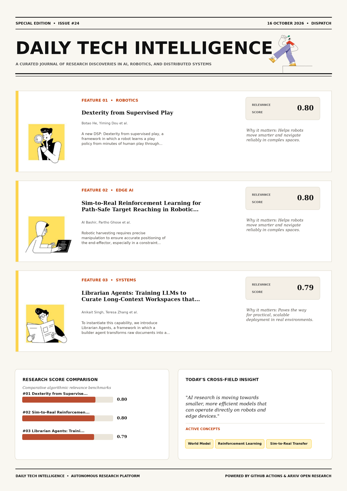

# Daily Tech Intelligence

## 16 October 2026

### Today's Overview

10 research papers analyzed.

Topics:

* Artificial Intelligence
* Robotics

### Visual Intelligence Templates

* **Template 3: Gen-Z Spotlight Broadside (Primary)**: [View High-Res](infographic_spotlight.png)
* **Template 2: Modern Tech Studio**: [View High-Res](infographic_modern.png)
* **Template 1: Editorial Research Journal**: [View High-Res](infographic_editorial.png)

---

## 1. Dexterity from Supervised Play

Authors: Botao He, Yiming Dou, Yiannis Aloimonos, Jitendra Malik, Akash Sharma, Ruoshi Liu

Publication: 2026-10-15T17:55:50Z

Category: cs.RO, cs.AI

Relevance Score: 0.80

Paper: [arXiv:2610.22340](https://arxiv.org/abs/2610.22340v1) | [PDF](https://arxiv.org/pdf/2610.22340v1)

### Summary

Addressing critical demands in Robotics, this research investigates how can robots autonomously collect the contact-rich experience needed to learn dexterous manipulation?. We present DSP: Dexterity from supervised play, a framework in which a robot learns a play policy from minutes of human play through behavior cloning, then deploys it autonomously to collect hours of interaction data to train a world model. In real world experiment, our method outperforms hindsight behavior cloning by 69.6% in success rate and achieves comparable success to reinforcement learning with 490 times less interaction data. These results demonstrate that supervised play can autonomously collect interaction data, guide model-based planning, and enable policy learning without any task-specific demonstrations or sim-to-real transfer.

### Key Concepts

* World Model
* Reinforcement Learning
* Sim-to-Real Transfer
* Dexterous Manipulation
* Manipulation
* Supervised Play

### Technical Insights

**Problem**

Addresses foundational constraints in Robotics and existing computational workflows.

**Approach**

We present DSP: Dexterity from supervised play, a framework in which a robot learns a play policy from minutes of human play through behavior cloning, then deploys it autonomously to collect hours of interaction data to train a world model.

**Key Innovation**

Formulates an integrated mechanism leveraging World Model, Reinforcement Learning.

**Results**

In real world experiment, our method outperforms hindsight behavior cloning by 69.6% in success rate and achieves comparable success to reinforcement learning with 490 times less interaction data.

**Applications**

Autonomous robotic manipulation, sim-to-real transfer, and agile mobile navigation systems.

**Limitations**

Not specified in the available abstract.

---

## 2. Sim-to-Real Reinforcement Learning for Path-Safe Target Reaching in Robotic Harvesting of Hydroponic Lettuce

Authors: Al Bashir, Partho Ghose, Yibin Wang, Robert G. Hardin, Joshua Peeples, Genhua Niu, Azlan Zahid

Publication: 2026-10-15T17:54:16Z

Category: cs.RO

Relevance Score: 0.80

Paper: [arXiv:2610.22337](https://arxiv.org/abs/2610.22337v1) | [PDF](https://arxiv.org/pdf/2610.22337v1)

### Summary

Addressing critical demands in Robotics, this research investigates robotic harvesting requires precise manipulation to ensure accurate positioning of the end-effector, especially in a constraint workspace. This study introduces the Path-Safe Approach Proximal Policy Optimization (PSA-PPO), a target-conditioned local reaching framework designed for robotic harvesting of nutrient film technique (NFT)-hydroponic lettuce in greenhouses. The proposed PSA-PPO preserves the standard clipped PPO objective while introducing a harvesting-oriented policy formulation that integrates target-conditioned observations, corridor-aware spatial constraints, trajectory-history-based safety encoding, and task-specific success criteria for constrained robotic manipulation. Finally, PSA-PPO was integrated with an RGB-D vision module and an end-effector and evaluated as a complete greenhouse harvesting system across 144 lettuce harvesting attempts, achieving 94.4% vision-guided target reaching and 86.1% complete harvesting success.

### Key Concepts

* Reinforcement Learning
* Sim-to-Real Transfer
* Manipulation
* Robotic Harvesting
* Target Reaching
* Successfully Transferred

### Technical Insights

**Problem**

Addresses foundational constraints in Robotics and existing computational workflows.

**Approach**

This study introduces the Path-Safe Approach Proximal Policy Optimization (PSA-PPO), a target-conditioned local reaching framework designed for robotic harvesting of nutrient film technique (NFT)-hydroponic lettuce in greenhouses.

**Key Innovation**

Formulates an integrated mechanism leveraging Reinforcement Learning, Sim-to-Real Transfer.

**Results**

Not specified in the available abstract.

**Applications**

Autonomous robotic manipulation, sim-to-real transfer, and agile mobile navigation systems.

**Limitations**

Robotic harvesting requires precise manipulation to ensure accurate positioning of the end-effector, especially in a constraint workspace.

---

## 3. Librarian Agents: Training LLMs to Curate Long-Context Workspaces that Anticipate Future Queries

Authors: Anikait Singh, Teresa Zhang, Yoonho Lee, Roshen Sanjay Nair, Aviral Kumar, Chelsea Finn

Publication: 2026-10-15T17:35:17Z

Category: cs.LG, cs.AI, cs.CL

Relevance Score: 0.79

Paper: [arXiv:2610.22273](https://arxiv.org/abs/2610.22273v1) | [PDF](https://arxiv.org/pdf/2610.22273v1)

### Summary

Reasoning over long document contexts remains a challenge for large language models (LLMs). We build on a key asymmetry in modern agentic harnesses (e.g., Claude Code): while LLM agents are adept at navigating existing filesystems to solve an immediate task, they are rarely trained to construct reusable workspaces for future use. Empirically, Librarian Agents outperforms the strongest retrieval and precomputation baselines by 33 percentage points on BrowseComp-Plus, amortizes upfront construction costs across repeated queries, and generalizes zero-shot to unseen domains on BRIGHT with a 31-point average accuracy improvement. Standard retrieval methods are inherently reactive, bottlenecking agents with complex, cross-document reasoning at inference time, while precomputed structures like knowledge graphs often fall short because they rely on rigid heuristics.

### Key Concepts

* Reinforcement Learning
* Zero-shot
* Downstream Answering
* Rigid Heuristics
* Serve Diverse
* Short Rely

### Technical Insights

**Problem**

Reasoning over long document contexts remains a challenge for large language models (LLMs).

**Approach**

We build on a key asymmetry in modern agentic harnesses (e.g., Claude Code): while LLM agents are adept at navigating existing filesystems to solve an immediate task, they are rarely trained to construct reusable workspaces for future use.

**Key Innovation**

Formulates an integrated mechanism leveraging Reinforcement Learning, Zero-shot.

**Results**

Empirically, Librarian Agents outperforms the strongest retrieval and precomputation baselines by 33 percentage points on BrowseComp-Plus, amortizes upfront construction costs across repeated queries, and generalizes zero-shot to unseen domains on BRIGHT with a 31-point average accuracy improvement.

**Applications**

Next-generation large language model workflows, retrieval-augmented intelligence, and structured document parsing.

**Limitations**

Not specified in the available abstract.

---

## 4. Perceive, Predict, and Plan: a Unified World Action Model for Egocentric Dexterous Manipulation

Authors: Zirui Wu, Chen Guo, Tianjian Jiang, Zeren Jiang, Zeming Li, Lingchen Yang, Longteng Duan, Ying Xue, Handi Yin, Shenyuan Gao, Martin R. Oswald, Jun Zhang, Ping Tan, Jie Song

Publication: 2026-10-15T17:59:07Z

Category: cs.CV, cs.RO

Relevance Score: 0.78

Paper: [arXiv:2610.22363](https://arxiv.org/abs/2610.22363v1) | [PDF](https://arxiv.org/pdf/2610.22363v1)

### Summary

Addressing critical demands in Robotics, this research investigates we introduce p^{3}-wam, a unified world action model for egocentric dexterous manipulation that learns 3d perception, action-conditioned prediction, and goal-directed planning through three complementary modes: perceive, which reconstructs articulated hand motion and camera trajectories from video; predict, which generates visual futures under prescribed actions; and plan, which jointly generates action trajectories and their anticipated visual consequences conditioned on an initial image, a language instruction, and an optional visual goal. We introduce P^{3}-WAM, a unified world action model for egocentric dexterous manipulation that learns 3D perception, action-conditioned prediction, and goal-directed planning through three complementary modes: Perceive, which reconstructs articulated hand motion and camera trajectories from video; Predict, which generates visual futures under prescribed actions; and Plan, which jointly generates action trajectories and their anticipated visual consequences conditioned on an initial image, a language instruction, and an optional visual goal. Through unified training, our model outperforms specialized baselines on 3D hand reconstruction and action-conditioned video prediction across four datasets, while producing goal-directed manipulation videos with stronger instruction adherence and action progression than video-generation baselines. Project Page: https://p3-wam.pages.dev/

### Key Concepts

* Dexterous Manipulation
* Manipulation
* Action Progression
* Action Representation
* Action Trajectories
* Action-conditioned Prediction

### Technical Insights

**Problem**

Addresses foundational constraints in Robotics and existing computational workflows.

**Approach**

We introduce P^{3}-WAM, a unified world action model for egocentric dexterous manipulation that learns 3D perception, action-conditioned prediction, and goal-directed planning through three complementary modes: Perceive, which reconstructs articulated hand motion and camera trajectories from video; Predict, which generates visual futures under prescribed actions; and Plan, which jointly generates action trajectories and their anticipated visual consequences conditioned on an initial image, a language instruction, and an optional visual goal.

**Key Innovation**

Formulates an integrated mechanism leveraging Dexterous Manipulation, Manipulation.

**Results**

Through unified training, our model outperforms specialized baselines on 3D hand reconstruction and action-conditioned video prediction across four datasets, while producing goal-directed manipulation videos with stronger instruction adherence and action progression than video-generation baselines.

**Applications**

Autonomous robotic manipulation, sim-to-real transfer, and agile mobile navigation systems. High-resolution real-time visual perception, automated 3D reconstruction, and embodied vision.

**Limitations**

Not specified in the available abstract.

---

## 5. Spark-0: Scaling Spatially Aligned Tactile Pretraining for Robot Dexterous Manipulation

Authors: Tianxing Chen, Wenwei Lin, Chuqiao Lyu, Peicheng Xiang, Junyuan Tang, Tian Nian, Zijian Cai, Kehe Ye, Chenze Yu, Wenxuan Zhu, Eric J. Chen, Yan Qin, Yue Chen, Tongyu Wu, Junhao Gong, Kai-Chong Lei, Jiahao Zhang, Kailun Su, Qiwei Liang, Renjing Xu, Ping Luo, Wenbo Ding

Publication: 2026-10-15T17:56:17Z

Category: cs.RO

Relevance Score: 0.78

Paper: [arXiv:2610.22342](https://arxiv.org/abs/2610.22342v1) | [PDF](https://arxiv.org/pdf/2610.22342v1)

### Summary

Generalist robot policies benefit from large-scale visual pretraining but often struggle with contact-rich dexterous manipulation, where force, compliance, and incipient slip are hard to observe from images. We present Spark-0, a spatially aligned vision-tactile-language-action (VTLA) model that uses touch in two complementary ways. During pretraining, image-space contact maps derived from tactile gloves, together with features from a frozen 3D geometry teacher, supervise the visual tokens; these objectives are removed at inference. The Website is available at: https://xsparkai.com/Spark-0. In parallel, a tactile pathway encodes regional force histories and 3D taxel states to condition the action expert. A single checkpoint therefore supports both vision-only and tactile-conditioned deployment.

### Key Concepts

* Dexterous Manipulation
* Manipulation
* Ego Humanoid
* Taxel States
* Teacher Supervise
* Tokens Objectives

### Technical Insights

**Problem**

Generalist robot policies benefit from large-scale visual pretraining but often struggle with contact-rich dexterous manipulation, where force, compliance, and incipient slip are hard to observe from images.

**Approach**

We present Spark-0, a spatially aligned vision-tactile-language-action (VTLA) model that uses touch in two complementary ways.

**Key Innovation**

Formulates an integrated mechanism leveraging Dexterous Manipulation, Manipulation.

**Results**

Not specified in the available abstract.

**Applications**

Autonomous robotic manipulation, sim-to-real transfer, and agile mobile navigation systems.

**Limitations**

Not specified in the available abstract.

---

## 6. Learning to Steer LLM Agents and Multi-Agent Systems

Authors: Leyang Shen, Yaxin Gong, Yang Zhang, Chenxiao Fan, Jiakai Wang, Dong Wang, Yang Liu, Fuli Feng, Chun Kai Ling, Tat-Seng Chua

Publication: 2026-10-15T17:51:17Z

Category: cs.LG, cs.AI, cs.MA

Relevance Score: 0.77

Paper: [arXiv:2610.22316](https://arxiv.org/abs/2610.22316v1) | [PDF](https://arxiv.org/pdf/2610.22316v1)

### Summary

However, these systems are prone to deviating from the overall goal as execution unfolds, which wastes execution resources and leads to undesired outcomes, a failure termed goal drift. In this work, we propose a steering agent that supervises execution on the fly and steers the system back on track when drift occurs. The learned steering intelligence generalizes to out-of-domain tasks, transfers to unseen executors, and supports controllable intervention frequency without retraining. Large language model (LLM)-based agents and multi-agent systems increasingly tackle complex tasks through long-horizon tool use and inter-agent collaboration. The steering agent observes the execution context, deciding when to intervene with a low-cost fast path and how to intervene with a high-cost slow path.

### Key Concepts

* Reinforcement Learning
* Large Language Model
* Agent Observes
* Agent Supervises
* Assess Goal
* Combining Pairwise

### Technical Insights

**Problem**

However, these systems are prone to deviating from the overall goal as execution unfolds, which wastes execution resources and leads to undesired outcomes, a failure termed goal drift.

**Approach**

In this work, we propose a steering agent that supervises execution on the fly and steers the system back on track when drift occurs.

**Key Innovation**

Formulates an integrated mechanism leveraging Reinforcement Learning, Large Language Model.

**Results**

Not specified in the available abstract.

**Applications**

Next-generation large language model workflows, retrieval-augmented intelligence, and structured document parsing.

**Limitations**

Not specified in the available abstract.

---

## 7. Value as Memory: Online Value-Guided Post-training for General Robot Policies

Authors: Wenye Yu, Yijin Chen, Kaiyi Xiong, Wenbo Han, Wendi Chen, Yang Jin, Han Xue, Jun Lv, Cewu Lu, Chuan Wen

Publication: 2026-10-15T17:59:31Z

Category: cs.RO

Relevance Score: 0.74

Paper: [arXiv:2610.22368](https://arxiv.org/abs/2610.22368v1) | [PDF](https://arxiv.org/pdf/2610.22368v1)

### Summary

Addressing critical demands in Robotics, this research investigates real-world post-training of generalist robot policies faces two challenges: partial observability makes action selection ambiguous, while offline post-training methods delay feedback from deployment experience. We present Value as Memory (VaM), a framework that addresses these challenges through value caching and online real-world reinforcement learning (RL). Value caching conditions actions on recent value predictions as task-progress memory, while online updates enable timely policy improvement by combining offline demonstrations, off-policy interventions, and on-policy rollouts for sample-efficient adaptation. The evaluated online schedule performs 8\times as many policy iterations under the same gradient-step budget, with more than 2\times lower recorded time per gradient step with concurrent data collection and training.

### Key Concepts

* Reinforcement Learning
* Manipulation
* Absolute Success-rate
* Achieving Gain
* Action Selection
* Adaptation Result

### Technical Insights

**Problem**

Addresses foundational constraints in Robotics and existing computational workflows.

**Approach**

We present Value as Memory (VaM), a framework that addresses these challenges through value caching and online real-world reinforcement learning (RL).

**Key Innovation**

Formulates an integrated mechanism leveraging Reinforcement Learning, Manipulation.

**Results**

Not specified in the available abstract.

**Applications**

Autonomous robotic manipulation, sim-to-real transfer, and agile mobile navigation systems.

**Limitations**

Not specified in the available abstract.

---

## 8. Training Reasoning Models to Generate Diverse Scientific Ideas

Authors: Manya Wadhwa, Pranav Narayanan Venkit, Hiroaki Hayashi, Yu Li, Tuhin Chakrabarty, Chien-Sheng Wu

Publication: 2026-10-15T17:52:12Z

Category: cs.CL

Relevance Score: 0.72

Paper: [arXiv:2610.22324](https://arxiv.org/abs/2610.22324v1) | [PDF](https://arxiv.org/pdf/2610.22324v1)

### Summary

Addressing critical demands in Artificial Intelligence, this research investigates one of the first steps of a research pipeline is generating ideas. To optimize for this, we propose training with a set-level reinforcement learning objective. Given prior papers, a model must propose a set of ideas that are each high-quality and clearly distinct from one another, while also being grounded in the input documents. In our work, we study document-grounded ideation, focusing on increasing the diversity of LLM generated ideas and ensuring they are high quality. When a coding agent runs proof-of-concept experiments on the ideas, our model's success@k is comparable to Claude Opus 4.8's, so we see that the added diversity does not cost any executability.

### Key Concepts

* Reinforcement Learning
* Achieves Higher
* Added Diversity
* Agent Runs
* Astra Contamination-free
* Automate Step

### Technical Insights

**Problem**

Addresses foundational constraints in Artificial Intelligence and existing computational workflows.

**Approach**

To optimize for this, we propose training with a set-level reinforcement learning objective.

**Key Innovation**

Given prior papers, a model must propose a set of ideas that are each high-quality and clearly distinct from one another, while also being grounded in the input documents.

**Results**

Not specified in the available abstract.

**Applications**

Next-generation large language model workflows, retrieval-augmented intelligence, and structured document parsing.

**Limitations**

Not specified in the available abstract.

---

## 9. CoDA: Co-Evolution of Data Engines and Action Policies

Authors: Tianjiao Yu, Zhilin Ou, Yifan Shen, Xinzhuo Li, Yuanzhe Liu, Onkar Kishor Susladkar, Fan Wang, Ismini Lourentzou

Publication: 2026-10-15T17:59:02Z

Category: cs.RO, cs.AI

Relevance Score: 0.72

Paper: [arXiv:2610.22362](https://arxiv.org/abs/2610.22362v1) | [PDF](https://arxiv.org/pdf/2610.22362v1)

### Summary

The challenge is to identify environments that address a policy's failures and supervision that helps it overcome them. We introduce CoDA, a framework in which a simulation data engine and an action policy co-evolve through a shared heterogeneous memory of environment construction, policy failures, and learning progress. On LIBERO-Pro, 15 rounds of generation and training raise success from 25% to 84% under position perturbations and from 1% to 76% under instruction perturbations. Generative simulation can automate robot environment construction, but physically valid environments are not necessarily useful for training. The memory compiles validated diagnoses from a vision-language critic into generation programs that recreate difficulties and training programs that help the policy overcome them.

### Key Concepts

* Manipulation
* Action Policy
* Action-chunk Value
* Address Policy
* Assumptions Measured
* Automate Robot

### Technical Insights

**Problem**

The challenge is to identify environments that address a policy's failures and supervision that helps it overcome them.

**Approach**

We introduce CoDA, a framework in which a simulation data engine and an action policy co-evolve through a shared heterogeneous memory of environment construction, policy failures, and learning progress.

**Key Innovation**

Formulates an integrated mechanism leveraging Manipulation, Action Policy.

**Results**

Not specified in the available abstract.

**Applications**

Autonomous robotic manipulation, sim-to-real transfer, and agile mobile navigation systems.

**Limitations**

Not specified in the available abstract.

---

## 10. MLExpert: Towards a Generalist Agentic Model for Autonomous Machine Learning Engineering

Authors: Shangheng Du, Jinxin Shi, Shuaiyu Zhang, Yiming Wu, Junpeng Zhao, Shiyang Feng, Xin Li, Liang He, Xiangchao Yan, Bo Zhang

Publication: 2026-10-15T17:56:32Z

Category: cs.AI, cs.CL, cs.LG

Relevance Score: 0.71

Paper: [arXiv:2610.22344](https://arxiv.org/abs/2610.22344v1) | [PDF](https://arxiv.org/pdf/2610.22344v1)

### Summary

However, feedback from each experiment reflects several preceding decisions, and a long MLE run contains many such costly experiments. We propose a post-training method for autonomous long-horizon MLE optimization and apply it to train MLExpert, a 35B Mixture-of-Experts agentic model. Further experiments show that MLExpert improves performance on NatureBench Lite, agent scaffold optimization, and algorithm optimization, suggesting that the learned optimization capability generalizes to other tasks. Large language models (LLMs) are expanding from assisting scientific research and engineering to autonomously developing and improving AI systems, advancing AI for AI (AI4AI) as a pathway toward recursive self-improvement (RSI). Workflow-driven machine learning engineering (MLE) systems provide a practical path toward this pursuit through complex orchestration that manages long-horizon experimentation, while recent MLE systems adopt model-directed interaction, allowing models to autonomously organize experiments and adapt optimization strategies based on execution feedback.

### Key Concepts

* Mlexpert Improves
* Tool-use Coding Capabilities
* Train Mlexpert
* Trajectories Learn
* Trajectory Ends Mle-bench
* Transfers General

### Technical Insights

**Problem**

However, feedback from each experiment reflects several preceding decisions, and a long MLE run contains many such costly experiments.

**Approach**

We propose a post-training method for autonomous long-horizon MLE optimization and apply it to train MLExpert, a 35B Mixture-of-Experts agentic model.

**Key Innovation**

Formulates an integrated mechanism leveraging Mlexpert Improves, Tool-use Coding Capabilities.

**Results**

Not specified in the available abstract.

**Applications**

Next-generation large language model workflows, retrieval-augmented intelligence, and structured document parsing.

**Limitations**

Not specified in the available abstract.

---
