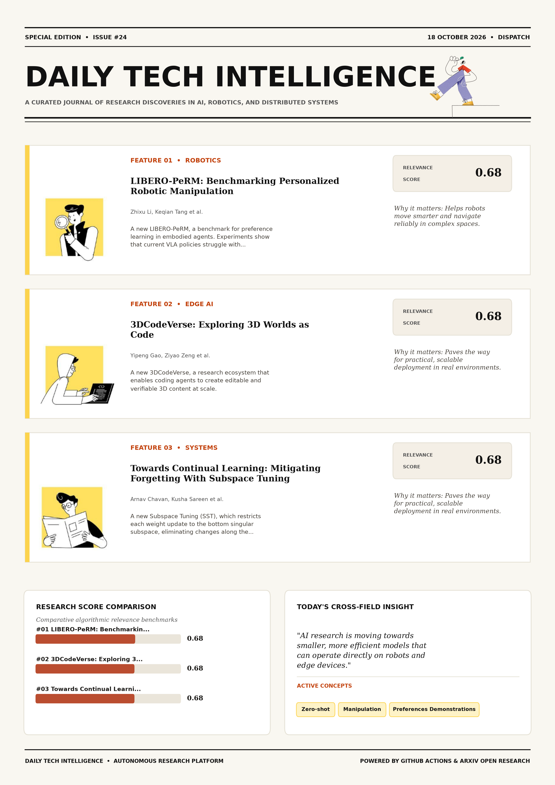

# Daily Tech Intelligence

## 18 October 2026

### Today's Overview

10 research papers analyzed.

Topics:

* Artificial Intelligence
* Machine Learning
* Natural Language Processing
* Robotics

### Visual Intelligence Templates

* **Template 3: Gen-Z Spotlight Broadside (Primary)**: [View High-Res](infographic_spotlight.png)
* **Template 2: Modern Tech Studio**: [View High-Res](infographic_modern.png)
* **Template 1: Editorial Research Journal**: [View High-Res](infographic_editorial.png)

---

## 1. LIBERO-PeRM: Benchmarking Personalized Robotic Manipulation

Authors: Zhixu Li, Keqian Tang, Litian Gong, Jingyu Yao, Wenqian Zhang, Tianze Xu, Zehao Wang, Yuping Wang, Junge Zhang, Jiachen Li

Publication: 2026-10-15T17:59:59Z

Category: cs.RO, cs.AI, cs.LG

Relevance Score: 0.68

Paper: [arXiv:2610.22372](https://arxiv.org/abs/2610.22372v1) | [PDF](https://arxiv.org/pdf/2610.22372v1)

### Summary

Mixed training achieves better no-preference retention than sequential adaptation and improves performance with contextual prompts compared with preference-only training, but can weaken motion-preference learning; preference generalization, decomposition, and conflict handling remain difficult. We introduce LIBERO-PeRM, a benchmark for preference learning in embodied agents. The code, datasets, and demos can be found on the project website: https://libero-perm.github.io/. Personalization is essential for general-purpose robots to transition into household environments and achieve true practicality. While general robotic manipulation has been extensively studied, personalized robotic manipulation (PeRM) lacks a controlled benchmark for separating task completion from preference satisfaction. LIBERO-PeRM studies five questions: 1) how policies follow preferences in zero-shot settings; 2) how they learn single preferences from demonstrations; 3) how efficiently they acquire preferences as demonstrations increase; 4) how learned preferences generalize across layouts and tasks; and 5) how policies compose preferences and behave under conflicts.

### Key Concepts

* Zero-shot
* Manipulation
* Preferences Demonstrations
* Taxonomy Observable
* Transition Household
* True Practicality

### Technical Insights

**Problem**

Mixed training achieves better no-preference retention than sequential adaptation and improves performance with contextual prompts compared with preference-only training, but can weaken motion-preference learning; preference generalization, decomposition, and conflict handling remain difficult.

**Approach**

We introduce LIBERO-PeRM, a benchmark for preference learning in embodied agents.

**Key Innovation**

Formulates an integrated mechanism leveraging Zero-shot, Manipulation.

**Results**

Not specified in the available abstract.

**Applications**

Autonomous robotic manipulation, sim-to-real transfer, and agile mobile navigation systems.

**Limitations**

This formulation is restricted to language-expressible preferences that can be instantiated in LIBERO without changing the task goal, evaluated automatically, and reused across tasks.

---

## 2. 3DCodeVerse: Exploring 3D Worlds as Code

Authors: Yipeng Gao, Ziyao Zeng, Jinfa Huang, Yijiang Li, Haolin Xiong, Wang Qin, Xinlei Yu, Youheng Yao, Jie Zhang, Kun-Yu Lin, Rong Liu, Yinyuan Zhao, Yajie Zhao, Meiqi Guo, Jiebo Luo, Lei Shu, Yunhao Ge, Xinyu Hu, Laurent Itti

Publication: 2026-10-15T17:56:07Z

Category: cs.CV, cs.AI

Relevance Score: 0.68

Paper: [arXiv:2610.22341](https://arxiv.org/abs/2610.22341v1) | [PDF](https://arxiv.org/pdf/2610.22341v1)

### Summary

Addressing critical demands in Artificial Intelligence, this research investigates we introduce 3dcodeverse, a research ecosystem that enables coding agents to create editable and verifiable 3d content at scale. We introduce 3DCodeVerse, a research ecosystem that enables coding agents to create editable and verifiable 3D content at scale. Extensive experiments demonstrate that fine-tuning on our dataset significantly improves the 3D coding capabilities of open-source models. Notably, our 3DCodeVerse harness achieves a 90% win rate against Claude Design (3D Object) in pairwise human evaluations, when both are utilized by Claude Opus 5.5. 3DCodeVerse comprises large-scale, high-quality datasets of executable 3D code, a coding harness for spatial reasoning and automated verification, and practical guidance for 3D coding.

### Key Concepts

* Achieves Win
* Acyclic Graph
* Analyses Harness
* Assets Required
* Associated Assets
* Automated Verification

### Technical Insights

**Problem**

Addresses foundational constraints in Artificial Intelligence and existing computational workflows.

**Approach**

We introduce 3DCodeVerse, a research ecosystem that enables coding agents to create editable and verifiable 3D content at scale.

**Key Innovation**

Formulates an integrated mechanism leveraging Achieves Win, Acyclic Graph.

**Results**

Extensive experiments demonstrate that fine-tuning on our dataset significantly improves the 3D coding capabilities of open-source models.

**Applications**

High-resolution real-time visual perception, automated 3D reconstruction, and embodied vision.

**Limitations**

Not specified in the available abstract.

---

## 3. Towards Continual Learning: Mitigating Forgetting With Subspace Tuning

Authors: Arnav Chavan, Kusha Sareen, Rishabh Tiwari, Abhranil Chandra, Johan Obando-Ceron, Kurt Keutzer, Scott Niekum, Inderjit S Dhillon, Devvrit Khatri

Publication: 2026-10-15T17:44:43Z

Category: cs.LG, cs.AI

Relevance Score: 0.68

Paper: [arXiv:2610.22293](https://arxiv.org/abs/2610.22293v1) | [PDF](https://arxiv.org/pdf/2610.22293v1)

### Summary

Addressing critical demands in Machine Learning, this research investigates large language models (llms) acquire new skills through fine-tuning, but it can destroy capabilities they already have: catastrophic forgetting remains a central obstacle to continual learning in llms. In this work, we introduce Subspace Tuning (SST), which restricts each weight update to the bottom singular subspace, eliminating changes along the principal directions. On-policy methods such as reinforcement learning and on-policy distillation avoid updating the principal singular directions of weight matrices and thus forget less. Overall, SST advances the learning--forgetting Pareto frontier, making it a practical default for fine-tuning pre-trained language models.

### Key Concepts

* Reinforcement Learning
* Catastrophic Forgetting
* Subspace Tuning Sst
* Substantially Improves
* Susceptible Catastrophic
* Tight Subspace Protection

### Technical Insights

**Problem**

Addresses foundational constraints in Machine Learning and existing computational workflows.

**Approach**

In this work, we introduce Subspace Tuning (SST), which restricts each weight update to the bottom singular subspace, eliminating changes along the principal directions.

**Key Innovation**

Formulates an integrated mechanism leveraging Reinforcement Learning, Catastrophic Forgetting.

**Results**

Not specified in the available abstract.

**Applications**

Autonomous agentic reasoning, multi-agent coordination, and decision-support platforms.

**Limitations**

Not specified in the available abstract.

---

## 4. DK-VLM: Geometry as Position for Spatial Reasoning in Vision-Language Models

Authors: Han Su, Meng Tian, Tianyu Huang, Mingyu Gao, Lennox Wei, Dongxu Li, Jianhua Han, Hang Xu, Xiaohe Wu, Wangmeng Zuo

Publication: 2026-10-15T17:58:15Z

Category: cs.CV

Relevance Score: 0.67

Paper: [arXiv:2610.22356](https://arxiv.org/abs/2610.22356v1) | [PDF](https://arxiv.org/pdf/2610.22356v1)

### Summary

Addressing critical demands in Artificial Intelligence, this research investigates vision-language models still struggle to understand 3d spatial relations across views and update spatial judgments as the observer moves. We propose DK-VLM with Dual-Kernel Attention, which computes attention from both a visual token's input position and its geometric position in the scene. Project page: https://sumuru789.github.io/DK-VLM-website/. Vision-language models still struggle to understand 3D spatial relations across views and update spatial judgments as the observer moves. A common approach fuses 3D reconstruction features into visual tokens, but aligning these features with pretrained semantic representations remains challenging under limited spatial supervision. A semantic kernel retains the pretrained model's native attention and positional encoding, while a separate geometric kernel uses estimated 3D points and camera poses to directly modulate attention through point displacements and relative view transformations.

### Key Concepts

* Achieves Highest
* Aligning Features
* Annotations Compared
* Attention Computes
* Attention Point
* Attention Position

### Technical Insights

**Problem**

Addresses foundational constraints in Artificial Intelligence and existing computational workflows.

**Approach**

We propose DK-VLM with Dual-Kernel Attention, which computes attention from both a visual token's input position and its geometric position in the scene.

**Key Innovation**

Formulates an integrated mechanism leveraging Achieves Highest, Aligning Features.

**Results**

Not specified in the available abstract.

**Applications**

High-resolution real-time visual perception, automated 3D reconstruction, and embodied vision. Next-generation large language model workflows, retrieval-augmented intelligence, and structured document parsing.

**Limitations**

Not specified in the available abstract.

---

## 5. OmniVerifier-C1: Decomposed Graded Verifier for Rule-Governed Generative World Modeling

Authors: Bowei Liu, Xinchen Zhang, Xuhuan Li, Tianlin Zhang, Kaian Jiang, Jingwei Liu, Congyang Zhao, Yifei Qian, Junhong Liu, Zhiheng Li, Yujiu Yang, Yang Cai, Ling Yang

Publication: 2026-10-15T17:58:04Z

Category: cs.CL

Relevance Score: 0.67

Paper: [arXiv:2610.22355](https://arxiv.org/abs/2610.22355v1) | [PDF](https://arxiv.org/pdf/2610.22355v1)

### Summary

Addressing critical demands in Artificial Intelligence, this research investigates generative visual verifiers play a crucial role in advancing multimodal intelligence. To train this verifier, we introduce a Decoupled RL training strategy that jointly optimizes sub-question-level binary judgment and global alignment scoring, using precise local feedback to develop fine-grained verification capabilities that provide a foundation for reliable continuous scoring at the global level. Under a general reinforcement learning framework, we first empirically demonstrate that the proposed pointwise graded verifier significantly outperforms binary verifiers in traditional text-to-image scenarios. Overall, our findings suggest a key insight: the transition from generative models to structured world-modeling agents critically hinges on the availability of accurate pairwise graded visual verifiers.

### Key Concepts

* Reinforcement Learning
* Binary Verifiers
* Structured World-modeling
* Traditional Text-to-image
* Train Verifier
* True False

### Technical Insights

**Problem**

Addresses foundational constraints in Artificial Intelligence and existing computational workflows.

**Approach**

To train this verifier, we introduce a Decoupled RL training strategy that jointly optimizes sub-question-level binary judgment and global alignment scoring, using precise local feedback to develop fine-grained verification capabilities that provide a foundation for reliable continuous scoring at the global level.

**Key Innovation**

Formulates an integrated mechanism leveraging Reinforcement Learning, Binary Verifiers.

**Results**

Under a general reinforcement learning framework, we first empirically demonstrate that the proposed pointwise graded verifier significantly outperforms binary verifiers in traditional text-to-image scenarios.

**Applications**

Next-generation large language model workflows, retrieval-augmented intelligence, and structured document parsing.

**Limitations**

Not specified in the available abstract.

---

## 6. CAT-alyzing Honesty: Continuous Adversarial Training for Transferable LLM Honesty

Authors: Yuan-Chen Chang, Niklas Herbster, Gauthier Gidel, Tommaso Tosato

Publication: 2026-10-15T17:43:47Z

Category: cs.LG, cs.CL, cs.CY

Relevance Score: 0.66

Paper: [arXiv:2610.22292](https://arxiv.org/abs/2610.22292v1) | [PDF](https://arxiv.org/pdf/2610.22292v1)

### Summary

However, despite alignment training, these models still exhibit dishonest behaviour, such as outputting claims that contradict some knowledge or are not supported by what is accessible in context. We introduce Continuous Adversarial Training for Consistent Honesty (CATCH), inspired by a method originally developed to robustly refuse harmful queries. However, CATCH surpasses honesty steering in maintaining utility, thanks to a novel choice of utility data. We show that CATCH outperforms prompting and supervised fine-tuning in improving honesty, and it is on par with state-of-the-art honesty activation steering. Large language models (LLMs) are becoming prevalent in scenarios where honesty is critical. CATCH trains the model towards an honest answer and away from a dishonest one while maintaining the model's capabilities.

### Key Concepts

* Accessible Context
* Activation Steering
* Answer Away
* Architectures Llama-
* Auditbench Catch
* Away Dishonest

### Technical Insights

**Problem**

However, despite alignment training, these models still exhibit dishonest behaviour, such as outputting claims that contradict some knowledge or are not supported by what is accessible in context.

**Approach**

We introduce Continuous Adversarial Training for Consistent Honesty (CATCH), inspired by a method originally developed to robustly refuse harmful queries.

**Key Innovation**

However, CATCH surpasses honesty steering in maintaining utility, thanks to a novel choice of utility data.

**Results**

We show that CATCH outperforms prompting and supervised fine-tuning in improving honesty, and it is on par with state-of-the-art honesty activation steering.

**Applications**

Next-generation large language model workflows, retrieval-augmented intelligence, and structured document parsing.

**Limitations**

Not specified in the available abstract.

---

## 7. Learning Rational Strategies for Temporal Objectives in Multi-Agent Systems

Authors: Omar Adalat, Edwin Hamel-De le Court, Francesco Belardinelli

Publication: 2026-10-15T17:42:52Z

Category: cs.LG, cs.LO, cs.MA

Relevance Score: 0.64

Paper: [arXiv:2610.22287](https://arxiv.org/abs/2610.22287v1) | [PDF](https://arxiv.org/pdf/2610.22287v1)

### Summary

Addressing critical demands in Artificial Intelligence, this research investigates we study rational synthesis for stochastic multi-agent systems with unknown dynamics, where each agent is equipped with its own probabilistic temporal objective specified using probabilistic linear temporal logic on finite traces (\mathsf{pltl}_f}). In particular, we formulate per-agent rational synthesis as finding a strategy profile -- if one exists -- such that (i) the designated agent's probabilistic temporal constraint is satisfied, and (ii) the profile represents a stable solution under a chosen solution concept. Our approach is empirically validated using 8 general-sum concurrent stochastic games. We study rational synthesis for stochastic multi-agent systems with unknown dynamics, where each agent is equipped with its own probabilistic temporal objective specified using Probabilistic Linear Temporal Logic on Finite Traces (\mathsf{PLTL}_f}).

### Key Concepts

* Reinforcement Learning
* Temporal Objective
* Agent Equipped
* Agent Probabilistic
* Agent Probability
* Algorithms Attempt

### Technical Insights

**Problem**

Addresses foundational constraints in Artificial Intelligence and existing computational workflows.

**Approach**

In particular, we formulate per-agent rational synthesis as finding a strategy profile -- if one exists -- such that (i) the designated agent's probabilistic temporal constraint is satisfied, and (ii) the profile represents a stable solution under a chosen solution concept.

**Key Innovation**

Formulates an integrated mechanism leveraging Reinforcement Learning, Temporal Objective.

**Results**

Not specified in the available abstract.

**Applications**

Autonomous agentic reasoning, multi-agent coordination, and decision-support platforms.

**Limitations**

We impose solution concepts (e.g., Nash equilibrium, subgame-perfect equilibrium) as constraints on the joint strategy profile, using payoffs derived from each agent's probability of satisfying its temporal objective.

---

## 8. AI Consilium: a Benchmark of LLM Clinical Multidisciplinary Second Opinions

Authors: Alexey A. Bokov, Ivan I. Panin, Nikolay B. Nechaev, Mikhail Yu. Valkov, Valeria Yu. Chernina, Natalia Gombolevskaya, Ayyaz Hussain, Vladimir M. Agafonov, Victor A. Gombolevskiy, Aleksandr V. Nesterov, Iaroslav R. Bespalov, Ivan V. Oseledets, Dmitry V. Dylov

Publication: 2026-10-15T17:46:37Z

Category: cs.CL, cs.AI

Relevance Score: 0.64

Paper: [arXiv:2610.22298](https://arxiv.org/abs/2610.22298v1) | [PDF](https://arxiv.org/pdf/2610.22298v1)

### Summary

Compared with the structured pre-consilium primary-role opinion, the complete structured synthesis had higher pooled scores across all five shared criteria, with the largest increases in problem prioritization, factual grounding, and reasoning coherence. We developed a multidimensional benchmark using 300 diagnostically resolved NEJM--MedQA cases: 110 for physician reference ratings and Judge calibration and 190 for held-out evaluation. Eight single-model pipelines generated independent role-specific opinions and interactive-consilium reports under free-form and structured clinical-reasoning conditions. These findings show that the benchmark can distinguish model capability, the contribution of multidisciplinary synthesis, criterion-specific effects of response structure, deliberation dynamics, and inference requirements within one common-case evaluation.

### Key Concepts

* Actionable Safe
* Advantage Management
* Calibration Held-out
* Capability Contribution
* Cases Physician
* Cases Useful

### Technical Insights

**Problem**

Compared with the structured pre-consilium primary-role opinion, the complete structured synthesis had higher pooled scores across all five shared criteria, with the largest increases in problem prioritization, factual grounding, and reasoning coherence.

**Approach**

We developed a multidimensional benchmark using 300 diagnostically resolved NEJM--MedQA cases: 110 for physician reference ratings and Judge calibration and 190 for held-out evaluation.

**Key Innovation**

Formulates an integrated mechanism leveraging Actionable Safe, Advantage Management.

**Results**

Not specified in the available abstract.

**Applications**

Next-generation large language model workflows, retrieval-augmented intelligence, and structured document parsing.

**Limitations**

Not specified in the available abstract.

---

## 9. Learning Self-Orchestration in Decentralized Agent Swarms

Authors: Guowei Xu, Zhenting Qi, Amani Kiruga, Himabindu Lakkaraju, Yilun Du

Publication: 2026-10-15T17:51:57Z

Category: cs.MA, cs.AI, cs.CL

Relevance Score: 0.64

Paper: [arXiv:2610.22322](https://arxiv.org/abs/2610.22322v1) | [PDF](https://arxiv.org/pdf/2610.22322v1)

### Summary

Larger populations also suffer smaller performance losses under agent dropout, demonstrating that learned self-orchestration supports reuse, scaling, and robustness in decentralized agent swarms. We introduce market-based post-training (MPT), a framework for jointly learning action policies and self-orchestration in decentralized agent swarms. Results show gains over monolithic post-training and confirm that agent participation indeed evolves with learning. Code and trained models are available at https://github.com/Embodied-Minds-Lab/MPT. The capabilities of an agent swarm depend on both its individual members and how they coordinate. Yet existing multi-agent systems often train agents within fixed orchestration structures, separating the learning of individual capabilities from the organization of collective behavior.

### Key Concepts

* Robot Navigation
* Agent Swarms
* Decentralized Agent
* Action Bidding
* Action Policies
* Individual Capabilities

### Technical Insights

**Problem**

Larger populations also suffer smaller performance losses under agent dropout, demonstrating that learned self-orchestration supports reuse, scaling, and robustness in decentralized agent swarms.

**Approach**

We introduce market-based post-training (MPT), a framework for jointly learning action policies and self-orchestration in decentralized agent swarms.

**Key Innovation**

Formulates an integrated mechanism leveraging Robot Navigation, Agent Swarms.

**Results**

Results show gains over monolithic post-training and confirm that agent participation indeed evolves with learning.

**Applications**

Autonomous robotic manipulation, sim-to-real transfer, and agile mobile navigation systems. Next-generation large language model workflows, retrieval-augmented intelligence, and structured document parsing.

**Limitations**

Not specified in the available abstract.

---

## 10. Illumination-Aware Active Perception for Spacecraft Inspection

Authors: Sagarika Rao Valluri, Benjamin Riviere

Publication: 2026-10-15T17:54:03Z

Category: cs.RO

Relevance Score: 0.63

Paper: [arXiv:2610.22335](https://arxiv.org/abs/2610.22335v1) | [PDF](https://arxiv.org/pdf/2610.22335v1)

### Summary

These metrics overlook illumination effects including eclipse, self-shadowing, and specular reflection from spacecraft materials and tend to declare components as inspected despite the corresponding images lacking sufficient information. We propose an inspection-planning framework that replaces geometric visibility with a learned measure of camera information derived from a classifier variational autoencoder (VAE) that operates directly on the captured image. We show that, although all approaches successfully maximize their own objective, our approach results in better illumination: a mean brightness of 0.57, with 81.6\% of observations above 0.25, compared with 0.02 (3.0\%) for geometric planning with an illumination band and 0.04 (6.0\%) for purely geometric planning.

### Key Concepts

* Approaches Successfully
* Autoencoder Vae
* Band Purely
* Better Illumination
* Brightness Observations
* Camera Information

### Technical Insights

**Problem**

These metrics overlook illumination effects including eclipse, self-shadowing, and specular reflection from spacecraft materials and tend to declare components as inspected despite the corresponding images lacking sufficient information.

**Approach**

We propose an inspection-planning framework that replaces geometric visibility with a learned measure of camera information derived from a classifier variational autoencoder (VAE) that operates directly on the captured image.

**Key Innovation**

Formulates an integrated mechanism leveraging Approaches Successfully, Autoencoder Vae.

**Results**

Not specified in the available abstract.

**Applications**

Autonomous robotic manipulation, sim-to-real transfer, and agile mobile navigation systems.

**Limitations**

Not specified in the available abstract.

---
