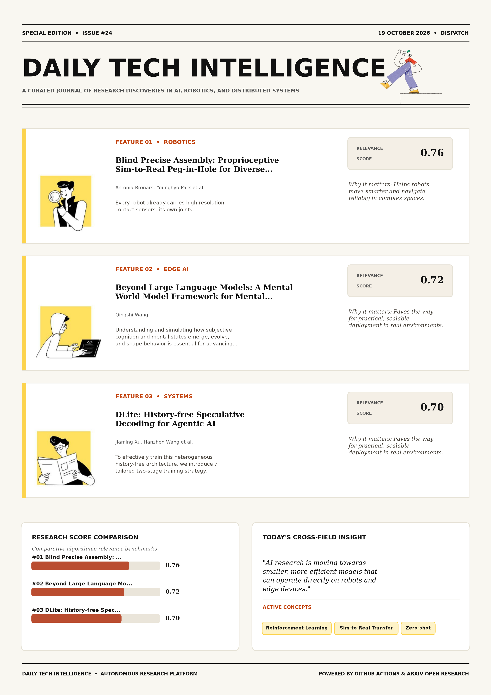

# Daily Tech Intelligence

## 19 October 2026

### Today's Overview

10 research papers analyzed.

Topics:

* Artificial Intelligence
* Machine Learning
* Natural Language Processing
* Robotics

### Visual Intelligence Templates

* **Template 3: Gen-Z Spotlight Broadside (Primary)**: [View High-Res](infographic_spotlight.png)
* **Template 2: Modern Tech Studio**: [View High-Res](infographic_modern.png)
* **Template 1: Editorial Research Journal**: [View High-Res](infographic_editorial.png)

---

## 1. Blind Precise Assembly: Proprioceptive Sim-to-Real Peg-in-Hole for Diverse Parts

Authors: Antonia Bronars, Younghyo Park, Kushal Kedia, Pulkit Agrawal

Publication: 2026-10-16T17:58:48Z

Category: cs.RO

Relevance Score: 0.76

Paper: [arXiv:2610.23849](https://arxiv.org/abs/2610.23849v1) | [PDF](https://arxiv.org/pdf/2610.23849v1)

### Summary

Addressing critical demands in Robotics, this research investigates every robot already carries high-resolution contact sensors: its own joints. Legged robots and humanoids exploit them to walk, run, and track whole-body motions without vision, but there the contacts are large and forceful. Is joint sensing also enough for precise, contact-rich assembly, where the robot must find a millimeter-scale opening, mesh gear teeth, or catch a thread through light contact? Videos and interactive simulations are at https://younghyopark.me/blind-proprioceptive-assembly/. Every robot already carries high-resolution contact sensors: its own joints. We study this question by training blind assembly policies that observe only a short history of joint positions, velocities, and their own actions, without visual, force, torque, or tactile sensing.

### Key Concepts

* Reinforcement Learning
* Sim-to-Real Transfer
* Zero-shot
* Peg Insertion
* Shapes Sizes
* Tactile Sensing

### Technical Insights

**Problem**

Addresses foundational constraints in Robotics and existing computational workflows.

**Approach**

Legged robots and humanoids exploit them to walk, run, and track whole-body motions without vision, but there the contacts are large and forceful.

**Key Innovation**

Formulates an integrated mechanism leveraging Reinforcement Learning, Sim-to-Real Transfer.

**Results**

Not specified in the available abstract.

**Applications**

Autonomous robotic manipulation, sim-to-real transfer, and agile mobile navigation systems.

**Limitations**

Not specified in the available abstract.

---

## 2. Beyond Large Language Models: A Mental World Model Framework for Mental Modeling, Simulation, Evolution, and Interpretability

Authors: Qingshi Wang

Publication: 2026-10-16T16:42:11Z

Category: cs.AI

Relevance Score: 0.72

Paper: [arXiv:2610.23722](https://arxiv.org/abs/2610.23722v1) | [PDF](https://arxiv.org/pdf/2610.23722v1)

### Summary

Addressing critical demands in Artificial Intelligence, this research investigates understanding and simulating how subjective cognition and mental states emerge, evolve, and shape behavior is essential for advancing artificial intelligence toward deeper social cognition and general intelligence. Existing large language models (LLMs) and Theory of Mind (ToM) methods primarily infer mental states from linguistic information, lacking unified mechanisms for subjective world construction, cognitive-psychological interactions, dynamic evolution, and historical dependencies. Additional experiments demonstrate improvements of 28.7, 39.3, and 16.6 percentage points in mental state and behavior prediction, long-sequence prediction, and implicit mental state inference, respectively. MWM also provides a promising foundation for causal reasoning, personalized AI, sustained human-AI interaction, and future advances toward artificial general intelligence (AGI).

### Key Concepts

* World Model
* Cognition Mental
* Continuous Mental
* General Intelligence
* Linguistic Information
* Mental Evolution

### Technical Insights

**Problem**

Addresses foundational constraints in Artificial Intelligence and existing computational workflows.

**Approach**

Existing large language models (LLMs) and Theory of Mind (ToM) methods primarily infer mental states from linguistic information, lacking unified mechanisms for subjective world construction, cognitive-psychological interactions, dynamic evolution, and historical dependencies.

**Key Innovation**

Formulates an integrated mechanism leveraging World Model, Cognition Mental.

**Results**

Additional experiments demonstrate improvements of 28.7, 39.3, and 16.6 percentage points in mental state and behavior prediction, long-sequence prediction, and implicit mental state inference, respectively.

**Applications**

Next-generation large language model workflows, retrieval-augmented intelligence, and structured document parsing.

**Limitations**

Not specified in the available abstract.

---

## 3. DLite: History-free Speculative Decoding for Agentic AI

Authors: Jiaming Xu, Hanzhen Wang, Tianlang Zhao, Jiewen Xiao, Chengze Yuan, Jiayi Pan, Yongkang Zhou, Jiancai Ye, Yu Wang, Guohao Dai

Publication: 2026-10-16T17:18:54Z

Category: cs.CL

Relevance Score: 0.70

Paper: [arXiv:2610.23787](https://arxiv.org/abs/2610.23787v1) | [PDF](https://arxiv.org/pdf/2610.23787v1)

### Summary

However, agentic workloads introduce long and continuously evolving contexts and frequent multi-turn interactions. To effectively train this heterogeneous history-free architecture, we introduce a tailored two-stage training strategy. Experiments on general-purpose, long-context and agentic workloads show that DLite achieves 2-6 acceptance length and outperforms the state-of-the-art speculative decoding method, DSpark, up to 70%. Speculative decoding has become a mainstream technique for accelerating large language model (LLM) inference by using a lightweight draft model to generate candidate tokens that are subsequently verified by the target model. Under such workloads, we observe that existing draft models suffer from up to an 80% degradation in acceptance length, while maintaining their historical KV cache introduces substantial system overhead.

### Key Concepts

* Large Language Model
* Speculative Decoding
* Accelerating Large
* Acceptance Length
* Achieves Acceptance
* Agentic Dlite

### Technical Insights

**Problem**

However, agentic workloads introduce long and continuously evolving contexts and frequent multi-turn interactions.

**Approach**

To effectively train this heterogeneous history-free architecture, we introduce a tailored two-stage training strategy.

**Key Innovation**

Formulates an integrated mechanism leveraging Large Language Model, Speculative Decoding.

**Results**

Experiments on general-purpose, long-context and agentic workloads show that DLite achieves 2-6 acceptance length and outperforms the state-of-the-art speculative decoding method, DSpark, up to 70%.

**Applications**

Next-generation large language model workflows, retrieval-augmented intelligence, and structured document parsing.

**Limitations**

Under such workloads, we observe that existing draft models suffer from up to an 80% degradation in acceptance length, while maintaining their historical KV cache introduces substantial system overhead.

---

## 4. MOSS: Multimodal Origami Swamp Robot System

Authors: T. Lan, A. Babgei, L. Romanello, M. Kovac, S. F. Armanini

Publication: 2026-10-16T17:35:24Z

Category: cs.RO

Relevance Score: 0.68

Paper: [arXiv:2610.23813](https://arxiv.org/abs/2610.23813v1) | [PDF](https://arxiv.org/pdf/2610.23813v1)

### Summary

Addressing critical demands in Robotics, this research investigates robotic systems for environmental monitoring and ecological surveying in wetlands and swamps must operate across diverse terrestrial and aquatic conditions. Conventional fixed-geometry wheels cannot adapt their contact geometry to these varying conditions. The contracted configuration achieved a lower cost of transport on firmer soil and mud, whereas the expanded configuration performed better on wetter mud, sand, and water, reducing the cost of transport by up to 29%. These results show that adaptive wheel geometry provides terrain-dependent locomotion benefits and enables a single compact platform to traverse substantially different terrestrial and aquatic conditions.

### Key Concepts

* Aquatic Conditions
* Contracted Configuration
* Cost Transport
* Expanded Configuration
* Reduced Slip
* Terrestrial Aquatic

### Technical Insights

**Problem**

Addresses foundational constraints in Robotics and existing computational workflows.

**Approach**

Conventional fixed-geometry wheels cannot adapt their contact geometry to these varying conditions.

**Key Innovation**

Formulates an integrated mechanism leveraging Aquatic Conditions, Contracted Configuration.

**Results**

The contracted configuration achieved a lower cost of transport on firmer soil and mud, whereas the expanded configuration performed better on wetter mud, sand, and water, reducing the cost of transport by up to 29%.

**Applications**

Autonomous robotic manipulation, sim-to-real transfer, and agile mobile navigation systems.

**Limitations**

Not specified in the available abstract.

---

## 5. The Cognitive Cost of LLM Writing: A Reading-Time Comparison with Human Text

Authors: Kamer Cekini, Elisabetta Biondi, Chiara Boldrini, Andrea Passarella, Marco Conti

Publication: 2026-10-16T16:35:41Z

Category: cs.CL

Relevance Score: 0.67

Paper: [arXiv:2610.23715](https://arxiv.org/abs/2610.23715v1) | [PDF](https://arxiv.org/pdf/2610.23715v1)

### Summary

Although linguistic differences between human-written and Large Language Model (LLM)-generated texts have been extensively studied, their implications for the cognitive effort involved in reading remain less explored. To this end, we introduce RoBERTa-RT, a model trained on human eye-tracking data to predict word-level reading times. Building on this perspective, we investigate whether human-written texts and their LLM-generated rewrites exhibit differences in predicted reading time that may reflect differences in processing demands for readers. This highlights the importance of considering not only the linguistic characteristics of machine-generated content, but also its potential implications for human cognitive processing. In psycholinguistics, reading time is commonly used as an indirect measure of cognitive processing effort.

### Key Concepts

* Large Language Model
* Cognitive Processing
* Llm-generated Rewrites
* Predicted Reading
* Processing Effort
* Reading Time

### Technical Insights

**Problem**

Although linguistic differences between human-written and Large Language Model (LLM)-generated texts have been extensively studied, their implications for the cognitive effort involved in reading remain less explored.

**Approach**

To this end, we introduce RoBERTa-RT, a model trained on human eye-tracking data to predict word-level reading times.

**Key Innovation**

Formulates an integrated mechanism leveraging Large Language Model, Cognitive Processing.

**Results**

Not specified in the available abstract.

**Applications**

Next-generation large language model workflows, retrieval-augmented intelligence, and structured document parsing.

**Limitations**

Not specified in the available abstract.

---

## 6. CocoRNA: Collective RNA Design with Cooperative Multi-agent Reinforcement Learning

Authors: Tianmeng Hu, Biao Luo, Ke Li

Publication: 2026-10-16T17:43:25Z

Category: cs.LG, cs.MA

Relevance Score: 0.65

Paper: [arXiv:2610.23820](https://arxiv.org/abs/2610.23820v1) | [PDF](https://arxiv.org/pdf/2610.23820v1)

### Summary

Designing RNA sequences that reliably fold into specific secondary structures is essential for understanding their biological functions but remains a challenging computational problem. We propose CocoRNA, a cooperative multi-agent reinforcement learning framework for RNA inverse design. Experiments on the Rfam dataset demonstrate that CocoRNA substantially outperforms state-of-the-art methods in both success rate and design speed. Further experiments on other biological sequence design tasks highlight the effectiveness and broad potential of CocoRNA for complex design tasks. CocoRNA simplifies the design task by decomposing it into smaller sub-problems, each solved collaboratively by multiple agents. This approach reduces the complexity of the problem and improves the exploration of design policies.

### Key Concepts

* Reinforcement Learning
* Biological Functions
* Biological Sequence
* Broad Potential
* Challenging Computational
* Cocorna Complex

### Technical Insights

**Problem**

Designing RNA sequences that reliably fold into specific secondary structures is essential for understanding their biological functions but remains a challenging computational problem.

**Approach**

We propose CocoRNA, a cooperative multi-agent reinforcement learning framework for RNA inverse design.

**Key Innovation**

Formulates an integrated mechanism leveraging Reinforcement Learning, Biological Functions.

**Results**

Experiments on the Rfam dataset demonstrate that CocoRNA substantially outperforms state-of-the-art methods in both success rate and design speed.

**Applications**

Autonomous agentic reasoning, multi-agent coordination, and decision-support platforms.

**Limitations**

Not specified in the available abstract.

---

## 7. FuTransformer: FP8 prefill and INT4 decode for Llama-style inference on Hopper

Authors: Wei Wang

Publication: 2026-10-16T17:22:01Z

Category: cs.AI

Relevance Score: 0.65

Paper: [arXiv:2610.23796](https://arxiv.org/abs/2610.23796v1) | [PDF](https://arxiv.org/pdf/2610.23796v1)

### Summary

Addressing critical demands in Machine Learning, this research investigates transformer prefill reuses weights across tokens and is dominated by matrix multiplication and activation data movement; single-token decode has limited reuse and is dominated by weight and kv-cache reads. We present FUTRANSFORMER, a CUDA implementation of a Llama-style Transformer block for NVIDIA Hopper GPUs. On one H100, prefill is up to 1.48x faster than compiled PyTorch FP8 and reaches 1.29 PFLOP/s. The kernels match a quantized reference computation within 0.001 perplexity. Transformer prefill reuses weights across tokens and is dominated by matrix multiplication and activation data movement; single-token decode has limited reuse and is dominated by weight and KV-cache reads.

### Key Concepts

* Quantization
* Coda Path
* Faster Compiled
* Path Faster
* Tokens Dominated
* Transform Reduces

### Technical Insights

**Problem**

Addresses foundational constraints in Machine Learning and existing computational workflows.

**Approach**

We present FUTRANSFORMER, a CUDA implementation of a Llama-style Transformer block for NVIDIA Hopper GPUs.

**Key Innovation**

Formulates an integrated mechanism leveraging Quantization, Coda Path.

**Results**

On one H100, prefill is up to 1.48x faster than compiled PyTorch FP8 and reaches 1.29 PFLOP/s.

**Applications**

Autonomous agentic reasoning, multi-agent coordination, and decision-support platforms.

**Limitations**

Not specified in the available abstract.

---

## 8. StopWatch: Goal Grounding for Object-goal Navigation

Authors: Xinhao Liu, Yunsheng Tian, Yuheng Qiu, Pieter Abbeel, Xi Chen, Guanya Shi, Chen Feng

Publication: 2026-10-16T17:57:05Z

Category: cs.CV, cs.RO

Relevance Score: 0.64

Paper: [arXiv:2610.23841](https://arxiv.org/abs/2610.23841v1) | [PDF](https://arxiv.org/pdf/2610.23841v1)

### Summary

Despite this progress, success rates remain low, and it is unclear which capability these fine-tuned policies lack. Despite this progress, success rates remain low, and it is unclear which capability these fine-tuned policies lack. Our diagnosis identifies goal grounding as the dominant failure. Our work points to goal grounding as a missing piece of object-goal navigation and offers a simple and effective solution to the task. Pretrained VLMs bring rich world knowledge and semantic priors to object-goal navigation, and fine-tuning a VLM into a navigation policy has become a common recipe. These policies explore well, yet often fail to notice that the goal is already in view or to estimate how far away it is.

### Key Concepts

* Goal Grounding
* Object-goal Navigation
* Address Failure
* Annotation Defects
* Away Address
* Capability Fine-tuned

### Technical Insights

**Problem**

Despite this progress, success rates remain low, and it is unclear which capability these fine-tuned policies lack.

**Approach**

Despite this progress, success rates remain low, and it is unclear which capability these fine-tuned policies lack.

**Key Innovation**

Formulates an integrated mechanism leveraging Goal Grounding, Object-goal Navigation.

**Results**

Not specified in the available abstract.

**Applications**

Autonomous robotic manipulation, sim-to-real transfer, and agile mobile navigation systems. High-resolution real-time visual perception, automated 3D reconstruction, and embodied vision.

**Limitations**

Not specified in the available abstract.

---

## 9. Not All Actions Contribute Equally: Learning Precise Progress Estimation from Imprecise Demonstrations

Authors: Huanqian Wang, Boshi Tang, Botong Xiao, Jie Zhang, Yang Yue, Danhua Tao, Shiji Song, Gao Huang

Publication: 2026-10-16T17:07:39Z

Category: cs.RO

Relevance Score: 0.64

Paper: [arXiv:2610.23769](https://arxiv.org/abs/2610.23769v1) | [PDF](https://arxiv.org/pdf/2610.23769v1)

### Summary

We argue that a key limitation is the lack of a global prior regarding task evaluation criteria, which is crucial for distinguishing meaningful progress from human mistakes. To this end, we propose PRIME, a novel progress estimator capable of learning precise progress estimation from imprecise demonstrations by aggregating experience across trajectories. To this end, we propose PRIME, a novel progress estimator capable of learning precise progress estimation from imprecise demonstrations by aggregating experience across trajectories. This assumption often breaks down in real-world scenarios, especially in high-precision manipulation, where subtle geometric errors can lead to task failure. Notably, the advantage of PRIME gets more pronounced in higher-precision scenarios, yielding up to a \(5\times\) improvement in policy success rate over the SFT baselines on charger insertion.

### Key Concepts

* Reinforcement Learning
* Manipulation
* Meaningful Progress
* Stagnation Setbacks Assuming
* States Connecting
* States Trajectories

### Technical Insights

**Problem**

We argue that a key limitation is the lack of a global prior regarding task evaluation criteria, which is crucial for distinguishing meaningful progress from human mistakes.

**Approach**

To this end, we propose PRIME, a novel progress estimator capable of learning precise progress estimation from imprecise demonstrations by aggregating experience across trajectories.

**Key Innovation**

To this end, we propose PRIME, a novel progress estimator capable of learning precise progress estimation from imprecise demonstrations by aggregating experience across trajectories.

**Results**

Not specified in the available abstract.

**Applications**

Autonomous robotic manipulation, sim-to-real transfer, and agile mobile navigation systems.

**Limitations**

Existing methods heavily rely on expert data and naively assume that all actions within a demonstration contribute to task success.

---

## 10. Beyond the Answer: Student-Conditioned Trace Construction for Reasoning Distillation

Authors: Shaoang Li, Yanhang Shi, Yufei Li, Mingfu Liang, Frank Shyu, Sandeep Pandey, Luke Simon, Xi Liu, Jian Li

Publication: 2026-10-16T17:52:58Z

Category: cs.CL, cs.LG

Relevance Score: 0.63

Paper: [arXiv:2610.23831](https://arxiv.org/abs/2610.23831v1) | [PDF](https://arxiv.org/pdf/2610.23831v1)

### Summary

Addressing critical demands in Artificial Intelligence, this research investigates a reasoning trace can accompany a correct answer without providing effective supervision for a particular student. We introduce ReDiST, a student-conditioned trace-construction and distillation framework for evidence-rich reasoning. Across supervision recipes, performance rankings can differ between source and transfer benchmarks, highlighting the importance of evaluating trace teaching utility across distributions. A reasoning trace can accompany a correct answer without providing effective supervision for a particular student. We study how to construct traces that improve learning beyond answer-only supervision by considering both their intermediate content and their accessibility to the target learner.

### Key Concepts

* Accessibility Target
* Accompany Correct
* Additional Guidance
* Answer Frozen
* Answer Loss
* Answer Recovery

### Technical Insights

**Problem**

Addresses foundational constraints in Artificial Intelligence and existing computational workflows.

**Approach**

We introduce ReDiST, a student-conditioned trace-construction and distillation framework for evidence-rich reasoning.

**Key Innovation**

Formulates an integrated mechanism leveraging Accessibility Target, Accompany Correct.

**Results**

Not specified in the available abstract.

**Applications**

Next-generation large language model workflows, retrieval-augmented intelligence, and structured document parsing.

**Limitations**

Not specified in the available abstract.

---
