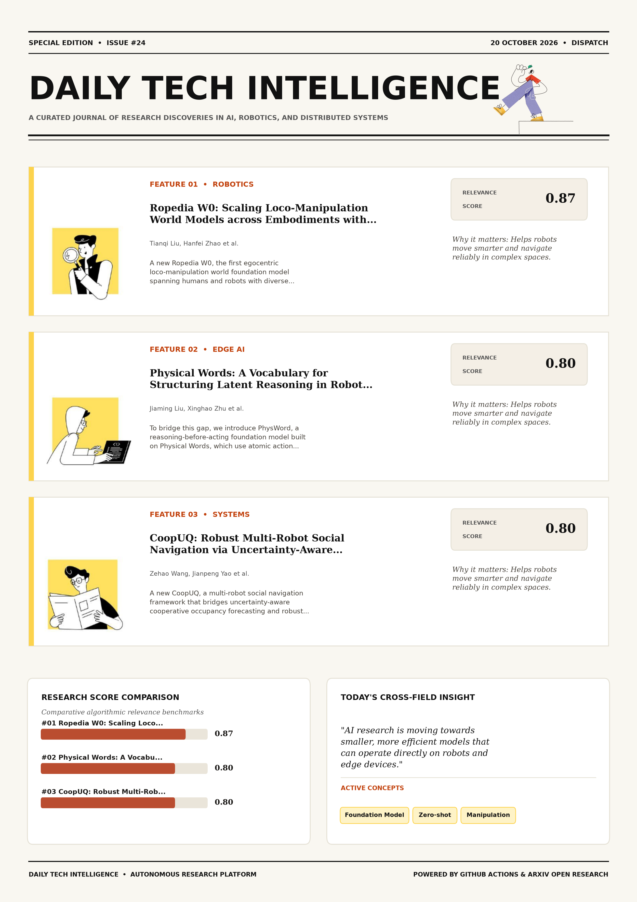

# Daily Tech Intelligence

## 20 October 2026

### Today's Overview

10 research papers analyzed.

Topics:

* Artificial Intelligence
* Machine Learning
* Robotics

### Visual Intelligence Templates

* **Template 3: Gen-Z Spotlight Broadside (Primary)**: [View High-Res](infographic_spotlight.png)
* **Template 2: Modern Tech Studio**: [View High-Res](infographic_modern.png)
* **Template 1: Editorial Research Journal**: [View High-Res](infographic_editorial.png)

---

## 1. Ropedia W0: Scaling Loco-Manipulation World Models across Embodiments with Human Experience

Authors: Tianqi Liu, Hanfei Zhao, Qifeng Liang, Hui En Pang, Jiarui Xu, Sayang Mu, Penghao Qiu, YingSheng Zhang, Jun Wang, Ziang Cao, Mingze Sun, Yukang Cao, Fangzhou Hong, Zhaoxi Chen, Ziwei Liu

Publication: 2026-10-19T17:59:55Z

Category: cs.CV, cs.RO

Relevance Score: 0.87

Paper: [arXiv:2610.26855](https://arxiv.org/abs/2610.26855v1) | [PDF](https://arxiv.org/pdf/2610.26855v1)

### Summary

Addressing critical demands in Robotics, this research investigates world models enable embodied agents to anticipate action consequences, yet jointly modeling locomotion and manipulation across diverse embodiments remains challenging due to heterogeneous action spaces and limited multimodal supervision. We present Ropedia W0, the first egocentric loco-manipulation world foundation model spanning humans and robots with diverse embodiments. We curate Xp-Data, comprising 10k hours of egocentric human data and 3k hours of robot data with unified multimodal annotations and systematic quality control. Applications in policy evaluation, model-based planning, and world-action modeling further demonstrate the model's utility for embodied decision-making. World models enable embodied agents to anticipate action consequences, yet jointly modeling locomotion and manipulation across diverse embodiments remains challenging due to heterogeneous action spaces and limited multimodal supervision.

### Key Concepts

* Foundation Model
* Zero-shot
* Manipulation
* Diverse Embodiments
* Systematic Quality
* Unified Kinematic

### Technical Insights

**Problem**

Addresses foundational constraints in Robotics and existing computational workflows.

**Approach**

We present Ropedia W0, the first egocentric loco-manipulation world foundation model spanning humans and robots with diverse embodiments.

**Key Innovation**

Formulates an integrated mechanism leveraging Foundation Model, Zero-shot.

**Results**

Not specified in the available abstract.

**Applications**

Autonomous robotic manipulation, sim-to-real transfer, and agile mobile navigation systems. High-resolution real-time visual perception, automated 3D reconstruction, and embodied vision.

**Limitations**

Not specified in the available abstract.

---

## 2. Physical Words: A Vocabulary for Structuring Latent Reasoning in Robot Manipulation

Authors: Jiaming Liu, Xinghao Zhu, Yiming Zhang, Shanghang Zhang, Yinxi Wang, Yichu Yang, Zhuoyang Liu, Dantong Niu, Soha Pouya, Juekun Li, Yan Chang

Publication: 2026-10-19T17:59:54Z

Category: cs.RO

Relevance Score: 0.80

Paper: [arXiv:2610.26854](https://arxiv.org/abs/2610.26854v1) | [PDF](https://arxiv.org/pdf/2610.26854v1)

### Summary

However, language-based reasoning captures task semantics but struggles to express fine-grained physical dynamics, while latent reasoning models future state evolution but offers limited structure for organizing these dynamics into reusable reasoning primitives. To bridge this gap, we introduce PhysWord, a reasoning-before-acting foundation model built on Physical Words, which use atomic action verbs as shared semantic anchors for continuous representations of physical dynamics. PhysWord achieves state-of-the-art success rates of 90.3\% on visuotactile UniVTAC and 99.6\% on vision-based LIBERO-Long, and outperforms competing methods on real-world tasks using bimanual grippers and dexterous hands. Further evaluations demonstrate that our structured latent reasoning framework generalizes to unseen scenarios and enables long-horizon manipulation.

### Key Concepts

* Foundation Model
* Manipulation
* Latent Reasoning
* Physical Words
* Action Generation
* Atomic Action

### Technical Insights

**Problem**

However, language-based reasoning captures task semantics but struggles to express fine-grained physical dynamics, while latent reasoning models future state evolution but offers limited structure for organizing these dynamics into reusable reasoning primitives.

**Approach**

To bridge this gap, we introduce PhysWord, a reasoning-before-acting foundation model built on Physical Words, which use atomic action verbs as shared semantic anchors for continuous representations of physical dynamics.

**Key Innovation**

Formulates an integrated mechanism leveraging Foundation Model, Manipulation.

**Results**

PhysWord achieves state-of-the-art success rates of 90.3\% on visuotactile UniVTAC and 99.6\% on vision-based LIBERO-Long, and outperforms competing methods on real-world tasks using bimanual grippers and dexterous hands.

**Applications**

Autonomous robotic manipulation, sim-to-real transfer, and agile mobile navigation systems.

**Limitations**

Not specified in the available abstract.

---

## 3. CoopUQ: Robust Multi-Robot Social Navigation via Uncertainty-Aware Cooperative Forecasting

Authors: Zehao Wang, Jianpeng Yao, Yuping Wang, Yiping Li, Jiaqi Li, Zhixu Li, Kanghoon Lee, Jinfeng Wang, Cong Liu, Zhaowei Tan, Jinkyoo Park, Jiachen Li

Publication: 2026-10-19T17:59:49Z

Category: cs.RO, cs.AI, cs.LG

Relevance Score: 0.80

Paper: [arXiv:2610.26852](https://arxiv.org/abs/2610.26852v1) | [PDF](https://arxiv.org/pdf/2610.26852v1)

### Summary

However, directly extending single-robot approaches to multi-robot settings often fails to ensure safety and efficiency, especially under occlusions and out-of-distribution (OOD) scenarios, where individual robots may overlook potential risks or make inaccurate predictions. We propose CoopUQ, a multi-robot social navigation framework that bridges uncertainty-aware cooperative occupancy forecasting and robust decision making. Leveraging cooperation effectively for both prediction and navigation remains a major challenge. Our code and videos are available at https://coopuq.github.io/. Reinforcement learning enables mobile robots to make fast and scalable navigation decisions in constrained human-shared environments. CoopUQ predicts future occupancy grid maps through cross-robot spatiotemporal feature fusion and further leverages forecasts and their uncertainty to guide policy via constrained multi-agent reinforcement learning, where the cost penalizes navigation through regions predicted to be occupied or highly uncertain.

### Key Concepts

* Reinforcement Learning
* Adapt Risk
* Approaches Multi-robot
* Available Https
* Baselines Real-robot
* Bridges Uncertainty-aware

### Technical Insights

**Problem**

However, directly extending single-robot approaches to multi-robot settings often fails to ensure safety and efficiency, especially under occlusions and out-of-distribution (OOD) scenarios, where individual robots may overlook potential risks or make inaccurate predictions.

**Approach**

We propose CoopUQ, a multi-robot social navigation framework that bridges uncertainty-aware cooperative occupancy forecasting and robust decision making.

**Key Innovation**

Formulates an integrated mechanism leveraging Reinforcement Learning, Adapt Risk.

**Results**

Not specified in the available abstract.

**Applications**

Autonomous robotic manipulation, sim-to-real transfer, and agile mobile navigation systems.

**Limitations**

However, directly extending single-robot approaches to multi-robot settings often fails to ensure safety and efficiency, especially under occlusions and out-of-distribution (OOD) scenarios, where individual robots may overlook potential risks or make inaccurate predictions.

---

## 4. HandsOn: A Large-Scale Simulation Benchmark for Generalizable Dexterous Manipulation

Authors: Tianwei Luo, Yiming He, Hongjin Wu, Ting Pan, Debin Ren, Haorui Guo, Junlin Yang, Yuxin Zuo, Zhehao Kou, Kaisen Yang, Zhuoqun Lai, Yi Ding, Jiale Yu, Yuchen Zhang, Zijie Qiu, Haozhan Li, Ning Ding

Publication: 2026-10-19T17:22:48Z

Category: cs.RO

Relevance Score: 0.78

Paper: [arXiv:2610.26765](https://arxiv.org/abs/2610.26765v1) | [PDF](https://arxiv.org/pdf/2610.26765v1)

### Summary

Addressing critical demands in Robotics, this research investigates general-purpose manipulation requires reliable behavior across embodiments, objects, and task demands. We introduce HandsOn, a composable simulation platform and benchmark for cross-embodiment dexterous manipulation. It supports five robotic arms, six dexterous hands, and approximately 200 rigid, articulated, and deformable assets in randomized scenes. HandsOn provides a shared basis for investigating manipulation generalization and the limits of reliable physical interaction. General-purpose manipulation requires reliable behavior across embodiments, objects, and task demands. The benchmark pairs 18,000 curated human demonstrations with 66 human-verified tasks: Core-50 supports demonstration-based learning and execution tests, while Transfer-16 evaluates asset and relation transfer, skill composition, and deformable manipulation without target-task training demonstrations.

### Key Concepts

* Sim-to-Real Transfer
* Dexterous Manipulation
* Manipulation
* Achieved Goals
* Achieves Core-
* Action Coordination

### Technical Insights

**Problem**

Addresses foundational constraints in Robotics and existing computational workflows.

**Approach**

We introduce HandsOn, a composable simulation platform and benchmark for cross-embodiment dexterous manipulation.

**Key Innovation**

Formulates an integrated mechanism leveraging Sim-to-Real Transfer, Dexterous Manipulation.

**Results**

Not specified in the available abstract.

**Applications**

Autonomous robotic manipulation, sim-to-real transfer, and agile mobile navigation systems.

**Limitations**

Not specified in the available abstract.

---

## 5. Train An Imaginative Agent

Authors: Jiaxin Ge, Junyi Zhang, Tianning Chai, Hanjun Yoo, Chenyang Wang, Xiuyu Li, Weijia Shi, XuDong Wang, Sewon Min, Luke Zettlemoyer, Trevor Darrell, Haiwen Feng

Publication: 2026-10-19T17:59:12Z

Category: cs.AI

Relevance Score: 0.76

Paper: [arXiv:2610.26845](https://arxiv.org/abs/2610.26845v1) | [PDF](https://arxiv.org/pdf/2610.26845v1)

### Summary

Addressing critical demands in Artificial Intelligence, this research investigates a seemingly reasonable push in sokoban can make the puzzle unsolvable. We introduce Agentic Imagination (Agima), a training framework that trains an agent to imagine before acting, i.e. to be imaginative. Project page: https://agima.net/. A seemingly reasonable push in Sokoban can make the puzzle unsolvable. To avoid such mistakes, an agent has to anticipate the consequences of its actions before execution, especially when feedback from the real environment is sparse or actions are irreversible. Agima trains a single omni model to propose actions, generate images of their outcomes, and then reason over these imagined futures to decide what to execute in the real environment.

### Key Concepts

* Reinforcement Learning
* Forward Thinking
* Futures Use
* Imagined Futures
* Real Environment
* Reason Imagined

### Technical Insights

**Problem**

Addresses foundational constraints in Artificial Intelligence and existing computational workflows.

**Approach**

We introduce Agentic Imagination (Agima), a training framework that trains an agent to imagine before acting, i.e. to be imaginative.

**Key Innovation**

Formulates an integrated mechanism leveraging Reinforcement Learning, Forward Thinking.

**Results**

Not specified in the available abstract.

**Applications**

Autonomous agentic reasoning, multi-agent coordination, and decision-support platforms.

**Limitations**

Not specified in the available abstract.

---

## 6. What Language Adds, and at What Cost: Four Controlled Probes of Pathology Vision-Language Models

Authors: Wenhao Zhang, Zhongliang Zhou, Yi Ping, Zirui Wang, Sheng Li

Publication: 2026-10-19T17:48:31Z

Category: cs.CV, q-bio.QM

Relevance Score: 0.76

Paper: [arXiv:2610.26805](https://arxiv.org/abs/2610.26805v1) | [PDF](https://arxiv.org/pdf/2610.26805v1)

### Summary

Addressing critical demands in Machine Learning, this research investigates vision--language models (vlms) promise to make computational pathology queryable and able to draft reports, but how much language adds beyond the vision backbone is unclear, because almost every system is evaluated by its developers on test sets of their own choosing. Language thus adds real but narrow value, and we propose minimum controls that would expose these failure modes in future evaluations. Report text adds prognostic signal: adding a frozen embedding of the stage-redacted report to a slide embedding raises the pooled C-index by 0.019 for progression-free interval and by 0.016 for overall survival across 1{,}633 TCGA patients, and restoring the stage statement adds nothing.

### Key Concepts

* Zero-shot
* Language Adds
* Able Draft
* Accuracy Inference
* Accuracy Unchanged
* Add Measurable

### Technical Insights

**Problem**

Addresses foundational constraints in Machine Learning and existing computational workflows.

**Approach**

Language thus adds real but narrow value, and we propose minimum controls that would expose these failure modes in future evaluations.

**Key Innovation**

Formulates an integrated mechanism leveraging Zero-shot, Language Adds.

**Results**

Not specified in the available abstract.

**Applications**

High-resolution real-time visual perception, automated 3D reconstruction, and embodied vision. Next-generation large language model workflows, retrieval-augmented intelligence, and structured document parsing.

**Limitations**

Not specified in the available abstract.

---

## 7. GPT-6 Astra Is a Native Visuo-Tactile Policy for Contact-Rich Manipulation

Authors: Chen Yang, Linzhe Shi, Hang Zhang, Mu Xu, Jiansheng Fan, Chen Wang

Publication: 2026-10-19T17:59:17Z

Category: cs.RO

Relevance Score: 0.76

Paper: [arXiv:2610.26846](https://arxiv.org/abs/2610.26846v1) | [PDF](https://arxiv.org/pdf/2610.26846v1)

### Summary

Our findings challenge the exclusivity of specialist policies in contact-rich manipulation and show that fine-grained vision can partially compensate for missing touch. Yet contact-rich control and tactile perception are often regarded as strengths of specialist policies, leaving open whether Astra can directly understand and use tactile observations. We provide, to our knowledge, the first demonstration that Astra directly interprets vision-based tactile images and uses their contact cues for manipulation. These results motivate joint visual-tactile pretraining, harder contact-rich evaluations, and physical-robot validation. Recent advances in multimodal models have enabled GPT-6 Astra to perform robotic manipulation through in-context learning. Tactile RGB images enter through its existing visual interface, enabling few-shot closed-loop control on nineteen simulated UniVTAC and OpenViTac tasks with 210 sampled scene seeds per setting.

### Key Concepts

* Manipulation
* Astra Directly
* Specialist Policies
* Tactile Sensing Interface
* Tangential Loading
* Touch Identify

### Technical Insights

**Problem**

Our findings challenge the exclusivity of specialist policies in contact-rich manipulation and show that fine-grained vision can partially compensate for missing touch.

**Approach**

Yet contact-rich control and tactile perception are often regarded as strengths of specialist policies, leaving open whether Astra can directly understand and use tactile observations.

**Key Innovation**

Formulates an integrated mechanism leveraging Manipulation, Astra Directly.

**Results**

Not specified in the available abstract.

**Applications**

Autonomous robotic manipulation, sim-to-real transfer, and agile mobile navigation systems.

**Limitations**

Not specified in the available abstract.

---

## 8. DexOAK: Object-Aware Kinematic Retargeting

Authors: Federica Spinola, Robert Katzschmann, Cordelia Schmid

Publication: 2026-10-19T17:20:10Z

Category: cs.RO

Relevance Score: 0.76

Paper: [arXiv:2610.26762](https://arxiv.org/abs/2610.26762v1) | [PDF](https://arxiv.org/pdf/2610.26762v1)

### Summary

Addressing critical demands in Robotics, this research investigates we introduce dexoak, a learning-based object-aware kinematic retargeting framework for generating contact-consistent robot hand references from human motion-capture data. We introduce DexOAK, a learning-based object-aware kinematic retargeting framework for generating contact-consistent robot hand references from human motion-capture data. These per-frame solutions form seed retargeted references, from which a feed-forward network conditioned on human keypoints and object point clouds learns the retargeting function. Visualizations and interactive results are at: https://fspinola.github.io/dexoak/. DexOAK first minimizes an interaction-graph Laplacian objective over a joint hand-object graph, so the robot reproduces the demonstrated object-relative interaction geometry rather than the human hand pose alone.

### Key Concepts

* Zero-shot
* Kinematic Retargeting
* Object-aware Kinematic
* Success Rises
* Trace Gains
* Transfers Arctic

### Technical Insights

**Problem**

Addresses foundational constraints in Robotics and existing computational workflows.

**Approach**

We introduce DexOAK, a learning-based object-aware kinematic retargeting framework for generating contact-consistent robot hand references from human motion-capture data.

**Key Innovation**

Formulates an integrated mechanism leveraging Zero-shot, Kinematic Retargeting.

**Results**

Not specified in the available abstract.

**Applications**

Autonomous robotic manipulation, sim-to-real transfer, and agile mobile navigation systems.

**Limitations**

Not specified in the available abstract.

---

## 9. Manga2Animate: An Agentic Framework for Faithful Manga Animation with Script and Storyboard Planning

Authors: Sheng-Wei Zhang, Hsi-An Chen, Yan-Ting Liou, Chih-Hsuan Chen, Shih-Chen Tseng, Yu-Lun Liu

Publication: 2026-10-19T17:59:46Z

Category: cs.CV

Relevance Score: 0.74

Paper: [arXiv:2610.26851](https://arxiv.org/abs/2610.26851v1) | [PDF](https://arxiv.org/pdf/2610.26851v1)

### Summary

Addressing critical demands in Artificial Intelligence, this research investigates adapting existing manga into coherent animation that stays faithful to the source is a valuable yet challenging task. In this paper, we propose Manga2Animate, a multi-agent framework that grounds every stage of generation in the source manga. Project page: https://annchenn.github.io/Manga2Animate/ Adapting existing manga into coherent animation that stays faithful to the source is a valuable yet challenging task. Existing methods either access the manga mainly through text, losing its characters and art style, or feed manga pages directly into video generation models, which misinterpret the manga's structure and produce incorrect storylines.

### Key Concepts

* Access Manga
* Agent Reviewed
* Agent Tailor
* Animation Extensive
* Animation Script
* Animation Stays

### Technical Insights

**Problem**

Addresses foundational constraints in Artificial Intelligence and existing computational workflows.

**Approach**

In this paper, we propose Manga2Animate, a multi-agent framework that grounds every stage of generation in the source manga.

**Key Innovation**

Formulates an integrated mechanism leveraging Access Manga, Agent Reviewed.

**Results**

Not specified in the available abstract.

**Applications**

High-resolution real-time visual perception, automated 3D reconstruction, and embodied vision.

**Limitations**

Not specified in the available abstract.

---

## 10. Simulation Priors for Rapid Adaptation in Model-Based RL for Autonomous Racing

Authors: Adrian Remonda, Jiajun Xi, Nicklas Hansen, Marcus Greiff, Thomas Lew, John Talbot, John Subosits, Xiaolong Wang

Publication: 2026-10-19T17:17:24Z

Category: cs.LG, cs.RO, eess.SY

Relevance Score: 0.73

Paper: [arXiv:2610.26757](https://arxiv.org/abs/2610.26757v1) | [PDF](https://arxiv.org/pdf/2610.26757v1)

### Summary

Reinforcement learning enables learning high-performance control policies, but its reliance on extensive interaction limits deployment on physical systems where data collection is costly, and failures are unsafe. We introduce Prior-Informed Adaptation (PIA), an offline-to-online model-based RL framework that uses structured simulation priors for rapid adaptation. PIA pretrains a world model on heterogeneous low- and high-fidelity simulated trajectories, then adapts it with limited target-domain interaction using uncertainty-regularized planning. On hardware, PIA achieves reliable few-shot adaptation with less than one hour of on-vehicle interaction. Rather than requiring an accurate simulator for policy transfer, PIA treats simulated trajectories as biased priors whose residual mismatch is corrected during online adaptation.

### Key Concepts

* World Model
* Reinforcement Learning
* Autonomous Racing
* Accurate Simulator
* Achieves Reliable
* Achieving Lower

### Technical Insights

**Problem**

Reinforcement learning enables learning high-performance control policies, but its reliance on extensive interaction limits deployment on physical systems where data collection is costly, and failures are unsafe.

**Approach**

We introduce Prior-Informed Adaptation (PIA), an offline-to-online model-based RL framework that uses structured simulation priors for rapid adaptation.

**Key Innovation**

Formulates an integrated mechanism leveraging World Model, Reinforcement Learning.

**Results**

Not specified in the available abstract.

**Applications**

Autonomous robotic manipulation, sim-to-real transfer, and agile mobile navigation systems.

**Limitations**

Not specified in the available abstract.

---
