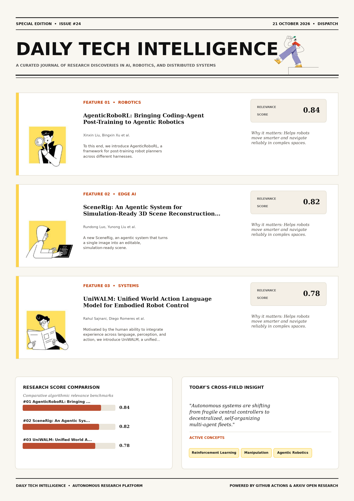

# Daily Tech Intelligence

## 21 October 2026

### Today's Overview

10 research papers analyzed.

Topics:

* Artificial Intelligence
* Machine Learning
* Natural Language Processing
* Robotics

### Visual Intelligence Templates

* **Template 3: Gen-Z Spotlight Broadside (Primary)**: [View High-Res](infographic_spotlight.png)
* **Template 2: Modern Tech Studio**: [View High-Res](infographic_modern.png)
* **Template 1: Editorial Research Journal**: [View High-Res](infographic_editorial.png)

---

## 1. AgenticRoboRL: Bringing Coding-Agent Post-Training to Agentic Robotics

Authors: Xinxin Liu, Bingxin Xu, Wenrui Bao, Ming Li, Wentao Bao, Chen Chen, Yuzhang Shang

Publication: 2026-10-20T17:41:09Z

Category: cs.RO

Relevance Score: 0.84

Paper: [arXiv:2610.28589](https://arxiv.org/abs/2610.28589v1) | [PDF](https://arxiv.org/pdf/2610.28589v1)

### Summary

However, applying it across robot harnesses requires accommodating different execution mechanisms, including VLA skill invocation and control-code generation. To this end, we introduce AgenticRoboRL, a framework for post-training robot planners across different harnesses. In contrast, coding agents have improved substantially by post-training the model itself. We will release the framework and trained planner checkpoints. Agentic robotics systems combine planners with robot harnesses to perform complex manipulation tasks. Recent work improves these systems through better harnesses and external memory, but relies on powerful closed-source models as planners and does not improve the planners' own capabilities. We therefore investigate whether post-training can also improve robot planners.

### Key Concepts

* Reinforcement Learning
* Manipulation
* Agentic Robotics
* Achieved Codex
* Agenticroborl Raises
* Applying Robot

### Technical Insights

**Problem**

However, applying it across robot harnesses requires accommodating different execution mechanisms, including VLA skill invocation and control-code generation.

**Approach**

To this end, we introduce AgenticRoboRL, a framework for post-training robot planners across different harnesses.

**Key Innovation**

Formulates an integrated mechanism leveraging Reinforcement Learning, Manipulation.

**Results**

Not specified in the available abstract.

**Applications**

Autonomous robotic manipulation, sim-to-real transfer, and agile mobile navigation systems.

**Limitations**

Not specified in the available abstract.

---

## 2. SceneRig: An Agentic System for Simulation-Ready 3D Scene Reconstruction from Single Images

Authors: Rundong Luo, Yunong Liu, Di Cao, Matthew Tancik, Shyamal Buch, Colton Stearns, Wenqi Xian

Publication: 2026-10-20T17:39:42Z

Category: cs.RO, cs.AI, cs.CV

Relevance Score: 0.82

Paper: [arXiv:2610.28585](https://arxiv.org/abs/2610.28585v1) | [PDF](https://arxiv.org/pdf/2610.28585v1)

### Summary

Simulation is a powerful tool for robotics, but building diverse, simulation-ready scenes at scale remains difficult. We present SceneRig, an agentic system that turns a single image into an editable, simulation-ready scene. Existing methods that rely on post-hoc physics settling often misplace objects, producing scenes that look correct but behave poorly under manipulation. Furthermore, SceneRig is effective for downstream robotics: its scenes predict real-robot policy outcomes more accurately than the baseline method and more reliably support replay of recorded manipulations without trajectory adaptation. Reconstructing scenes from single images is a promising alternative, but visual similarity alone is insufficient: objects must also be recovered, accurately placed, and physically grounded.

### Key Concepts

* Manipulation
* Accurately Placed
* Achieve Physical
* Agent Performs
* Agentic Turns
* Alternative Visual

### Technical Insights

**Problem**

Simulation is a powerful tool for robotics, but building diverse, simulation-ready scenes at scale remains difficult.

**Approach**

We present SceneRig, an agentic system that turns a single image into an editable, simulation-ready scene.

**Key Innovation**

Formulates an integrated mechanism leveraging Manipulation, Accurately Placed.

**Results**

Not specified in the available abstract.

**Applications**

Autonomous robotic manipulation, sim-to-real transfer, and agile mobile navigation systems. High-resolution real-time visual perception, automated 3D reconstruction, and embodied vision.

**Limitations**

Not specified in the available abstract.

---

## 3. UniWALM: Unified World Action Language Model for Embodied Robot Control

Authors: Rahul Sajnani, Diego Romeres, Mingyuan Zhang, Kai Gao, Carl Qi, Baichuan Huang, Srinath Sridhar, Dylan Randle, Lillian J. Ratliff, Jose Barreiros, Manikantan Nambi, Jeroen Vanbaar

Publication: 2026-10-20T17:59:04Z

Category: cs.RO, cs.AI, cs.CV

Relevance Score: 0.78

Paper: [arXiv:2610.28626](https://arxiv.org/abs/2610.28626v1) | [PDF](https://arxiv.org/pdf/2610.28626v1)

### Summary

Addressing critical demands in Artificial Intelligence, this research investigates motivated by the human ability to integrate experience across language, perception, and action, we introduce uniwalm, a unified world-action-language model that learns video, action, and language in a single shared representation, where each modality is both a conditioning signal and a supervision target. Motivated by the human ability to integrate experience across language, perception, and action, we introduce UniWALM, a unified world-action-language model that learns video, action, and language in a single shared representation, where each modality is both a conditioning signal and a supervision target. Unlike prior approaches that attach a reasoning or vision-language model to a video-action backbone and run them as distinct stages, UniWALM unifies all three modalities inside a single mixture-of-transformers backbone whose per-modality diffusion heads co-denoise synchronously, decoding subtask and textual memory in the same pass as action with no separate planning stage; the generated language is re-consumed on the next step, closing a language-as-memory loop without an external planner or memory bank. On a real-world Find-the-Item task, generating textual memory lifts success from 11.1% to 61.1%, while state-of-the-art VLAs stay at or below chance (<=33.3%).

### Key Concepts

* Manipulation
* Action Stream Reliable
* Action Trajectories
* Anchor Frame
* Approaches Attach
* Shared Representation

### Technical Insights

**Problem**

Addresses foundational constraints in Artificial Intelligence and existing computational workflows.

**Approach**

Motivated by the human ability to integrate experience across language, perception, and action, we introduce UniWALM, a unified world-action-language model that learns video, action, and language in a single shared representation, where each modality is both a conditioning signal and a supervision target.

**Key Innovation**

Formulates an integrated mechanism leveraging Manipulation, Action Stream Reliable.

**Results**

Not specified in the available abstract.

**Applications**

Autonomous robotic manipulation, sim-to-real transfer, and agile mobile navigation systems. High-resolution real-time visual perception, automated 3D reconstruction, and embodied vision. Next-generation large language model workflows, retrieval-augmented intelligence, and structured document parsing.

**Limitations**

Not specified in the available abstract.

---

## 4. Semantic Observability for Autonomous Systems Diagnostics

Authors: Jitendra Solanki, Anand Todkar, Ziran Min

Publication: 2026-10-20T17:53:32Z

Category: cs.AI

Relevance Score: 0.78

Paper: [arXiv:2610.28611](https://arxiv.org/abs/2610.28611v1) | [PDF](https://arxiv.org/pdf/2610.28611v1)

### Summary

Addressing critical demands in Artificial Intelligence, this research investigates modern distributed microservice deployments generate massive volumes of heterogeneous, multi-format observability logs across physically and logically partitioned infrastructure. We introduce Semantic Observability, an autonomous multi-agent framework that unifies disparate log streams into a dynamic, queryable Property Graph Database. We also specify an open-source validation framework on standard benchmarks (LogHub and Train-Ticket), laying the groundwork for a forthcoming companion paper on exhaustive quantitative evaluation and production benchmarking. Modern distributed microservice deployments generate massive volumes of heterogeneous, multi-format observability logs across physically and logically partitioned infrastructure. Isolating root causes during cascading failures remains an arduous task for Site Reliability Engineers (SREs), bottlenecked by manual keyword filtering and disjointed temporal correlation across monitoring dashboards.

### Key Concepts

* Large Language Model
* Semantic Observability
* Anomalies Pruned
* Applying Causal
* Time Resolution
* Token Consumption

### Technical Insights

**Problem**

Addresses foundational constraints in Artificial Intelligence and existing computational workflows.

**Approach**

We introduce Semantic Observability, an autonomous multi-agent framework that unifies disparate log streams into a dynamic, queryable Property Graph Database.

**Key Innovation**

Formulates an integrated mechanism leveraging Large Language Model, Semantic Observability.

**Results**

Not specified in the available abstract.

**Applications**

Autonomous agentic reasoning, multi-agent coordination, and decision-support platforms.

**Limitations**

Not specified in the available abstract.

---

## 5. Capable Teacher, Myopic Scorer: Reward-Free Teacher Repair for Agentic On-Policy Distillation

Authors: Shu Zhao, Tan Yu

Publication: 2026-10-20T17:40:08Z

Category: cs.CL, cs.AI

Relevance Score: 0.76

Paper: [arXiv:2610.28586](https://arxiv.org/abs/2610.28586v1) | [PDF](https://arxiv.org/pdf/2610.28586v1)

### Summary

Addressing critical demands in Machine Learning, this research investigates agentic on-policy distillation (opd) trains a student agent on its own trajectories while a teacher scores every token. We propose Rollout-to-Scorer Distillation (R2S), which repairs the scorer before distillation by mining high-disagreement states from the untrained student, running teacher takeovers from them, keeping the states where enough takeovers pass a reward-free check such as consensus or an LLM judge, and fine-tuning the teacher to give its takeover-informed scores on every assistant token from the divergence turn onward, without the takeover in context. Across three environments, two teachers and four students, R2S outperforms three state-of-the-art agentic-OPD methods in all twelve teacher-student-environment cells, by 12.8 success points on average over the best of them in each cell. Project page: https://tree-shu-zhao.github.io/r2s/.

### Key Concepts

* Assistant Token
* Attribute Myopia
* Best Cell
* Teacher Takeovers
* Trains Student
* Trajectories Region

### Technical Insights

**Problem**

Addresses foundational constraints in Machine Learning and existing computational workflows.

**Approach**

We propose Rollout-to-Scorer Distillation (R2S), which repairs the scorer before distillation by mining high-disagreement states from the untrained student, running teacher takeovers from them, keeping the states where enough takeovers pass a reward-free check such as consensus or an LLM judge, and fine-tuning the teacher to give its takeover-informed scores on every assistant token from the divergence turn onward, without the takeover in context.

**Key Innovation**

Formulates an integrated mechanism leveraging Assistant Token, Attribute Myopia.

**Results**

Across three environments, two teachers and four students, R2S outperforms three state-of-the-art agentic-OPD methods in all twelve teacher-student-environment cells, by 12.8 success points on average over the best of them in each cell.

**Applications**

Next-generation large language model workflows, retrieval-augmented intelligence, and structured document parsing.

**Limitations**

Not specified in the available abstract.

---

## 6. VLM-Guided Contact Retargeting and Generative Partner Modeling for Humanoid-Human Interaction

Authors: Yuto Shibata, Kotaro Amaya, Kashu Yamazaki, Lalit Jayanti, Yoshimitsu Aoki, Mariko Isogawa, Katerina Fragkiadaki

Publication: 2026-10-20T16:57:52Z

Category: cs.RO, cs.AI, cs.CV

Relevance Score: 0.76

Paper: [arXiv:2610.28523](https://arxiv.org/abs/2610.28523v1) | [PDF](https://arxiv.org/pdf/2610.28523v1)

### Summary

Addressing critical demands in Robotics, this research investigates humanoid-human interaction requires robots to operate under severe partial observability: during close physical contact, the human partner is occluded, truncated, or outside the robot's field of view, causing pose estimation to fail and often necessitating external tracking or privileged human state. We present REACT, a framework for learning deployable humanoid-human interaction policies from human-human demonstrations. On real hardware, REACT performs all five interactions using onboard sensing alone. Humanoid-human interaction requires robots to operate under severe partial observability: during close physical contact, the human partner is occluded, truncated, or outside the robot's field of view, causing pose estimation to fail and often necessitating external tracking or privileged human state.

### Key Concepts

* Humanoid-human Interaction
* Contact Modeling
* Generative Partner-state
* Interaction Policies
* Onboard Sensing
* Partial Observability

### Technical Insights

**Problem**

Addresses foundational constraints in Robotics and existing computational workflows.

**Approach**

We present REACT, a framework for learning deployable humanoid-human interaction policies from human-human demonstrations.

**Key Innovation**

Formulates an integrated mechanism leveraging Humanoid-human Interaction, Contact Modeling.

**Results**

Not specified in the available abstract.

**Applications**

Autonomous robotic manipulation, sim-to-real transfer, and agile mobile navigation systems. High-resolution real-time visual perception, automated 3D reconstruction, and embodied vision.

**Limitations**

Not specified in the available abstract.

---

## 7. Physical Canvas: A Vision Tactile World Model For Robot Policy Evaluation And Learning

Authors: Zebin Xing, Yuhang Zheng, Yupeng Zheng, Yichen Zhang, Zichen Li, Shangqing Zhou, Yujie Zang, Yuchen Liu, Zhongpu Xia, Haoran Li, Qichao Zhang

Publication: 2026-10-20T17:54:03Z

Category: cs.RO

Relevance Score: 0.73

Paper: [arXiv:2610.28613](https://arxiv.org/abs/2610.28613v1) | [PDF](https://arxiv.org/pdf/2610.28613v1)

### Summary

Evaluating and post-training robot policies through physical interaction is costly and difficult to scale, motivating action-conditioned world models as interactive simulators. We introduce PhysCanvas, a state-consistent visuo-tactile world model for contact-rich robot manipulation. Project page: https://zebinx.github.io/PhysCanvas_HomePage/. However, visually plausible predictions can misrepresent contact dynamics, providing unreliable feedback for policy evaluation and learning. PhysCanvas unifies multi-view RGB, tactile images, marker displacement, task state, and actions within a unified vision space. All modalities share a video VAE and pretrained generative backbone, allowing optical touch to reuse visual and temporal priors. Motion images derived through forward kinematics and camera projection provide spatially aligned action conditioning, while an initial RGB anchor and updated reference observations guide sequential generation.

### Key Concepts

* World Model
* Manipulation
* Consistency-aware Post-training
* Post-training Robot
* Real-world Success
* State Reward

### Technical Insights

**Problem**

Evaluating and post-training robot policies through physical interaction is costly and difficult to scale, motivating action-conditioned world models as interactive simulators.

**Approach**

We introduce PhysCanvas, a state-consistent visuo-tactile world model for contact-rich robot manipulation.

**Key Innovation**

Formulates an integrated mechanism leveraging World Model, Manipulation.

**Results**

Not specified in the available abstract.

**Applications**

Autonomous robotic manipulation, sim-to-real transfer, and agile mobile navigation systems. High-resolution real-time visual perception, automated 3D reconstruction, and embodied vision.

**Limitations**

Not specified in the available abstract.

---

## 8. Touch-JEPA: Tactile Representation Learning from Hand-Object Video with Limited Tactile Supervision

Authors: Minseong Kweon, Qiao Feng, Yiming Huang, Lingjie Liu

Publication: 2026-10-20T16:56:11Z

Category: cs.CV

Relevance Score: 0.72

Paper: [arXiv:2610.28519](https://arxiv.org/abs/2610.28519v1) | [PDF](https://arxiv.org/pdf/2610.28519v1)

### Summary

Addressing critical demands in Machine Learning, this research investigates understanding contact and tactile magnitude in hand-object interaction is a key step toward physically intelligent systems, yet learning such representations is limited by the cost and restricted coverage of tactile measurements. We present Touch-JEPA, a framework for learning tactile representations from hand-object videos with limited tactile supervision. Together, these results show that hand-object video can provide scalable self-supervision for tactile representation learning, while limited tactile measurements provide complementary physical grounding. Understanding contact and tactile magnitude in hand-object interaction is a key step toward physically intelligent systems, yet learning such representations is limited by the cost and restricted coverage of tactile measurements.

### Key Concepts

* Representation Learning
* Limited Tactile
* Tactile Supervision
* Contact Discrimination Tactile
* Contact Dynamics
* Contact Magnitude

### Technical Insights

**Problem**

Addresses foundational constraints in Machine Learning and existing computational workflows.

**Approach**

We present Touch-JEPA, a framework for learning tactile representations from hand-object videos with limited tactile supervision.

**Key Innovation**

Formulates an integrated mechanism leveraging Representation Learning, Limited Tactile.

**Results**

Together, these results show that hand-object video can provide scalable self-supervision for tactile representation learning, while limited tactile measurements provide complementary physical grounding.

**Applications**

High-resolution real-time visual perception, automated 3D reconstruction, and embodied vision.

**Limitations**

Not specified in the available abstract.

---

## 9. DecisionPivot: A Diagnostic Benchmark for Decision Models in LLM Systems

Authors: Xialie Zhuang, Mingcong Lei, Zunhai Su, Ri Liu, Jianjin Li, Peixian Ma, Jia Pan, Ngai Wong, Guanhua Chen, Chuan-Wei Kuo

Publication: 2026-10-20T16:57:49Z

Category: cs.AI

Relevance Score: 0.71

Paper: [arXiv:2610.28522](https://arxiv.org/abs/2610.28522v1) | [PDF](https://arxiv.org/pdf/2610.28522v1)

### Summary

However, item accuracy alone cannot establish whether models make correct decisions across controlled variations or assign reliable confidence to their predictions. We introduce DecisionPivot, a diagnostic benchmark comprising 48 tasks and 40,033 items across seven decision roles. By linking errors to pivotal details and difficulty levels, DecisionPivot provides fine-grained diagnostics of decision failures that aggregate evaluation alone cannot reveal. Decision models support routing, guardrails, and output verification in LLM systems. Its core track contains 7,800 items from 13 generated task families, organized into contrast groups with computed answers verified by independently implemented solvers. The complementary reference track contains 32,233 items from 35 public test sets, preserving their original evaluation metrics.

### Key Concepts

* Achieves Contrast-group Accuracy
* Contains Items
* Item Accuracy
* Probability Ordering
* Reference Track
* Test Sets

### Technical Insights

**Problem**

However, item accuracy alone cannot establish whether models make correct decisions across controlled variations or assign reliable confidence to their predictions.

**Approach**

We introduce DecisionPivot, a diagnostic benchmark comprising 48 tasks and 40,033 items across seven decision roles.

**Key Innovation**

Formulates an integrated mechanism leveraging Achieves Contrast-group Accuracy, Contains Items.

**Results**

Not specified in the available abstract.

**Applications**

Next-generation large language model workflows, retrieval-augmented intelligence, and structured document parsing.

**Limitations**

Not specified in the available abstract.

---

## 10. Turning TS2Vec into a Foundation Model for Time Series Classification

Authors: Vasilii Feofanov, Zhenghan Tai, Andrei Ermakov, Irina Rish

Publication: 2026-10-20T17:47:51Z

Category: cs.LG, cs.AI

Relevance Score: 0.69

Paper: [arXiv:2610.28602](https://arxiv.org/abs/2610.28602v1) | [PDF](https://arxiv.org/pdf/2610.28602v1)

### Summary

Addressing critical demands in Machine Learning, this research investigates ts2vec is one of the strongest self-supervised methods for time series classification, introduced in 2022. It is designed to be trained anew on every dataset: self-supervised pre-training followed by linear probing. Since then, the field has shifted towards foundation models that reuse one encoder across datasets. What we find most interesting is how different TS2Vec-FM is from other foundation models in design: near-parity is reached without attention, without a patch tokenizer, and without intermediate-layer extraction, using an "old-school" convolutional encoder and a two-layer MLP stem. TS2Vec is one of the strongest self-supervised methods for time series classification, introduced in 2022.

### Key Concepts

* Foundation Model
* Accepts Variable-length
* Amplitude View
* Ask Properties
* Attention Patch
* Classification Introduced

### Technical Insights

**Problem**

Addresses foundational constraints in Machine Learning and existing computational workflows.

**Approach**

It is designed to be trained anew on every dataset: self-supervised pre-training followed by linear probing.

**Key Innovation**

Formulates an integrated mechanism leveraging Foundation Model, Accepts Variable-length.

**Results**

Not specified in the available abstract.

**Applications**

Autonomous agentic reasoning, multi-agent coordination, and decision-support platforms.

**Limitations**

Not specified in the available abstract.

---
