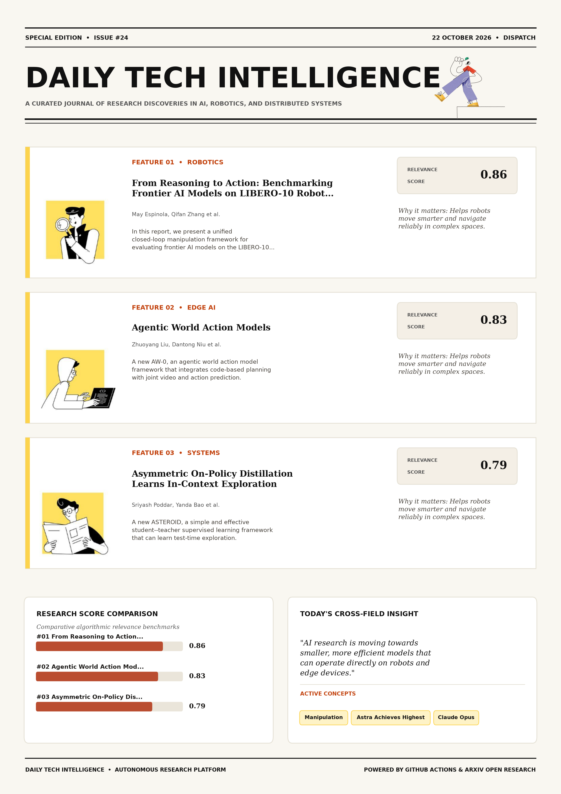

# Daily Tech Intelligence

## 22 October 2026

### Today's Overview

10 research papers analyzed.

Topics:

* Artificial Intelligence
* Machine Learning
* Robotics

### Visual Intelligence Templates

* **Template 3: Gen-Z Spotlight Broadside (Primary)**: [View High-Res](infographic_spotlight.png)
* **Template 2: Modern Tech Studio**: [View High-Res](infographic_modern.png)
* **Template 1: Editorial Research Journal**: [View High-Res](infographic_editorial.png)

---

## 1. From Reasoning to Action: Benchmarking Frontier AI Models on LIBERO-10 Robot Manipulation Tasks

Authors: May Espinola, Qifan Zhang, Yu Xiang

Publication: 2026-10-21T17:11:52Z

Category: cs.RO, cs.AI

Relevance Score: 0.86

Paper: [arXiv:2610.30051](https://arxiv.org/abs/2610.30051v1) | [PDF](https://arxiv.org/pdf/2610.30051v1)

### Summary

However, their manipulation capabilities have not been systematically evaluated on standardized robotics benchmarks. In this report, we present a unified closed-loop manipulation framework for evaluating frontier AI models on the LIBERO-10 benchmark. Our results show that GPT-6 Astra achieves the highest success rate of 44%, followed by Gemini-4 Argon at 43%. We release our evaluation framework and experimental results to support reproducible benchmarking and future research on reasoning-based robot manipulation. Recent advances in frontier AI models have demonstrated remarkable capabilities in visual understanding, reasoning, planning, and tool use, raising the possibility of using general-purpose AI models for robot manipulation without task-specific training.

### Key Concepts

* Manipulation
* Astra Achieves Highest
* Claude Opus
* Gemini- Argon
* Gpt- Astra
* Reasoning Effort

### Technical Insights

**Problem**

However, their manipulation capabilities have not been systematically evaluated on standardized robotics benchmarks.

**Approach**

In this report, we present a unified closed-loop manipulation framework for evaluating frontier AI models on the LIBERO-10 benchmark.

**Key Innovation**

Formulates an integrated mechanism leveraging Manipulation, Astra Achieves Highest.

**Results**

Our results show that GPT-6 Astra achieves the highest success rate of 44%, followed by Gemini-4 Argon at 43%.

**Applications**

Autonomous robotic manipulation, sim-to-real transfer, and agile mobile navigation systems.

**Limitations**

These findings demonstrate both the potential and limitations of frontier AI models for robot manipulation, highlighting the challenges of translating reasoning capabilities into reliable physical actions.

---

## 2. Agentic World Action Models

Authors: Zhuoyang Liu, Dantong Niu, Botong Zhang, Boning Shao, Jing Wang, Ruijie Zheng, Yuvan Sharma, Runyu Lu, Jiaming Liu, Renrui Zhang, Roei Herzig, Yutong Bai, Ken Goldberg, Danfei Xu, Yuke Zhu, Guanzhi Wang, Linxi "Jim" Fan, Trevor Darrell

Publication: 2026-10-21T17:59:56Z

Category: cs.RO

Relevance Score: 0.83

Paper: [arXiv:2610.30136](https://arxiv.org/abs/2610.30136v1) | [PDF](https://arxiv.org/pdf/2610.30136v1)

### Summary

Addressing critical demands in Artificial Intelligence, this research investigates recent world action models provide visual foresight and future prediction for robot manipulation, but lack explicit mechanisms for compositional skill reuse. We introduce AW-0, an agentic world action model framework that integrates code-based planning with joint video and action prediction. Evaluations on RoboTwin 2.0 and physical bimanual manipulation tasks show improved task performance over VLA and WAM baselines, alongside gains in language following, semantic reasoning and robustness, demonstrating that agentic code enables connection between planning, prediction and execution within WAMs. Recent world action models provide visual foresight and future prediction for robot manipulation, but lack explicit mechanisms for compositional skill reuse.

### Key Concepts

* World Model
* Manipulation
* Agentic World
* World Action
* Agentic Code
* Agentic Execution

### Technical Insights

**Problem**

Addresses foundational constraints in Artificial Intelligence and existing computational workflows.

**Approach**

We introduce AW-0, an agentic world action model framework that integrates code-based planning with joint video and action prediction.

**Key Innovation**

Formulates an integrated mechanism leveraging World Model, Manipulation.

**Results**

Not specified in the available abstract.

**Applications**

Autonomous robotic manipulation, sim-to-real transfer, and agile mobile navigation systems.

**Limitations**

Not specified in the available abstract.

---

## 3. Asymmetric On-Policy Distillation Learns In-Context Exploration

Authors: Sriyash Poddar, Yanda Bao, Jacob Krantz, Matthew Chang, Xavier Puig, Roozbeh Mottaghi, Natasha Jaques, Abhishek Gupta

Publication: 2026-10-21T17:50:31Z

Category: cs.RO, cs.AI, cs.LG

Relevance Score: 0.79

Paper: [arXiv:2610.30105](https://arxiv.org/abs/2610.30105v1) | [PDF](https://arxiv.org/pdf/2610.30105v1)

### Summary

Sequential decision-making under partial observability is difficult because agents must explore to infer hidden, task-relevant information before acting effectively. In this work, we propose ASTEROID, a simple and effective student--teacher supervised learning framework that can learn test-time exploration. Across a diverse range of eleven different environments, including discrete exploration benchmarks, robotic manipulation, navigation, and Procgen environments, ASTEROID achieves ~2x higher returns under fixed exploration budgets, uses ~100x fewer interactions than RL baselines, and outperforms frontier models at exploration. Overall, it provides a simple yet surprisingly effective framework to learn efficient test-time exploration. Learning such information-gathering behaviors tabula rasa via online reinforcement learning is sample-inefficient, whereas offline imitation averages expert actions across hidden states and fails to learn exploration.

### Key Concepts

* Reinforcement Learning
* Manipulation
* Asteroid Simple
* Expert Actions
* Partial Observability
* Privileged Expert

### Technical Insights

**Problem**

Sequential decision-making under partial observability is difficult because agents must explore to infer hidden, task-relevant information before acting effectively.

**Approach**

In this work, we propose ASTEROID, a simple and effective student--teacher supervised learning framework that can learn test-time exploration.

**Key Innovation**

Formulates an integrated mechanism leveraging Reinforcement Learning, Manipulation.

**Results**

Across a diverse range of eleven different environments, including discrete exploration benchmarks, robotic manipulation, navigation, and Procgen environments, ASTEROID achieves ~2x higher returns under fixed exploration budgets, uses ~100x fewer interactions than RL baselines, and outperforms frontier models at exploration.

**Applications**

Autonomous robotic manipulation, sim-to-real transfer, and agile mobile navigation systems.

**Limitations**

Learning such information-gathering behaviors tabula rasa via online reinforcement learning is sample-inefficient, whereas offline imitation averages expert actions across hidden states and fails to learn exploration.

---

## 4. SP-HLM: Sparse-Pose-Driven Motion Generation and Whole-Body Control for Humanoid Loco-Manipulation

Authors: Zhaohui Yang, Quanbao Lin, Chengqi Shi, Zhenglang Weng, Jicheng Lin, Boyu Chen, Tengjie Zhu, Guanzhu Ren, Jiahao Xu, Yang Feng, Xiaokang Yang, Yao Mu

Publication: 2026-10-21T17:03:34Z

Category: cs.RO, cs.AI

Relevance Score: 0.76

Paper: [arXiv:2610.30044](https://arxiv.org/abs/2610.30044v1) | [PDF](https://arxiv.org/pdf/2610.30044v1)

### Summary

Addressing critical demands in Robotics, this research investigates humanoid loco-manipulation requires an effective interface between high-level task policies and whole-body control. We present SP-HLM, a framework built on a sparse-pose-driven interface. This may burden the high-level policy or leave one aspect underspecified. Additional results and videos are available on our \href{https://sp-hlm.github.io/}{\textcolor{blue}{project page}}. Humanoid loco-manipulation requires an effective interface between high-level task policies and whole-body control. Existing interfaces typically rely on a single action representation for both task intent and whole-body coordination. The interface combines five task-critical body poses with a learned latent motion prior to represent spatial intent and whole-body coordination in complementary forms.

### Key Concepts

* Manipulation
* Whole-body Control
* Action Representation
* Action-chunk Inference
* Aspect Underspecified
* Asynchronous Action-chunk

### Technical Insights

**Problem**

Addresses foundational constraints in Robotics and existing computational workflows.

**Approach**

We present SP-HLM, a framework built on a sparse-pose-driven interface.

**Key Innovation**

Formulates an integrated mechanism leveraging Manipulation, Whole-body Control.

**Results**

Not specified in the available abstract.

**Applications**

Autonomous robotic manipulation, sim-to-real transfer, and agile mobile navigation systems.

**Limitations**

Not specified in the available abstract.

---

## 5. GoiBERT: Compact Vietnamese Language Models via Two-Stage Knowledge Distillation

Authors: Quang Anh Kiet Tran, Nam Anh Tran, Manh Hung Trinh, Thanh Danh Le, Khang Nhat Hoang Vo, Huynh Dai Nhan Tran

Publication: 2026-10-21T17:24:36Z

Category: cs.CL

Relevance Score: 0.74

Paper: [arXiv:2610.30067](https://arxiv.org/abs/2610.30067v1) | [PDF](https://arxiv.org/pdf/2610.30067v1)

### Summary

Vietnamese pre-trained encoders have improved rapidly, but the strongest ones are large, multilingual-vocabulary models or depend on external word segmentation, which makes them costly to deploy. We present GoiBERT, a family of two compact Vietnamese encoders with 26M and 49M parameters that operate directly on raw text. GoiBERT learns from two complementary teachers. Our code and models are available at: https://github.com/Nhantran65/GoiBERT.git A same-tokenizer Vietnamese encoder first teaches general-purpose representations. A much larger teacher then provides task-level guidance through soft labels that are generated without ever labeling its own training data. Across eight benchmarks covering text classification, aspect-based sentiment analysis, natural language inference, and named entity recognition, GoiBERT-large achieves the highest average score among non-teacher models.

### Key Concepts

* Knowledge Distillation
* Achieves Highest
* Aspect-based Sentiment
* Available Https
* Classification Aspect-based
* Clear Directions

### Technical Insights

**Problem**

Vietnamese pre-trained encoders have improved rapidly, but the strongest ones are large, multilingual-vocabulary models or depend on external word segmentation, which makes them costly to deploy.

**Approach**

We present GoiBERT, a family of two compact Vietnamese encoders with 26M and 49M parameters that operate directly on raw text.

**Key Innovation**

Formulates an integrated mechanism leveraging Knowledge Distillation, Achieves Highest.

**Results**

Not specified in the available abstract.

**Applications**

Low-power edge AI devices, embedded IoT sensor networks, and distributed on-device inference. Next-generation large language model workflows, retrieval-augmented intelligence, and structured document parsing.

**Limitations**

Our analysis shows that compression is nearly lossless for sentiment and classification tasks but remains costly for inference and entity recognition, which points to clear directions for future work.

---

## 6. Rethinking Video Autoencoders for Interactive World Models

Authors: Adrien Ramanana Rahary, Yutong Bai, Nicolas Dufour, Patrick Pérez, David Picard

Publication: 2026-10-21T17:58:11Z

Category: cs.CV

Relevance Score: 0.74

Paper: [arXiv:2610.30129](https://arxiv.org/abs/2610.30129v1) | [PDF](https://arxiv.org/pdf/2610.30129v1)

### Summary

Its members differ only in a small bottleneck on frozen features and share a diffusion decoder self-distilled to one or a few steps. We build CADRE, an open family of causal diffusion representation autoencoders spanning multiple spatio-temporal compressions. They generate in the latent space of a video autoencoder, whose compression sets their cost per frame and how long each action waits to take effect. Code, models and a live demo are at https://kyutai.org/blog/2026-10-21-cadre Video world models predict future frames from past frames and actions. They serve as simulators in which agents train, plan or are evaluated, and that humans can control interactively.

### Key Concepts

* World Model
* Manipulation
* Video Autoencoder
* Autoencoder World
* Autoencoders Spanning
* Diffusion Decoder

### Technical Insights

**Problem**

Its members differ only in a small bottleneck on frozen features and share a diffusion decoder self-distilled to one or a few steps.

**Approach**

We build CADRE, an open family of causal diffusion representation autoencoders spanning multiple spatio-temporal compressions.

**Key Innovation**

Formulates an integrated mechanism leveraging World Model, Manipulation.

**Results**

Not specified in the available abstract.

**Applications**

Autonomous robotic manipulation, sim-to-real transfer, and agile mobile navigation systems. High-resolution real-time visual perception, automated 3D reconstruction, and embodied vision.

**Limitations**

Not specified in the available abstract.

---

## 7. TARSphere: A Robot-Oriented Full-Stack Framework for Long-Horizon Embodied Agents in Evolving Physical and Social Environments

Authors: Yicheng Xu, Zhikai Xu, Ziyuan Chen, Yuhang Dong, Tao Zhang, Zhucun Xue, Yong Liu, Jiangning Zhang

Publication: 2026-10-21T17:02:52Z

Category: cs.RO

Relevance Score: 0.73

Paper: [arXiv:2610.30043](https://arxiv.org/abs/2610.30043v1) | [PDF](https://arxiv.org/pdf/2610.30043v1)

### Summary

Our evaluation of 8 MLLMs shows that general-purpose models can outperform embodied models, while task updates and human interaction remain difficult. We introduce TARSphere, a robot-oriented full-stack framework for physically and socially grounded long-horizon embodied agents. Frequent collisions and falls further motivate evaluating execution safety alongside task success, even with a shared action interface and decision budget. Robots must act under physical and social constraints while adapting to changes in their environment and human needs. Existing embodied-agent systems often focus on specified goals or abstract execution into symbolic actions, limiting evaluation in an evolving world. TARSphere-Infra runs robot policies in a physics simulator with embodied NPCs and constrained dialogue.

### Key Concepts

* Large Language Model
* Abstract Execution
* Act Multi-level
* Act Physical
* Action Interface
* Actions Delivered

### Technical Insights

**Problem**

Our evaluation of 8 MLLMs shows that general-purpose models can outperform embodied models, while task updates and human interaction remain difficult.

**Approach**

We introduce TARSphere, a robot-oriented full-stack framework for physically and socially grounded long-horizon embodied agents.

**Key Innovation**

Formulates an integrated mechanism leveraging Large Language Model, Abstract Execution.

**Results**

Not specified in the available abstract.

**Applications**

Autonomous robotic manipulation, sim-to-real transfer, and agile mobile navigation systems.

**Limitations**

Robots must act under physical and social constraints while adapting to changes in their environment and human needs.

---

## 8. Charts as Epistemic Actions for Experience-Driven Agentic Data Analysis

Authors: Xinzhe Wang, Xudong Weng, Zang Li, Shaolei Zhang

Publication: 2026-10-21T17:26:53Z

Category: cs.AI

Relevance Score: 0.72

Paper: [arXiv:2610.30072](https://arxiv.org/abs/2610.30072v1) | [PDF](https://arxiv.org/pdf/2610.30072v1)

### Summary

Addressing critical demands in Artificial Intelligence, this research investigates data agents built on react-style loops now execute complex analytical workflows over structured data, yet their intermediate reasoning still runs almost entirely through text. Human analysts instead move between numbers, tables, and charts, reading visual evidence to expose trends and anomalies that text summaries drop. We ask whether charts can serve as internal epistemic actions inside a data agent's reasoning loop, and how to teach an agent to use them. On three held-out benchmarks with four LLM backbones, \method{} raises analytical accuracy and visual evidence quality over matched baselines, and backbones that never drew charts begin using them, all without touching model parameters.

### Key Concepts

* Admits Experience Improves
* Agent Reasoning
* Agent Use
* Use Build Probe
* Validation Gate
* Verify Analytical

### Technical Insights

**Problem**

Addresses foundational constraints in Artificial Intelligence and existing computational workflows.

**Approach**

Human analysts instead move between numbers, tables, and charts, reading visual evidence to expose trends and anomalies that text summaries drop.

**Key Innovation**

Formulates an integrated mechanism leveraging Admits Experience Improves, Agent Reasoning.

**Results**

Not specified in the available abstract.

**Applications**

Autonomous agentic reasoning, multi-agent coordination, and decision-support platforms.

**Limitations**

Not specified in the available abstract.

---

## 9. Do Earth-Trained Humanoid Controllers Walk on the Moon? Gravity, Terrain, and Soil Transfer

Authors: Guillem Casadesus Vila, Sri Aditya Deevi, Grace X. Gao

Publication: 2026-10-21T17:28:57Z

Category: cs.RO

Relevance Score: 0.72

Paper: [arXiv:2610.30080](https://arxiv.org/abs/2610.30080v1) | [PDF](https://arxiv.org/pdf/2610.30080v1)

### Summary

Addressing critical demands in Robotics, this research investigates the moon changes gravity, terrain, and soil at once. Learned locomotion has studied reduced gravity on rigid ground and granular terrain mostly at Earth gravity, but not humanoids under both, generalist-controller transfer, or the Earth cost of lunar adaptation. A gravity-randomized policy trained on rough 3D RFT terrain has a seed-mean survival of at least 0.84 at Earth and 0.96 at the Moon on every key test cell up to 20 degrees. Lunar results are simulation predictions conditional on the contact model and soil stiffness. The Moon changes gravity, terrain, and soil at once.

### Key Concepts

* Earth Moon
* Gravities Rigid
* Gravity Terrain
* Held-out Soil
* Moon-trained Policies
* Rigid Ground

### Technical Insights

**Problem**

Addresses foundational constraints in Robotics and existing computational workflows.

**Approach**

Learned locomotion has studied reduced gravity on rigid ground and granular terrain mostly at Earth gravity, but not humanoids under both, generalist-controller transfer, or the Earth cost of lunar adaptation.

**Key Innovation**

Formulates an integrated mechanism leveraging Earth Moon, Gravities Rigid.

**Results**

A gravity-randomized policy trained on rough 3D RFT terrain has a seed-mean survival of at least 0.84 at Earth and 0.96 at the Moon on every key test cell up to 20 degrees.

**Applications**

Autonomous robotic manipulation, sim-to-real transfer, and agile mobile navigation systems.

**Limitations**

Not specified in the available abstract.

---

## 10. DONIC: Generalist Dexterous Bimanual Tracking Control from Human Demonstrations

Authors: Mingze Sun, Ziang Cao, Yuan Fei, Qiankuan Tao, Zihan Wang, Tianqi Liu, Junhao Chen, Haiwen Diao, Fangzhou Hong, Zhaoxi Chen, Ziwei Liu

Publication: 2026-10-21T16:36:02Z

Category: cs.RO, cs.CV

Relevance Score: 0.72

Paper: [arXiv:2610.29997](https://arxiv.org/abs/2610.29997v1) | [PDF](https://arxiv.org/pdf/2610.29997v1)

### Summary

Despite recent progress in dexterous reference tracking, existing models focus primarily on single-hand manipulation and a limited range of interactions, leaving the bimanual dexterous behaviors common in real life unaddressed. Therefore, we present 1) DONIC, the first generalist bimanual tracker jointly trained across operation categories and human-motion sources, together with 2) BiHOI, a multi-view dataset of 1,575 sequences spanning 229 objects and emphasizing sustained bimanual interaction, where reconstructed interactions are retargeted into robot references. Without finetuning, a single checkpoint achieves 86.79% success on unseen trajectories of training objects and 57.32% on held-out objects, surpassing the state-of-the-art bimanual tracking baselines by 77.36 and 45.73 percentage points.

### Key Concepts

* Manipulation
* According Reference
* Achieves Success
* Advantage Offsets
* Advantages Remove
* Baselines Percentage

### Technical Insights

**Problem**

Despite recent progress in dexterous reference tracking, existing models focus primarily on single-hand manipulation and a limited range of interactions, leaving the bimanual dexterous behaviors common in real life unaddressed.

**Approach**

Therefore, we present 1) DONIC, the first generalist bimanual tracker jointly trained across operation categories and human-motion sources, together with 2) BiHOI, a multi-view dataset of 1,575 sequences spanning 229 objects and emphasizing sustained bimanual interaction, where reconstructed interactions are retargeted into robot references.

**Key Innovation**

Formulates an integrated mechanism leveraging Manipulation, According Reference.

**Results**

Not specified in the available abstract.

**Applications**

Autonomous robotic manipulation, sim-to-real transfer, and agile mobile navigation systems. High-resolution real-time visual perception, automated 3D reconstruction, and embodied vision.

**Limitations**

Not specified in the available abstract.

---
