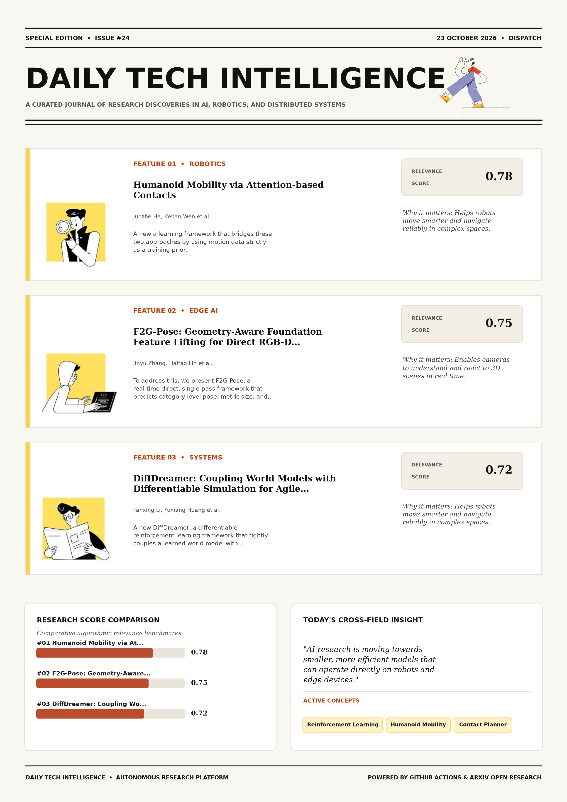

# Daily Tech Intelligence

## 23 October 2026

### Today's Overview

10 research papers analyzed.

Topics:

* Artificial Intelligence
* Computer Vision
* Machine Learning
* Natural Language Processing
* Robotics

### Visual Intelligence Templates

* **Template 3: Gen-Z Spotlight Broadside (Primary)**: [View High-Res](infographic_spotlight.png)
* **Template 2: Modern Tech Studio**: [View High-Res](infographic_modern.png)
* **Template 1: Editorial Research Journal**: [View High-Res](infographic_editorial.png)

---

## 1. Humanoid Mobility via Attention-based Contacts

Authors: Junzhe He, Kehan Wen, Chong Zhang, Clemens Schwarke, Zewei Zhang, Kaixian Qu, Siyuan Hu, Matthias Müller, Vladlen Koltun, Marco Hutter

Publication: 2026-10-22T17:37:36Z

Category: cs.RO

Relevance Score: 0.78

Paper: [arXiv:2610.31608](https://arxiv.org/abs/2610.31608v1) | [PDF](https://arxiv.org/pdf/2610.31608v1)

### Summary

Addressing critical demands in Robotics, this research investigates humanoid mobility over complex terrain requires accurate foot placement and coordinated whole-body motion capable of robust adaptation. We introduce a learning framework that bridges these two approaches by using motion data strictly as a training prior. In contrast, reference-based methods yield natural motions but struggle to adapt beyond the predefined trajectories in their training data. Operating entirely from onboard observations without any reference inputs at deployment, this framework enables versatile humanoid mobility in challenging environments. Humanoid mobility over complex terrain requires accurate foot placement and coordinated whole-body motion capable of robust adaptation.

### Key Concepts

* Reinforcement Learning
* Humanoid Mobility
* Contact Planner
* Coordinated Whole-body
* Tracker Subsequent
* Translates Plans

### Technical Insights

**Problem**

Addresses foundational constraints in Robotics and existing computational workflows.

**Approach**

We introduce a learning framework that bridges these two approaches by using motion data strictly as a training prior.

**Key Innovation**

Formulates an integrated mechanism leveraging Reinforcement Learning, Humanoid Mobility.

**Results**

Not specified in the available abstract.

**Applications**

Autonomous robotic manipulation, sim-to-real transfer, and agile mobile navigation systems.

**Limitations**

Not specified in the available abstract.

---

## 2. F2G-Pose: Geometry-Aware Foundation Feature Lifting for Direct RGB-D Category-Level Object Pose Estimation

Authors: Jinyu Zhang, Haitao Lin, Jiashu Hou, Xiangyang Xue, Yanwei Fu

Publication: 2026-10-22T17:43:34Z

Category: cs.CV

Relevance Score: 0.75

Paper: [arXiv:2610.31623](https://arxiv.org/abs/2610.31623v1) | [PDF](https://arxiv.org/pdf/2610.31623v1)

### Summary

Current solutions struggle to balance reliability and efficiency: methods based on intermediate structures are prone to error propagation, while diffusion models suffer from high inference latency and complex post-hoc candidate extraction. To address this, we present F2G-Pose, a real-time direct, single-pass framework that predicts category-level pose, metric size, and camera-frame completed shape from a single RGB-D observation in one feed-forward pass. With its task-specific network trained only on pose-annotated synthetic SOPE data and its frozen RADIO backbone externally pretrained, F2G-Pose achieves state-of-the-art accuracy on SOPE and ROPE while running at 28 FPS for pose-only inference, and further demonstrates strong camera-frame geometry on HouseCat6D and real-object transfer on HANDAL. The project page, code, and pretrained models are made available at https://jrryzh.github.io/F2G-Pose/.

### Key Concepts

* Manipulation
* Shape Completion
* Size Prediction
* Solutions Struggle
* Sope Rope
* Strong Camera-frame

### Technical Insights

**Problem**

Current solutions struggle to balance reliability and efficiency: methods based on intermediate structures are prone to error propagation, while diffusion models suffer from high inference latency and complex post-hoc candidate extraction.

**Approach**

To address this, we present F2G-Pose, a real-time direct, single-pass framework that predicts category-level pose, metric size, and camera-frame completed shape from a single RGB-D observation in one feed-forward pass.

**Key Innovation**

Formulates an integrated mechanism leveraging Manipulation, Shape Completion.

**Results**

With its task-specific network trained only on pose-annotated synthetic SOPE data and its frozen RADIO backbone externally pretrained, F2G-Pose achieves state-of-the-art accuracy on SOPE and ROPE while running at 28 FPS for pose-only inference, and further demonstrates strong camera-frame geometry on HouseCat6D and real-object transfer on HANDAL.

**Applications**

High-resolution real-time visual perception, automated 3D reconstruction, and embodied vision.

**Limitations**

Not specified in the available abstract.

---

## 3. DiffDreamer: Coupling World Models with Differentiable Simulation for Agile Quadrotor Control

Authors: Fanxing Li, Yuxiang Huang, Shengyang Wang, Fangyu Sun, Shuyu Wu, Tianbao Zhang, Dexin Zuo, Yan Yufei, Danping Zou, Wenxian Yu

Publication: 2026-10-22T17:41:13Z

Category: cs.RO

Relevance Score: 0.72

Paper: [arXiv:2610.31617](https://arxiv.org/abs/2610.31617v1) | [PDF](https://arxiv.org/pdf/2610.31617v1)

### Summary

Addressing critical demands in Machine Learning, this research investigates tasks such as quadrotor dynamic-gate racing require agents to anticipate external motion while maintaining precise high-frequency control. We propose DiffDreamer, a differentiable reinforcement learning framework that tightly couples a learned world model with differentiable simulation for actor optimization. We also provide proof-of-concept real-world flight experiments for validation. Tasks such as quadrotor dynamic-gate racing require agents to anticipate external motion while maintaining precise high-frequency control. World-model-based reinforcement learning provides a natural solution by learning latent dynamics for future imagination, yet it often entangles environmental evolution and the robot's own dynamics in a single learned rollout, where model bias can affect policy optimization efficiency.

### Key Concepts

* World Model
* Reinforcement Learning
* Ablations Provide
* Actor Objective
* Actor Optimization
* Affect Policy

### Technical Insights

**Problem**

Addresses foundational constraints in Machine Learning and existing computational workflows.

**Approach**

We propose DiffDreamer, a differentiable reinforcement learning framework that tightly couples a learned world model with differentiable simulation for actor optimization.

**Key Innovation**

Formulates an integrated mechanism leveraging World Model, Reinforcement Learning.

**Results**

Not specified in the available abstract.

**Applications**

Autonomous robotic manipulation, sim-to-real transfer, and agile mobile navigation systems.

**Limitations**

Not specified in the available abstract.

---

## 4. How Ground Truth Shapes Retrieval Scores: Evidence-Aware Evaluation of a Retrieval-Augmented Generation System for Breast Lesions

Authors: Miguel Mochizuki Silva, Samuel Ismael, Mateus C. Dias, Thaís Gaudêncio, Yuri Malheiros, Barufaldi

Publication: 2026-10-22T17:36:14Z

Category: cs.CL, cs.AI

Relevance Score: 0.72

Paper: [arXiv:2610.31606](https://arxiv.org/abs/2610.31606v1) | [PDF](https://arxiv.org/pdf/2610.31606v1)

### Summary

Addressing critical demands in Natural Language Processing, this research investigates purpose: to describe an evidence-aware retrieval evaluation protocol for a clinical retrieval-augmented generation (rag) system over breast lesion management literature, addressing the dependence of retrieval scores on annotation coverage. Methods: An 18-document corpus and an 18-query development benchmark, with one Yes/No or WH-question per document, were used. Retrieval combined dense embeddings, BM25, and cross-encoder reranking. The small development set and retrieval-informed curation require independent validation, including radiologist assessment of evidence sufficiency. Purpose: To describe an evidence-aware retrieval evaluation protocol for a clinical retrieval-augmented generation (RAG) system over breast lesion management literature, addressing the dependence of retrieval scores on annotation coverage.

### Key Concepts

* Retrieval-augmented Generation
* Retrieval Scores
* Cross-encoder Reranking
* Evidence Spans
* Mrr Ndcg
* Sensitivity Small Development

### Technical Insights

**Problem**

Addresses foundational constraints in Natural Language Processing and existing computational workflows.

**Approach**

Methods: An 18-document corpus and an 18-query development benchmark, with one Yes/No or WH-question per document, were used.

**Key Innovation**

Formulates an integrated mechanism leveraging Retrieval-augmented Generation, Retrieval Scores.

**Results**

Not specified in the available abstract.

**Applications**

Next-generation large language model workflows, retrieval-augmented intelligence, and structured document parsing.

**Limitations**

Not specified in the available abstract.

---

## 5. Would an LLM Match into a Residency? Uncertainty, Reasoning and Image Use of Open Language Models on the Spanish MIR Examination

Authors: Miguel Fernandez-de-Retana, Unai Zulaika, Ruben Sanchez-Corcuera, Aritz Bilbao-Jayo, Aitor Almeida

Publication: 2026-10-22T17:23:11Z

Category: cs.CL, cs.AI, cs.CY, cs.LG

Relevance Score: 0.71

Paper: [arXiv:2610.31586](https://arxiv.org/abs/2610.31586v1) | [PDF](https://arxiv.org/pdf/2610.31586v1)

### Summary

Abstention, however, never pays, because even their least confident answers are right more often than the 25% break-even. We examine these questions for four open models of 8 to 27 billion parameters on the Spanish MIR residency examination, scoring 1,552 questions from eight editions under the exam's own rules. Answering every question, the three larger models would rank among roughly the first 600 to 3,000 candidates, with 41 to 43 specialties still open to them. Moreover, 13-38% of correct answers rejected a distractor for a clinically unsound reason that confidence did not reflect, and removing or swapping the provided contextual images left accuracy unchanged.

### Key Concepts

* Abstention Pays
* Accuracy Improving
* Accuracy Medical
* Accuracy Unchanged
* Actually Uses
* Answering Question

### Technical Insights

**Problem**

Abstention, however, never pays, because even their least confident answers are right more often than the 25% break-even.

**Approach**

We examine these questions for four open models of 8 to 27 billion parameters on the Spanish MIR residency examination, scoring 1,552 questions from eight editions under the exam's own rules.

**Key Innovation**

Formulates an integrated mechanism leveraging Abstention Pays, Accuracy Improving.

**Results**

Not specified in the available abstract.

**Applications**

High-resolution real-time visual perception, automated 3D reconstruction, and embodied vision. Next-generation large language model workflows, retrieval-augmented intelligence, and structured document parsing.

**Limitations**

Not specified in the available abstract.

---

## 6. An Empirical Study of Recent Large Language Models for Knowledge Graph to Text Generation on Standard Benchmarks

Authors: Priyanka, Renaud Delbru, Souhail Bakkali, Mickaël Coustaty, Antoine Doucet

Publication: 2026-10-22T16:36:35Z

Category: cs.CL

Relevance Score: 0.71

Paper: [arXiv:2610.31529](https://arxiv.org/abs/2610.31529v1) | [PDF](https://arxiv.org/pdf/2610.31529v1)

### Summary

Addressing critical demands in Artificial Intelligence, this research investigates knowledge graph-to-text (kg-to-text) generation verbalizes a set of knowledge graph triples into fluent natural language. While fine-tuned encoder-decoder models have long been the standard approach, recent LLMs are becoming increasingly competitive. We benchmark recent LLMs against fine-tuned encoder-decoder models, using reference-based metrics and graph-grounded reference-free LLM-based evaluation validated against human annotations. Graph-grounded evaluation reveals that prompted models produce fewer contradictions and triple omissions than fine-tuned models, and these errors increase more rapidly with graph size for fine-tuned models, highlighting differences between the two approaches that reference-based metrics may not fully capture.

### Key Concepts

* Annotations Observed
* Approaches Capture
* Aspects Generation
* Better Graph-grounded
* Close Gap
* Contradictions Triple

### Technical Insights

**Problem**

Addresses foundational constraints in Artificial Intelligence and existing computational workflows.

**Approach**

While fine-tuned encoder-decoder models have long been the standard approach, recent LLMs are becoming increasingly competitive.

**Key Innovation**

Formulates an integrated mechanism leveraging Annotations Observed, Approaches Capture.

**Results**

Not specified in the available abstract.

**Applications**

Low-power edge AI devices, embedded IoT sensor networks, and distributed on-device inference. Next-generation large language model workflows, retrieval-augmented intelligence, and structured document parsing.

**Limitations**

Not specified in the available abstract.

---

## 7. OpenTac: An Open Ecosystem for Customizable, Scalable, and Transferable 3D Tactile Sensing

Authors: Ariel Slepyan, Geeta Chandra Raju Bethala, Jiafeng Gu, Anagha Rajendra Dangle, Yinzhe Zhou, Hongyuan Fu, Jade Sim, Tuhin Basu, Xinyi Yin, Md Faizal Karim, Gregory Hager, Homanga Bharadhwaj, Anand Bhattad, Krishna Murthy Jatavallabhula, Nitish V. Thakor

Publication: 2026-10-22T17:59:06Z

Category: cs.RO, eess.SP, eess.SY

Relevance Score: 0.71

Paper: [arXiv:2610.31661](https://arxiv.org/abs/2610.31661v1) | [PDF](https://arxiv.org/pdf/2610.31661v1)

### Summary

Addressing critical demands in Robotics, this research investigates we present opentac, a novel sensor and a full-stack ecosystem for tactile skins that are highly customizable, scalable, and readily deployed in downstream robot control and learning applications. We present OpenTac, a novel sensor and a full-stack ecosystem for tactile skins that are highly customizable, scalable, and readily deployed in downstream robot control and learning applications. We present OpenTac, a novel sensor and a full-stack ecosystem for tactile skins that are highly customizable, scalable, and readily deployed in downstream robot control and learning applications. First, we develop a scalable resistive tactile skin with a structured deformable overlay that converts tangential loading into spatially varying pressure. We demonstrate the broad applicability of the OpenTac-CAD sensor design tool by designing and fabricating more than 30 sensors across a variety of robot embodiments.

### Key Concepts

* Manipulation
* Broad Applicability
* Design Tool
* Highly Customizable
* Robot Embodiments
* Sensor Design

### Technical Insights

**Problem**

Addresses foundational constraints in Robotics and existing computational workflows.

**Approach**

We present OpenTac, a novel sensor and a full-stack ecosystem for tactile skins that are highly customizable, scalable, and readily deployed in downstream robot control and learning applications.

**Key Innovation**

We present OpenTac, a novel sensor and a full-stack ecosystem for tactile skins that are highly customizable, scalable, and readily deployed in downstream robot control and learning applications.

**Results**

Not specified in the available abstract.

**Applications**

Autonomous robotic manipulation, sim-to-real transfer, and agile mobile navigation systems.

**Limitations**

Not specified in the available abstract.

---

## 8. Dispersive Tree Agreements for Multi-Robot Coordination

Authors: Shashank A. Deshpande, Blake T. Edwards, Jonathan P. How

Publication: 2026-10-22T16:48:09Z

Category: cs.RO, cs.MA, math.OC

Relevance Score: 0.71

Paper: [arXiv:2610.31540](https://arxiv.org/abs/2610.31540v1) | [PDF](https://arxiv.org/pdf/2610.31540v1)

### Summary

Addressing critical demands in Robotics, this research investigates multi-robot coordination of nonlinear systems is naturally formulated as joint-space optimal control subject to constraints over groups of robots. Existing methods that approach joint optimality remain largely centralized, offline, and confined to collision-free motion planning, while decentralized, real-time counterparts target safe navigation without pursuing the joint optimum. In simulation, WarpWeaver reduces total travel time by up to 22% against centralized offline planners on the Dynobench suite and by up to 37% against a decentralized real-time baseline, and nearly doubles the success rate of a task-specific planner on graph connectivity. Hardware experiments on six robots planning onboard demonstrate real-world implementability.

### Key Concepts

* Centralized Offline
* Decentralized Real-time
* Dispersive Trees
* Joint Optimum
* Settles Agreement
* Shared Space

### Technical Insights

**Problem**

Addresses foundational constraints in Robotics and existing computational workflows.

**Approach**

Existing methods that approach joint optimality remain largely centralized, offline, and confined to collision-free motion planning, while decentralized, real-time counterparts target safe navigation without pursuing the joint optimum.

**Key Innovation**

Formulates an integrated mechanism leveraging Centralized Offline, Decentralized Real-time.

**Results**

In simulation, WarpWeaver reduces total travel time by up to 22% against centralized offline planners on the Dynobench suite and by up to 37% against a decentralized real-time baseline, and nearly doubles the success rate of a task-specific planner on graph connectivity.

**Applications**

Autonomous robotic manipulation, sim-to-real transfer, and agile mobile navigation systems.

**Limitations**

Multi-robot coordination of nonlinear systems is naturally formulated as joint-space optimal control subject to constraints over groups of robots.

---

## 9. Echo: Coupled Action and Task Status Signal Denoising for Vision Language Action Models

Authors: Yufeng Liu, Bohao Fan, Juntu Zhao, Xinyi Wang, Hang Yu, Wenzhuan Luo, Yingzhi Wang, Qinghai Li, Yingdong Hu, Junliang Guo, Richard Wang, Dequan Wang, Yang Gao, Cheng Ma

Publication: 2026-10-22T17:12:16Z

Category: cs.RO

Relevance Score: 0.71

Paper: [arXiv:2610.31569](https://arxiv.org/abs/2610.31569v1) | [PDF](https://arxiv.org/pdf/2610.31569v1)

### Summary

However, learning and integrating these signals can require fine-grained supervision, external monitoring models, or complex architectural designs. We present Echo, a framework that combines task status signal learning without frame-level progress annotations with a compact design for status prediction and action generation within a single VLA. Extensive real-world manipulation experiments show that Echo accurately predicts task status and consistently improves policy performance. Recognizing task completion and failure enables robots to stop upon success and initiate recovery or replanning after failure. Existing methods augment Vision Language Action (VLA) policies with task status signal prediction to support these execution decisions. Moreover, the potential of task status signals to directly guide action generation remains underexplored.

### Key Concepts

* Manipulation
* Status Signal
* Action Generation
* Completion Failure
* Progress Annotations
* Signal Prediction

### Technical Insights

**Problem**

However, learning and integrating these signals can require fine-grained supervision, external monitoring models, or complex architectural designs.

**Approach**

We present Echo, a framework that combines task status signal learning without frame-level progress annotations with a compact design for status prediction and action generation within a single VLA.

**Key Innovation**

Formulates an integrated mechanism leveraging Manipulation, Status Signal.

**Results**

Not specified in the available abstract.

**Applications**

Autonomous robotic manipulation, sim-to-real transfer, and agile mobile navigation systems. High-resolution real-time visual perception, automated 3D reconstruction, and embodied vision. Next-generation large language model workflows, retrieval-augmented intelligence, and structured document parsing.

**Limitations**

Not specified in the available abstract.

---

## 10. Same Luck, Different Choice: Twin-World Credit Assignment for Agentic Reinforcement Learning

Authors: Zeropy Surio, Tobias Engel, Mei-Lin Chou, Anika Raman, Samuel Okafor

Publication: 2026-10-22T16:51:27Z

Category: cs.LG

Relevance Score: 0.69

Paper: [arXiv:2610.31544](https://arxiv.org/abs/2610.31544v1) | [PDF](https://arxiv.org/pdf/2610.31544v1)

### Summary

Addressing critical demands in Artificial Intelligence, this research investigates agentic reinforcement learning rewards a complete episode, yet the policy needs credit for every decision inside it. We introduce TWICE (TWIn-world Credit Estimation), which keys the Gumbel noise of every token by turn and line, rolls out counterfactual twins that inherit the factual episode's downstream noise, and turns their paired outcome differences into turn-level advantages for policy-gradient updates on actor-sampled trajectories; only the actor is deployed. On seven question-answering benchmarks, TWICE improves the average exact match of GRPO by 5.3 and 4.5 points on Qwen2.5-3B and 7B, outperforms tree-search and counterfactual-branching baselines, and uses 68% fewer auxiliary tokens than VinePPO.

### Key Concepts

* Reinforcement Learning
* Twin-world Credit
* Factual Episode
* Sampling Noise
* Turns Paired Outcome
* Twice Improves

### Technical Insights

**Problem**

Addresses foundational constraints in Artificial Intelligence and existing computational workflows.

**Approach**

We introduce TWICE (TWIn-world Credit Estimation), which keys the Gumbel noise of every token by turn and line, rolls out counterfactual twins that inherit the factual episode's downstream noise, and turns their paired outcome differences into turn-level advantages for policy-gradient updates on actor-sampled trajectories; only the actor is deployed.

**Key Innovation**

Formulates an integrated mechanism leveraging Reinforcement Learning, Twin-world Credit.

**Results**

On seven question-answering benchmarks, TWICE improves the average exact match of GRPO by 5.3 and 4.5 points on Qwen2.5-3B and 7B, outperforms tree-search and counterfactual-branching baselines, and uses 68% fewer auxiliary tokens than VinePPO.

**Applications**

Autonomous agentic reasoning, multi-agent coordination, and decision-support platforms.

**Limitations**

Not specified in the available abstract.

---
