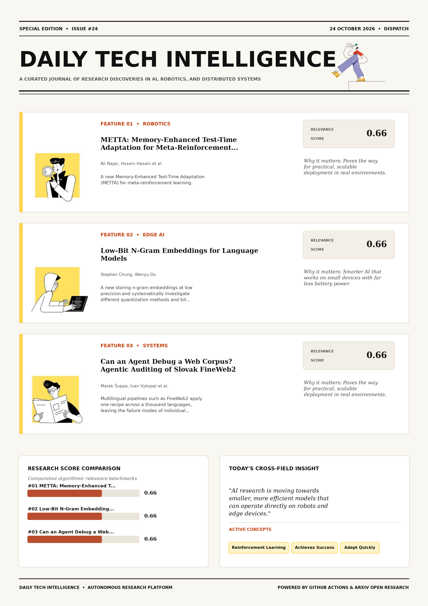

# Daily Tech Intelligence

## 24 October 2026

### Today's Overview

10 research papers analyzed.

Topics:

* Artificial Intelligence
* Computer Vision
* Machine Learning
* Natural Language Processing

### Visual Intelligence Templates

* **Template 3: Gen-Z Spotlight Broadside (Primary)**: [View High-Res](infographic_spotlight.png)
* **Template 2: Modern Tech Studio**: [View High-Res](infographic_modern.png)
* **Template 1: Editorial Research Journal**: [View High-Res](infographic_editorial.png)

---

## 1. METTA: Memory-Enhanced Test-Time Adaptation for Meta-Reinforcement Learning

Authors: Ali Najar, Hosein Hasani, Amir Kooshan Fattah, Yasamin Rajabi, Mahdieh Soleymani Baghshah

Publication: 2026-10-22T17:58:27Z

Category: cs.LG, cs.AI

Relevance Score: 0.66

Paper: [arXiv:2610.31656](https://arxiv.org/abs/2610.31656v1) | [PDF](https://arxiv.org/pdf/2610.31656v1)

### Summary

Addressing critical demands in Machine Learning, this research investigates meta-reinforcement learning aims to train agents that adapt quickly to unseen tasks from limited interaction, but this requires representing task evidence over long interaction histories. In this work, we propose Memory-Enhanced Test-Time Adaptation (METTA) for meta-reinforcement learning. On long-context sparse-reward PointMaze tasks, it outperforms transformer-based baselines by exhibiting more structured exploration behavior. These results show that METTA provides an efficient path toward more adaptive and scalable long-context meta-RL. Meta-reinforcement learning aims to train agents that adapt quickly to unseen tasks from limited interaction, but this requires representing task evidence over long interaction histories.

### Key Concepts

* Reinforcement Learning
* Achieves Success
* Adapt Quickly
* Adaptation Linear
* Adaptation Metta
* Adaptation Phase

### Technical Insights

**Problem**

Addresses foundational constraints in Machine Learning and existing computational workflows.

**Approach**

In this work, we propose Memory-Enhanced Test-Time Adaptation (METTA) for meta-reinforcement learning.

**Key Innovation**

Formulates an integrated mechanism leveraging Reinforcement Learning, Achieves Success.

**Results**

On long-context sparse-reward PointMaze tasks, it outperforms transformer-based baselines by exhibiting more structured exploration behavior.

**Applications**

Autonomous agentic reasoning, multi-agent coordination, and decision-support platforms.

**Limitations**

Not specified in the available abstract.

---

## 2. Low-Bit N-Gram Embeddings for Language Models

Authors: Stephen Chung, Wenyu Du

Publication: 2026-10-22T17:56:13Z

Category: cs.CL, cs.AI

Relevance Score: 0.66

Paper: [arXiv:2610.31646](https://arxiv.org/abs/2610.31646v1) | [PDF](https://arxiv.org/pdf/2610.31646v1)

### Summary

However, they can require substantial memory: DeepSeek-V4.1-Flash, for example, allocates 196 billion parameters to its Engram n-gram memory. We propose storing n-gram embeddings at low precision and systematically investigate different quantization methods and bit allocations across tables. These findings establish low-bit precision as a practical way to reduce the memory requirements of n-gram embeddings and use the saved capacity to improve model performance. Many recent open-weight language models use n-gram embedding tables to improve performance. These tables store learned representations of short token sequences, such as pairs or triples of consecutive tokens, which the model retrieves during processing. We therefore investigate whether this memory cost can be reduced while preserving the performance improvement that the tables provide.

### Key Concepts

* Quantization
* N-gram Embeddings
* Deepseek- Flash
* Table Memory
* Tables Improve
* Tables Provide

### Technical Insights

**Problem**

However, they can require substantial memory: DeepSeek-V4.1-Flash, for example, allocates 196 billion parameters to its Engram n-gram memory.

**Approach**

We propose storing n-gram embeddings at low precision and systematically investigate different quantization methods and bit allocations across tables.

**Key Innovation**

Formulates an integrated mechanism leveraging Quantization, N-gram Embeddings.

**Results**

Not specified in the available abstract.

**Applications**

Next-generation large language model workflows, retrieval-augmented intelligence, and structured document parsing.

**Limitations**

Not specified in the available abstract.

---

## 3. Can an Agent Debug a Web Corpus? Agentic Auditing of Slovak FineWeb2

Authors: Marek Šuppa, Ivan Vykopal, Jaroslav Kopčan

Publication: 2026-10-22T17:52:22Z

Category: cs.CL

Relevance Score: 0.66

Paper: [arXiv:2610.31636](https://arxiv.org/abs/2610.31636v1) | [PDF](https://arxiv.org/pdf/2610.31636v1)

### Summary

Addressing critical demands in Artificial Intelligence, this research investigates multilingual pipelines such as fineweb2 apply one recipe across a thousand languages, leaving the failure modes of individual languages unanticipated. We use an LLM once, as a corpus debugger rather than a classifier: a tool-using agent explores the corpus through a read-only, budgeted API and compiles each finding into an executable test, which a native speaker then validates. On the 26.5M-document Slovak portion of FineWeb2, three runs costing \2.21-\2.84 each found seven findings over four phenomena. We release the framework, Slovak test suite, validation data and agent trajectories. Multilingual pipelines such as FineWeb2 apply one recipe across a thousand languages, leaving the failure modes of individual languages unanticipated.

### Key Concepts

* Account Pipeline
* Agent Contributes
* Agent Explores
* Agent Run
* Agent Trajectories
* Api Compiles

### Technical Insights

**Problem**

Addresses foundational constraints in Artificial Intelligence and existing computational workflows.

**Approach**

We use an LLM once, as a corpus debugger rather than a classifier: a tool-using agent explores the corpus through a read-only, budgeted API and compiles each finding into an executable test, which a native speaker then validates.

**Key Innovation**

Formulates an integrated mechanism leveraging Account Pipeline, Agent Contributes.

**Results**

Not specified in the available abstract.

**Applications**

Next-generation large language model workflows, retrieval-augmented intelligence, and structured document parsing.

**Limitations**

Not specified in the available abstract.

---

## 4. PYTHIA, a transferable machine learning framework for simultaneous defect and adsorption site optimization

Authors: Ioannis Kouroudis, Zhaosu Gu, Poonam, Leon Muller, Alessio Gagliardi

Publication: 2026-10-22T16:46:46Z

Category: cs.LG

Relevance Score: 0.66

Paper: [arXiv:2610.31539](https://arxiv.org/abs/2610.31539v1) | [PDF](https://arxiv.org/pdf/2610.31539v1)

### Summary

Addressing critical demands in Machine Learning, this research investigates machine learning has permeated material optimization, providing high value. Nevertheless, its re- liance on a high number of samples limits its applicability to relatively explored material families. In this paper we extend the applicability of machine learning to novel and understudied materials through the PYTHIA (Probabilistic Yet Transferable Hierarchical Interaction Architecture) framework. Not only were we able to correctly and efficiently identify the optimal adsorption sites of even complex a Machine learning has permeated material optimization, providing high value. Pythia utilizes two of the most powerful machine learning concepts, foundational models and transfer learning.

### Key Concepts

* Machine Learning
* Able Correctly
* Add Uncertainty
* Adsorption Defect
* Adsorption Sites
* Alignment Use

### Technical Insights

**Problem**

Addresses foundational constraints in Machine Learning and existing computational workflows.

**Approach**

Nevertheless, its re- liance on a high number of samples limits its applicability to relatively explored material families.

**Key Innovation**

In this paper we extend the applicability of machine learning to novel and understudied materials through the PYTHIA (Probabilistic Yet Transferable Hierarchical Interaction Architecture) framework.

**Results**

Not specified in the available abstract.

**Applications**

Autonomous agentic reasoning, multi-agent coordination, and decision-support platforms.

**Limitations**

Not specified in the available abstract.

---

## 5. Sensorimotor Alignment: A Platonic Proxy for Embodied Policy Success

Authors: Yunfei Xie, Howard H. Qian, Shiyi Lan, Kaiyu Hang, Chen Wei

Publication: 2026-10-22T17:59:51Z

Category: cs.CV, cs.LG, cs.RO

Relevance Score: 0.64

Paper: [arXiv:2610.31670](https://arxiv.org/abs/2610.31670v1) | [PDF](https://arxiv.org/pdf/2610.31670v1)

### Summary

Robotic foundation models are typically evaluated through costly closed-loop rollouts, which motivates cheap offline proxies for model capability. To examine this, we propose Sensorimotor Alignment (S^2), a training-free offline metric that measures how well a model's sensory representation aligns with the geometry of physical motion. We ask whether motion trajectories form another such modality: as embodied models become more capable, should their sensory representations converge toward the structure of physical motion? With S^2, we extend PRH to embodied models and make sensorimotor alignment empirically measurable, offering insight into why an embodied model succeeds beyond its closed-loop success rate. The Platonic Representation Hypothesis (PRH) suggests that as representations improve, different modalities such as vision and language converge toward a shared statistical model of reality.

### Key Concepts

* Sensorimotor Alignment
* Alignment Empirically
* Alignment Training-free
* Ask Motion
* Backbones Costly
* Capability Platonic

### Technical Insights

**Problem**

Robotic foundation models are typically evaluated through costly closed-loop rollouts, which motivates cheap offline proxies for model capability.

**Approach**

To examine this, we propose Sensorimotor Alignment (S^2), a training-free offline metric that measures how well a model's sensory representation aligns with the geometry of physical motion.

**Key Innovation**

Formulates an integrated mechanism leveraging Sensorimotor Alignment, Alignment Empirically.

**Results**

Not specified in the available abstract.

**Applications**

Autonomous robotic manipulation, sim-to-real transfer, and agile mobile navigation systems. High-resolution real-time visual perception, automated 3D reconstruction, and embodied vision.

**Limitations**

Not specified in the available abstract.

---

## 6. CellTrack-Bench: Microscopic Cell Tracking Benchmark for Vision-Language Models

Authors: Ilan Theodoro, Jordão Bragantini, Loïc A. Royer

Publication: 2026-10-22T17:09:12Z

Category: cs.CV

Relevance Score: 0.64

Paper: [arXiv:2610.31566](https://arxiv.org/abs/2610.31566v1) | [PDF](https://arxiv.org/pdf/2610.31566v1)

### Summary

However, in these scenarios, their general-purpose accuracy compared with specialized algorithms remains in question. Recent efforts are shifting models' training to include scientific problems that often live in highly specialized domains beyond text, such as protein structure and biological images. Code, the stored model outputs, and a pipeline that regenerates the benchmark from the source datasets are available at https://github.com/royerlab/celltrack-bench. Large language models have shown outstanding performance on text-first tasks such as coding, math, and writing. One such domain is cell tracking, which requires spatiotemporal awareness of cell dynamics. To evaluate this, we created a new benchmark, CellTrack-Bench, which assesses Vision-Language Models' (VLMs) cell-tracking-related performance against specialized trackers.

### Key Concepts

* Accuracy Compared
* Algorithmic Trackers
* Assesses Vision-language
* Available Https
* Awareness Cell
* Benchmarked Frontier

### Technical Insights

**Problem**

However, in these scenarios, their general-purpose accuracy compared with specialized algorithms remains in question.

**Approach**

Recent efforts are shifting models' training to include scientific problems that often live in highly specialized domains beyond text, such as protein structure and biological images.

**Key Innovation**

Formulates an integrated mechanism leveraging Accuracy Compared, Algorithmic Trackers.

**Results**

Not specified in the available abstract.

**Applications**

High-resolution real-time visual perception, automated 3D reconstruction, and embodied vision. Next-generation large language model workflows, retrieval-augmented intelligence, and structured document parsing.

**Limitations**

Not specified in the available abstract.

---

## 7. Cost-Aware Abstention for LLM-Based IT Ticket Classification

Authors: Sachin Gupta

Publication: 2026-10-22T17:58:52Z

Category: cs.LG, cs.AI, cs.CL

Relevance Score: 0.64

Paper: [arXiv:2610.31657](https://arxiv.org/abs/2610.31657v1) | [PDF](https://arxiv.org/pdf/2610.31657v1)

### Summary

Addressing critical demands in Natural Language Processing, this research investigates wrong automatic routing of an it support ticket can cost more than human triage. We evaluate cost-aware abstention as an offline, cost-conditional readiness assessment: select a routing policy on calibration data under explicit costs, then evaluate that frozen policy once on held-out test data. On a public 47,837-ticket, eight-class corpus, we compare four trained non-LLM classifiers with four large language models under zero- and few-shot prompting. The findings are scoped to this dataset, prompt design, model endpoints, and illustrative costs; the work is an evaluation framework, not a new abstention algorithm or universal deployment certification.

### Key Concepts

* Correctness Auroc
* Held-out Test
* Threshold Selected Calibration
* Ticket Cost
* Ticket Eight-class
* Tickets Haiku Few-shot

### Technical Insights

**Problem**

Addresses foundational constraints in Natural Language Processing and existing computational workflows.

**Approach**

We evaluate cost-aware abstention as an offline, cost-conditional readiness assessment: select a routing policy on calibration data under explicit costs, then evaluate that frozen policy once on held-out test data.

**Key Innovation**

Formulates an integrated mechanism leveraging Correctness Auroc, Held-out Test.

**Results**

Not specified in the available abstract.

**Applications**

Next-generation large language model workflows, retrieval-augmented intelligence, and structured document parsing.

**Limitations**

Not specified in the available abstract.

---

## 8. OmniRay: Camera-Agnostic Monocular 3D Reconstruction with Composite Ray Fields

Authors: Namitha Guruprasad, Abhay Yadav, Cheng Peng, Rama Chellappa, Anand Bhattad

Publication: 2026-10-22T17:55:30Z

Category: cs.CV

Relevance Score: 0.64

Paper: [arXiv:2610.31645](https://arxiv.org/abs/2610.31645v1) | [PDF](https://arxiv.org/pdf/2610.31645v1)

### Summary

However, they represent different camera geometries using a single fixed basis to capture both the overall camera projection and its finer variations. We present OmniRay, a feed-forward model whose Ray Module is composed of three components: a monotone radial base that captures radially symmetric structure, a spherical-harmonic residual for smooth deviations from it, and a free-form residual for remaining local variation. Extensive experiments across different camera configurations demonstrate that OmniRay establishes a new state-of-the-art in camera-agnostic monocular 3D reconstruction. Monocular models recover 3D geometry from a single image in one pass, but most assume a pinhole camera and produce distorted geometry on the wide-angle imagery produced by fisheye and panoramic lenses.

### Key Concepts

* Point Cloud
* Accommodate Diverse
* Argue Camera
* Assume Pinhole
* Assumption Predicting
* Base Captures

### Technical Insights

**Problem**

However, they represent different camera geometries using a single fixed basis to capture both the overall camera projection and its finer variations.

**Approach**

We present OmniRay, a feed-forward model whose Ray Module is composed of three components: a monotone radial base that captures radially symmetric structure, a spherical-harmonic residual for smooth deviations from it, and a free-form residual for remaining local variation.

**Key Innovation**

Formulates an integrated mechanism leveraging Point Cloud, Accommodate Diverse.

**Results**

Not specified in the available abstract.

**Applications**

High-resolution real-time visual perception, automated 3D reconstruction, and embodied vision.

**Limitations**

Monocular models recover 3D geometry from a single image in one pass, but most assume a pinhole camera and produce distorted geometry on the wide-angle imagery produced by fisheye and panoramic lenses.

---

## 9. HiP3R: Hierarchical Pose Graphs for Long-Horizon 3D Reconstruction

Authors: Zunnan Xu, Shangchen Zhou, Yihang Luo, Chen Change Loy

Publication: 2026-10-22T17:51:10Z

Category: cs.CV

Relevance Score: 0.64

Paper: [arXiv:2610.31635](https://arxiv.org/abs/2610.31635v1) | [PDF](https://arxiv.org/pdf/2610.31635v1)

### Summary

However, computational and memory costs prevent direct inference on sequences containing thousands of frames. Our method applies to both chunk-based and streaming backends without additional training or fine-tuning. Long videos must therefore be processed as overlapping chunks. The codes are available at https://kkakkkka.github.io/HiP3R. Feed-forward models accurately estimate camera motion and 3D geometry from short video windows. This division produces independent local reconstructions with inconsistent coordinate frames and duplicate estimates of shared cameras. Achieving global consistency requires propagating constraints from adjacent overlaps and distant revisits across the sequence. This requirement naturally motivates pose graph optimization. However, the choice of graph level creates a trade-off.

### Key Concepts

* Pose Graph
* Estimates Shared
* Scaling Globally
* Sequence Requirement
* Sequences Containing
* Shared Cameras Achieving

### Technical Insights

**Problem**

However, computational and memory costs prevent direct inference on sequences containing thousands of frames.

**Approach**

Our method applies to both chunk-based and streaming backends without additional training or fine-tuning.

**Key Innovation**

Formulates an integrated mechanism leveraging Pose Graph, Estimates Shared.

**Results**

Not specified in the available abstract.

**Applications**

High-resolution real-time visual perception, automated 3D reconstruction, and embodied vision.

**Limitations**

Achieving global consistency requires propagating constraints from adjacent overlaps and distant revisits across the sequence.

---

## 10. On the Token Collapse Phenomenon in Textual Graph Soft Prompting

Authors: Andrea Giuseppe Di Francesco, Rishabh Jain, Franco Maria Nardini, Nicola Tonellotto, Pietro Liò, Fabrizio Silvestri

Publication: 2026-10-22T17:13:03Z

Category: cs.LG

Relevance Score: 0.63

Paper: [arXiv:2610.31572](https://arxiv.org/abs/2610.31572v1) | [PDF](https://arxiv.org/pdf/2610.31572v1)

### Summary

However, token variability alone does not prove that the model uses graph information: via interventions and decoding probes, we show that depending on the configuration, a token can reflect the question, an answer prior, or graph-derived content that the LLM may or may not use. G-Retriever combines graph soft prompts with a verbalized description of the same graph to strengthen the textual prompt signal. Moreover, a learned constant prompt that never accesses the graph matches or surpasses G-Retriever on all three benchmarks. Code to reproduce our experiments is available at https://github.com/difra100/Token_Collapse_KGQA. Recent methods for injecting graph structure into LLM prompts include graph soft prompting, in which a graph neural network (GNN) learns graph-specific tokens that capture relational information among entities in textual prompts.

### Key Concepts

* Graph Neural Network
* Graph Soft
* Token Collapse
* Strengthen Textual
* Structure LLM
* Subsequent Methods

### Technical Insights

**Problem**

However, token variability alone does not prove that the model uses graph information: via interventions and decoding probes, we show that depending on the configuration, a token can reflect the question, an answer prior, or graph-derived content that the LLM may or may not use.

**Approach**

G-Retriever combines graph soft prompts with a verbalized description of the same graph to strengthen the textual prompt signal.

**Key Innovation**

Formulates an integrated mechanism leveraging Graph Neural Network, Graph Soft.

**Results**

Moreover, a learned constant prompt that never accesses the graph matches or surpasses G-Retriever on all three benchmarks.

**Applications**

Next-generation large language model workflows, retrieval-augmented intelligence, and structured document parsing.

**Limitations**

Not specified in the available abstract.

---
