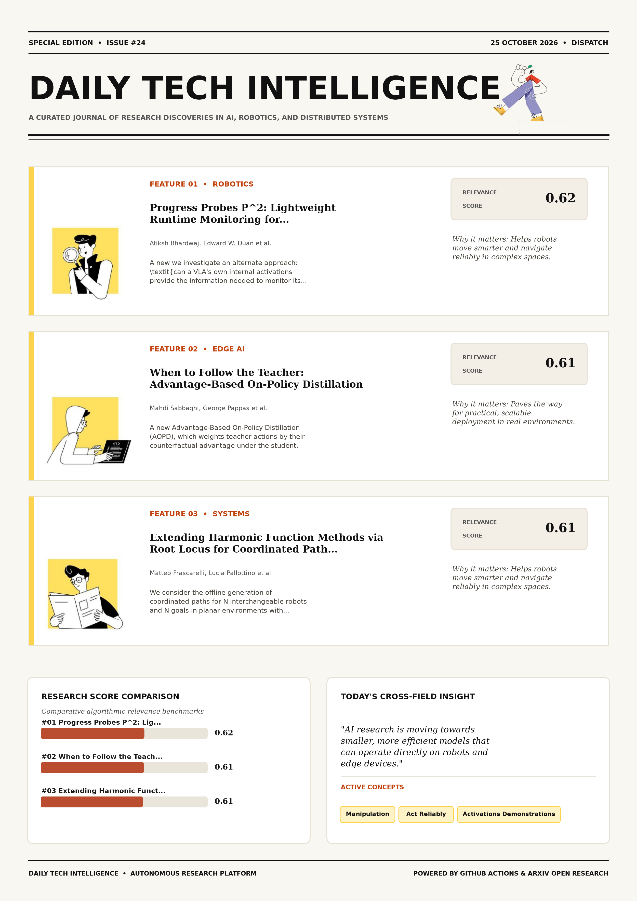

# Daily Tech Intelligence

## 25 October 2026

### Today's Overview

10 research papers analyzed.

Topics:

* Artificial Intelligence
* IoT & Edge AI
* Machine Learning
* Natural Language Processing
* Robotics

### Visual Intelligence Templates

* **Template 3: Gen-Z Spotlight Broadside (Primary)**: [View High-Res](infographic_spotlight.png)
* **Template 2: Modern Tech Studio**: [View High-Res](infographic_modern.png)
* **Template 1: Editorial Research Journal**: [View High-Res](infographic_editorial.png)

---

## 1. Progress Probes P^2: Lightweight Runtime Monitoring for Vision-Language-Action Models

Authors: Atiksh Bhardwaj, Edward W. Duan, Junwon Seo, Prithwish Dan, Wei-Chiu Ma, Andrea Bajscy, Preston Culbertson

Publication: 2026-10-22T17:40:19Z

Category: cs.RO

Relevance Score: 0.62

Paper: [arXiv:2610.31613](https://arxiv.org/abs/2610.31613v1) | [PDF](https://arxiv.org/pdf/2610.31613v1)

### Summary

Addressing critical demands in Robotics, this research investigates vision-language-action (vla) models can perform diverse manipulation tasks directly from visual observations and natural language instructions, but they remain prone to mistakes and unpredictable failures. In this work, we investigate an alternate approach: \textit{can a VLA's own internal activations provide the information needed to monitor its execution?} Our method trains linear probes on policy activations from demonstrations to estimate progress, then flags executions that deviate from expected progress. In experiments with the open-source VLA π_{0.5} and across simulated and real-world manipulation tasks, this approach is competitive with or outperforms VLM-based monitors in task failure detection, as well as methods which require failure data for training. These findings suggest that simple probes of VLA internals can be used to develop reliable runtime monitors, opening a path toward building policies that can act reliably and monitor their execution without external foundation models.

### Key Concepts

* Manipulation
* Act Reliably
* Activations Demonstrations
* Activations Provide
* Building Policies
* Complexity Computational

### Technical Insights

**Problem**

Addresses foundational constraints in Robotics and existing computational workflows.

**Approach**

In this work, we investigate an alternate approach: \textit{can a VLA's own internal activations provide the information needed to monitor its execution?} Our method trains linear probes on policy activations from demonstrations to estimate progress, then flags executions that deviate from expected progress.

**Key Innovation**

Formulates an integrated mechanism leveraging Manipulation, Act Reliably.

**Results**

In experiments with the open-source VLA π_{0.5} and across simulated and real-world manipulation tasks, this approach is competitive with or outperforms VLM-based monitors in task failure detection, as well as methods which require failure data for training.

**Applications**

Autonomous robotic manipulation, sim-to-real transfer, and agile mobile navigation systems. High-resolution real-time visual perception, automated 3D reconstruction, and embodied vision. Next-generation large language model workflows, retrieval-augmented intelligence, and structured document parsing.

**Limitations**

Existing monitors use external foundation models, such as vision-language models (VLMs) to supervise the policy, introducing significant complexity and computational cost for monitoring at runtime.

---

## 2. When to Follow the Teacher: Advantage-Based On-Policy Distillation

Authors: Mahdi Sabbaghi, George Pappas, Hamed Hassani, Adel Javanmard

Publication: 2026-10-22T17:05:21Z

Category: cs.LG, cs.AI, stat.ML

Relevance Score: 0.61

Paper: [arXiv:2610.31563](https://arxiv.org/abs/2610.31563v1) | [PDF](https://arxiv.org/pdf/2610.31563v1)

### Summary

However, standard OPD trains the student to follow the teacher at every state of the trajectory, assuming that teacher guidance is always beneficial. We introduce Advantage-Based On-Policy Distillation (AOPD), which weights teacher actions by their counterfactual advantage under the student. Online Policy Distillation (OPD) often outperforms offline methods such as Supervised Fine-Tuning (SFT) by training on trajectories sampled directly from the student. Experiments on math, coding, and Medqa show gains over distillation and RL baselines in both external-teacher and self-distillation settings. We instead distinguish between what the teacher prefers and what actually helps the current student succeed. Teacher actions that improve the student's expected outcome are reinforced, while those that do not are downweighted.

### Key Concepts

* Advantage-based On-policy
* Actions Counterfactual
* Actions Help
* Actions Improve
* Actions Provide
* Actions Step

### Technical Insights

**Problem**

However, standard OPD trains the student to follow the teacher at every state of the trajectory, assuming that teacher guidance is always beneficial.

**Approach**

We introduce Advantage-Based On-Policy Distillation (AOPD), which weights teacher actions by their counterfactual advantage under the student.

**Key Innovation**

Formulates an integrated mechanism leveraging Advantage-based On-policy, Actions Counterfactual.

**Results**

Online Policy Distillation (OPD) often outperforms offline methods such as Supervised Fine-Tuning (SFT) by training on trajectories sampled directly from the student.

**Applications**

Autonomous agentic reasoning, multi-agent coordination, and decision-support platforms.

**Limitations**

Not specified in the available abstract.

---

## 3. Extending Harmonic Function Methods via Root Locus for Coordinated Path Generation

Authors: Matteo Frascarelli, Lucia Pallottino, Alberto Landi

Publication: 2026-10-22T17:45:31Z

Category: cs.RO, eess.SY

Relevance Score: 0.61

Paper: [arXiv:2610.31625](https://arxiv.org/abs/2610.31625v1) | [PDF](https://arxiv.org/pdf/2610.31625v1)

### Summary

Addressing critical demands in Artificial Intelligence, this research investigates we consider the offline generation of coordinated paths for n interchangeable robots and n goals in planar environments with polygonal obstacles. After a conformal map to a circular domain, starts and goals become the poles and zeros of a rational function R, and the paths are the branches of its Generalized Root Locus (GRL), i.e. the streamlines of the logarithmic potential -log R. We show that, for every phase outside a finite set of critical phases and a set of boundary phases, the induced gradient motion drives each robot to a distinct goal along pairwise disjoint paths that never reach the obstacles; the robot-goal assignment is produced by the construction, and with the gain used as a clock all robots move as the closed-loop roots of the GRL and arrive together at a prescribed time. The method is illustrated on two polygonal workspaces, 100 random instances compared with independent harmonic planning and artificial potentials, and a scene with ten robots and ten obstacles.

### Key Concepts

* Actually Computed
* Arrive Prescribed
* Artificial Potentials
* Assignment Produced
* Boundary Phases
* Branches Generalized

### Technical Insights

**Problem**

Addresses foundational constraints in Artificial Intelligence and existing computational workflows.

**Approach**

After a conformal map to a circular domain, starts and goals become the poles and zeros of a rational function R, and the paths are the branches of its Generalized Root Locus (GRL), i.e. the streamlines of the logarithmic potential -log R.

**Key Innovation**

Formulates an integrated mechanism leveraging Actually Computed, Arrive Prescribed.

**Results**

Not specified in the available abstract.

**Applications**

Autonomous robotic manipulation, sim-to-real transfer, and agile mobile navigation systems.

**Limitations**

Not specified in the available abstract.

---

## 4. BrickWright: Agentic Creation of Physically Feasible Brick Builds

Authors: Ava Pun, Kevin Dai, Sally Chen, Maxwell Jones, Ruixuan Liu, Kangle Deng, Changliu Liu, Maneesh Agrawala, Deva Ramanan, Jun-Yan Zhu

Publication: 2026-10-22T17:57:20Z

Category: cs.CV

Relevance Score: 0.58

Paper: [arXiv:2610.31651](https://arxiv.org/abs/2610.31651v1) | [PDF](https://arxiv.org/pdf/2610.31651v1)

### Summary

Addressing critical demands in Artificial Intelligence, this research investigates frontier coding agents are becoming increasingly adept at 3d modeling. Focusing on the domain of LEGO brick builds, we present BrickWright, a framework for generating physically feasible brick builds from text or image prompts using pre-trained agents, where a build is physically feasible if it uses only real parts, has no colliding or floating parts, and forms a connected structure if possible. We argue that providing agents with tools for assembling builds and verifying their physical feasibility is sufficient for them to produce physically valid assemblies that still adhere to input prompts. Code is available on our project page: https://avalovelace1.github.io/brickwright/

### Key Concepts

* Brick Builds
* Physically Feasible
* Physical Feasibility
* Structure Possible Brickwright
* Sufficient Produce
* Toolkit Main

### Technical Insights

**Problem**

Addresses foundational constraints in Artificial Intelligence and existing computational workflows.

**Approach**

Focusing on the domain of LEGO brick builds, we present BrickWright, a framework for generating physically feasible brick builds from text or image prompts using pre-trained agents, where a build is physically feasible if it uses only real parts, has no colliding or floating parts, and forms a connected structure if possible.

**Key Innovation**

Formulates an integrated mechanism leveraging Brick Builds, Physically Feasible.

**Results**

Not specified in the available abstract.

**Applications**

High-resolution real-time visual perception, automated 3D reconstruction, and embodied vision.

**Limitations**

Not specified in the available abstract.

---

## 5. WorldForge V2: Eliciting Camera-Trajectory Alignment in Video Diffusion Models

Authors: Chenxi Song, Yanming Yang, Tong Zhao, Ruibo Li, Joey Tianyi Zhou, Chi Zhang

Publication: 2026-10-22T17:53:03Z

Category: cs.CV

Relevance Score: 0.58

Paper: [arXiv:2610.31640](https://arxiv.org/abs/2610.31640v1) | [PDF](https://arxiv.org/pdf/2610.31640v1)

### Summary

However, their use in spatial tasks is limited by imprecise camera control, spatial and temporal inconsistencies, and entangled camera motion with scene dynamics. We propose WorldForge V2 to achieve accurate camera control while preserving the generative capabilities of pretrained video models. Quantitative and qualitative evaluations across multiple datasets show that our method achieves state-of-the-art generation quality and trajectory accuracy in camera-controlled video generation. Video diffusion models have learned rich 3D/4D priors, making them promising for scene generation and video re-rendering. Existing approaches, such as task-specific fine-tuning and post-process warping, often introduce visual artifacts, generalize poorly, or incur high computational costs.

### Key Concepts

* Camera Control
* Latent Channels
* Training-free Guidance
* Trajectory Accuracy
* Trajectory Guidance
* Trajectory Lora Concentrates

### Technical Insights

**Problem**

However, their use in spatial tasks is limited by imprecise camera control, spatial and temporal inconsistencies, and entangled camera motion with scene dynamics.

**Approach**

We propose WorldForge V2 to achieve accurate camera control while preserving the generative capabilities of pretrained video models.

**Key Innovation**

Formulates an integrated mechanism leveraging Camera Control, Latent Channels.

**Results**

Quantitative and qualitative evaluations across multiple datasets show that our method achieves state-of-the-art generation quality and trajectory accuracy in camera-controlled video generation.

**Applications**

High-resolution real-time visual perception, automated 3D reconstruction, and embodied vision.

**Limitations**

Not specified in the available abstract.

---

## 6. BeNice! Closing Looping's Inference-Memory Gap via KV-Sharing

Authors: Hayden Prairie, Jacob M. Ryan, Taylor Berg-Kirkpatrick, Daniel Y. Fu

Publication: 2026-10-22T17:49:44Z

Category: cs.LG

Relevance Score: 0.58

Paper: [arXiv:2610.31633](https://arxiv.org/abs/2610.31633v1) | [PDF](https://arxiv.org/pdf/2610.31633v1)

### Summary

To address this challenge, prior work has proposed KV-sharing (i.e., sharing KV-caches across depth), finding that, in some cases, the KV-cache of the final recurrence can be shared with the earlier recurrences without quality loss, a property we denote as KV-shareability. We propose a two-stage method: in the first stage, we use stochastic depth during pretraining, which induces contractive residual dynamics that drive representations toward a common limit across recurrences. Finally, in simulated low-memory, long-context inference, KV-sharing improves cache hit rates by up to 31.4%, increases throughput by up to 23.6%, and reduces p90 time-to-first-token by up to 83.6%. Looped architectures scale quality while keeping parameter count fixed by repeatedly passing activations through the same block of layers.

### Key Concepts

* Quantization
* Final Recurrence
* Looped Architectures
* Result Benice Enables
* Sequence Mixers
* Shared Earlier Recurrences

### Technical Insights

**Problem**

To address this challenge, prior work has proposed KV-sharing (i.e., sharing KV-caches across depth), finding that, in some cases, the KV-cache of the final recurrence can be shared with the earlier recurrences without quality loss, a property we denote as KV-shareability.

**Approach**

We propose a two-stage method: in the first stage, we use stochastic depth during pretraining, which induces contractive residual dynamics that drive representations toward a common limit across recurrences.

**Key Innovation**

Formulates an integrated mechanism leveraging Quantization, Final Recurrence.

**Results**

Finally, in simulated low-memory, long-context inference, KV-sharing improves cache hit rates by up to 31.4%, increases throughput by up to 23.6%, and reduces p90 time-to-first-token by up to 83.6%.

**Applications**

Low-power edge AI devices, embedded IoT sensor networks, and distributed on-device inference.

**Limitations**

Not specified in the available abstract.

---

## 7. EpiSEM-Bench: Evaluating Safety and Evidence Recovery in LLM Agents under Missing Evidence

Authors: Qijin Zhang, Hanzhen Wang, Yuehan Zhao, Haoyu Dai, Yao Shu, Zhongxiang Dai, Shuang Qiu

Publication: 2026-10-22T17:57:04Z

Category: cs.AI, cs.LG

Relevance Score: 0.58

Paper: [arXiv:2610.31650](https://arxiv.org/abs/2610.31650v1) | [PDF](https://arxiv.org/pdf/2610.31650v1)

### Summary

Addressing critical demands in Natural Language Processing, this research investigates tool-using language model agents rely on environmental facts to decide whether an action is permitted. We introduce \bench{}, an executable benchmark for evaluating unsafe execution, safety boundaries, and evidence recovery in LLM agents under missing evidence. Recovery access reduces unsafe execution for all ten models, but agents differ in whether they actively obtain the missing facts and use them to act appropriately in both worlds. Tool-using language model agents rely on environmental facts to decide whether an action is permitted. When a tool response omits a safety-relevant fact, an agent may carry out a prohibited action even though the user request is benign and every returned statement is true.

### Key Concepts

* Missing Evidence
* Access Reduces
* Acquisition Appropriate
* Act Appropriately
* Action Permitted
* Action Resistance

### Technical Insights

**Problem**

Addresses foundational constraints in Natural Language Processing and existing computational workflows.

**Approach**

We introduce \bench{}, an executable benchmark for evaluating unsafe execution, safety boundaries, and evidence recovery in LLM agents under missing evidence.

**Key Innovation**

Formulates an integrated mechanism leveraging Missing Evidence, Access Reduces.

**Results**

Not specified in the available abstract.

**Applications**

Next-generation large language model workflows, retrieval-augmented intelligence, and structured document parsing.

**Limitations**

Not specified in the available abstract.

---

## 8. Direct Pass@k Optimization for Thought Pruning: Balancing Quality and Diversity in Test-Time Reasoning

Authors: Mahdi Salmani, Adel Javanmard, Devansh Gupta, Meisam Razaviyayn

Publication: 2026-10-22T17:59:48Z

Category: cs.AI, cs.CL

Relevance Score: 0.56

Paper: [arXiv:2610.31667](https://arxiv.org/abs/2610.31667v1) | [PDF](https://arxiv.org/pdf/2610.31667v1)

### Summary

Addressing critical demands in Artificial Intelligence, this research investigates test-time scaling has emerged as a key inference strategy for reasoning models, where a model generates a large number of candidate solutions in the hope of finding at least one correct solution. In this paper, we introduce a pruning procedure that addresses this trade-off directly by optimizing pass@k over the selected solution pool. On eight open-weight reasoning models, our method outperforms existing quality-based and diversity-based pruning strategies. The gains are particularly pronounced when the pruning procedure keeps a moderate number of partial solutions for continued generation, highlighting the value of directly balancing quality and diversity during pruning.

### Key Concepts

* Pruning
* Candidate Solutions
* Partial Solutions
* Quality Diversity
* Solutions Continued
* Solutions Tension Objectives

### Technical Insights

**Problem**

Addresses foundational constraints in Artificial Intelligence and existing computational workflows.

**Approach**

In this paper, we introduce a pruning procedure that addresses this trade-off directly by optimizing pass@k over the selected solution pool.

**Key Innovation**

Formulates an integrated mechanism leveraging Pruning, Candidate Solutions.

**Results**

On eight open-weight reasoning models, our method outperforms existing quality-based and diversity-based pruning strategies.

**Applications**

Next-generation large language model workflows, retrieval-augmented intelligence, and structured document parsing.

**Limitations**

The tension between these two objectives is an instance of exploration versus exploitation, yet little to no prior work on pruning exposes this trade-off directly, let alone optimizes it.

---

## 9. A Fix for Softmax and Cross-Entropy

Authors: Jonathan T. Barron, Dan Gnanapragasam, Michael Tschannen

Publication: 2026-10-22T17:54:56Z

Category: cs.LG

Relevance Score: 0.56

Paper: [arXiv:2610.31642](https://arxiv.org/abs/2610.31642v1) | [PDF](https://arxiv.org/pdf/2610.31642v1)

### Summary

Addressing critical demands in Machine Learning, this research investigates standard implementations of softmax, log-softmax, and cross-entropy have two numerical bugs. We present simple implementations of log-softmax, softmax, and cross-entropy that fix both bugs. The second bug, Softmax Cancellation, occurs when student logits are close to teacher logits, and produces non-zero gradients even when the student and teacher logits are equal. Our fix eliminates the previously-observed "Slingshot" phenomenon, speeds up grokking with weight decay, prevents accuracy collapse without weight decay, stops student networks from drifting away from the teacher during distillation, and shows that after memorization, logit growth is bounded by an equilibrium between weight decay and Adam's ε hyperparameter.

### Key Concepts

* Accuracy Collapse
* Adam Hyperparameter
* Away Teacher
* Bounded Equilibrium
* Bug Softmax
* Bugs Bug

### Technical Insights

**Problem**

Addresses foundational constraints in Machine Learning and existing computational workflows.

**Approach**

We present simple implementations of log-softmax, softmax, and cross-entropy that fix both bugs.

**Key Innovation**

Formulates an integrated mechanism leveraging Accuracy Collapse, Adam Hyperparameter.

**Results**

Not specified in the available abstract.

**Applications**

Autonomous agentic reasoning, multi-agent coordination, and decision-support platforms.

**Limitations**

Not specified in the available abstract.

---

## 10. Causal Chain of Thought: Mitigating Attention Leakage via Context Isolation

Authors: Gabriele Dominici, Teague McMillan, Fazl Barez, Marc Langheinrich, Martin Gjoreski

Publication: 2026-10-22T17:52:56Z

Category: cs.LG, cs.AI

Relevance Score: 0.56

Paper: [arXiv:2610.31639](https://arxiv.org/abs/2610.31639v1) | [PDF](https://arxiv.org/pdf/2610.31639v1)

### Summary

Addressing critical demands in Artificial Intelligence, this research investigates chain-of-thought (cot) prompting elicits step-by-step rationales that appear to explain model predictions, but there is no guarantee these steps causally drive the final answer. We introduce CausalCoT, an inference framework that enforces causal transparency by decomposing problems into a directed acyclic graph of atomic sub-questions, evaluating each node in an isolated context containing only its direct causal parents. Across a diverse suite of reasoning benchmarks, CausalCoT preserves competitive predictive performance while improving explanation faithfulness, increasing causal sensitivity of intermediate reasoning steps by an average of 12 and up to 21 percentage points over the strongest baseline. The structured dependency graph additionally enables test-time interventions in which local corrections propagate predictably through downstream reasoning.

### Key Concepts

* Acyclic Graph
* Additionally Enables
* Answer Standard
* Answers Direct
* Appear Explain
* Atomic Sub-questions

### Technical Insights

**Problem**

Addresses foundational constraints in Artificial Intelligence and existing computational workflows.

**Approach**

We introduce CausalCoT, an inference framework that enforces causal transparency by decomposing problems into a directed acyclic graph of atomic sub-questions, evaluating each node in an isolated context containing only its direct causal parents.

**Key Innovation**

Formulates an integrated mechanism leveraging Acyclic Graph, Additionally Enables.

**Results**

Across a diverse suite of reasoning benchmarks, CausalCoT preserves competitive predictive performance while improving explanation faithfulness, increasing causal sensitivity of intermediate reasoning steps by an average of 12 and up to 21 percentage points over the strongest baseline.

**Applications**

Autonomous agentic reasoning, multi-agent coordination, and decision-support platforms.

**Limitations**

Not specified in the available abstract.

---
