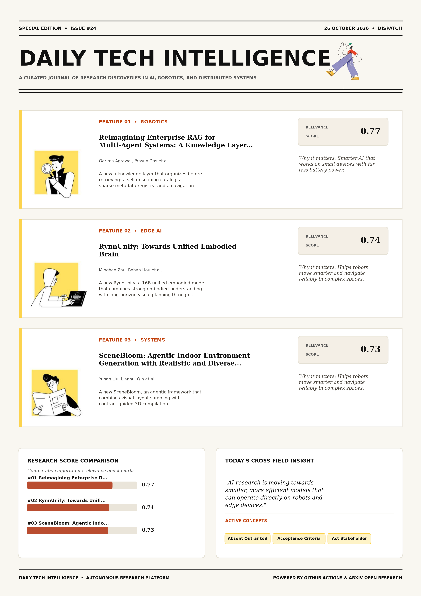

# Daily Tech Intelligence

## 26 October 2026

### Today's Overview

10 research papers analyzed.

Topics:

* Artificial Intelligence
* Machine Learning
* Natural Language Processing
* Robotics

### Visual Intelligence Templates

* **Template 3: Gen-Z Spotlight Broadside (Primary)**: [View High-Res](infographic_spotlight.png)
* **Template 2: Modern Tech Studio**: [View High-Res](infographic_modern.png)
* **Template 1: Editorial Research Journal**: [View High-Res](infographic_editorial.png)

---

## 1. Reimagining Enterprise RAG for Multi-Agent Systems: A Knowledge Layer That Organizes Before It Retrieves

Authors: Garima Agrawal, Prasun Das, Akshay Sarvade, Priyanka L, Minisha N, Sravani Joshna, Hemath Manivannan, Lavanya Korada, Sambhrit Pattanayak, Srashti Gupta, Siddu R, Prasad Kalyanasundaram

Publication: 2026-10-23T16:21:56Z

Category: cs.AI

Relevance Score: 0.77

Paper: [arXiv:2610.32851](https://arxiv.org/abs/2610.32851v1) | [PDF](https://arxiv.org/pdf/2610.32851v1)

### Summary

Addressing critical demands in Artificial Intelligence, this research investigates enterprises are deploying agentic ai across the software development lifecycle, and they need the behavioral logic of the systems they act on, not stakeholder documentation. We present a knowledge layer that organizes before retrieving: a self-describing catalog, a sparse metadata registry, and a navigation hypergraph defined over artifacts rather than extracted entities. Recovery does not confer usability. It supported root-cause analysis and resolution of 100+ production defects with developer verification and attributed 35 release regression failures to specific rules and services. Enterprises are deploying agentic AI across the software development lifecycle, and they need the behavioral logic of the systems they act on, not stakeholder documentation.

### Key Concepts

* Absent Outranked
* Acceptance Criteria
* Act Stakeholder
* Activation Recur
* Agentic Software
* Analysts Supported

### Technical Insights

**Problem**

Addresses foundational constraints in Artificial Intelligence and existing computational workflows.

**Approach**

We present a knowledge layer that organizes before retrieving: a self-describing catalog, a sparse metadata registry, and a navigation hypergraph defined over artifacts rather than extracted entities.

**Key Innovation**

Formulates an integrated mechanism leveraging Absent Outranked, Acceptance Criteria.

**Results**

Not specified in the available abstract.

**Applications**

Low-power edge AI devices, embedded IoT sensor networks, and distributed on-device inference.

**Limitations**

Not specified in the available abstract.

---

## 2. RynnUnify: Towards Unified Embodied Brain

Authors: Minghao Zhu, Bohan Hou, Kun Xiang, Zixuan Wang, Yinzhou Tang, Yifei Yang, Zhikai Wang, Tianyi Zhang, Kehan Li, Haoyu Zhao, Siteng Huang, Leigang Qu, Sicong Leng, Dongchi Huang, Mingxiu Chen, Shijian Lu, Yue Wang, Xiaodan Liang, Zhenyu Zeng, Deli Zhao, Chengju Liu, Jianfei Yang, Xin Li

Publication: 2026-10-23T17:54:07Z

Category: cs.RO

Relevance Score: 0.74

Paper: [arXiv:2610.32965](https://arxiv.org/abs/2610.32965v1) | [PDF](https://arxiv.org/pdf/2610.32965v1)

### Summary

Addressing critical demands in Artificial Intelligence, this research investigates we introduce rynnunify, a 16b unified embodied model that combines strong embodied understanding with long-horizon visual planning through interleaved video--language reasoning. We introduce RynnUnify, a 16B unified embodied model that combines strong embodied understanding with long-horizon visual planning through interleaved video--language reasoning. Building on these capabilities, we further develop an agentic extension through reinforcement learning to selectively use video predictions for reasoning about unobserved states and interaction outcomes. Together, these results establish RynnUnify as a shared foundation for embodied understanding, visual planning, and robot control, taking a step toward a unified embodied brain.

### Key Concepts

* Reinforcement Learning
* Unified Embodied
* Achieves Highest
* Achieves Success
* Agentic Extension
* Anticipation Evolves Successive

### Technical Insights

**Problem**

Addresses foundational constraints in Artificial Intelligence and existing computational workflows.

**Approach**

We introduce RynnUnify, a 16B unified embodied model that combines strong embodied understanding with long-horizon visual planning through interleaved video--language reasoning.

**Key Innovation**

Formulates an integrated mechanism leveraging Reinforcement Learning, Unified Embodied.

**Results**

Not specified in the available abstract.

**Applications**

Autonomous robotic manipulation, sim-to-real transfer, and agile mobile navigation systems.

**Limitations**

Not specified in the available abstract.

---

## 3. SceneBloom: Agentic Indoor Environment Generation with Realistic and Diverse Layouts for Embodied Learning

Authors: Yuhan Liu, Lianhui Qin, Shenji Wan

Publication: 2026-10-23T17:59:21Z

Category: cs.CV, cs.AI, cs.RO

Relevance Score: 0.73

Paper: [arXiv:2610.32978](https://arxiv.org/abs/2610.32978v1) | [PDF](https://arxiv.org/pdf/2610.32978v1)

### Summary

Language-guided methods support semantic planning and object-level reasoning, but precise spatial grounding remains difficult. We introduce SceneBloom, an agentic framework that combines visual layout sampling with contract-guided 3D compilation. Visual generative models offer rich priors over plausible arrangements, yet their outputs require geometric reasoning to become physically valid 3D scenes. Code is available at https://github.com/Tinaliu0123/scenebloom. Training generalizable embodied agents requires realistic, varied, and simulation-ready indoor environments. A hierarchical sampler uses diffusion priors to generate furniture arrangements within functional zones. A compiler then uses relations extracted from each proposal to guide geometric fitting and local pose correction. Across five room types, SceneBloom attains the highest visual quality and physical stability among the compared methods and is the only method with no detected mesh collisions and out-of-bounds objects.

### Key Concepts

* Achieve Higher
* Arrangements Functional
* Arrangements Outputs
* Attains Highest
* Available Https
* Baselines Object

### Technical Insights

**Problem**

Language-guided methods support semantic planning and object-level reasoning, but precise spatial grounding remains difficult.

**Approach**

We introduce SceneBloom, an agentic framework that combines visual layout sampling with contract-guided 3D compilation.

**Key Innovation**

Formulates an integrated mechanism leveraging Achieve Higher, Arrangements Functional.

**Results**

Not specified in the available abstract.

**Applications**

Autonomous robotic manipulation, sim-to-real transfer, and agile mobile navigation systems. High-resolution real-time visual perception, automated 3D reconstruction, and embodied vision.

**Limitations**

Not specified in the available abstract.

---

## 4. Multimodal Generative AI Assists Comprehensive Echocardiographic Interpretation

Authors: Yi Qin, Marawan Elbatel, Shanshan Song, Taoran Huang, Jiarong Guo, Ningshu Li, Lehan Wang, Chenxu Zhao, Jiexin He, Machteld J. Boonstra, Stephan van der Zwaard, Marielle C. van de Veerdonk, Pere Lopez-Gutierrez, Lydia Dux-Santoy, Andrea Guala, Enrique Almar-Munoz, Sebastian Johannes Reinstadler, Radek Debiec, Yi-Hang Zhu, Huiyu Zhou, Adrian P Cheong, Yike Guo, Agnes Mayr, Karim Lekadir, Yong Jiang, Nilesh J. Samani, Dacheng Tao, Folkert W. Asselbergs, Hongwen Fei, Alex PW Lee, Xiaomeng Li

Publication: 2026-10-23T16:47:01Z

Category: cs.CV

Relevance Score: 0.70

Paper: [arXiv:2610.32880](https://arxiv.org/abs/2610.32880v1) | [PDF](https://arxiv.org/pdf/2610.32880v1)

### Summary

Addressing critical demands in Artificial Intelligence, this research investigates echocardiography is the cornerstone of cardiovascular diagnostics, yet its global utility is constrained by a critical shortage of experienced interpreters. Here we introduce EchoChat, a generative multimodal vision-language model that performs comprehensive echocardiographic analysis to support clinician interpretation. It surpasses existing best-performing foundation models in cardiac condition recognition (improving average recall by 13.54% on shared tasks) and quantification (average R2 score increase of 0.275 on shared tasks). These results demonstrate that integrating clinical reasoning into multimodal AI can democratize specialist expertise and transform the standard of cardiovascular care. Echocardiography is the cornerstone of cardiovascular diagnostics, yet its global utility is constrained by a critical shortage of experienced interpreters.

### Key Concepts

* Artificial Intelligence
* Available External
* Support Clinician
* Supports Broadest
* Terms Score

### Technical Insights

**Problem**

Addresses foundational constraints in Artificial Intelligence and existing computational workflows.

**Approach**

Here we introduce EchoChat, a generative multimodal vision-language model that performs comprehensive echocardiographic analysis to support clinician interpretation.

**Key Innovation**

Formulates an integrated mechanism leveraging Artificial Intelligence, Available External.

**Results**

It surpasses existing best-performing foundation models in cardiac condition recognition (improving average recall by 13.54% on shared tasks) and quantification (average R2 score increase of 0.275 on shared tasks).

**Applications**

High-resolution real-time visual perception, automated 3D reconstruction, and embodied vision.

**Limitations**

Not specified in the available abstract.

---

## 5. DexPort: A Hand-Held Skill Interface for Dexterous Hand Data Collection

Authors: Amber Xie, Jiawei Fu, Xiaofeng Guo, Carmelo Sferrazza, Guanya Shi, Haozhi Qi

Publication: 2026-10-23T17:56:28Z

Category: cs.RO, cs.AI, cs.LG

Relevance Score: 0.69

Paper: [arXiv:2610.32969](https://arxiv.org/abs/2610.32969v1) | [PDF](https://arxiv.org/pdf/2610.32969v1)

### Summary

Collecting high-quality demonstrations remains a central bottleneck for learning dexterous manipulation. In this paper, we introduce DexPort, a portable data-collection interface for high-DoF robot hands. Human demonstrations are easier to collect, but their motions must be estimated and retargeted to the robot, and they do not directly provide robot actions. Across our tasks, we see an improvement from 11% to 64% when using recorded robot commands instead of states, and an improvement from 36% to 78% for task success when using in-the-wild data. Teleoperation records executable robot actions, but it requires a complete robot setup and places the burden of coordinating many finger joints on the operator.

### Key Concepts

* Dexterous Manipulation
* Manipulation
* Avoiding Hand Embodiment
* Behavior Cloning
* Behaviors Precise
* Bimanual Scanning

### Technical Insights

**Problem**

Collecting high-quality demonstrations remains a central bottleneck for learning dexterous manipulation.

**Approach**

In this paper, we introduce DexPort, a portable data-collection interface for high-DoF robot hands.

**Key Innovation**

Formulates an integrated mechanism leveraging Dexterous Manipulation, Manipulation.

**Results**

Not specified in the available abstract.

**Applications**

Autonomous robotic manipulation, sim-to-real transfer, and agile mobile navigation systems.

**Limitations**

Not specified in the available abstract.

---

## 6. RobustRLlib: A Unified Library and Benchmark for Robust Reinforcement Learning Algorithms

Authors: Xi Chen, Fengqi Hu, Zeyu Shen, Jiaying Xu, Shangding Gu, Pan Xu, Anqi Liu, Laixi Shi

Publication: 2026-10-23T17:57:22Z

Category: cs.LG, cs.AI, cs.RO

Relevance Score: 0.69

Paper: [arXiv:2610.32971](https://arxiv.org/abs/2610.32971v1) | [PDF](https://arxiv.org/pdf/2610.32971v1)

### Summary

Addressing critical demands in Machine Learning, this research investigates robust reinforcement learning (rl) is critical for reliable real-world deployment, where policies may fail under diverse shifts and disruptions. We introduce RobustRLlib, an algorithm-centric library and benchmark that addresses both challenges. Robust reinforcement learning (RL) is critical for reliable real-world deployment, where policies may fail under diverse shifts and disruptions. Existing robust RL algorithms offer a rich set of mechanisms and principles, yet two major barriers limit their broader potential: limited algorithm reusability and an unclear empirical capability boundary. It integrates 17 representative robust online, offline, and safe RL algorithms under a unified interface for substantially improved reusability, together with an enhanced evaluation platform spanning diverse real-world shifts and advanced humanoid and vision-language-action tasks.

### Key Concepts

* Reinforcement Learning
* Addresses Challenges
* Advanced Humanoid
* Algorithm Reusability
* Algorithm-centric Library
* Algorithms Offer

### Technical Insights

**Problem**

Addresses foundational constraints in Machine Learning and existing computational workflows.

**Approach**

We introduce RobustRLlib, an algorithm-centric library and benchmark that addresses both challenges.

**Key Innovation**

Formulates an integrated mechanism leveraging Reinforcement Learning, Addresses Challenges.

**Results**

Not specified in the available abstract.

**Applications**

Autonomous robotic manipulation, sim-to-real transfer, and agile mobile navigation systems.

**Limitations**

Not specified in the available abstract.

---

## 7. Robotic Optical Coherence Tomography-Guided Geometric Modeling of Soft Tissue: 3D Representations for Data-Driven Closed-Loop Shape Control

Authors: Chaoyu Zhang, Guangshen Ma, Mark Draelos

Publication: 2026-10-23T17:52:30Z

Category: cs.RO

Relevance Score: 0.68

Paper: [arXiv:2610.32961](https://arxiv.org/abs/2610.32961v1) | [PDF](https://arxiv.org/pdf/2610.32961v1)

### Summary

This challenge is particularly important in microscale manipulation, where localized deformation is difficult to observe, represent, and control, while physics-based models can be computationally expensive and difficult to adapt to realistic environments. In this work, we introduce an OCT-guided data-driven framework for tissue shape control, learned from user-guided demonstrations and executed with closed-loop OCT feedback. Optical coherence tomography (OCT) provides high-resolution volumetric perception of tissue deformation, but target-conditioned control requires effective representations of both observed and desired tissue states. These results establish volumetric OCT as current and goal representations for learned closed-loop tissue shape control across deterministic and generative action models.

### Key Concepts

* Manipulation
* Coherence Tomography
* Shape Control
* Closed-loop Tissue
* Control Requires
* Diffusion Policies

### Technical Insights

**Problem**

This challenge is particularly important in microscale manipulation, where localized deformation is difficult to observe, represent, and control, while physics-based models can be computationally expensive and difficult to adapt to realistic environments.

**Approach**

In this work, we introduce an OCT-guided data-driven framework for tissue shape control, learned from user-guided demonstrations and executed with closed-loop OCT feedback.

**Key Innovation**

Formulates an integrated mechanism leveraging Manipulation, Coherence Tomography.

**Results**

Not specified in the available abstract.

**Applications**

Autonomous robotic manipulation, sim-to-real transfer, and agile mobile navigation systems.

**Limitations**

Not specified in the available abstract.

---

## 8. ViT-H: Generative Video-To-Humanoid Control with Motion Tracking Feedback

Authors: Zimo He, Tianyi Bian, Zizhong Yang, Hongjie Li, Nan Jiang, Jieming Cui, Baoxiong Jia, Yizhou Wang, Siyuan Huang, Yixin Zhu

Publication: 2026-10-23T17:54:09Z

Category: cs.RO, cs.CV

Relevance Score: 0.66

Paper: [arXiv:2610.32966](https://arxiv.org/abs/2610.32966v1) | [PDF](https://arxiv.org/pdf/2610.32966v1)

### Summary

Addressing critical demands in Robotics, this research investigates learning humanoid control from monocular human videos offers a scalable way to acquire diverse whole-body behaviors. We present ViT-H, a video-to-humanoid control framework following a generation-and-tracking paradigm. Extensive experiments on the Unitree G1 demonstrate that ViT-H outperforms state-of-the-art reconstruction-retargeting-tracking pipelines in both motion quality and executability. We further show that ViT-H scales favorably with model size and with both pre-training and post-training data scale, while motion-tracking feedback consistently improves executability across different motion trackers. Learning humanoid control from monocular human videos offers a scalable way to acquire diverse whole-body behaviors. Yet, existing reconstruction-retargeting-tracking pipelines are limited in system-level scalability by separately optimized intermediate stages and cannot directly optimize reference motion executability using downstream tracking feedback.

### Key Concepts

* Diffusion Model
* Acquire Diverse
* Autoregressive Variant
* Consistently Improves
* Control Monocular
* Direct Preference

### Technical Insights

**Problem**

Addresses foundational constraints in Robotics and existing computational workflows.

**Approach**

We present ViT-H, a video-to-humanoid control framework following a generation-and-tracking paradigm.

**Key Innovation**

Formulates an integrated mechanism leveraging Diffusion Model, Acquire Diverse.

**Results**

Extensive experiments on the Unitree G1 demonstrate that ViT-H outperforms state-of-the-art reconstruction-retargeting-tracking pipelines in both motion quality and executability.

**Applications**

Autonomous robotic manipulation, sim-to-real transfer, and agile mobile navigation systems. High-resolution real-time visual perception, automated 3D reconstruction, and embodied vision.

**Limitations**

Not specified in the available abstract.

---

## 9. Measure Before You Train: Typed Decision Models vs. a Classical Baseline vs. a Generative LLM for Routing a Personal Multilingual Inbox

Authors: Federico Lucca

Publication: 2026-10-23T17:49:43Z

Category: cs.CL, cs.HC, cs.LG

Relevance Score: 0.65

Paper: [arXiv:2610.32955](https://arxiv.org/abs/2610.32955v1) | [PDF](https://arxiv.org/pdf/2610.32955v1)

### Summary

Addressing critical demands in Natural Language Processing, this research investigates personal email agents decide, for every message, what it is, whether it is urgent, whether to draft a reply, create a task, or ignore it. We present Foyer, a self-hosted personal inbox agent in daily use, and a measurement protocol (stratified sampling, frozen snapshots, thread-grouped splits, pre-registered hypotheses, human labels in the agent's review loop) that yields ground truth before any training. Finally, accuracy is not the product metric: composed into actions, the most accurate system most often ignores emails needing action (18% vs 4% for the best LLM); a cost-chosen threshold on its noise probability halves that rate and makes it the cheapest system.

### Key Concepts

* Accuracy Contact
* Accuracy Field
* Accuracy Product
* Accurate Ignores
* Action Best
* Actions Accurate

### Technical Insights

**Problem**

Addresses foundational constraints in Natural Language Processing and existing computational workflows.

**Approach**

We present Foyer, a self-hosted personal inbox agent in daily use, and a measurement protocol (stratified sampling, frozen snapshots, thread-grouped splits, pre-registered hypotheses, human labels in the agent's review loop) that yields ground truth before any training.

**Key Innovation**

Formulates an integrated mechanism leveraging Accuracy Contact, Accuracy Field.

**Results**

Not specified in the available abstract.

**Applications**

Next-generation large language model workflows, retrieval-augmented intelligence, and structured document parsing.

**Limitations**

Not specified in the available abstract.

---

## 10. Where Rounding Happens Matters: Rounding-Location Alignment Stabilizes LLM Reinforcement Learning

Authors: Yijing Ke, Tianle Cai, Ruosong Wang

Publication: 2026-10-23T17:45:03Z

Category: cs.LG

Relevance Score: 0.65

Paper: [arXiv:2610.32951](https://arxiv.org/abs/2610.32951v1) | [PDF](https://arxiv.org/pdf/2610.32951v1)

### Summary

Across four Qwen-family models, aligning all three regions prevents the collapse observed under the default BF16 baseline; RoPE-path alignment alone also suffices in the studied runs, despite remaining numerical discrepancies. Even with identical weights and BF16 tensors, implementation differences can make an intended on-policy update off-policy and destabilize training. Existing remedies align the entire inference and training stacks, change global precision, or modify the learning algorithm. The interventions keep the inference engine, matrix-multiplication and attention kernels, and learning objective unchanged. Reinforcement learning for large language models often uses separate systems for inference and training. We ask whether aligning selected parts of the execution stack can stabilize BF16 RL while other implementation differences remain.

### Key Concepts

* Reinforcement Learning
* Algorithm Ask
* Align Entire
* Align Training-side
* Aligning Regions
* Aligning Selected

### Technical Insights

**Problem**

Across four Qwen-family models, aligning all three regions prevents the collapse observed under the default BF16 baseline; RoPE-path alignment alone also suffices in the studied runs, despite remaining numerical discrepancies.

**Approach**

Even with identical weights and BF16 tensors, implementation differences can make an intended on-policy update off-policy and destabilize training.

**Key Innovation**

Formulates an integrated mechanism leveraging Reinforcement Learning, Algorithm Ask.

**Results**

Not specified in the available abstract.

**Applications**

Next-generation large language model workflows, retrieval-augmented intelligence, and structured document parsing.

**Limitations**

Not specified in the available abstract.

---
