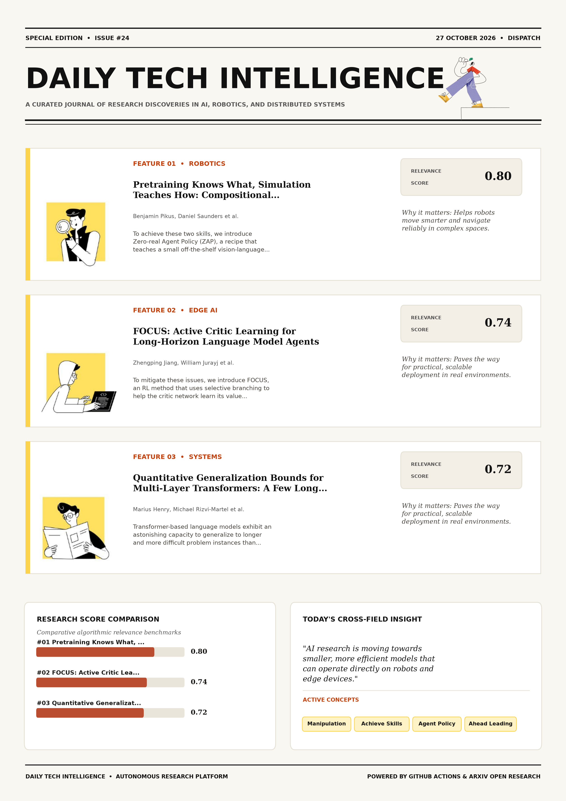

# Daily Tech Intelligence

## 27 October 2026

### Today's Overview

10 research papers analyzed.

Topics:

* Artificial Intelligence
* Machine Learning
* Natural Language Processing
* Robotics

### Visual Intelligence Templates

* **Template 3: Gen-Z Spotlight Broadside (Primary)**: [View High-Res](infographic_spotlight.png)
* **Template 2: Modern Tech Studio**: [View High-Res](infographic_modern.png)
* **Template 1: Editorial Research Journal**: [View High-Res](infographic_editorial.png)

---

## 1. Pretraining Knows What, Simulation Teaches How: Compositional Generalization in a Sim-Trained Robot Agent

Authors: Benjamin Pikus, Daniel Saunders, Mircea Mironenco, Salman Mohammadi, Mathew Mathew, Sirou Zhu, Divya Makkar, Xuhua Huang, Qinbo Li, Supreeth Narasimhaswamy, Siyuan Cen, Thomas Neff, Dejia Xu, Shyamal Buch

Publication: 2026-10-26T17:44:34Z

Category: cs.RO, cs.AI, cs.CV, cs.LG

Relevance Score: 0.80

Paper: [arXiv:2610.35817](https://arxiv.org/abs/2610.35817v1) | [PDF](https://arxiv.org/pdf/2610.35817v1)

### Summary

Addressing critical demands in Robotics, this research investigates a robot policy needs to understand what a task is asking for in a scene, and how to move the robot to accomplish that task. To achieve these two skills, we introduce Zero-real Agent Policy (ZAP), a recipe that teaches a small off-the-shelf vision-language model to control a robot via a simple tool harness. We use a pretrained 27B parameter model to bootstrap world understanding and reasoning, followed by supervised fine-tuning and GRPO on simple simulated tasks to teach it how to move the robot. On a single-arm Franka, ZAP reaches 55.9% on RoboLab-120, 4.9 percentage points ahead of the leading VLA/WAM baseline.

### Key Concepts

* Manipulation
* Achieve Skills
* Agent Policy
* Ahead Leading
* Arms Mid-air
* Asking Scene

### Technical Insights

**Problem**

Addresses foundational constraints in Robotics and existing computational workflows.

**Approach**

To achieve these two skills, we introduce Zero-real Agent Policy (ZAP), a recipe that teaches a small off-the-shelf vision-language model to control a robot via a simple tool harness.

**Key Innovation**

Formulates an integrated mechanism leveraging Manipulation, Achieve Skills.

**Results**

Not specified in the available abstract.

**Applications**

Autonomous robotic manipulation, sim-to-real transfer, and agile mobile navigation systems. High-resolution real-time visual perception, automated 3D reconstruction, and embodied vision.

**Limitations**

Not specified in the available abstract.

---

## 2. FOCUS: Active Critic Learning for Long-Horizon Language Model Agents

Authors: Zhengping Jiang, William Jurayj, Liaoyaqi Wang, Chunsheng Zuo, Anqi Liu, Benjamin Van Durme

Publication: 2026-10-26T17:34:47Z

Category: cs.LG

Relevance Score: 0.74

Paper: [arXiv:2610.35801](https://arxiv.org/abs/2610.35801v1) | [PDF](https://arxiv.org/pdf/2610.35801v1)

### Summary

Sparse outcome rewards make it difficult for long-horizon language-model agents to assign credit to earlier actions. To mitigate these issues, we introduce FOCUS, an RL method that uses selective branching to help the critic network learn its value estimator. Our experiments show that using compaction-induced segment boundaries for value estimation and credit assignment, FOCUS outperforms GRPO and VinePPO with matched per-step generation budgets on legal reasoning, deep search, and code localization benchmarks, improving held-out accuracy at Qwen3.5-9B scale by 7.2 points over the strongest baseline on BrowseComp-Plus (55.4 vs. 48.2) and by 4.1 points on DeonticBench (56.5 vs. 52.4). Learned critics provide value estimates for intermediate states, but these estimates can be inaccurate, while estimating intermediate values with repetitive continuation samples from points within a trajectory incurs substantial costs.

### Key Concepts

* Reinforcement Learning
* Actions Learned
* Active Learning
* Advantage Sampled
* Agentic Reinforcement
* Assign Credit

### Technical Insights

**Problem**

Sparse outcome rewards make it difficult for long-horizon language-model agents to assign credit to earlier actions.

**Approach**

To mitigate these issues, we introduce FOCUS, an RL method that uses selective branching to help the critic network learn its value estimator.

**Key Innovation**

Formulates an integrated mechanism leveraging Reinforcement Learning, Actions Learned.

**Results**

Our experiments show that using compaction-induced segment boundaries for value estimation and credit assignment, FOCUS outperforms GRPO and VinePPO with matched per-step generation budgets on legal reasoning, deep search, and code localization benchmarks, improving held-out accuracy at Qwen3.5-9B scale by 7.2 points over the strongest baseline on BrowseComp-Plus (55.4 vs. 48.2) and by 4.1 points on DeonticBench (56.5 vs. 52.4).

**Applications**

Next-generation large language model workflows, retrieval-augmented intelligence, and structured document parsing.

**Limitations**

Not specified in the available abstract.

---

## 3. Quantitative Generalization Bounds for Multi-Layer Transformers: A Few Long Strings can Beat Many Short Ones

Authors: Marius Henry, Michael Rizvi-Martel, Michael Hahn

Publication: 2026-10-26T16:36:27Z

Category: cs.LG, cs.AI, cs.CL

Relevance Score: 0.72

Paper: [arXiv:2610.35715](https://arxiv.org/abs/2610.35715v1) | [PDF](https://arxiv.org/pdf/2610.35715v1)

### Summary

Transformer-based language models exhibit an astonishing capacity to generalize to longer and more difficult problem instances than those seen in training. In this work, we give a joint treatment of both axes for fixed-precision transformers. On one hand, one must examine in-distribution statistical generalisation, which concerns the ability of a model to broaden a function from training samples to novel samples of the same distribution. Unlike most machine learning models, the generalisation abilities of transformers inherently require considering two axes. Experiments support predictions of the theory. However, theoretical understanding of this phenomenon still lags behind. On the other hand, given the sequential nature of language data, one must also consider length generalisation, which reflects whether a model trained on inputs of a given length can extrapolate to longer ones.These two notions have mostly been studied separately, leaving open how they interact.

### Key Concepts

* Quantization
* Abilities Transformers
* Alphabet Size
* Astonishing Capacity
* Axes Fixed-precision
* Axes Hand

### Technical Insights

**Problem**

Transformer-based language models exhibit an astonishing capacity to generalize to longer and more difficult problem instances than those seen in training.

**Approach**

In this work, we give a joint treatment of both axes for fixed-precision transformers.

**Key Innovation**

On one hand, one must examine in-distribution statistical generalisation, which concerns the ability of a model to broaden a function from training samples to novel samples of the same distribution.

**Results**

Not specified in the available abstract.

**Applications**

Next-generation large language model workflows, retrieval-augmented intelligence, and structured document parsing.

**Limitations**

Not specified in the available abstract.

---

## 4. Differentiable Contact Dynamics for Legged Locomotion: Policy Learning and Contact-Implicit Trajectory Optimization

Authors: Gijeong Kim, Seungbin Oh, Dongyun Kang, Hae-Won Park

Publication: 2026-10-26T17:57:14Z

Category: cs.RO

Relevance Score: 0.72

Paper: [arXiv:2610.35852](https://arxiv.org/abs/2610.35852v1) | [PDF](https://arxiv.org/pdf/2610.35852v1)

### Summary

A central-path relaxation of the de Saxcé-corrected second-order-cone complementarity problem for Coulomb friction smooths the conditions defining the separating, clamping, and sliding modes. The exact contact sensitivity is available in closed form but describes changes within the current contact mode, providing no first-order information toward neighboring contact modes. The proposed gradient replaces this sensitivity only in the backward pass, leaving the hard-contact forward solve unchanged and the realized rollout feasible. Project page: https://diffcontact.github.io This paper proposes a smooth analytic gradient for frictional contact and applies it to policy learning and contact-implicit trajectory optimization for legged locomotion. The relaxed sensitivity is evaluated at a point on the central path obtained by a Newton iteration initialized from the hard-contact solution.

### Key Concepts

* Policy Learning
* Trajectory Optimization
* Analytic Gradient
* Applies Policy
* Available Closed
* Backward Pass

### Technical Insights

**Problem**

A central-path relaxation of the de Saxcé-corrected second-order-cone complementarity problem for Coulomb friction smooths the conditions defining the separating, clamping, and sliding modes.

**Approach**

The exact contact sensitivity is available in closed form but describes changes within the current contact mode, providing no first-order information toward neighboring contact modes.

**Key Innovation**

Formulates an integrated mechanism leveraging Policy Learning, Trajectory Optimization.

**Results**

Not specified in the available abstract.

**Applications**

Autonomous robotic manipulation, sim-to-real transfer, and agile mobile navigation systems.

**Limitations**

Not specified in the available abstract.

---

## 5. Preserve to Expand: Source-Aware Adaptation and Model Merging for Multilingual LLM-Based ASR

Authors: Yuchen Zhang, Haralambos Mouratidis, Ravi Shekhar

Publication: 2026-10-26T17:56:22Z

Category: cs.CL

Relevance Score: 0.72

Paper: [arXiv:2610.35846](https://arxiv.org/abs/2610.35846v1) | [PDF](https://arxiv.org/pdf/2610.35846v1)

### Summary

We study this problem in connector-based Speech LLMs, where a trainable connector maps speech representations into a frozen large language model. We study this problem in connector-based Speech LLMs, where a trainable connector maps speech representations into a frozen large language model. These results show that multilingual ASR expansion requires balancing target acquisition, source retention, and interactions among target-language updates. Expanding multilingual ASR systems to new languages is challenging when adaptation must preserve previously supported languages without replaying source-language training data. We evaluate target-update construction and merging strategies for adapting the connector while preserving source-language performance. In single-target expansion, target-only fine-tuning and standard TIES merging learn new languages but cause severe source-language forgetting, while SSU-Wanda+TIES gives the best source-preserving trade-off.

### Key Concepts

* Large Language Model
* Acquisition Source
* Adaptation Favorable
* Adaptation Preserve
* Adapting Connector
* Asr Expansion

### Technical Insights

**Problem**

We study this problem in connector-based Speech LLMs, where a trainable connector maps speech representations into a frozen large language model.

**Approach**

We study this problem in connector-based Speech LLMs, where a trainable connector maps speech representations into a frozen large language model.

**Key Innovation**

Formulates an integrated mechanism leveraging Large Language Model, Acquisition Source.

**Results**

These results show that multilingual ASR expansion requires balancing target acquisition, source retention, and interactions among target-language updates.

**Applications**

Next-generation large language model workflows, retrieval-augmented intelligence, and structured document parsing.

**Limitations**

In single-target expansion, target-only fine-tuning and standard TIES merging learn new languages but cause severe source-language forgetting, while SSU-Wanda+TIES gives the best source-preserving trade-off.

---

## 6. Learning Force-Reactive Humanoid Loco-Manipulation

Authors: Sihang Li, Xiaofeng Guo, Jinkun Cao, Charlie Cheng, Ruihan Yang, Chen Feng, Guanya Shi, Haozhi Qi

Publication: 2026-10-26T17:59:11Z

Category: cs.RO, cs.AI, cs.LG, eess.SY

Relevance Score: 0.71

Paper: [arXiv:2610.35862](https://arxiv.org/abs/2610.35862v1) | [PDF](https://arxiv.org/pdf/2610.35862v1)

### Summary

Addressing critical demands in Robotics, this research investigates many everyday tasks require controlling contact force as well as motion. Therefore, we present FLORE, a framework for learning force-reactive humanoid loco-manipulation. For more details, please visit our website: https://louis-leee.github.io/FLoRe/. Many everyday tasks require controlling contact force as well as motion. On a humanoid, this force must often be coordinated across both hands and the whole body, and cannot be specified by kinematic trajectories alone. We collect robot-free demonstrations using two force-sensing UMI-style handheld grippers for hand motion and contact wrenches, and wearable trackers for body motion. A force-reactive diffusion policy takes vision, proprioception, and measured wrenches as input, then predicts actions and per-hand force commands.

### Key Concepts

* Diffusion Policy
* Manipulation
* Accuracy Contact-rich
* Accurately Commanded
* Actions Per-hand
* Balance Integral

### Technical Insights

**Problem**

Addresses foundational constraints in Robotics and existing computational workflows.

**Approach**

Therefore, we present FLORE, a framework for learning force-reactive humanoid loco-manipulation.

**Key Innovation**

Formulates an integrated mechanism leveraging Diffusion Policy, Manipulation.

**Results**

Not specified in the available abstract.

**Applications**

Autonomous robotic manipulation, sim-to-real transfer, and agile mobile navigation systems.

**Limitations**

Not specified in the available abstract.

---

## 7. Multi-Objective Reinforcement Learning Using Routed Ensembles and Trajectory Attribution

Authors: Zhenshuo Zhang, Ruoxuan Xiong, Hongyang R. Zhang

Publication: 2026-10-26T16:52:29Z

Category: cs.LG, cs.AI, cs.MA, cs.RO, stat.ML

Relevance Score: 0.71

Paper: [arXiv:2610.35733](https://arxiv.org/abs/2610.35733v1) | [PDF](https://arxiv.org/pdf/2610.35733v1)

### Summary

Multi-objective reinforcement learning is a fundamental problem for modern AI, with applications spanning post-training, reasoning models, and robotic control. In this paper, we introduce objective-conflict coefficients and derive near-optimal regret bounds for online settings using this measure, thereby quantifying the impact of misalignment on learning efficiency. When applied to trajectory selection, kernel-based attribution yields a 27% improvement in reward over baseline attribution methods. A central challenge is to learn policies that balance competing objectives, such as helpfulness versus honesty in safety and alignment, or speed versus energy in robotics. The optimal policy can vary sharply with objective-weighting combinations, and the extent of this variation depends crucially on the degree of conflict among objectives, making per-preference policy learning sample-inefficient.

### Key Concepts

* Reinforcement Learning
* Trajectory Attribution
* Applications Spanning
* Applied Trajectory
* Kernel Surrogate
* Policy Learning

### Technical Insights

**Problem**

Multi-objective reinforcement learning is a fundamental problem for modern AI, with applications spanning post-training, reasoning models, and robotic control.

**Approach**

In this paper, we introduce objective-conflict coefficients and derive near-optimal regret bounds for online settings using this measure, thereby quantifying the impact of misalignment on learning efficiency.

**Key Innovation**

Formulates an integrated mechanism leveraging Reinforcement Learning, Trajectory Attribution.

**Results**

When applied to trajectory selection, kernel-based attribution yields a 27% improvement in reward over baseline attribution methods.

**Applications**

Autonomous robotic manipulation, sim-to-real transfer, and agile mobile navigation systems.

**Limitations**

Not specified in the available abstract.

---

## 8. Understanding Jev-Style System One Models: Does Structure Reduce Selection Bias?

Authors: Mingyang Song, Mao Zheng, Zhiyuan Ma, Xinpeng Zhou

Publication: 2026-10-26T17:48:55Z

Category: cs.CL

Relevance Score: 0.69

Paper: [arXiv:2610.35826](https://arxiv.org/abs/2610.35826v1) | [PDF](https://arxiv.org/pdf/2610.35826v1)

### Summary

Selection bias in large language models (LLMs) can persist despite instructions to ignore presentation order or prompts that elicit reasoning. Recent efforts to reproduce Jev-style System One behavior have produced a growing family of models that predict probabilities directly over supplied candidates. Yet systematic comparisons of selection bias across Jev versions, Jev reproductions, and generative LLMs remain limited in multi-option tasks. These results expose a gap between repeatable decisions and decisions that remain correct across equivalent presentations, showing why stable accuracy alone cannot establish resistance to selection bias. This leaves a central question: does Jev-style decision structure reduce selection bias?

### Key Concepts

* Selection Bias
* Fixed-order Repetition
* Generative Llms
* Jev Reproductions
* Jev Versions
* Reproductions Generative

### Technical Insights

**Problem**

Selection bias in large language models (LLMs) can persist despite instructions to ignore presentation order or prompts that elicit reasoning.

**Approach**

Recent efforts to reproduce Jev-style System One behavior have produced a growing family of models that predict probabilities directly over supplied candidates.

**Key Innovation**

Formulates an integrated mechanism leveraging Selection Bias, Fixed-order Repetition.

**Results**

Not specified in the available abstract.

**Applications**

Next-generation large language model workflows, retrieval-augmented intelligence, and structured document parsing.

**Limitations**

Not specified in the available abstract.

---

## 9. Profiling a Frontier Agent with EBench: From Direct Control to Harness with Policy

Authors: Yifei Yao, Yude Zou, Guanbo Jiao, Xing Gao, Ning Gao, Yukai Wang, Jiantong Chen, Zihou Zhu, Xinyu Li, Ningyu Yan, Shuai Wang, Jianming Ma, Haoyu Guo, Weinan Zhang, Chunhua Shen

Publication: 2026-10-26T17:51:02Z

Category: cs.RO, cs.AI

Relevance Score: 0.69

Paper: [arXiv:2610.35832](https://arxiv.org/abs/2610.35832v1) | [PDF](https://arxiv.org/pdf/2610.35832v1)

### Summary

However, performance remains below the per-task upper bound of the standalone components due to suboptimal policy invocation, fixed-instruction execution without subgoals, and grasp disruption when the agent resumes control. In this report, we evaluate GPT-6-Astra on EBench as the core of an agent that controls a robot through an agent harness under the same visual and proprioceptive observation protocol as post-trained policies. We study two agent configurations: direct control, in which the agent generates waypoint commands directly, and harness with policy, in which it can also invoke a post-trained VLA or WAM policy for action execution. Project page: https://internrobotics.github.io/EBench-Astra-Tech-Report/ Frontier multimodal large language models (MLLMs) can control robots without robot-specific training, but how their capabilities compare and interact with post-trained vision-language-action (VLA) and world action model (WAM) policies across manipulation demands remains to be thoroughly evaluated.

### Key Concepts

* Manipulation
* Direct Control
* Agent Harness
* Control Agent
* Harness Policy
* Post-trained Policies

### Technical Insights

**Problem**

However, performance remains below the per-task upper bound of the standalone components due to suboptimal policy invocation, fixed-instruction execution without subgoals, and grasp disruption when the agent resumes control.

**Approach**

In this report, we evaluate GPT-6-Astra on EBench as the core of an agent that controls a robot through an agent harness under the same visual and proprioceptive observation protocol as post-trained policies.

**Key Innovation**

Formulates an integrated mechanism leveraging Manipulation, Direct Control.

**Results**

Not specified in the available abstract.

**Applications**

Autonomous robotic manipulation, sim-to-real transfer, and agile mobile navigation systems.

**Limitations**

Not specified in the available abstract.

---

## 10. Reva: Real-Time Vulnerability Detection through Contextual Probing of Large Language Models

Authors: Amine Lbath, Massih-Reza Amini

Publication: 2026-10-26T17:50:09Z

Category: cs.CR, cs.AI

Relevance Score: 0.68

Paper: [arXiv:2610.35829](https://arxiv.org/abs/2610.35829v1) | [PDF](https://arxiv.org/pdf/2610.35829v1)

### Summary

This reasoning, however, spans many model calls, so that each verdict takes minutes of compute, far too long for real-time screening. We present REVA (REal-time Vulnerability Analysis), an AI vulnerability detector that brings the security context and code understanding components behind agentic detectors into a single forward pass of an LLM. LLM agents have recently become capable of finding real-world vulnerabilities by working as a security expert would: they run analysis tools, explore the surrounding code, test hypotheses and weigh the evidence before forming their own judgement. An LLM's internal representations thus encode much of what agentic detectors obtain through reasoning.

### Key Concepts

* Accurate LLM
* Agentic Detectors
* Direct Verdict
* Function Context
* Internal Representations
* LLM Direct

### Technical Insights

**Problem**

This reasoning, however, spans many model calls, so that each verdict takes minutes of compute, far too long for real-time screening.

**Approach**

We present REVA (REal-time Vulnerability Analysis), an AI vulnerability detector that brings the security context and code understanding components behind agentic detectors into a single forward pass of an LLM.

**Key Innovation**

Formulates an integrated mechanism leveraging Accurate LLM, Agentic Detectors.

**Results**

Not specified in the available abstract.

**Applications**

Next-generation large language model workflows, retrieval-augmented intelligence, and structured document parsing.

**Limitations**

A vulnerability costs more to fix the later it is discovered.

---
