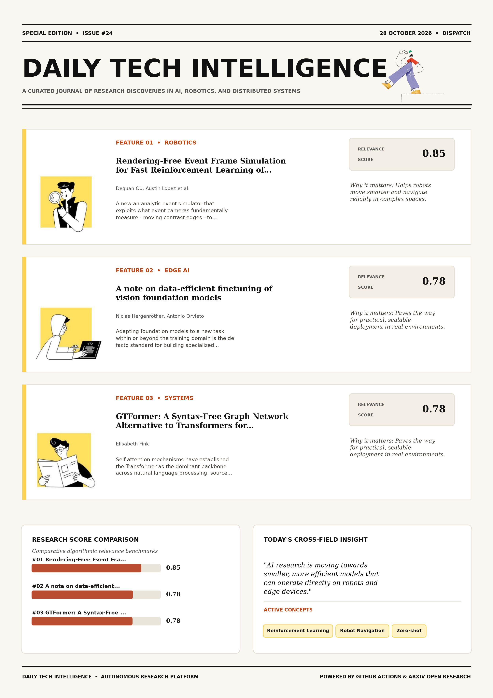

# Daily Tech Intelligence

## 28 October 2026

### Today's Overview

10 research papers analyzed.

Topics:

* Artificial Intelligence
* Machine Learning
* Robotics

### Visual Intelligence Templates

* **Template 3: Gen-Z Spotlight Broadside (Primary)**: [View High-Res](infographic_spotlight.png)
* **Template 2: Modern Tech Studio**: [View High-Res](infographic_modern.png)
* **Template 1: Editorial Research Journal**: [View High-Res](infographic_editorial.png)

---

## 1. Rendering-Free Event Frame Simulation for Fast Reinforcement Learning of Autonomous Robot Navigation

Authors: Dequan Ou, Austin Lopez, Quentin Missinne, Christophe De Wagter, Guido C. H. E. de Croon

Publication: 2026-10-27T16:56:18Z

Category: cs.RO

Relevance Score: 0.85

Paper: [arXiv:2610.37543](https://arxiv.org/abs/2610.37543v1) | [PDF](https://arxiv.org/pdf/2610.37543v1)

### Summary

However, existing simulators generally render photorealistic images before converting them into events, making large-scale reinforcement learning prohibitively slow. We propose an analytic event simulator that exploits what event cameras fundamentally measure - moving contrast edges - to synthesize event streams directly from scene geometry and ego-motion without visual rendering. We propose an analytic event simulator that exploits what event cameras fundamentally measure - moving contrast edges - to synthesize event streams directly from scene geometry and ego-motion without visual rendering. Code: https://github.com/tudelft/rendering-free-event-nav Event cameras offer low latency, high dynamic range, and milliwatt-level power consumption, making them ideal for agile robots such as tiny drones navigating through cluttered environments.

### Key Concepts

* Reinforcement Learning
* Robot Navigation
* Zero-shot
* Event Cameras
* Success Rate
* Synthesize Event

### Technical Insights

**Problem**

However, existing simulators generally render photorealistic images before converting them into events, making large-scale reinforcement learning prohibitively slow.

**Approach**

We propose an analytic event simulator that exploits what event cameras fundamentally measure - moving contrast edges - to synthesize event streams directly from scene geometry and ego-motion without visual rendering.

**Key Innovation**

We propose an analytic event simulator that exploits what event cameras fundamentally measure - moving contrast edges - to synthesize event streams directly from scene geometry and ego-motion without visual rendering.

**Results**

Not specified in the available abstract.

**Applications**

Autonomous robotic manipulation, sim-to-real transfer, and agile mobile navigation systems.

**Limitations**

Not specified in the available abstract.

---

## 2. A note on data-efficient finetuning of vision foundation models

Authors: Niclas Hergenröther, Antonio Orvieto

Publication: 2026-10-27T16:30:45Z

Category: cs.CV, cs.LG

Relevance Score: 0.78

Paper: [arXiv:2610.37510](https://arxiv.org/abs/2610.37510v1) | [PDF](https://arxiv.org/pdf/2610.37510v1)

### Summary

Addressing critical demands in Machine Learning, this research investigates adapting foundation models to a new task within or beyond the training domain is the de facto standard for building specialized machine learning models. In this work, we assess the performance of the latest models, comparing them to earlier architectures and alternative fine-tuning methods, to better understand the progress, challenges and opportunities in the field of efficient fine-tuning under resource limitations. As new foundation model families~(like Mamba) get introduced and VP pipelines such as AutoVP reach greater maturity, we find a growing need for a systematic evaluation of current approaches. In the interest of delivering practical guidelines for the user, we also explore application of prevalent regularization techniques to boost performance in the context of VP.

### Key Concepts

* Foundation Model
* Adaptation Lora
* Adapting Foundation
* Alternative Fine-tuning
* Application Prevalent
* Architectures Alternative

### Technical Insights

**Problem**

Addresses foundational constraints in Machine Learning and existing computational workflows.

**Approach**

In this work, we assess the performance of the latest models, comparing them to earlier architectures and alternative fine-tuning methods, to better understand the progress, challenges and opportunities in the field of efficient fine-tuning under resource limitations.

**Key Innovation**

Formulates an integrated mechanism leveraging Foundation Model, Adaptation Lora.

**Results**

Not specified in the available abstract.

**Applications**

High-resolution real-time visual perception, automated 3D reconstruction, and embodied vision.

**Limitations**

In this work, we assess the performance of the latest models, comparing them to earlier architectures and alternative fine-tuning methods, to better understand the progress, challenges and opportunities in the field of efficient fine-tuning under resource limitations.

---

## 3. GTFormer: A Syntax-Free Graph Network Alternative to Transformers for 8192\times Length Extrapolation in Linear Time

Authors: Elisabeth Fink

Publication: 2026-10-27T16:45:29Z

Category: cs.LG

Relevance Score: 0.78

Paper: [arXiv:2610.37524](https://arxiv.org/abs/2610.37524v1) | [PDF](https://arxiv.org/pdf/2610.37524v1)

### Summary

However, all-to-all pairwise token comparison enforces a quadratic \mathcal{O}(N^2) compute and memory barrier alongside severe softmax attention dilution as sequence length N scales beyond the training horizon. However, all-to-all pairwise token comparison enforces a quadratic \mathcal{O}(N^2) compute and memory barrier alongside severe softmax attention dilution as sequence length N scales beyond the training horizon. Inspired by recent advances in algebraic graph learning (\textbf{WPNet}), this work introduces \textbf{GTFormer}, a syntax-free hierarchical Graph Neural Network (GNN) that replaces flat self-attention for general long-context sequence modeling. Across eight long-context code, log, and multi-hop retrieval benchmarks trained exclusively on sequences of length N \le 512, GTFormer extrapolates zero-shot to N = 4{,}194{,}304 (8192\times) on a single commodity GPU in linear \mathcal{O}(N) memory, maintaining near-perfect accuracy where standard and RoPE Transformers suffer from out-of-distribution attention collapse and out-of-memory exhaustion.

### Key Concepts

* Zero-shot
* Graph Neural Network
* Accuracy Standard
* Advances Algebraic
* Algebraic Graph
* All-to-all Pairwise

### Technical Insights

**Problem**

However, all-to-all pairwise token comparison enforces a quadratic \mathcal{O}(N^2) compute and memory barrier alongside severe softmax attention dilution as sequence length N scales beyond the training horizon.

**Approach**

However, all-to-all pairwise token comparison enforces a quadratic \mathcal{O}(N^2) compute and memory barrier alongside severe softmax attention dilution as sequence length N scales beyond the training horizon.

**Key Innovation**

Formulates an integrated mechanism leveraging Zero-shot, Graph Neural Network.

**Results**

Not specified in the available abstract.

**Applications**

Autonomous agentic reasoning, multi-agent coordination, and decision-support platforms.

**Limitations**

Not specified in the available abstract.

---

## 4. Pushing Dexterity and Safety for In-Hand Object Pose Reaching That Works Remarkably Well

Authors: Ian Chuang, Hiya Shah, Vamsi Chilamkur, Iman Soltani, Claire Tomlin

Publication: 2026-10-27T17:58:20Z

Category: cs.RO, cs.LG, eess.SY

Relevance Score: 0.77

Paper: [arXiv:2610.37652](https://arxiv.org/abs/2610.37652v1) | [PDF](https://arxiv.org/pdf/2610.37652v1)

### Summary

We study in-hand object pose reaching, a task that demands diverse and difficult grasps: moving an object to almost any position and orientation within reach of the fingers, at any wrist orientation, through long sequences of consecutive goals. We present a recipe for training such policies for a LEAP hand in simulation without human data, built on a range of insights, from diverse resets and goals via generated grasp datasets to an adaptive friction curriculum. Videos and more are available at https://ian-chuang.github.io/dexsafe/. Dexterous manipulation with multi-fingered hands is the next frontier of robotics, yet learned hand skills remain limited to simple grasps or basic repeated motions, such as rotating an object.

### Key Concepts

* Zero-shot
* Dexterous Manipulation
* Manipulation
* Adaptive Friction
* Add Learned
* Adjustable Conservativeness

### Technical Insights

**Problem**

We study in-hand object pose reaching, a task that demands diverse and difficult grasps: moving an object to almost any position and orientation within reach of the fingers, at any wrist orientation, through long sequences of consecutive goals.

**Approach**

We present a recipe for training such policies for a LEAP hand in simulation without human data, built on a range of insights, from diverse resets and goals via generated grasp datasets to an adaptive friction curriculum.

**Key Innovation**

Formulates an integrated mechanism leveraging Zero-shot, Dexterous Manipulation.

**Results**

Not specified in the available abstract.

**Applications**

Autonomous robotic manipulation, sim-to-real transfer, and agile mobile navigation systems.

**Limitations**

Not specified in the available abstract.

---

## 5. ThinkWorld: World Imagination Reinforces Chain-of-Dynamics Reasoning

Authors: Chaehyun Kim, Chi-Pin Huang, Jisoo Kim, Min-Hung Chen, Yu-Chiang Frank Wang, Seungryong Kim, Fu-En Yang

Publication: 2026-10-27T17:59:52Z

Category: cs.RO, cs.AI, cs.CV

Relevance Score: 0.74

Paper: [arXiv:2610.37666](https://arxiv.org/abs/2610.37666v1) | [PDF](https://arxiv.org/pdf/2610.37666v1)

### Summary

Addressing critical demands in Artificial Intelligence, this research investigates vision-language-action (vla) models have made substantial progress in robotic manipulation, but their generalization remains constrained by the diversity and coverage of action-labeled robot demonstrations. We introduce ThinkWorld, a VLA learning framework that grounds action reasoning in world dynamics and strengthens it through reinforcement learning with world imagination. Experiments in simulation and on real robots demonstrate effective human-to-robot transfer and strong generalization to unseen tasks and environments. Vision-Language-Action (VLA) models have made substantial progress in robotic manipulation, but their generalization remains constrained by the diversity and coverage of action-labeled robot demonstrations. Human videos provide much broader behavioral and environmental experience, while learning from them faces a fundamental trade-off between scalable data and explicit action grounding.

### Key Concepts

* Reinforcement Learning
* Manipulation
* Action Annotations
* Action Grounding
* Action Reasoning
* Action Representation

### Technical Insights

**Problem**

Addresses foundational constraints in Artificial Intelligence and existing computational workflows.

**Approach**

We introduce ThinkWorld, a VLA learning framework that grounds action reasoning in world dynamics and strengthens it through reinforcement learning with world imagination.

**Key Innovation**

Formulates an integrated mechanism leveraging Reinforcement Learning, Manipulation.

**Results**

Not specified in the available abstract.

**Applications**

Autonomous robotic manipulation, sim-to-real transfer, and agile mobile navigation systems. High-resolution real-time visual perception, automated 3D reconstruction, and embodied vision.

**Limitations**

Human videos provide much broader behavioral and environmental experience, while learning from them faces a fundamental trade-off between scalable data and explicit action grounding.

---

## 6. When, Where, and What to Correct: Human-Guided Adaptive Residual Correction for Robot Policies

Authors: Anukriti Singh, Maxime Caniot, Pratap Tokekar, Firas Abi-Farraj

Publication: 2026-10-27T16:58:54Z

Category: cs.RO, cs.AI

Relevance Score: 0.74

Paper: [arXiv:2610.37547](https://arxiv.org/abs/2610.37547v1) | [PDF](https://arxiv.org/pdf/2610.37547v1)

### Summary

Updating the full policy or exploring residual actions everywhere treats this local failure as a global learning problem. We introduce Adaptive Residual Correction (ARC), a lightweight post-training module that uses reinforcement learning (RL) to learn a residual correction on top of a frozen policy while using sparse human corrections to structure autonomous exploration. Together, these results show that sparse human corrections can localize and constrain autonomous post-training without requiring the observed correction itself to serve as the final action target. Imitation policies that reliably execute most of a manipulation trajectory can still fail in localized regions requiring last-mile precision. Rather than treating human corrections as imitation targets, ARC uses pre-intervention states to determine 'when' residual control should become active and correction geometry to determine 'where' in residual action space autonomous refinement should explore; task reward determines 'what' residual is ultimately executed.

### Key Concepts

* Reinforcement Learning
* Manipulation
* Adaptive Residual Correction
* Action Space
* Action Target
* Actions Treats Local

### Technical Insights

**Problem**

Updating the full policy or exploring residual actions everywhere treats this local failure as a global learning problem.

**Approach**

We introduce Adaptive Residual Correction (ARC), a lightweight post-training module that uses reinforcement learning (RL) to learn a residual correction on top of a frozen policy while using sparse human corrections to structure autonomous exploration.

**Key Innovation**

Formulates an integrated mechanism leveraging Reinforcement Learning, Manipulation.

**Results**

Together, these results show that sparse human corrections can localize and constrain autonomous post-training without requiring the observed correction itself to serve as the final action target.

**Applications**

Autonomous robotic manipulation, sim-to-real transfer, and agile mobile navigation systems.

**Limitations**

Not specified in the available abstract.

---

## 7. Collective Dynamics of Self-Reinforcement: How Cross-Task Coupling Drives Policy Collapse in Unsupervised RLVR

Authors: Peize Ding

Publication: 2026-10-27T17:01:55Z

Category: cs.LG

Relevance Score: 0.72

Paper: [arXiv:2610.37553](https://arxiv.org/abs/2610.37553v1) | [PDF](https://arxiv.org/pdf/2610.37553v1)

### Summary

It improves reasoning at first but eventually collapses: the self-assessed reward goes to one while accuracy falls, often until the model gives the same answer to every problem. It improves reasoning at first but eventually collapses: the self-assessed reward goes to one while accuracy falls, often until the model gives the same answer to every problem. The collapse appears only when training uses many problems. In label-free RL of a small Transformer, removing the shared direction prevents collapse entirely, restoring it causes collapse, and collapse grows with training-set size and base-model entropy. Label-free reinforcement learning with verifiable rewards (RLVR) rewards a language model for agreeing with its own majority vote.

### Key Concepts

* Reinforcement Learning
* Shared Mode
* Single Critical
* Single-problem Self-reinforcement
* Size Base-model
* Size Collapse

### Technical Insights

**Problem**

It improves reasoning at first but eventually collapses: the self-assessed reward goes to one while accuracy falls, often until the model gives the same answer to every problem.

**Approach**

It improves reasoning at first but eventually collapses: the self-assessed reward goes to one while accuracy falls, often until the model gives the same answer to every problem.

**Key Innovation**

Formulates an integrated mechanism leveraging Reinforcement Learning, Shared Mode.

**Results**

Not specified in the available abstract.

**Applications**

Autonomous agentic reasoning, multi-agent coordination, and decision-support platforms.

**Limitations**

Not specified in the available abstract.

---

## 8. Ego-CEVR: Learning Cross-Embodiment Visual Representations from Human Egocentric Videos

Authors: Keru Zhou, Zhirui Fang, Xinrun Xu, Yaopeng Lou, Zeyuan He, Zihao Zhu, Xinze Niu, Chen Wang, Tianfu Li, Samith Va, Bin Qian, Junwei Li, Wenjia Ding, Yicheng Xu, Chang Zhou, Ziwei Wang, Li Liu, Xiu Li, Maoqing Yao

Publication: 2026-10-27T16:30:35Z

Category: cs.RO

Relevance Score: 0.72

Paper: [arXiv:2610.37509](https://arxiv.org/abs/2610.37509v1) | [PDF](https://arxiv.org/pdf/2610.37509v1)

### Summary

Addressing critical demands in Robotics, this research investigates as egocentric video becomes increasingly available for embodied learning, an important research question is how to turn this low-cost, scalable source of data into robot manipulation capabilities. We present Ego-CEVR, a data-native framework for hierarchical visual representation learning that assigns distinct learning objectives to global and interaction representations. Ego-CEVR supports independent pretraining of its global video module on large-scale human egocentric videos and videos from diverse robot embodiments, without requiring robot action labels or paired wrist observations. As egocentric video becomes increasingly available for embodied learning, an important research question is how to turn this low-cost, scalable source of data into robot manipulation capabilities.

### Key Concepts

* Representation Learning
* Manipulation
* Egocentric Video
* Action Alignment
* Action Annotations
* Action Policy

### Technical Insights

**Problem**

Addresses foundational constraints in Robotics and existing computational workflows.

**Approach**

We present Ego-CEVR, a data-native framework for hierarchical visual representation learning that assigns distinct learning objectives to global and interaction representations.

**Key Innovation**

Formulates an integrated mechanism leveraging Representation Learning, Manipulation.

**Results**

Not specified in the available abstract.

**Applications**

Autonomous robotic manipulation, sim-to-real transfer, and agile mobile navigation systems.

**Limitations**

Not specified in the available abstract.

---

## 9. EnvSched: Environment-Aware Scheduling for Rollout-Efficient Agent Reinforcement Learning

Authors: Sihan Yang, Weichen Bai, Ruichuan An, Yiming Cheng, Zhiyuan Feng, Tianyi Jiang, Renye Yan, Ning Ding, Yifan Zhang, Renrui Zhang, Yehui Tang, Wentao Zhang

Publication: 2026-10-27T17:38:52Z

Category: cs.LG, cs.CL

Relevance Score: 0.71

Paper: [arXiv:2610.37609](https://arxiv.org/abs/2610.37609v1) | [PDF](https://arxiv.org/pdf/2610.37609v1)

### Summary

Addressing critical demands in Machine Learning, this research investigates as executable environments for language agents scale, generating and verifying their rollouts becomes increasingly expensive. To address this question, we introduce EnvSched (Environment-aware Scheduling), an online scheduler that learns from rollout history. It also improves downstream performance across model sizes at the same training budget. As executable environments for language agents scale, generating and verifying their rollouts becomes increasingly expensive. Under finite rollout budgets, this raises an important question: can data management at the environment level make agentic reinforcement learning (RL) more efficient by organizing, evaluating, and scheduling task instances together with the environments that determine their tools, states, transitions, and verification?

### Key Concepts

* Reinforcement Learning
* Edges Capturing
* Reward Variance
* Tau-bench Acebench-agent
* Tool State
* Tools States

### Technical Insights

**Problem**

Addresses foundational constraints in Machine Learning and existing computational workflows.

**Approach**

To address this question, we introduce EnvSched (Environment-aware Scheduling), an online scheduler that learns from rollout history.

**Key Innovation**

Formulates an integrated mechanism leveraging Reinforcement Learning, Edges Capturing.

**Results**

Not specified in the available abstract.

**Applications**

Next-generation large language model workflows, retrieval-augmented intelligence, and structured document parsing.

**Limitations**

Not specified in the available abstract.

---

## 10. Leveraging Distributed Sensing and Hyperdimensional Computing for Non-Line-of-Sight Passive Object Sensing

Authors: Placido Mursia, Marco Rossanese, Francesco Devoti, Adrian Lendinez Ibanez, Lanfranco Zanzi, Xi Li, Xavier Costa-Perez

Publication: 2026-10-27T16:41:37Z

Category: cs.RO, cs.ET

Relevance Score: 0.70

Paper: [arXiv:2610.37519](https://arxiv.org/abs/2610.37519v1) | [PDF](https://arxiv.org/pdf/2610.37519v1)

### Summary

However, conventional passive object detection systems rely on sensors such as LiDAR, radar, or cameras, which operate under direct line-of-sight (LoS) and are limited by obstacles and occlusions. In this paper, we propose a framework for passive entity sensing beyond the robot's FoV that relies solely on distributed channel measurements from the communication infrastructure to perform risk-aware classification. Numerical simulations based on a commercial ray tracer and ROS-based validation in realistic smart factory scenarios demonstrate improved safety and enhanced path planning with up to 89% accuracy under severe occlusions, while maintaining low computational complexity. In smart factory environments, passive entities such as humans and movable obstacles may interfere with autonomous robot operations, posing significant safety risks.

### Key Concepts

* Accuracy Severe
* Autonomous Robot
* Cameras Operate
* Channel Measurements
* Channel Reconstruction
* Classification Measurements

### Technical Insights

**Problem**

However, conventional passive object detection systems rely on sensors such as LiDAR, radar, or cameras, which operate under direct line-of-sight (LoS) and are limited by obstacles and occlusions.

**Approach**

In this paper, we propose a framework for passive entity sensing beyond the robot's FoV that relies solely on distributed channel measurements from the communication infrastructure to perform risk-aware classification.

**Key Innovation**

Formulates an integrated mechanism leveraging Accuracy Severe, Autonomous Robot.

**Results**

Numerical simulations based on a commercial ray tracer and ROS-based validation in realistic smart factory scenarios demonstrate improved safety and enhanced path planning with up to 89% accuracy under severe occlusions, while maintaining low computational complexity.

**Applications**

Autonomous robotic manipulation, sim-to-real transfer, and agile mobile navigation systems.

**Limitations**

To overcome these limitations, integrated sensing and communication (ISAC) enables environmental perception via the communication infrastructure thanks to cooperation among distributed wireless devices.

---
