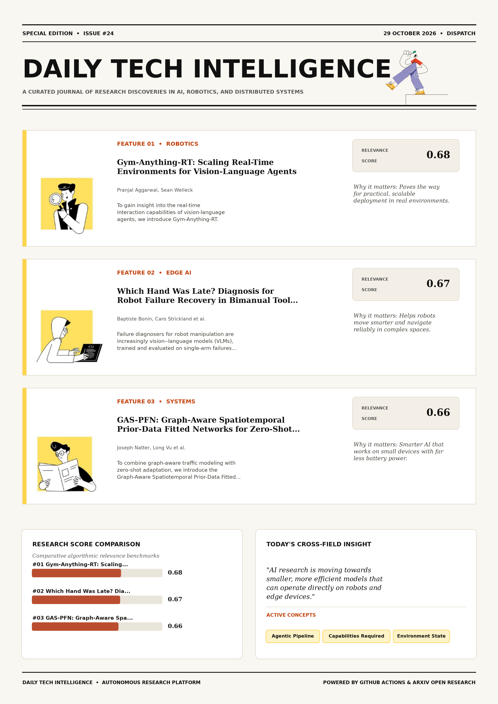

# Daily Tech Intelligence

## 29 October 2026

### Today's Overview

10 research papers analyzed.

Topics:

* Artificial Intelligence
* Machine Learning
* Natural Language Processing
* Robotics

### Visual Intelligence Templates

* **Template 3: Gen-Z Spotlight Broadside (Primary)**: [View High-Res](infographic_spotlight.png)
* **Template 2: Modern Tech Studio**: [View High-Res](infographic_modern.png)
* **Template 1: Editorial Research Journal**: [View High-Res](infographic_editorial.png)

---

## 1. Gym-Anything-RT: Scaling Real-Time Environments for Vision-Language Agents

Authors: Pranjal Aggarwal, Sean Welleck

Publication: 2026-10-27T17:13:05Z

Category: cs.LG, cs.AI

Relevance Score: 0.68

Paper: [arXiv:2610.37567](https://arxiv.org/abs/2610.37567v1) | [PDF](https://arxiv.org/pdf/2610.37567v1)

### Summary

Addressing critical demands in Artificial Intelligence, this research investigates ai agents have made substantial progress in domains where they have a non-trivial amount of time to deliberate between actions, such as mathematics, software engineering, and performing tasks on desktop applications. To gain insight into the real-time interaction capabilities of vision-language agents, we introduce Gym-Anything-RT. In these settings, the environment state may evolve as the agent is reasoning, or even as the underlying model is performing a forward pass. We publicly release Gym-Anything-RT and the generated minigames to spur further research on AI agents in real-time interactive settings. AI agents have made substantial progress in domains where they have a non-trivial amount of time to deliberate between actions, such as mathematics, software engineering, and performing tasks on desktop applications.

### Key Concepts

* Agentic Pipeline
* Capabilities Required
* Environment State
* Interaction Capabilities
* Real Time
* Real-time Interaction

### Technical Insights

**Problem**

Addresses foundational constraints in Artificial Intelligence and existing computational workflows.

**Approach**

To gain insight into the real-time interaction capabilities of vision-language agents, we introduce Gym-Anything-RT.

**Key Innovation**

Formulates an integrated mechanism leveraging Agentic Pipeline, Capabilities Required.

**Results**

Not specified in the available abstract.

**Applications**

High-resolution real-time visual perception, automated 3D reconstruction, and embodied vision. Next-generation large language model workflows, retrieval-augmented intelligence, and structured document parsing.

**Limitations**

Not specified in the available abstract.

---

## 2. Which Hand Was Late? Diagnosis for Robot Failure Recovery in Bimanual Tool Use

Authors: Baptiste Bonin, Caro Strickland, Audrey Durand

Publication: 2026-10-27T16:53:18Z

Category: cs.RO, cs.AI

Relevance Score: 0.67

Paper: [arXiv:2610.37533](https://arxiv.org/abs/2610.37533v1) | [PDF](https://arxiv.org/pdf/2610.37533v1)

### Summary

Addressing critical demands in Robotics, this research investigates failure diagnosers for robot manipulation are increasingly vision--language models (vlms), trained and evaluated on single-arm failures produced by perturbing a successful demonstration. Bimanual tool use adds failures of other kinds: a tool that slips out of its socket while still held, two correct gestures made at different times, and attempts that fail for two reasons at once. On a simulated bimanual tool-use task whose failure causes are read from the recorded trace, we measure what each sensing channel lets a diagnoser tell. A VLM's internal state carries the late hand almost perfectly, along a direction no closer to the one its answer reads than a random one; whether the answer reports it depends on the wording of the question.

### Key Concepts

* Manipulation
* Bimanual Tool
* Adds Failures
* Answer Reads
* Answer Reports
* Arms Sensor

### Technical Insights

**Problem**

Addresses foundational constraints in Robotics and existing computational workflows.

**Approach**

Bimanual tool use adds failures of other kinds: a tool that slips out of its socket while still held, two correct gestures made at different times, and attempts that fail for two reasons at once.

**Key Innovation**

Formulates an integrated mechanism leveraging Manipulation, Bimanual Tool.

**Results**

Not specified in the available abstract.

**Applications**

Autonomous robotic manipulation, sim-to-real transfer, and agile mobile navigation systems.

**Limitations**

Not specified in the available abstract.

---

## 3. GAS-PFN: Graph-Aware Spatiotemporal Prior-Data Fitted Networks for Zero-Shot Traffic Forecasting

Authors: Joseph Natter, Long Vu, Yifan Zhang, Bobin Deng, Kun Suo, Rui Wu

Publication: 2026-10-27T17:31:26Z

Category: cs.LG, cs.AI, cs.NE

Relevance Score: 0.66

Paper: [arXiv:2610.37598](https://arxiv.org/abs/2610.37598v1) | [PDF](https://arxiv.org/pdf/2610.37598v1)

### Summary

Supervised graph-based models achieve strong performance, but are often trained for a particular dataset and sensor graph, making deployment to new or evolving networks costly. To combine graph-aware traffic modeling with zero-shot adaptation, we introduce the Graph-Aware Spatiotemporal Prior-Data Fitted Network (GAS-PFN). Prior-Data Fitted Networks (PFNs) offer a zero-shot alternative by learning in-context inference from synthetic task priors, which provide an explicit mechanism for encoding domain-specific assumptions. These results indicate that aligning PFN priors and inference architectures with graph structure improves in-context learning for zero-shot traffic forecasting. Traffic forecasting requires modeling complex temporal dynamics and the spatial dependencies imposed by road topology.

### Key Concepts

* Zero-shot
* Prior-data Fitted
* Traffic Forecasting
* Reduces Mse
* Road Topology
* Temporal Dynamics

### Technical Insights

**Problem**

Supervised graph-based models achieve strong performance, but are often trained for a particular dataset and sensor graph, making deployment to new or evolving networks costly.

**Approach**

To combine graph-aware traffic modeling with zero-shot adaptation, we introduce the Graph-Aware Spatiotemporal Prior-Data Fitted Network (GAS-PFN).

**Key Innovation**

Formulates an integrated mechanism leveraging Zero-shot, Prior-data Fitted.

**Results**

Not specified in the available abstract.

**Applications**

Low-power edge AI devices, embedded IoT sensor networks, and distributed on-device inference.

**Limitations**

Not specified in the available abstract.

---

## 4. Scaling Laws for Tool-Use Agents via Controllable Environment Synthesis

Authors: Andrew Szot, Samira Abnar, Omar Attia, Abbas Kazerouni, Michael Kirchhof, Cheng-Yu Hsieh, Raviteja Vemulapalli, Alexander Toshev

Publication: 2026-10-27T17:56:46Z

Category: cs.LG

Relevance Score: 0.65

Paper: [arXiv:2610.37648](https://arxiv.org/abs/2610.37648v1) | [PDF](https://arxiv.org/pdf/2610.37648v1)

### Summary

Addressing critical demands in Natural Language Processing, this research investigates we explore how to build performant large language model (llm) tool-use agents that complete complex, multi-step tasks. To do so, we propose the SynthAPI pipeline, which explicitly controls the diversity of generated environments along the axes of tools, tasks, and the databases on which the tools operate. Scaling according to these findings yields agents that outperform models trained on data from prior work in large-scale tool-use agent and synthetic environment generation across four evaluation benchmarks. We explore how to build performant large language model (LLM) tool-use agents that complete complex, multi-step tasks.

### Key Concepts

* Scaling Laws
* Large Language Model
* Tool-use Agent
* According Findings
* Agent Generalization
* Agent Synthetic

### Technical Insights

**Problem**

Addresses foundational constraints in Natural Language Processing and existing computational workflows.

**Approach**

To do so, we propose the SynthAPI pipeline, which explicitly controls the diversity of generated environments along the axes of tools, tasks, and the databases on which the tools operate.

**Key Innovation**

Formulates an integrated mechanism leveraging Scaling Laws, Large Language Model.

**Results**

Not specified in the available abstract.

**Applications**

Next-generation large language model workflows, retrieval-augmented intelligence, and structured document parsing.

**Limitations**

Not specified in the available abstract.

---

## 5. EgoThumb: A Vision-Driven Supernumerary Robotic Thumb for Autonomous Grasp and Holding Assistance

Authors: Jianyu Hou, Jiawei Fu, Weikang Wan, Minghui Jiang, Jiajun Li, Hao Su

Publication: 2026-10-27T17:22:25Z

Category: cs.RO

Relevance Score: 0.65

Paper: [arXiv:2610.37582](https://arxiv.org/abs/2610.37582v1) | [PDF](https://arxiv.org/pdf/2610.37582v1)

### Summary

However, existing devices are often hindered by bulky hardware that limits interaction to large objects and rely on explicit hand motion triggers that lack environmental context. To address these challenges, we present EgoThumb, a fully open-source, vision-driven supernumerary robotic thumb. All hardware designs and software implementations are fully open-sourced at https://ego-thumb.github.io. Supernumerary robotic fingers augment human dexterity by enabling a single hand to perform complex "hold-and-manipulate" tasks that typically require bimanual coordination. EgoThumb features a compact, dual tendon-driven finger whose actuation is relocated to the forearm, reducing distal weight while enabling precise active joint control. The system utilizes a visual imitation learning policy that maps egocentric images from a palm-facing camera directly to continuous joint positions.

### Key Concepts

* Imitation Learning
* Manipulation
* Supernumerary Robotic
* Achieves Robust
* Active Joint
* Actuation Relocated

### Technical Insights

**Problem**

However, existing devices are often hindered by bulky hardware that limits interaction to large objects and rely on explicit hand motion triggers that lack environmental context.

**Approach**

To address these challenges, we present EgoThumb, a fully open-source, vision-driven supernumerary robotic thumb.

**Key Innovation**

Formulates an integrated mechanism leveraging Imitation Learning, Manipulation.

**Results**

Not specified in the available abstract.

**Applications**

Autonomous robotic manipulation, sim-to-real transfer, and agile mobile navigation systems. High-resolution real-time visual perception, automated 3D reconstruction, and embodied vision.

**Limitations**

Not specified in the available abstract.

---

## 6. VideoLVR: Latent Visual Reasoning over Grounded Video Evidence

Authors: Shilong Li, Xingyuan Bu, Hao Shi, Yun Xing, Weixin Feng, Qiangpeng Yang, Shilei Wen

Publication: 2026-10-27T17:41:56Z

Category: cs.CV, cs.AI

Relevance Score: 0.64

Paper: [arXiv:2610.37613](https://arxiv.org/abs/2610.37613v1) | [PDF](https://arxiv.org/pdf/2610.37613v1)

### Summary

However, language-based reasoning traces do not provide a reliable mechanism for models to revisit relevant visual evidence, leading to visual forgetting and impairing their ability to reason over video content. To address these limitations, we introduce VideoLVR, which constructs latent visual evidence from local regions at relevant video moments, thereby providing visual support for intermediate reasoning steps. Existing approaches maintain visual grounding during reasoning in two main ways: they either refer to evidence using textual coordinates, which specify symbolic locations rather than the visual content itself, or reinsert cropped regions or frames into the multimodal context, preserving visual details at the cost of substantial context expansion. Experiments on multiple video benchmarks demonstrate its effectiveness, especially on tasks requiring fine-grained visual evidence.

### Key Concepts

* Reinforcement Learning
* Latent Visual
* Chain-of-thought Reasoning Substantially
* Multimodal Context
* Text Tokens
* Token Prediction

### Technical Insights

**Problem**

However, language-based reasoning traces do not provide a reliable mechanism for models to revisit relevant visual evidence, leading to visual forgetting and impairing their ability to reason over video content.

**Approach**

To address these limitations, we introduce VideoLVR, which constructs latent visual evidence from local regions at relevant video moments, thereby providing visual support for intermediate reasoning steps.

**Key Innovation**

Formulates an integrated mechanism leveraging Reinforcement Learning, Latent Visual.

**Results**

Not specified in the available abstract.

**Applications**

High-resolution real-time visual perception, automated 3D reconstruction, and embodied vision.

**Limitations**

To address these limitations, we introduce VideoLVR, which constructs latent visual evidence from local regions at relevant video moments, thereby providing visual support for intermediate reasoning steps.

---

## 7. Learning Visuomotor Quadrotor Flight Through Dynamic Narrow Gaps via Differentiable Simulation

Authors: Riccardo Bianco, Yunfan Ren, Jiaxu Xing, Davide Scaramuzza

Publication: 2026-10-27T17:05:05Z

Category: cs.RO

Relevance Score: 0.64

Paper: [arXiv:2610.37557](https://arxiv.org/abs/2610.37557v1) | [PDF](https://arxiv.org/pdf/2610.37557v1)

### Summary

We address this challenge using a control policy that operates directly on onboard visual and inertial measurements to output collective thrust and body-rate commands. We introduce a differentiable moving-gap formulation that gates centering, alignment, and smooth collision terms by signed distance to a time-varying gap plane, turning a sparse traversal event into a dense pathwise objective. The task is difficult because success lies on a thin feasible manifold: small errors in timing, position, attitude, or visual observability cause collision. Furthermore, the policy transfers directly to a real quadrotor, successfully crossing a dynamic narrow gap from varied initial conditions using onboard sensing and inertial measurements, achieving an 80% success rate over 10 physical trials.

### Key Concepts

* Narrow Gap
* Attitude Visual
* Inertial Measurements
* Success Rate
* Timing Position
* Transfers Directly

### Technical Insights

**Problem**

We address this challenge using a control policy that operates directly on onboard visual and inertial measurements to output collective thrust and body-rate commands.

**Approach**

We introduce a differentiable moving-gap formulation that gates centering, alignment, and smooth collision terms by signed distance to a time-varying gap plane, turning a sparse traversal event into a dense pathwise objective.

**Key Innovation**

Formulates an integrated mechanism leveraging Narrow Gap, Attitude Visual.

**Results**

Not specified in the available abstract.

**Applications**

Autonomous robotic manipulation, sim-to-real transfer, and agile mobile navigation systems.

**Limitations**

Not specified in the available abstract.

---

## 8. The Structure Gap: When More Data Cannot Replace Structured Reasoning

Authors: Kheer Sagar Patel, Mojtaba Soltanalian

Publication: 2026-10-27T16:45:22Z

Category: cs.LG, cs.AI

Relevance Score: 0.64

Paper: [arXiv:2610.37523](https://arxiv.org/abs/2610.37523v1) | [PDF](https://arxiv.org/pdf/2610.37523v1)

### Summary

This paper examines a limitation of that belief. We introduce the structure gap: the finite-resource gap between a method that receives the governing structure and a learner that receives only examples. We define structure-encoded problems: tasks whose input-output map is determined, or sharply constrained, by known structure such as a solver, symmetry group, graph, physical law, measurement operator, grammar, combinatorial search space, or optimization objective. When validated structure is available, it can constrain the hypothesis space before learning begins, leaving learning to address components the structure does not specify. A persistent belief in modern AI is that sufficiently large learners trained on sufficiently much data can make explicit domain knowledge optional.

### Key Concepts

* Absolute Structure-agnostic
* Address Components
* Asymptotic Absolute
* Attains Bayes
* Available Constrain
* Bayes Risk

### Technical Insights

**Problem**

This paper examines a limitation of that belief.

**Approach**

We introduce the structure gap: the finite-resource gap between a method that receives the governing structure and a learner that receives only examples.

**Key Innovation**

Formulates an integrated mechanism leveraging Absolute Structure-agnostic, Address Components.

**Results**

Not specified in the available abstract.

**Applications**

Autonomous agentic reasoning, multi-agent coordination, and decision-support platforms.

**Limitations**

This paper examines a limitation of that belief.

---

## 9. Predict the Swing, Match the Speed: Robotic Pipe Stabbing With Learned Stereo Vision and Residual Reinforcement Learning

Authors: Mohamed Ashraf Mostafa, Taher El-Fakharany, Samir Khaled

Publication: 2026-10-27T16:53:37Z

Category: cs.RO

Relevance Score: 0.64

Paper: [arXiv:2610.37535](https://arxiv.org/abs/2610.37535v1) | [PDF](https://arxiv.org/pdf/2610.37535v1)

### Summary

Addressing critical demands in Machine Learning, this research investigates a joint of pipe run into the hole swings from the elevator over the well and strikes a fixed stabbing guide at whatever speed the swing has. StabBot, a robotic stabbing system, predicts the swing and meets the pipe at its own speed. A pendulum Kalman filter tuned from the pipe tally tracks the joint in stereo images. All results come from a 1:4 Froude-scaled MuJoCo model and are reported at full scale. A joint of pipe run into the hole swings from the elevator over the well and strikes a fixed stabbing guide at whatever speed the swing has.

### Key Concepts

* Reinforcement Learning
* Added Noise
* Aims Pin
* Arm Open
* Block Lateral
* Box Elevator

### Technical Insights

**Problem**

Addresses foundational constraints in Machine Learning and existing computational workflows.

**Approach**

StabBot, a robotic stabbing system, predicts the swing and meets the pipe at its own speed.

**Key Innovation**

Formulates an integrated mechanism leveraging Reinforcement Learning, Added Noise.

**Results**

Not specified in the available abstract.

**Applications**

Autonomous robotic manipulation, sim-to-real transfer, and agile mobile navigation systems. High-resolution real-time visual perception, automated 3D reconstruction, and embodied vision.

**Limitations**

Not specified in the available abstract.

---

## 10. World Dreamer v5-lite: A Multi-Robot World Action Model with One Dreamer

Authors: Guoning Wu, Zijian Cai, Yuhang Zhang, Ying Liu, Yongbin Zheng

Publication: 2026-10-27T16:40:10Z

Category: cs.RO

Relevance Score: 0.63

Paper: [arXiv:2610.37518](https://arxiv.org/abs/2610.37518v1) | [PDF](https://arxiv.org/pdf/2610.37518v1)

### Summary

Addressing critical demands in Robotics, this research investigates multi-robot control requires integrating distributed camera views while predicting separate action sequences. Most vision-language-action and world-action models target one robot. Combining multiple views alone does not establish spatial correspondence between them. It also reaches 58.08% overall on RoboCasa365. Multi-robot control requires integrating distributed camera views while predicting separate action sequences. World Dreamer v5-lite is a multi-robot world-action model built around a shared world state for robot-specific action prediction. Calibrated features from a pretrained video encoder populate this state in workspace coordinates; its spatial size remains fixed as views are added. A vision-language model provides scene context and one query per robot.

### Key Concepts

* World-action Model
* World Dreamer
* Achieves Mean
* Action Prediction
* Action Sequences
* Action Streams

### Technical Insights

**Problem**

Addresses foundational constraints in Robotics and existing computational workflows.

**Approach**

Most vision-language-action and world-action models target one robot.

**Key Innovation**

Formulates an integrated mechanism leveraging World-action Model, World Dreamer.

**Results**

Not specified in the available abstract.

**Applications**

Autonomous robotic manipulation, sim-to-real transfer, and agile mobile navigation systems.

**Limitations**

Not specified in the available abstract.

---
