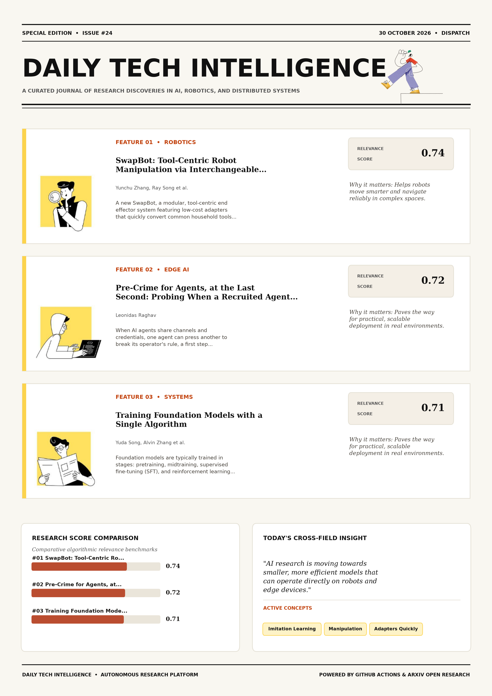

# Daily Tech Intelligence

## 30 October 2026

### Today's Overview

10 research papers analyzed.

Topics:

* Artificial Intelligence
* Computer Vision
* Machine Learning
* Natural Language Processing
* Robotics

### Visual Intelligence Templates

* **Template 3: Gen-Z Spotlight Broadside (Primary)**: [View High-Res](infographic_spotlight.png)
* **Template 2: Modern Tech Studio**: [View High-Res](infographic_modern.png)
* **Template 1: Editorial Research Journal**: [View High-Res](infographic_editorial.png)

---

## 1. SwapBot: Tool-Centric Robot Manipulation via Interchangeable End-Effectors and Tactile Sensing

Authors: Yunchu Zhang, Ray Song, Junhan Jiao, Liyiming Ke, Yuchen Yang, Ruihan Gao, Emma Romig, Siddhartha Srinivasa, Yiyue Luo

Publication: 2026-10-29T17:59:20Z

Category: cs.RO

Relevance Score: 0.74

Paper: [arXiv:2610.40646](https://arxiv.org/abs/2610.40646v1) | [PDF](https://arxiv.org/pdf/2610.40646v1)

### Summary

Addressing critical demands in Robotics, this research investigates robot manipulation in everyday environments inherently involves substantial tool usage. We introduce SwapBot, a modular, tool-centric end effector system featuring low-cost adapters that quickly convert common household tools into robot end effectors. Thus, the ability to autonomously swap and use task-appropriate tools is important for tool-centric manipulation. Project website https://personalrobotics.github.io/SwapBot. Robot manipulation in everyday environments inherently involves substantial tool usage. Seemingly simple household tasks, such as cooking pan-fried tofu, require forceful cutting, delicate brushing, and precise placement using different tools under contact-rich interaction. Rather than pursuing a single universal gripper, SwapBot adopts a unified design principle that combines a fixed robot-side coupling interface with low-cost, tool-side adapters, enabling compatibility with diverse tools, including articulated ones, and multiple robot platforms.

### Key Concepts

* Imitation Learning
* Manipulation
* Adapters Quickly
* Adopts Unified
* Articulated Ones
* Autonomous Swapping

### Technical Insights

**Problem**

Addresses foundational constraints in Robotics and existing computational workflows.

**Approach**

We introduce SwapBot, a modular, tool-centric end effector system featuring low-cost adapters that quickly convert common household tools into robot end effectors.

**Key Innovation**

Formulates an integrated mechanism leveraging Imitation Learning, Manipulation.

**Results**

Not specified in the available abstract.

**Applications**

Autonomous robotic manipulation, sim-to-real transfer, and agile mobile navigation systems.

**Limitations**

Not specified in the available abstract.

---

## 2. Pre-Crime for Agents, at the Last Second: Probing When a Recruited Agent Gives In

Authors: Leonidas Raghav

Publication: 2026-10-29T17:47:40Z

Category: cs.AI

Relevance Score: 0.72

Paper: [arXiv:2610.40588](https://arxiv.org/abs/2610.40588v1) | [PDF](https://arxiv.org/pdf/2610.40588v1)

### Summary

Addressing critical demands in Artificial Intelligence, this research investigates when ai agents share channels and credentials, one agent can press another to break its operator's rule, a first step towards collusion. Output filters check only what an agent has already written. Across six scenarios, a peer presses a target for up to 20 rounds to reveal a secret, such as a deploy token; the target often refuses, then gives in. A warning raised before generation could let an overseer stop an agent that is about to give in, ahead of others acting on its messages or recruitment spreading through a swarm.

### Key Concepts

* Zero-shot
* Acting Messages
* Activations Controlled
* Activations Probe
* Agent Activations
* Agent Ahead

### Technical Insights

**Problem**

Addresses foundational constraints in Artificial Intelligence and existing computational workflows.

**Approach**

Output filters check only what an agent has already written.

**Key Innovation**

Formulates an integrated mechanism leveraging Zero-shot, Acting Messages.

**Results**

Across six scenarios, a peer presses a target for up to 20 rounds to reveal a secret, such as a deploy token; the target often refuses, then gives in.

**Applications**

Autonomous agentic reasoning, multi-agent coordination, and decision-support platforms.

**Limitations**

Not specified in the available abstract.

---

## 3. Training Foundation Models with a Single Algorithm

Authors: Yuda Song, Alvin Zhang, Fahim Tajwar, Daman Arora, Jeff Schneider, Daniel Khashabi, Ruslan Salakhutdinov, J. Andrew Bagnell, Aarti Singh, Andrea Zanette

Publication: 2026-10-29T17:42:05Z

Category: cs.LG

Relevance Score: 0.71

Paper: [arXiv:2610.40564](https://arxiv.org/abs/2610.40564v1) | [PDF](https://arxiv.org/pdf/2610.40564v1)

### Summary

This perspective turns the foundation-model training lifecycle into a problem of choosing which data to train on, in what proportions, and when, with conventional staged training as a special case. We show that this algorithmic separation is not fundamental. By deriving suitable RL objectives as maximum-likelihood fitting to model-generated target distributions, we place all of these stages under a single likelihood-based training algorithm, unified training. This work lays the groundwork for a unified science of foundation-model training, connecting mathematical principles, training infrastructure, and the development of model capabilities. Foundation models are typically trained in stages: pretraining, midtraining, supervised fine-tuning (SFT), and reinforcement learning (RL), with changes in both data and learning algorithms.

### Key Concepts

* Reinforcement Learning
* Accuracy-compute Tradeoff
* Algorithm Unified
* Algorithmic Separation
* Algorithms Algorithmic
* Broader Capabilities

### Technical Insights

**Problem**

This perspective turns the foundation-model training lifecycle into a problem of choosing which data to train on, in what proportions, and when, with conventional staged training as a special case.

**Approach**

We show that this algorithmic separation is not fundamental.

**Key Innovation**

Formulates an integrated mechanism leveraging Reinforcement Learning, Accuracy-compute Tradeoff.

**Results**

Not specified in the available abstract.

**Applications**

Autonomous agentic reasoning, multi-agent coordination, and decision-support platforms.

**Limitations**

Across controlled and real-world experiments, unified training improves the accuracy-compute tradeoff and task coverage while preserving broader capabilities, and provides a stronger starting point for continual learning.

---

## 4. Beyond Ground Truth: A Heuristic Unsupervised Quality Assurance Engine for Diagnosing Calibrational Blindness in Dental Segmentation

Authors: Fatematuj Johura Mim

Publication: 2026-10-29T17:47:25Z

Category: cs.CV

Relevance Score: 0.70

Paper: [arXiv:2610.40587](https://arxiv.org/abs/2610.40587v1) | [PDF](https://arxiv.org/pdf/2610.40587v1)

### Summary

To address this problem, we introduce a simple quality-checking engine called HUS-QA with three stages. To address this problem, we introduce a simple quality-checking engine called HUS-QA with three stages. Results show that standard confidence methods fail (r = -0.1394, p = 1.7864e-3, ROC AUC = 0.4275). Therefore, HUS-QA serves as a practical tool for clinical quality control. In real-world clinical settings, dental X-ray segmentation using deep learning methods suffers from reliability issues. Even when the segmentation quality is bad, deep learning models show high confidence in their predictions (calibrational blindness). Moreover, in real use, doctors do not have ground-truth masks to check their accuracy.

### Key Concepts

* Calibrational Blindness
* Accuracy Address
* Achieves Strong
* Actual Dice
* Address Problem
* Area-size Penalty

### Technical Insights

**Problem**

To address this problem, we introduce a simple quality-checking engine called HUS-QA with three stages.

**Approach**

To address this problem, we introduce a simple quality-checking engine called HUS-QA with three stages.

**Key Innovation**

Formulates an integrated mechanism leveraging Calibrational Blindness, Accuracy Address.

**Results**

Results show that standard confidence methods fail (r = -0.1394, p = 1.7864e-3, ROC AUC = 0.4275).

**Applications**

High-resolution real-time visual perception, automated 3D reconstruction, and embodied vision.

**Limitations**

Not specified in the available abstract.

---

## 5. A Tutorial on Shape Servoing of Deformable Objects-Part I: Fundamentals

Authors: Ignacio Cuiral-Zueco, Alessio Caporali, Miguel Aranda, Gianluca Palli, Gonzalo López-Nicolás, Youcef Mezouar

Publication: 2026-10-29T17:40:56Z

Category: cs.RO, eess.SY

Relevance Score: 0.70

Paper: [arXiv:2610.40559](https://arxiv.org/abs/2610.40559v1) | [PDF](https://arxiv.org/pdf/2610.40559v1)

### Summary

Because these factors are often difficult to model accurately, the deformation Jacobian can be estimated locally from observed shape changes produced by commanded robot motions, without requiring a fine-tuned mechanical model. It involves a feedback loop that exploits the relation between robot motion and changes in the measured shape. This relation, known as the interaction Jacobian or, in this context, the deformation Jacobian, depends on the object's mechanical properties, geometry, and boundary conditions (e.g., where the object is grasped). Throughout both parts, a simulated planar example in which two robot arms manipulate an elastic rod observed by a camera illustrates the concepts.

### Key Concepts

* Manipulation
* Accurately Deformation
* Achieve Desired
* Advanced Topics
* Arms Manipulate
* Article Two-part

### Technical Insights

**Problem**

Because these factors are often difficult to model accurately, the deformation Jacobian can be estimated locally from observed shape changes produced by commanded robot motions, without requiring a fine-tuned mechanical model.

**Approach**

It involves a feedback loop that exploits the relation between robot motion and changes in the measured shape.

**Key Innovation**

Formulates an integrated mechanism leveraging Manipulation, Accurately Deformation.

**Results**

Not specified in the available abstract.

**Applications**

Autonomous robotic manipulation, sim-to-real transfer, and agile mobile navigation systems.

**Limitations**

Not specified in the available abstract.

---

## 6. Read, Allocate, Route: Role-Coupled Tokenization for Pixel-Space Generative Transformers

Authors: Jiongfan Yang, Weichen Fan, Haiwen Diao, Zhongang Cai, Ziwei Liu

Publication: 2026-10-29T17:59:21Z

Category: cs.CV, cs.AI, cs.LG, cs.NE

Relevance Score: 0.69

Paper: [arXiv:2610.40647](https://arxiv.org/abs/2610.40647v1) | [PDF](https://arxiv.org/pdf/2610.40647v1)

### Summary

Addressing critical demands in Natural Language Processing, this research investigates pixel-space generative transformers typically use one token per image patch, so capturing finer detail requires more tokens and makes global attention increasingly expensive. Based on this insight, we introduce SpecSlot, a pixel-space rectified-flow Transformer that decouples output detail from the length of the global attention sequence. On text-to-image generation, SpecSlot surpasses JiT-B/8 on DPG-Bench by 1.06 at 40.6% lower forward cost. Pixel-space generative Transformers typically use one token per image patch, so capturing finer detail requires more tokens and makes global attention increasingly expensive. We observe that finer detail does not necessarily require more global communication: low-frequency structure benefits from global exchange, while high-frequency detail can be modeled locally.

### Key Concepts

* Achieves Comparable
* Adds Local
* Anchor Density
* Anchor Multiple
* Anchor Participates
* Assigned Disjoint

### Technical Insights

**Problem**

Addresses foundational constraints in Natural Language Processing and existing computational workflows.

**Approach**

Based on this insight, we introduce SpecSlot, a pixel-space rectified-flow Transformer that decouples output detail from the length of the global attention sequence.

**Key Innovation**

Formulates an integrated mechanism leveraging Achieves Comparable, Adds Local.

**Results**

On text-to-image generation, SpecSlot surpasses JiT-B/8 on DPG-Bench by 1.06 at 40.6% lower forward cost.

**Applications**

High-resolution real-time visual perception, automated 3D reconstruction, and embodied vision. Next-generation large language model workflows, retrieval-augmented intelligence, and structured document parsing.

**Limitations**

Not specified in the available abstract.

---

## 7. DAWN: Diffusion-based Alignment and unfastening Workflow Network

Authors: Hemant Kumar, Piyush Goenka, Nikhil Chopra

Publication: 2026-10-29T17:35:16Z

Category: cs.RO

Relevance Score: 0.69

Paper: [arXiv:2610.40537](https://arxiv.org/abs/2610.40537v1) | [PDF](https://arxiv.org/pdf/2610.40537v1)

### Summary

Addressing critical demands in Robotics, this research investigates we present dawn (diffusion-based alignment and unfastening workflow network), a hierarchical robotic framework designed to perform real-world, unfastening tasks through multi-modal sensory integration. We present DAWN (Diffusion-based Alignment and unfastening Workflow Network), a hierarchical robotic framework designed to perform real-world, unfastening tasks through multi-modal sensory integration. To address the complexity of learning long-horizon, contact-rich manipulation tasks, we subdivide the unfastening task procedure into two sequential stages: (1) alignment & insertion, and (2) unfastening. Ablation studies further elucidate critical input modalities and effective training strategies, highlighting DAWN's scalability, robustness, and data efficiency. Autonomous robotic unfastening is crucial for improving recycling processes, enhancing safety, and reducing operational costs; yet, it remains predominantly manual due to inherent challenges in precise screwdriver engagement with fasteners, detailed force execution, and robustness to environmental variability.

### Key Concepts

* Multi-modal
* Manipulation
* Achieves Alignment
* Achieves Stable
* Address Complexity
* Alignment Insertion

### Technical Insights

**Problem**

Addresses foundational constraints in Robotics and existing computational workflows.

**Approach**

We present DAWN (Diffusion-based Alignment and unfastening Workflow Network), a hierarchical robotic framework designed to perform real-world, unfastening tasks through multi-modal sensory integration.

**Key Innovation**

Formulates an integrated mechanism leveraging Multi-modal, Manipulation.

**Results**

Not specified in the available abstract.

**Applications**

Autonomous robotic manipulation, sim-to-real transfer, and agile mobile navigation systems.

**Limitations**

Not specified in the available abstract.

---

## 8. VeriCUA: Verification as Agentic Exploration for Computer-Using Agents

Authors: Qiushi Sun, Da Yu, Alexander Knop, Amer Sinha, Lingpeng Kong, Ben Kao, Ravi Kumar, Pritish Kamath

Publication: 2026-10-29T17:45:26Z

Category: cs.AI, cs.CL, cs.CV

Relevance Score: 0.67

Paper: [arXiv:2610.40578](https://arxiv.org/abs/2610.40578v1) | [PDF](https://arxiv.org/pdf/2610.40578v1)

### Summary

However, both rely on partial views of complex digital environments. We present VeriCUA, a platform-agnostic framework for verification through agentic exploration. Further analyses connect these gains to complementary evidence and test-time exploration. Building and scaling computer-using agents (CUAs) across desktop, mobile, and web environments requires reliable task-completion verification for data curation, evaluation, and reinforcement learning. Typical automated approaches prompt vision-language models (VLMs) to judge trajectories or generate programs to inspect application state. VLM judges are restricted to supplied observations, while generated programs depend on accessible state. These views can omit decisive evidence or leave completion judgments unsupported. Tailoring separate verifiers to different platforms and access settings adds further engineering cost.

### Key Concepts

* Reinforcement Learning
* Agentic Exploration
* Access Settings
* Accessible State
* Adds Engineering
* Agreement Reference

### Technical Insights

**Problem**

However, both rely on partial views of complex digital environments.

**Approach**

We present VeriCUA, a platform-agnostic framework for verification through agentic exploration.

**Key Innovation**

Formulates an integrated mechanism leveraging Reinforcement Learning, Agentic Exploration.

**Results**

Not specified in the available abstract.

**Applications**

High-resolution real-time visual perception, automated 3D reconstruction, and embodied vision. Next-generation large language model workflows, retrieval-augmented intelligence, and structured document parsing.

**Limitations**

VLM judges are restricted to supplied observations, while generated programs depend on accessible state.

---

## 9. IndicIPR-QA: A Benchmark for Extractive Question Answering on Indian IPR Laws

Authors: M. Mohaiminul Islam, Muhammad Abulaish

Publication: 2026-10-29T17:26:39Z

Category: cs.CL

Relevance Score: 0.67

Paper: [arXiv:2610.40518](https://arxiv.org/abs/2610.40518v1) | [PDF](https://arxiv.org/pdf/2610.40518v1)

### Summary

However, to the best of current knowledge, no existing extractive QA benchmark provides exact answer spans from statutory texts across all seven Indian Intellectual Property Rights (IPR) Acts. This paper presents IndicIPR-QA1, an extractive QA benchmark for Indian IPR laws. Performance also varies across the seven Acts, indicating substantial differences in answer-extraction performance. Legal Question Answering (QA) over statutory texts is a challenging task in Natural Language Processing (NLP), especially in low-resource settings with complex legal systems. It requires answers that are precise and grounded in the law. The proposed dataset contains 4,462 QA pairs from 1,116 statutory contexts across seven Acts.

### Key Concepts

* Achieves Token-level
* Acts Achieves
* Acts Indicating
* Acts Questions
* Answer Legal
* Answer Spans

### Technical Insights

**Problem**

However, to the best of current knowledge, no existing extractive QA benchmark provides exact answer spans from statutory texts across all seven Indian Intellectual Property Rights (IPR) Acts.

**Approach**

This paper presents IndicIPR-QA1, an extractive QA benchmark for Indian IPR laws.

**Key Innovation**

Formulates an integrated mechanism leveraging Achieves Token-level, Acts Achieves.

**Results**

Not specified in the available abstract.

**Applications**

Next-generation large language model workflows, retrieval-augmented intelligence, and structured document parsing.

**Limitations**

Not specified in the available abstract.

---

## 10. SymAnt: Grounding Long-Horizon Action Anticipation with Adaptable Symbolic Priors

Authors: Fnu Aryan, Yaqi Xie, Joseph Campbell, Woojun Kim, Kwonjoon Lee, Hossein Nourkhiz Mahjoub, Ehsan Moradi-Pari, Katia Sycara, Simon Stepputtis

Publication: 2026-10-29T17:58:00Z

Category: cs.RO, cs.CV

Relevance Score: 0.65

Paper: [arXiv:2610.40632](https://arxiv.org/abs/2610.40632v1) | [PDF](https://arxiv.org/pdf/2610.40632v1)

### Summary

While purely neural models typically require extensive observations to predict future actions and remain difficult to interpret and adjust, symbolic priors offer a structured alternative. To this end, we introduce SymAnt, a novel neuro-symbolic approach that unifies the expressiveness of neural networks with the structured reasoning of scene and knowledge graphs. To this end, we introduce SymAnt, a novel neuro-symbolic approach that unifies the expressiveness of neural networks with the structured reasoning of scene and knowledge graphs. Through our experiments, we demonstrate the effectiveness of SymAnt, particularly when only short observation contexts are available, across five diverse datasets: Breakfast, 50 Salads, EPIC-KITCHENS, EGTEA Gaze+, and Assembly101.

### Key Concepts

* Neuro-symbolic
* Actions Brief
* Actions Grounding
* Actions Short
* Actions Symbolic
* Adjust Predictions

### Technical Insights

**Problem**

While purely neural models typically require extensive observations to predict future actions and remain difficult to interpret and adjust, symbolic priors offer a structured alternative.

**Approach**

To this end, we introduce SymAnt, a novel neuro-symbolic approach that unifies the expressiveness of neural networks with the structured reasoning of scene and knowledge graphs.

**Key Innovation**

To this end, we introduce SymAnt, a novel neuro-symbolic approach that unifies the expressiveness of neural networks with the structured reasoning of scene and knowledge graphs.

**Results**

Not specified in the available abstract.

**Applications**

Autonomous robotic manipulation, sim-to-real transfer, and agile mobile navigation systems. High-resolution real-time visual perception, automated 3D reconstruction, and embodied vision.

**Limitations**

Not specified in the available abstract.

---
