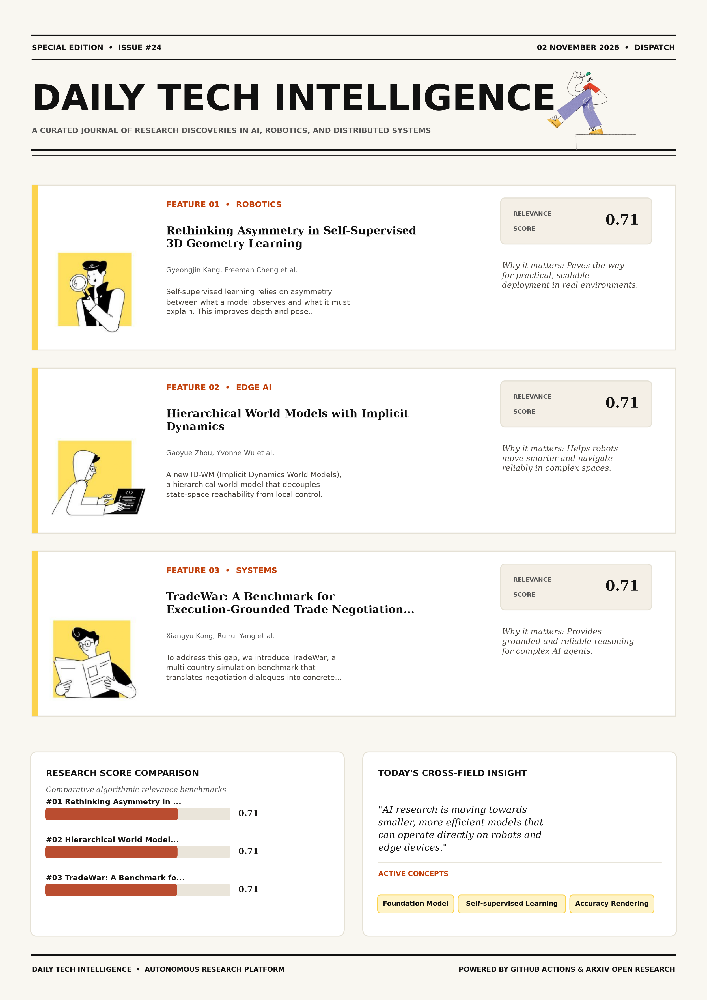

# Daily Tech Intelligence

## 02 November 2026

### Today's Overview

10 research papers analyzed.

Topics:

* Artificial Intelligence
* Machine Learning
* Natural Language Processing
* Robotics

### Visual Intelligence Templates

* **Template 3: Gen-Z Spotlight Broadside (Primary)**: [View High-Res](infographic_spotlight.png)
* **Template 2: Modern Tech Studio**: [View High-Res](infographic_modern.png)
* **Template 1: Editorial Research Journal**: [View High-Res](infographic_editorial.png)

---

## 1. Rethinking Asymmetry in Self-Supervised 3D Geometry Learning

Authors: Gyeongjin Kang, Freeman Cheng, Botao Ye, Weijie Lyu, Ming-Hsuan Yang, Eunbyung Park

Publication: 2026-10-30T17:38:39Z

Category: cs.CV

Relevance Score: 0.71

Paper: [arXiv:2610.42092](https://arxiv.org/abs/2610.42092v1) | [PDF](https://arxiv.org/pdf/2610.42092v1)

### Summary

Addressing critical demands in Machine Learning, this research investigates self-supervised learning relies on asymmetry between what a model observes and what it must explain. Recent methods learn 3D geometry from unposed images by predicting cameras and scene structure, then rendering held-out views. To avoid trivial solutions, they impose this asymmetry in the input space, restricting how views interact through separate branches or masked attention. Controlled experiments isolate the contribution of each component, and self-supervised pretraining also improves subsequent supervised training. Self-supervised learning relies on asymmetry between what a model observes and what it must explain. We revisit this design with geometric accuracy, rather than rendering quality, as the main objective.

### Key Concepts

* Foundation Model
* Self-supervised Learning
* Accuracy Rendering
* Additionally Align
* Align Features
* Aligning Sparse-context

### Technical Insights

**Problem**

Addresses foundational constraints in Machine Learning and existing computational workflows.

**Approach**

Recent methods learn 3D geometry from unposed images by predicting cameras and scene structure, then rendering held-out views.

**Key Innovation**

Formulates an integrated mechanism leveraging Foundation Model, Self-supervised Learning.

**Results**

Not specified in the available abstract.

**Applications**

High-resolution real-time visual perception, automated 3D reconstruction, and embodied vision.

**Limitations**

Not specified in the available abstract.

---

## 2. Hierarchical World Models with Implicit Dynamics

Authors: Gaoyue Zhou, Yvonne Wu, Zichen Jeff Cui, Nicolas Ballas, Mido Assran, Lerrel Pinto, Yann LeCun

Publication: 2026-10-30T17:59:25Z

Category: cs.RO, cs.AI

Relevance Score: 0.71

Paper: [arXiv:2610.42146](https://arxiv.org/abs/2610.42146v1) | [PDF](https://arxiv.org/pdf/2610.42146v1)

### Summary

However, long-horizon tasks remain hindered by cumulative errors and search complexity. We introduce ID-WM (Implicit Dynamics World Models), a hierarchical world model that decouples state-space reachability from local control. By prioritizing local physical feasibility over global behavioral patterns, ID-WM synthesizes novel long-horizon plans from short segments, transcending the specific behavioral modes seen during training. Crucially, by leveraging this hierarchical structure to mitigate compounding errors, our approach yields a 135% performance gain over single-level world model MPC, particularly in complex, unseen configurations for long-horizon tasks. Videos can be viewed at https://id-wm.github.io Planning with world models enables test-time adaptation for embodied agents, offering superior generalization over direct policy learning.

### Key Concepts

* World Model
* Manipulation
* Test-time Adaptation
* Transcending Specific
* Transitions Precise Actions
* Transitions State

### Technical Insights

**Problem**

However, long-horizon tasks remain hindered by cumulative errors and search complexity.

**Approach**

We introduce ID-WM (Implicit Dynamics World Models), a hierarchical world model that decouples state-space reachability from local control.

**Key Innovation**

By prioritizing local physical feasibility over global behavioral patterns, ID-WM synthesizes novel long-horizon plans from short segments, transcending the specific behavioral modes seen during training.

**Results**

Crucially, by leveraging this hierarchical structure to mitigate compounding errors, our approach yields a 135% performance gain over single-level world model MPC, particularly in complex, unseen configurations for long-horizon tasks.

**Applications**

Autonomous robotic manipulation, sim-to-real transfer, and agile mobile navigation systems.

**Limitations**

Not specified in the available abstract.

---

## 3. TradeWar: A Benchmark for Execution-Grounded Trade Negotiation with Adaptive LLM Agents

Authors: Xiangyu Kong, Ruirui Yang, Xia Hou

Publication: 2026-10-30T16:45:29Z

Category: cs.AI

Relevance Score: 0.71

Paper: [arXiv:2610.42004](https://arxiv.org/abs/2610.42004v1) | [PDF](https://arxiv.org/pdf/2610.42004v1)

### Summary

Multi-turn negotiation remains a challenging problem for large language model (LLM) agents. To address this gap, we introduce TradeWar, a multi-country simulation benchmark that translates negotiation dialogues into concrete tariff and trade-share policies, enforces capacity and network constraints during settlement, and evaluates outcomes via an Economic Health Index (EHI). These results indicate that CoT deliberation and interaction memory alone do not fully address delayed execution feedback, whereas settlement-grounded adaptation improves long-horizon negotiation in TradeWar. While LLMs can conduct natural-language dialogue, existing benchmarks predominantly assess only agreement rates, overlooking whether negotiated commitments actually create value once executed. To solve this execution-grounded task, we propose TACTIC (Trade-aware Adaptive Consolidation and Theory-of-mind for International Commerce), an agent that iteratively refines its negotiation strategy across episodes-without updating base LLM weights-by leveraging prior experience, opponent behavior, and past settlement outcomes.

### Key Concepts

* Zero-shot
* Large Language Model
* Final Ehi
* Tactic Trade-aware
* Tariff Trade-share
* Technology-controls Energy-crisis

### Technical Insights

**Problem**

Multi-turn negotiation remains a challenging problem for large language model (LLM) agents.

**Approach**

To address this gap, we introduce TradeWar, a multi-country simulation benchmark that translates negotiation dialogues into concrete tariff and trade-share policies, enforces capacity and network constraints during settlement, and evaluates outcomes via an Economic Health Index (EHI).

**Key Innovation**

Formulates an integrated mechanism leveraging Zero-shot, Large Language Model.

**Results**

Not specified in the available abstract.

**Applications**

Next-generation large language model workflows, retrieval-augmented intelligence, and structured document parsing.

**Limitations**

To address this gap, we introduce TradeWar, a multi-country simulation benchmark that translates negotiation dialogues into concrete tariff and trade-share policies, enforces capacity and network constraints during settlement, and evaluates outcomes via an Economic Health Index (EHI).

---

## 4. Latent Reasoning in Continuous Space for Unified Multimodal Models

Authors: Byungwoo Jeon, Yoonwoo Jeong, Hyunseok Lee, Minsu Cho, Jinwoo Shin

Publication: 2026-10-30T17:59:43Z

Category: cs.CV, cs.CL, cs.LG

Relevance Score: 0.70

Paper: [arXiv:2610.42149](https://arxiv.org/abs/2610.42149v1) | [PDF](https://arxiv.org/pdf/2610.42149v1)

### Summary

To bridge this gap, we introduce a Latent Reasoning framework in Continuous space (LARC), which alleviates the token-level bottleneck by reasoning over continuous hidden states. To bridge this gap, we introduce a Latent Reasoning framework in Continuous space (LARC), which alleviates the token-level bottleneck by reasoning over continuous hidden states. Notably, LARC achieves state-of-the-art performance on GenEval with a 7%p gain over BAGEL and demonstrates clear test-time scaling behavior, outperforming token-based generation under both parallel and sequential test-time scaling strategies. Unified Multimodal Models (UMMs) achieve remarkable success on diverse multimodal understanding and generation tasks, yet they still struggle to effectively leverage language-based chain-of-thought reasoning for image generation.

### Key Concepts

* Reinforcement Learning
* Continuous Space
* Latent Reasoning
* Achieve Remarkable
* Alleviates Token-level
* Attribute Failure

### Technical Insights

**Problem**

To bridge this gap, we introduce a Latent Reasoning framework in Continuous space (LARC), which alleviates the token-level bottleneck by reasoning over continuous hidden states.

**Approach**

To bridge this gap, we introduce a Latent Reasoning framework in Continuous space (LARC), which alleviates the token-level bottleneck by reasoning over continuous hidden states.

**Key Innovation**

Formulates an integrated mechanism leveraging Reinforcement Learning, Continuous Space.

**Results**

Notably, LARC achieves state-of-the-art performance on GenEval with a 7%p gain over BAGEL and demonstrates clear test-time scaling behavior, outperforming token-based generation under both parallel and sequential test-time scaling strategies.

**Applications**

High-resolution real-time visual perception, automated 3D reconstruction, and embodied vision. Next-generation large language model workflows, retrieval-augmented intelligence, and structured document parsing.

**Limitations**

Not specified in the available abstract.

---

## 5. DecisionRank: On-Policy Distillation for Decision-Model Rerankers

Authors: Yanran Wu, Dian Yu, Chongyang Bai, Jieyi Zhang, Rui Liu, Tianyi Chen, Shike Mei, Hang Cui, Frank Shyu, Sandeep Pandey, Luke Simon, Chunwei Liu, Xi Liu

Publication: 2026-10-30T17:56:58Z

Category: cs.CL

Relevance Score: 0.70

Paper: [arXiv:2610.42128](https://arxiv.org/abs/2610.42128v1) | [PDF](https://arxiv.org/pdf/2610.42128v1)

### Summary

However, transferring a generative LLM's ranking knowledge to a decision model remains challenging: the teacher expresses preferences through a ranked list of document ID sequences, while the student determines the ranking using scores from the first-token position. To bridge this gap, we introduce DecisionRank, a decision model trained through item-space on-policy distillation (OPD). Combined with offline ranking supervision, DecisionRank achieves state-of-the-art performance on both general and reasoning-intensive retrieval benchmarks such as TREC DL, BEIR, and BRIGHT. At 8B, it outperforms its generative listwise counterpart while running 24.5\times faster on TREC DL and 16.7\times faster on BRIGHT. Decision models target structured tasks by directly predicting choices or scores, avoiding autoregressive decoding latency.

### Key Concepts

* Autoregressive Decoding
* Avoiding Autoregressive
* Beir Bright
* Challenging Teacher
* Choices Scores
* Combined Offline

### Technical Insights

**Problem**

However, transferring a generative LLM's ranking knowledge to a decision model remains challenging: the teacher expresses preferences through a ranked list of document ID sequences, while the student determines the ranking using scores from the first-token position.

**Approach**

To bridge this gap, we introduce DecisionRank, a decision model trained through item-space on-policy distillation (OPD).

**Key Innovation**

Formulates an integrated mechanism leveraging Autoregressive Decoding, Avoiding Autoregressive.

**Results**

Combined with offline ranking supervision, DecisionRank achieves state-of-the-art performance on both general and reasoning-intensive retrieval benchmarks such as TREC DL, BEIR, and BRIGHT.

**Applications**

Next-generation large language model workflows, retrieval-augmented intelligence, and structured document parsing.

**Limitations**

Not specified in the available abstract.

---

## 6. Think in 360°: Benchmarking and Bootstrapping Panoramic Video Reasoning

Authors: Lidong Lu, Lidong Zou, Xinyi Mao, Jiaxin Lv, Zhenquan Li, Liangrui Dong, Tong Lu, Guo Chen

Publication: 2026-10-30T17:35:02Z

Category: cs.CV

Relevance Score: 0.70

Paper: [arXiv:2610.42082](https://arxiv.org/abs/2610.42082v1) | [PDF](https://arxiv.org/pdf/2610.42082v1)

### Summary

Addressing critical demands in Artificial Intelligence, this research investigates a panoramic video captures all directions around the camera, but relevant evidence can appear in different directions and at different times. We introduce PanoVideoBench, the first manually annotated benchmark for comprehensive panoramic video understanding. It reaches 55.7% on PanoVideoBench, improving the backbone by 12.5 points and the previous SOTA by 2.6. The gains concentrate on the same spatial, cross-view, and temporal capabilities exposed by the benchmark, showing that grounded sphere-time supervision can equip a general video MLLM with panoramic reasoning. A panoramic video captures all directions around the camera, but relevant evidence can appear in different directions and at different times.

### Key Concepts

* Panoramic Video
* Agentic Explorations
* Annotations Target
* Backbone Points
* Capabilities Construct
* Capabilities Exposed

### Technical Insights

**Problem**

Addresses foundational constraints in Artificial Intelligence and existing computational workflows.

**Approach**

We introduce PanoVideoBench, the first manually annotated benchmark for comprehensive panoramic video understanding.

**Key Innovation**

Formulates an integrated mechanism leveraging Panoramic Video, Agentic Explorations.

**Results**

It reaches 55.7% on PanoVideoBench, improving the backbone by 12.5 points and the previous SOTA by 2.6.

**Applications**

High-resolution real-time visual perception, automated 3D reconstruction, and embodied vision.

**Limitations**

Not specified in the available abstract.

---

## 7. REA: A Routed Embodied Agent Runtime for Asynchronous Brain-Cerebellum Control

Authors: Pengfei Zhou, Yixing Ma, Zhengfeiyang Zhang, Haoyuan Chen, Zhenglin Wan, Hexin Wang, Wangbo Zhao, Yang You

Publication: 2026-10-30T17:18:13Z

Category: cs.RO, cs.CV

Relevance Score: 0.70

Paper: [arXiv:2610.42053](https://arxiv.org/abs/2610.42053v1) | [PDF](https://arxiv.org/pdf/2610.42053v1)

### Summary

Foundation models are becoming remarkably reliable at high-level reasoning, yet they remain too slow and costly to serve as fine-grained controllers. To address this, we propose REA (Routed Embodied Agent), a unified runtime where a deliberative System 2, an embodied router System 1 and reactive System 0 policies cooperate under a single golden rule - no running policy waits on the brain. While pairing a deliberative brain (foundation models) with a reactive cerebellum (fast policies) seems natural for embodied systems, two obstacles remain: methods are built and scored on incompatible stacks, and their asynchronous coordination is difficult. REA also transfers to BEHAVIOR-1K and a real Unitree G1 humanoid, achieving the highest observed success among the compared methods.

### Key Concepts

* Fast Policies
* Success Compared Methods
* Success Vla
* Tends Re-trigger Fallbacks
* Test Episodes
* Time Boundary-triggered

### Technical Insights

**Problem**

Foundation models are becoming remarkably reliable at high-level reasoning, yet they remain too slow and costly to serve as fine-grained controllers.

**Approach**

To address this, we propose REA (Routed Embodied Agent), a unified runtime where a deliberative System 2, an embodied router System 1 and reactive System 0 policies cooperate under a single golden rule - no running policy waits on the brain.

**Key Innovation**

Formulates an integrated mechanism leveraging Fast Policies, Success Compared Methods.

**Results**

Not specified in the available abstract.

**Applications**

Autonomous robotic manipulation, sim-to-real transfer, and agile mobile navigation systems. High-resolution real-time visual perception, automated 3D reconstruction, and embodied vision.

**Limitations**

Not specified in the available abstract.

---

## 8. ROOF: Learning Humanoid Fall Recovery under Overhead Constraints

Authors: Yidan Lu, Jiayuan Yu, Zongrui Cai, Jingwen Sun, Jinrui Han, Jing Wang, Ping Luo, Peng Lu

Publication: 2026-10-30T17:41:32Z

Category: cs.RO

Relevance Score: 0.69

Paper: [arXiv:2610.42097](https://arxiv.org/abs/2610.42097v1) | [PDF](https://arxiv.org/pdf/2610.42097v1)

### Summary

A fallen humanoid beneath an overhead obstacle faces a coupled recovery problem. We introduce a reinforcement learning method with contact-supported geometric escape guidance, which rewards incremental reduction of robot-obstacle overlap without prescribing an escape path. Project page: https://lu-yidan.github.io/ROOF/ It must create clearance while organizing support for a stable rise, since attempting to stand before making room can further increase obstruction. To achieve this, a learned motion prior, together with posture-dependent support and joint-stall costs, is proposed to shape a single policy that learns when to clear the obstacle, how to establish support, and when to complete the rise, all using proprioception alone.

### Key Concepts

* Reinforcement Learning
* Achieve Learned
* Arrangements Absent
* Attempting Stand
* Attempts Seven
* Beneath Free

### Technical Insights

**Problem**

A fallen humanoid beneath an overhead obstacle faces a coupled recovery problem.

**Approach**

We introduce a reinforcement learning method with contact-supported geometric escape guidance, which rewards incremental reduction of robot-obstacle overlap without prescribing an escape path.

**Key Innovation**

Formulates an integrated mechanism leveraging Reinforcement Learning, Achieve Learned.

**Results**

Not specified in the available abstract.

**Applications**

Autonomous robotic manipulation, sim-to-real transfer, and agile mobile navigation systems.

**Limitations**

A fallen humanoid beneath an overhead obstacle faces a coupled recovery problem.

---

## 9. A Hybrid Path Planning Framework for Assistive Wheelchair Navigation in Dynamic Pedestrian Environments

Authors: Damla Leblebicioğlu, Rachel Barume, Taşkın Padır

Publication: 2026-10-30T17:16:59Z

Category: cs.RO, eess.SY

Relevance Score: 0.69

Paper: [arXiv:2610.42049](https://arxiv.org/abs/2610.42049v1) | [PDF](https://arxiv.org/pdf/2610.42049v1)

### Summary

However, reliable navigation especially in human environments is a major challenge due to factors such as dynamic obstacles, unpredictable pedestrian behavior, and the users' need to complete multiple stops along the way before reaching their final destination. This paper presents a hybrid path planning framework for multi-goal navigation in dynamic environments. Experimental results demonstrate that the proposed hybrid framework enables efficient multi-goal navigation while maintaining safe operation in dynamic environments with humans, with TSP-PF-RRT achieving fewer or no collisions and shorter travel distances. Autonomous wheelchairs can improve the quality of life for individuals with mobility impairments by providing greater independence.

### Key Concepts

* Dynamic Environments
* Dynamic Obstacles
* Local Planners
* Multi-goal Navigation
* Shorter Travel
* Simulations Crowded

### Technical Insights

**Problem**

However, reliable navigation especially in human environments is a major challenge due to factors such as dynamic obstacles, unpredictable pedestrian behavior, and the users' need to complete multiple stops along the way before reaching their final destination.

**Approach**

This paper presents a hybrid path planning framework for multi-goal navigation in dynamic environments.

**Key Innovation**

Formulates an integrated mechanism leveraging Dynamic Environments, Dynamic Obstacles.

**Results**

Not specified in the available abstract.

**Applications**

Autonomous robotic manipulation, sim-to-real transfer, and agile mobile navigation systems.

**Limitations**

Not specified in the available abstract.

---

## 10. RoboArchitect: Automating the Design of Robotic Agents with Persistent Memory

Authors: Shengguang Wu, Suning Huang, Cherie Ho, Ria Doshi, Hao Zhu, Serena Yeung-Levy

Publication: 2026-10-30T17:58:48Z

Category: cs.RO, cs.AI, cs.CV

Relevance Score: 0.68

Paper: [arXiv:2610.42141](https://arxiv.org/abs/2610.42141v1) | [PDF](https://arxiv.org/pdf/2610.42141v1)

### Summary

Addressing critical demands in Robotics, this research investigates recent work shows that a frozen robot policy performs far better inside an agent harness, where control code decides when to query the policy, consult vision tools, or command the arm directly. Yet today these harnesses are built by hand and redesigned for each new robot or benchmark. We show that harness design can be automated, offering a strong alternative to finetuning on a novel setup. The gains are largest where the benchmark is far from the policy's training data: wrapping a general-purpose policy, the evolved harness yields a specialist that often outperforms even the finetuned version. These results suggest that substantial headroom in robotic manipulation lies in the agent harness, and its design can be effectively automated and optimized without weight updates.

### Key Concepts

* Manipulation
* Agent Harness
* Harness Design
* Harness Evolves
* Today Harnesses
* Tools Command

### Technical Insights

**Problem**

Addresses foundational constraints in Robotics and existing computational workflows.

**Approach**

Yet today these harnesses are built by hand and redesigned for each new robot or benchmark.

**Key Innovation**

We show that harness design can be automated, offering a strong alternative to finetuning on a novel setup.

**Results**

The gains are largest where the benchmark is far from the policy's training data: wrapping a general-purpose policy, the evolved harness yields a specialist that often outperforms even the finetuned version.

**Applications**

Autonomous robotic manipulation, sim-to-real transfer, and agile mobile navigation systems. High-resolution real-time visual perception, automated 3D reconstruction, and embodied vision.

**Limitations**

Not specified in the available abstract.

---
