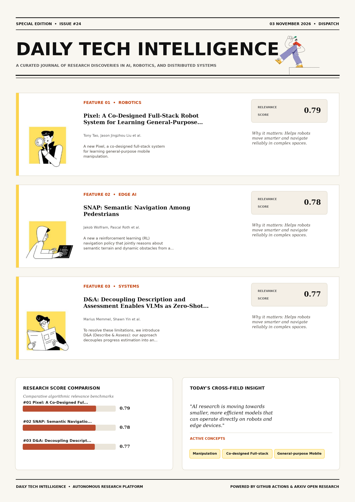

# Daily Tech Intelligence

## 03 November 2026

### Today's Overview

10 research papers analyzed.

Topics:

* Artificial Intelligence
* IoT & Edge AI
* Machine Learning
* Robotics

### Visual Intelligence Templates

* **Template 3: Gen-Z Spotlight Broadside (Primary)**: [View High-Res](infographic_spotlight.png)
* **Template 2: Modern Tech Studio**: [View High-Res](infographic_modern.png)
* **Template 1: Editorial Research Journal**: [View High-Res](infographic_editorial.png)

---

## 1. Pixel: A Co-Designed Full-Stack Robot System for Learning General-Purpose Mobile Manipulation

Authors: Tony Tao, Jason Jingzhou Liu, Ruslan Salakhutdinov, Deepak Pathak

Publication: 2026-11-02T18:59:32Z

Category: cs.RO, cs.AI, cs.CV, cs.LG, eess.SY

Relevance Score: 0.79

Paper: [arXiv:2611.03648](https://arxiv.org/abs/2611.03648v1) | [PDF](https://arxiv.org/pdf/2611.03648v1)

### Summary

Addressing critical demands in Robotics, this research investigates general-purpose mobile manipulation requires a combination of capable robot hardware, scalable demonstration collection, expressive whole-body control, and effective policy learning. We present Pixel, a co-designed full-stack system for learning general-purpose mobile manipulation. More results at https://pixel-robot.com/pixel General-purpose mobile manipulation requires a combination of capable robot hardware, scalable demonstration collection, expressive whole-body control, and effective policy learning. Yet these components are often developed independently, creating mismatches that limit the capabilities of the complete system. Pixel combines a low-cost wheeled humanoid with human-aligned kinematics and compliant grippers, multiple teleoperation and robot-free human data-collection interfaces, a unified whole-body controller, and a common policy learning pipeline across human and robot demonstrations.

### Key Concepts

* Manipulation
* Co-designed Full-stack
* General-purpose Mobile
* Active Perception
* Behaviors Requiring
* Capabilities Complete

### Technical Insights

**Problem**

Addresses foundational constraints in Robotics and existing computational workflows.

**Approach**

We present Pixel, a co-designed full-stack system for learning general-purpose mobile manipulation.

**Key Innovation**

Formulates an integrated mechanism leveraging Manipulation, Co-designed Full-stack.

**Results**

Not specified in the available abstract.

**Applications**

Autonomous robotic manipulation, sim-to-real transfer, and agile mobile navigation systems. High-resolution real-time visual perception, automated 3D reconstruction, and embodied vision.

**Limitations**

Not specified in the available abstract.

---

## 2. SNAP: Semantic Navigation Among Pedestrians

Authors: Jakob Wolfram, Pascal Roth, Fan Yang, Cesar Cadena, Marco Hutter

Publication: 2026-11-02T17:37:50Z

Category: cs.RO

Relevance Score: 0.78

Paper: [arXiv:2611.03498](https://arxiv.org/abs/2611.03498v1) | [PDF](https://arxiv.org/pdf/2611.03498v1)

### Summary

Addressing critical demands in Robotics, this research investigates navigating crowded urban environments requires robots to avoid pedestrians while adhering to social norms such as remaining on sidewalks. We propose a reinforcement learning (RL) navigation policy that jointly reasons about semantic terrain and dynamic obstacles from a single semantically annotated bird's-eye-view (BEV) map, without relying on explicit human-state estimation. Our policy outperforms established crowd-navigation and semantic-aware baselines and transfers zero-shot to a legged robot, demonstrating socially compliant navigation in highly dynamic real-world scenarios. Navigating crowded urban environments requires robots to avoid pedestrians while adhering to social norms such as remaining on sidewalks.

### Key Concepts

* Reinforcement Learning
* Zero-shot
* Address Crowd
* Adhering Social
* Annotated Bird
* Approaches Typically

### Technical Insights

**Problem**

Addresses foundational constraints in Robotics and existing computational workflows.

**Approach**

We propose a reinforcement learning (RL) navigation policy that jointly reasons about semantic terrain and dynamic obstacles from a single semantically annotated bird's-eye-view (BEV) map, without relying on explicit human-state estimation.

**Key Innovation**

Formulates an integrated mechanism leveraging Reinforcement Learning, Zero-shot.

**Results**

Our policy outperforms established crowd-navigation and semantic-aware baselines and transfers zero-shot to a legged robot, demonstrating socially compliant navigation in highly dynamic real-world scenarios.

**Applications**

Autonomous robotic manipulation, sim-to-real transfer, and agile mobile navigation systems.

**Limitations**

Not specified in the available abstract.

---

## 3. D&A: Decoupling Description and Assessment Enables VLMs as Zero-Shot Robotic Reward Models

Authors: Marius Memmel, Shawn Yin, Urvi Rutia, Angad Wadhwa, Eldon Li, Gavin Angeloff, Ankit Goyal, Jesse Zhang, Dieter Fox, Fabio Ramos, Anqi Li, Abhishek Gupta

Publication: 2026-11-02T18:52:11Z

Category: cs.RO, cs.AI, cs.CL, cs.LG, eess.SY

Relevance Score: 0.77

Paper: [arXiv:2611.03622](https://arxiv.org/abs/2611.03622v1) | [PDF](https://arxiv.org/pdf/2611.03622v1)

### Summary

Vision-Language Models (VLMs) hold promise for zero-shot video task-progress estimation in robot learning, yet existing frameworks frequently suffer from confirmation bias, hallucinating progress in failed executions due to implicit success assumptions or relative temporal ranking designs. To resolve these limitations, we introduce D&A (Describe & Assess): our approach decouples progress estimation into an objective, task-grounded textual description of scene dynamics followed by an assessment phase using explicit rubrics. Empirical results demonstrate that our method calibrates zero-shot estimates and mitigates confirmation bias, providing fine-grained, partial progress metrics that accurately penalize failed executions while correctly interpolating successful runs. Being purely prompt-based, D&A generalizes across tasks, embodiments, and benchmarks---matching or surpassing post-trained reward models---and its reward estimates enable efficient downstream reinforcement learning.

### Key Concepts

* Reinforcement Learning
* Zero-shot
* Approaches Mitigate Explicit
* Assessment Phase
* Assumptions Relative
* Confirmation Bias

### Technical Insights

**Problem**

Vision-Language Models (VLMs) hold promise for zero-shot video task-progress estimation in robot learning, yet existing frameworks frequently suffer from confirmation bias, hallucinating progress in failed executions due to implicit success assumptions or relative temporal ranking designs.

**Approach**

To resolve these limitations, we introduce D&A (Describe & Assess): our approach decouples progress estimation into an objective, task-grounded textual description of scene dynamics followed by an assessment phase using explicit rubrics.

**Key Innovation**

Formulates an integrated mechanism leveraging Reinforcement Learning, Zero-shot.

**Results**

Empirical results demonstrate that our method calibrates zero-shot estimates and mitigates confirmation bias, providing fine-grained, partial progress metrics that accurately penalize failed executions while correctly interpolating successful runs.

**Applications**

Autonomous robotic manipulation, sim-to-real transfer, and agile mobile navigation systems. Next-generation large language model workflows, retrieval-augmented intelligence, and structured document parsing.

**Limitations**

Naive prompting of frontier models collapses into a binary success detector that fails to capture nuanced, non-linear progress and failures.

---

## 4. TAMPAgent: Agentic Belief-Space Planning for Mobile Manipulation

Authors: Utkarsh A. Mishra, Alperen Degirmenci, Yongxin Chen, Danfei Xu, Tucker Hermans, Caelan Garrett

Publication: 2026-11-02T18:32:18Z

Category: cs.RO

Relevance Score: 0.76

Paper: [arXiv:2611.03584](https://arxiv.org/abs/2611.03584v1) | [PDF](https://arxiv.org/pdf/2611.03584v1)

### Summary

Addressing critical demands in Artificial Intelligence, this research investigates open-world robotic mobile manipulation requires acting in physical environments with only partial information. We propose \textbf{TAMPAgent}, an agentic planning framework that unifies the reasoning of LVLMs with the structured constraint satisfaction of TAMP systems. Evaluated across complex household mobile manipulation tasks on Rainbow Y1 and Unitree G1 platforms, TAMPAgent significantly outperforms direct tool-calling agentic baselines, demonstrating that integrating TAMP constraint satisfaction into agentic planning loops is essential for unstructured, partially observable environments. Open-world robotic mobile manipulation requires acting in physical environments with only partial information. While recent Large Vision-Language Model (LVLM) agents show strong open-world reasoning capabilities, existing architectures that rely on direct tool calling struggle with geometric uncertainty and thus are limited to fully-observable tabletop environments.

### Key Concepts

* Manipulation
* Agent Formulates Partial
* Agent Leverages
* Agentic Baselines
* Agentic Planning
* Constraint Satisfaction

### Technical Insights

**Problem**

Addresses foundational constraints in Artificial Intelligence and existing computational workflows.

**Approach**

We propose \textbf{TAMPAgent}, an agentic planning framework that unifies the reasoning of LVLMs with the structured constraint satisfaction of TAMP systems.

**Key Innovation**

Formulates an integrated mechanism leveraging Manipulation, Agent Formulates Partial.

**Results**

Evaluated across complex household mobile manipulation tasks on Rainbow Y1 and Unitree G1 platforms, TAMPAgent significantly outperforms direct tool-calling agentic baselines, demonstrating that integrating TAMP constraint satisfaction into agentic planning loops is essential for unstructured, partially observable environments.

**Applications**

Autonomous robotic manipulation, sim-to-real transfer, and agile mobile navigation systems.

**Limitations**

We propose \textbf{TAMPAgent}, an agentic planning framework that unifies the reasoning of LVLMs with the structured constraint satisfaction of TAMP systems.

---

## 5. Structured Visual Landscape: Generating Preferred Representations in Biological and Artificial Neural Networks

Authors: Yusong Zhao, Edgar Y. Walker, Hao Wang, Mi Lu

Publication: 2026-11-02T18:39:55Z

Category: cs.CV, cs.LG, cs.NE

Relevance Score: 0.74

Paper: [arXiv:2611.03597](https://arxiv.org/abs/2611.03597v1) | [PDF](https://arxiv.org/pdf/2611.03597v1)

### Summary

Addressing critical demands in Machine Learning, this research investigates understanding how neurons respond to visual stimulus is an important question in both deep learning and neuroscience. We propose a structured visual representations landscape and design an activation-based prior that allows us to effectively regularize the landscape with activations from brain regions or neural network units. Our framework improves activation modulation and image realism compared with a recent state-of-the-art method for generating preferred visual representations of these neural targets. Understanding how neurons respond to visual stimulus is an important question in both deep learning and neuroscience. It has significant implications for enhancing the interpretability of black-box artificial neural networks and for understanding the visual representation in the human brain.

### Key Concepts

* Diffusion Model
* Artificial Neural
* Neural Networks
* Activation Modulation
* Activation-based Prior
* Activation-regularized Latent

### Technical Insights

**Problem**

Addresses foundational constraints in Machine Learning and existing computational workflows.

**Approach**

We propose a structured visual representations landscape and design an activation-based prior that allows us to effectively regularize the landscape with activations from brain regions or neural network units.

**Key Innovation**

Formulates an integrated mechanism leveraging Diffusion Model, Artificial Neural.

**Results**

Not specified in the available abstract.

**Applications**

High-resolution real-time visual perception, automated 3D reconstruction, and embodied vision.

**Limitations**

Not specified in the available abstract.

---

## 6. From Natural Language to Exact Cover: A Neuro-Symbolic Approach to Zebra Puzzles

Authors: Paulius Skaisgiris, Thomas Pammer, Veronika Semmelrock, Mykyta Ielanskyi, Maximilian Heisinger, Erich Kobler

Publication: 2026-11-02T18:58:21Z

Category: cs.AI

Relevance Score: 0.74

Paper: [arXiv:2611.03641](https://arxiv.org/abs/2611.03641v1) | [PDF](https://arxiv.org/pdf/2611.03641v1)

### Summary

Despite these advances, purely neural LLMs continue to struggle with elementary logical reasoning problems and lack the determinism, soundness, and reliability characteristic of symbolic reasoning systems. In this work, we present a synergistic neuro-symbolic framework that bridges this gap by combining neural semantic parsing with deterministic exact cover reasoning. The results demonstrate that our hybrid approach consistently outperforms strong plain neural baselines, including CoT prompting, as well as recent neuro-symbolic methods. Chain-of-Thought (CoT) generation has substantially improved the performance of Large Language Models (LLMs) on complex reasoning tasks, including code generation, data analysis, and exam-style question answering. Conversely, classical symbolic methods such as SAT solving and exact cover guarantee correctness and completeness, but require problems to be expressed in highly specialized formal encodings, limiting their applicability to natural language inputs.

### Key Concepts

* Neuro-symbolic
* Exact Cover
* Natural Language
* Baselines Including
* Bridges Gap
* Calls Construct

### Technical Insights

**Problem**

Despite these advances, purely neural LLMs continue to struggle with elementary logical reasoning problems and lack the determinism, soundness, and reliability characteristic of symbolic reasoning systems.

**Approach**

In this work, we present a synergistic neuro-symbolic framework that bridges this gap by combining neural semantic parsing with deterministic exact cover reasoning.

**Key Innovation**

Formulates an integrated mechanism leveraging Neuro-symbolic, Exact Cover.

**Results**

The results demonstrate that our hybrid approach consistently outperforms strong plain neural baselines, including CoT prompting, as well as recent neuro-symbolic methods.

**Applications**

Next-generation large language model workflows, retrieval-augmented intelligence, and structured document parsing.

**Limitations**

Given a Zebra-style logic puzzle in natural language, an LLM translates entities and constraints into structured tool calls that construct an exact cover instance.

---

## 7. Not All Reasoning Generalizes: A Case Study on Learning Generalizable Reasoning Strategies in RLVR

Authors: Ziqi Pang, Yu-Xiong Wang

Publication: 2026-11-02T18:53:54Z

Category: cs.LG

Relevance Score: 0.74

Paper: [arXiv:2611.03627](https://arxiv.org/abs/2611.03627v1) | [PDF](https://arxiv.org/pdf/2611.03627v1)

### Summary

Although these bijective tasks are actually not uniformly harder and even further from the non-bijective OOD evaluation, they make derivation more certain and substantially restore the correct strategy and accuracy under OOD shifts. This paper studies how to incentivize such generalization via reasoning strategies. We study this question with a controllable equation-solving framework: finding multiple inputs x for equations f(x)=y, where f is a non-bijective string function. Code is available at https://github.com/ziqipang/rl_meta_thinking. Reinforcement learning with verifiable rewards (RLVR) can enable generalizable improvement for large language model (LLM) reasoning. This setting makes reasoning strategies observable while supporting a clear definition of easy-to-hard out-of-distribution (OOD) shifts, e.g., more solutions, longer y, etc.

### Key Concepts

* Reinforcement Learning
* Large Language Model
* Reasoning Strategies
* Available Https
* Ood Shifts
* Rlvr Generalization

### Technical Insights

**Problem**

Although these bijective tasks are actually not uniformly harder and even further from the non-bijective OOD evaluation, they make derivation more certain and substantially restore the correct strategy and accuracy under OOD shifts.

**Approach**

This paper studies how to incentivize such generalization via reasoning strategies.

**Key Innovation**

Formulates an integrated mechanism leveraging Reinforcement Learning, Large Language Model.

**Results**

Not specified in the available abstract.

**Applications**

Autonomous agentic reasoning, multi-agent coordination, and decision-support platforms.

**Limitations**

Not specified in the available abstract.

---

## 8. When Robots Outweigh Objects: How Inertia Mismatch Shapes Robot Policy Learning

Authors: Younghyo Park, Antonia Bronars, Pulkit Agrawal

Publication: 2026-11-02T17:40:05Z

Category: cs.RO

Relevance Score: 0.74

Paper: [arXiv:2611.03501](https://arxiv.org/abs/2611.03501v1) | [PDF](https://arxiv.org/pdf/2611.03501v1)

### Summary

However, it remains unclear whether high inertia imposes a hidden cost on learning, potentially worsening scaling with data or lowering the performance ceiling of modern robot learning methods. Even a small accidental bump from a heavy arm can knock a light object out of place. Modern learning methods have nevertheless demonstrated a wide range of successful manipulation behaviors on these platforms, suggesting that even extreme inertia mismatch can be overcome with sufficient data. Project website: https://younghyopark.me/inertia-mismatch/ Conventional robot arms can be extremely heavy compared with the everyday objects they manipulate, creating a significant inertia mismatch at contact. We investigate this question through controlled simulation experiments that vary robot and object masses.

### Key Concepts

* Reinforcement Learning
* Manipulation
* Inertia Mismatch
* Arms Extremely Heavy
* Behavior Cloning
* Behaviors Platforms

### Technical Insights

**Problem**

However, it remains unclear whether high inertia imposes a hidden cost on learning, potentially worsening scaling with data or lowering the performance ceiling of modern robot learning methods.

**Approach**

Even a small accidental bump from a heavy arm can knock a light object out of place.

**Key Innovation**

Formulates an integrated mechanism leveraging Reinforcement Learning, Manipulation.

**Results**

Not specified in the available abstract.

**Applications**

Autonomous robotic manipulation, sim-to-real transfer, and agile mobile navigation systems.

**Limitations**

Not specified in the available abstract.

---

## 9. Exploring Proximity and Tactile Sensing for Robotic Manipulation

Authors: Eric T. Chang, Bianca Aumann, Zhanpeng He, Mohamed Elnoor, Thomas Liang, Matei Ciocarlie, Nima Fazeli, Joshua Migdal, Tye Brady, Taskin Padir

Publication: 2026-11-02T17:33:03Z

Category: cs.RO

Relevance Score: 0.74

Paper: [arXiv:2611.03489](https://arxiv.org/abs/2611.03489v1) | [PDF](https://arxiv.org/pdf/2611.03489v1)

### Summary

Addressing critical demands in Robotics, this research investigates pre-touch sensing, or sensing information about an object before contact, is an attractive modality for robot hands as it can allow a robot to anticipate and respond to a contact before it happens. In this work, we introduce ToFTouch, a multimodal tactile sensor combining three multizone (4\times4 resolution) time-of-flight sensors with an optics-based pressure sensing array. We mount this sensor on a parallel jaw gripper and demonstrate its utility on three distinct tasks: (i) pre-grasp adjustment, (ii) item extraction from clutter, and (iii) item insertion into tight spaces. The results demonstrate the utility of multizone ToF sensing in a manipulation environment.

### Key Concepts

* Manipulation
* Adjustment Item
* Adjustment Tof
* Allow Robot
* Anticipate Respond
* Anticipatory Gripper

### Technical Insights

**Problem**

Addresses foundational constraints in Robotics and existing computational workflows.

**Approach**

In this work, we introduce ToFTouch, a multimodal tactile sensor combining three multizone (4\times4 resolution) time-of-flight sensors with an optics-based pressure sensing array.

**Key Innovation**

Formulates an integrated mechanism leveraging Manipulation, Adjustment Item.

**Results**

Not specified in the available abstract.

**Applications**

Autonomous robotic manipulation, sim-to-real transfer, and agile mobile navigation systems.

**Limitations**

Not specified in the available abstract.

---

## 10. PlantVLM-Edge: Quantized Vision-Language Models for On-Device Crop Health Diagnosis

Authors: Gaurab Wagle, Bishal Adhikari, Jiajia Li, Xiaolei Huang, Dong Chen

Publication: 2026-11-02T18:19:19Z

Category: cs.CV, cs.AI

Relevance Score: 0.73

Paper: [arXiv:2611.03557](https://arxiv.org/abs/2611.03557v1) | [PDF](https://arxiv.org/pdf/2611.03557v1)

### Summary

However, deploying VLMs on resource-constrained devices remains challenging due to their substantial computational and memory requirements. This paper presents PlantVLM-Edge, a quantized vision-language framework for conversational crop health diagnosis that can run entirely on resource-constrained edge devices. These results demonstrate that timely and accurate crop health diagnosis is practical on edge devices, providing a foundation for next-generation crop monitoring and decision support systems. Timely and accurate crop health diagnosis is essential for sustainable agricultural production, yet accurate diagnosis often requires expert knowledge that is not readily available. Recent vision-language models (VLMs) have demonstrated remarkable capabilities in visual understanding, reasoning, and natural-language interaction, creating new opportunities for intelligent crop health assessment.

### Key Concepts

* Quantization
* Domain Adaptation
* Crop Health
* Health Diagnosis
* Accurate Crop
* Answer Quality

### Technical Insights

**Problem**

However, deploying VLMs on resource-constrained devices remains challenging due to their substantial computational and memory requirements.

**Approach**

This paper presents PlantVLM-Edge, a quantized vision-language framework for conversational crop health diagnosis that can run entirely on resource-constrained edge devices.

**Key Innovation**

Formulates an integrated mechanism leveraging Quantization, Domain Adaptation.

**Results**

Not specified in the available abstract.

**Applications**

Low-power edge AI devices, embedded IoT sensor networks, and distributed on-device inference. High-resolution real-time visual perception, automated 3D reconstruction, and embodied vision. Next-generation large language model workflows, retrieval-augmented intelligence, and structured document parsing.

**Limitations**

Not specified in the available abstract.

---
