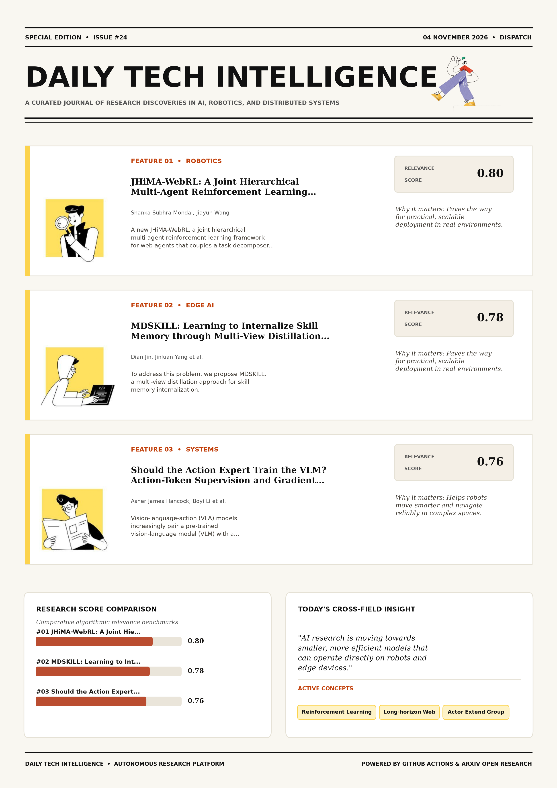

# Daily Tech Intelligence

## 04 November 2026

### Today's Overview

10 research papers analyzed.

Topics:

* Artificial Intelligence
* Machine Learning
* Robotics

### Visual Intelligence Templates

* **Template 3: Gen-Z Spotlight Broadside (Primary)**: [View High-Res](infographic_spotlight.png)
* **Template 2: Modern Tech Studio**: [View High-Res](infographic_modern.png)
* **Template 1: Editorial Research Journal**: [View High-Res](infographic_editorial.png)

---

## 1. JHiMA-WebRL: A Joint Hierarchical Multi-Agent Reinforcement Learning Framework for Long-Horizon Web Tasks

Authors: Shanka Subhra Mondal, Jiayun Wang

Publication: 2026-11-03T17:49:14Z

Category: cs.AI

Relevance Score: 0.80

Paper: [arXiv:2611.05263](https://arxiv.org/abs/2611.05263v1) | [PDF](https://arxiv.org/pdf/2611.05263v1)

### Summary

Although prior work has explored modular multi-agent systems with a separate planner, the planner is typically not updated jointly with the actor. We introduce JHiMA-WebRL, a joint hierarchical multi-agent reinforcement learning framework for web agents that couples a task decomposer with an actor. Ablations show that jointly updating the decomposer during RL outperforms updating the actor alone. These results suggest that jointly learned role factorization with smaller models can be a competitive alternative to scaling monolithic agents for long-horizon web tasks. Multimodal web agents have shown promising capabilities for interacting with websites through graphical user interfaces (GUIs), yet realistic web tasks often require long-horizon, multi-step planning that remains challenging for monolithic policies.

### Key Concepts

* Reinforcement Learning
* Long-horizon Web
* Actor Extend Group
* Actor Interactive
* Actor Investigate
* Decomposer Actor

### Technical Insights

**Problem**

Although prior work has explored modular multi-agent systems with a separate planner, the planner is typically not updated jointly with the actor.

**Approach**

We introduce JHiMA-WebRL, a joint hierarchical multi-agent reinforcement learning framework for web agents that couples a task decomposer with an actor.

**Key Innovation**

Formulates an integrated mechanism leveraging Reinforcement Learning, Long-horizon Web.

**Results**

Ablations show that jointly updating the decomposer during RL outperforms updating the actor alone.

**Applications**

Autonomous agentic reasoning, multi-agent coordination, and decision-support platforms.

**Limitations**

Not specified in the available abstract.

---

## 2. MDSKILL: Learning to Internalize Skill Memory through Multi-View Distillation for Efficient Dynamic Agent Self-Evolution

Authors: Dian Jin, Jinluan Yang, Kairong Han, Baohong Li, Zijing Hu, Yi He, Wenlin Zhong, Yunze Tong, Minqin Zhu, Linchuan Li, Yanan Niu, Kun Kuang

Publication: 2026-11-03T18:19:55Z

Category: cs.CL

Relevance Score: 0.78

Paper: [arXiv:2611.05313](https://arxiv.org/abs/2611.05313v1) | [PDF](https://arxiv.org/pdf/2611.05313v1)

### Summary

However, self-generated memories often contain noisy supervision and functionally entangled, redundant, or conflicting knowledge, making direct distillation difficult. To address this problem, we propose MDSKILL, a multi-view distillation approach for skill memory internalization. Without additional computational overhead, MDSKILL improves upon SOTA performance by up to 7.1% and 8.1% on ALFWorld and WebShop. The code is available at https://anonymous.4open.science/r/MDSKILL-CF53. Skill memories encode past experiences as textual prompts to improve reinforcement learning (RL) for self-evolving agents. Complementing RL, On-Policy Self-Distillation (OPSD) provides dense, fine-grained supervision to internalize knowledge from skill-guided trajectories and accelerate policy learning. Under limited training budgets, these issues can hinder knowledge internalization and even degrade performance.

### Key Concepts

* Reinforcement Learning
* Agent Self-evolution
* Knowledge Internalization
* Skill Memories
* State Grounding
* Stronger External

### Technical Insights

**Problem**

However, self-generated memories often contain noisy supervision and functionally entangled, redundant, or conflicting knowledge, making direct distillation difficult.

**Approach**

To address this problem, we propose MDSKILL, a multi-view distillation approach for skill memory internalization.

**Key Innovation**

Formulates an integrated mechanism leveraging Reinforcement Learning, Agent Self-evolution.

**Results**

Without additional computational overhead, MDSKILL improves upon SOTA performance by up to 7.1% and 8.1% on ALFWorld and WebShop.

**Applications**

Next-generation large language model workflows, retrieval-augmented intelligence, and structured document parsing.

**Limitations**

Without additional computational overhead, MDSKILL improves upon SOTA performance by up to 7.1% and 8.1% on ALFWorld and WebShop.

---

## 3. Should the Action Expert Train the VLM? Action-Token Supervision and Gradient Routing in Mixture-of-Transformer VLAs

Authors: Asher James Hancock, Boyi Li, Yuxiao Chen, Shuhan Tan, Wenhao Ding, Thomas Tian, Yan Wang, Boris Ivanovic, Marco Pavone

Publication: 2026-11-03T17:35:27Z

Category: cs.RO

Relevance Score: 0.76

Paper: [arXiv:2611.05249](https://arxiv.org/abs/2611.05249v1) | [PDF](https://arxiv.org/pdf/2611.05249v1)

### Summary

Addressing critical demands in Robotics, this research investigates vision-language-action (vla) models increasingly pair a pre-trained vision-language model (vlm) with a flow-matching expert that conditions its action predictions on the vlm's key-value representations. Those representations must carry information useful for control, yet the VLM was never trained for the action expert's flow-matching objective. Two signals can address this: gradients backpropagated from the expert's loss (coupling), or VLM supervision to predict discrete tokens encoding the same target actions. These findings show that the value of gradient insulation depends on the VLM's action supervision and the evaluation setting, challenging insulation as a default VLA training recipe.

### Key Concepts

* Manipulation
* Action-token Supervision
* Action Tokens
* Action-relevant Representations
* Expert Loss
* Vision-language Co-training

### Technical Insights

**Problem**

Addresses foundational constraints in Robotics and existing computational workflows.

**Approach**

Those representations must carry information useful for control, yet the VLM was never trained for the action expert's flow-matching objective.

**Key Innovation**

Formulates an integrated mechanism leveraging Manipulation, Action-token Supervision.

**Results**

Not specified in the available abstract.

**Applications**

Autonomous robotic manipulation, sim-to-real transfer, and agile mobile navigation systems. High-resolution real-time visual perception, automated 3D reconstruction, and embodied vision.

**Limitations**

Not specified in the available abstract.

---

## 4. From Autonomous Agents to Cognitive Symbionts: Toward AI-Augmented Human Intelligence

Authors: Hao Fei

Publication: 2026-11-03T18:59:52Z

Category: cs.CL, cs.AI

Relevance Score: 0.74

Paper: [arXiv:2611.05376](https://arxiv.org/abs/2611.05376v1) | [PDF](https://arxiv.org/pdf/2611.05376v1)

### Summary

Addressing critical demands in Artificial Intelligence, this research investigates for a decade, progress in artificial intelligence has been measured by how much a machine can do on its own. Large foundation models now write code and run multistep tasks, and personal agents act on a person's behalf. Yet people still forget what they once knew, miss what they are not looking at, fail to find the right words, and face hard choices without the benefit of their own history, because the machine that could help stands outside the situation. Because a symbiont changes what a person can do in front of others, it also raises risks of a new kind, from covert assistance in examinations to pressure on everyone to adopt it, and we treat their governance as part of the paradigm.

### Key Concepts

* Ahi Asks
* Alongside Acting
* Alongside Artificial
* Thinking Right
* Treat Governance
* Trust Symbiont

### Technical Insights

**Problem**

Addresses foundational constraints in Artificial Intelligence and existing computational workflows.

**Approach**

Large foundation models now write code and run multistep tasks, and personal agents act on a person's behalf.

**Key Innovation**

Formulates an integrated mechanism leveraging Ahi Asks, Alongside Acting.

**Results**

Not specified in the available abstract.

**Applications**

Next-generation large language model workflows, retrieval-augmented intelligence, and structured document parsing.

**Limitations**

Not specified in the available abstract.

---

## 5. Stabilizing On-Policy Targeted Guidance in Agentic Reinforcement Learning

Authors: Kevin Frans, Alexander M Rush, Sergey Levine, Pieter Abbeel, Ashvin Nair

Publication: 2026-11-03T17:54:33Z

Category: cs.LG

Relevance Score: 0.74

Paper: [arXiv:2611.05266](https://arxiv.org/abs/2611.05266v1) | [PDF](https://arxiv.org/pdf/2611.05266v1)

### Summary

Can we utilize such structures to provide a rich directional signal that enables improving on otherwise difficult to optimize rewards? In this work, we examine a framework we refer to as targeted guidance that learns from per-turn textual feedback via an on-policy self-distillation objective. We further examine the design choices that lead to stable entropy and reduce oscillatory behavior throughout training. Naive on-policy RL is often bottlenecked by the capabilities of the base model --- insufficient coverage can result in an inability to learn from certain rewards. At the same time, rewards in modern post-training systems often come from rich textual sources, e.g. judge models with a rubric of criteria.

### Key Concepts

* Reinforcement Learning
* Agentic Multi-turn
* Bottlenecked Capabilities
* Capabilities Base
* Certain Rewards
* Choices Lead

### Technical Insights

**Problem**

Can we utilize such structures to provide a rich directional signal that enables improving on otherwise difficult to optimize rewards?

**Approach**

In this work, we examine a framework we refer to as targeted guidance that learns from per-turn textual feedback via an on-policy self-distillation objective.

**Key Innovation**

Formulates an integrated mechanism leveraging Reinforcement Learning, Agentic Multi-turn.

**Results**

Not specified in the available abstract.

**Applications**

Autonomous agentic reasoning, multi-agent coordination, and decision-support platforms.

**Limitations**

Not specified in the available abstract.

---

## 6. PACT: Pose-Robust Actuation Co-Design for Tendon-Driven Robotic Hands

Authors: Prashant Kumar, Rachael Granberry, Taylor Niehues, Andrew A. Stanley, Gabe Pirie

Publication: 2026-11-03T18:13:41Z

Category: cs.RO

Relevance Score: 0.74

Paper: [arXiv:2611.05302](https://arxiv.org/abs/2611.05302v1) | [PDF](https://arxiv.org/pdf/2611.05302v1)

### Summary

Tendon-driven transmissions address this challenge by relocating actuators to the palm and forearm, but routing paths, moment arms, and capstan dimensions jointly determine both force capability and joint speed, so selecting them sequentially satisfies one requirement at the expense of the other. This paper presents a pose-robust actuation co-design for tendon-driven robot hands (PACT) framework that optimizes tendon routing, moment arms, and capstan dimensions under pose-dependent force requirements and drivetrain-bandwidth constraints. Prototype measurements deviate from predictions by up to 24.5%, primarily due to unmodeled transmission losses. These results indicate that co-designing routing with the drivetrain can meet pose-dependent force requirements without relaxing the bandwidth constraint, paving the way for human-sized robotic hands with human-level performance.

### Key Concepts

* Actuation Co-design
* Robotic Hands
* Achieves Task-force
* Actuator Bounds
* Actuators Palm
* Applied Four-degree-of-freedom

### Technical Insights

**Problem**

Tendon-driven transmissions address this challenge by relocating actuators to the palm and forearm, but routing paths, moment arms, and capstan dimensions jointly determine both force capability and joint speed, so selecting them sequentially satisfies one requirement at the expense of the other.

**Approach**

This paper presents a pose-robust actuation co-design for tendon-driven robot hands (PACT) framework that optimizes tendon routing, moment arms, and capstan dimensions under pose-dependent force requirements and drivetrain-bandwidth constraints.

**Key Innovation**

Formulates an integrated mechanism leveraging Actuation Co-design, Robotic Hands.

**Results**

Prototype measurements deviate from predictions by up to 24.5%, primarily due to unmodeled transmission losses.

**Applications**

Autonomous robotic manipulation, sim-to-real transfer, and agile mobile navigation systems.

**Limitations**

This paper presents a pose-robust actuation co-design for tendon-driven robot hands (PACT) framework that optimizes tendon routing, moment arms, and capstan dimensions under pose-dependent force requirements and drivetrain-bandwidth constraints.

---

## 7. PyRUA-DataFarm: LLM Agent as a Cost-Efficient Teleoperator for Real-Ready Robot Data

Authors: Kewei Zhang, Juncheng Ma, Guodong Lv, Duomin Wang, Feixiang Ruan, Ruiyang Si, Chuanrui Zhang, Yuxuan Chen, Hao Chen, Yichen Liu, Yintianrun Zhang, Yufan Deng, Enze Xie, Daquan Zhou

Publication: 2026-11-03T18:25:14Z

Category: cs.RO, cs.AI

Relevance Score: 0.73

Paper: [arXiv:2611.05320](https://arxiv.org/abs/2611.05320v1) | [PDF](https://arxiv.org/pdf/2611.05320v1)

### Summary

Addressing critical demands in Robotics, this research investigates teleoperation remains the default way to collect robot demonstrations, but every episode costs robot and operator time, and every new task starts from scratch. We ask whether a coding agent can take over the teleoperator's job. In our DataFarm, the agent receives a data request and one calibration episode of the robot in the target scene and rebuilds the task in simulation: it writes the scene, an expert controller, and a success judge. One hour of three-view data for a task costs \107 on average, these costs included, slightly below a quote of \117 for teleoperation in China and below \290 in labour alone in North America.

### Key Concepts

* Api Usage
* Ask Coding
* Camera Views
* Episode Costs
* Robot Operator
* Trials Unseen

### Technical Insights

**Problem**

Addresses foundational constraints in Robotics and existing computational workflows.

**Approach**

We ask whether a coding agent can take over the teleoperator's job.

**Key Innovation**

Formulates an integrated mechanism leveraging Api Usage, Ask Coding.

**Results**

Not specified in the available abstract.

**Applications**

Autonomous robotic manipulation, sim-to-real transfer, and agile mobile navigation systems. Next-generation large language model workflows, retrieval-augmented intelligence, and structured document parsing.

**Limitations**

Not specified in the available abstract.

---

## 8. DreamX: Video Diffusion Model is a Universal Latent Action Learner

Authors: Jisoo Kim, Chaehyun Kim, Junsu Kim, Jiho Park, Seongchan Kim, Eunbeen Hong, Soowon Son, Fu-En Yang, Seungryong Kim

Publication: 2026-11-03T18:59:56Z

Category: cs.CV, cs.AI, cs.RO

Relevance Score: 0.72

Paper: [arXiv:2611.05377](https://arxiv.org/abs/2611.05377v1) | [PDF](https://arxiv.org/pdf/2611.05377v1)

### Summary

Addressing critical demands in Machine Learning, this research investigates learning a universal action representation from video requires modeling dynamics that are consistent across different executions of the same action yet invariant to changes in embodiment and appearance. We introduce DreamX, which repurposes a pretrained video diffusion model as a universal latent action learner. On LARY-Bench, DreamX achieves state-of-the-art performance among latent action models. Furthermore, this shared interface also enables policy learning in a compact latent action space, reducing the computational cost of video-diffusion-based policies. Learning a universal action representation from video requires modeling dynamics that are consistent across different executions of the same action yet invariant to changes in embodiment and appearance.

### Key Concepts

* Diffusion Model
* Zero-shot
* Action Learner
* Latent Action
* Action Interface
* Action Invariant

### Technical Insights

**Problem**

Addresses foundational constraints in Machine Learning and existing computational workflows.

**Approach**

We introduce DreamX, which repurposes a pretrained video diffusion model as a universal latent action learner.

**Key Innovation**

Formulates an integrated mechanism leveraging Diffusion Model, Zero-shot.

**Results**

On LARY-Bench, DreamX achieves state-of-the-art performance among latent action models.

**Applications**

Autonomous robotic manipulation, sim-to-real transfer, and agile mobile navigation systems. High-resolution real-time visual perception, automated 3D reconstruction, and embodied vision.

**Limitations**

Furthermore, this shared interface also enables policy learning in a compact latent action space, reducing the computational cost of video-diffusion-based policies.

---

## 9. Adversarial Speculative Reasoning Improves Long Horizon Agents

Authors: Hongyin Luo, Wei Fang, Lijie Yang, Owen Stepan, Daniel Suit, Jeff Krapf, Dana Wensberg, Jack O'Brien

Publication: 2026-11-03T18:45:23Z

Category: cs.AI

Relevance Score: 0.72

Paper: [arXiv:2611.05345](https://arxiv.org/abs/2611.05345v1) | [PDF](https://arxiv.org/pdf/2611.05345v1)

### Summary

Addressing critical demands in Artificial Intelligence, this research investigates speculative decoding has been treated purely as a systems optimization that speeds up large language model decoding without changing the model behavior. In this work, we improve the reasoning capability of target models by controlling such noise. We argue that this view does not hold true for long-horizon agent reasoning. Our results recast the speculative decoding mechanism from a pure accelerator into an active allocator for context precision that improves the accuracy of long-horizon agents by training 0.06% to 0.28% of hosted parameters. Speculative decoding has been treated purely as a systems optimization that speeds up large language model decoding without changing the model behavior.

### Key Concepts

* Large Language Model
* Accuracy Long-horizon
* Complex Agentic
* Critical Reasoning
* Output Distribution
* Speculative Decoding

### Technical Insights

**Problem**

Addresses foundational constraints in Artificial Intelligence and existing computational workflows.

**Approach**

In this work, we improve the reasoning capability of target models by controlling such noise.

**Key Innovation**

Formulates an integrated mechanism leveraging Large Language Model, Accuracy Long-horizon.

**Results**

Not specified in the available abstract.

**Applications**

Autonomous agentic reasoning, multi-agent coordination, and decision-support platforms.

**Limitations**

Not specified in the available abstract.

---

## 10. CATF: A Manager-Worker Framework for Context-Aware Time-Series Forecasting

Authors: Yueqiao Chen, Dongyu Liu

Publication: 2026-11-03T18:28:04Z

Category: cs.LG

Relevance Score: 0.72

Paper: [arXiv:2611.05325](https://arxiv.org/abs/2611.05325v1) | [PDF](https://arxiv.org/pdf/2611.05325v1)

### Summary

Addressing critical demands in Machine Learning, this research investigates we study context-aware time-series forecasting, in which a single target variable is predicted from its own history and a set of contextual variables, such as weather and calendar information. We propose CATF, a Context-Aware Time-Series Forecasting framework built on a Manager-Worker architecture: a Transformer-based Manager routes each input to a single Worker based on the context, using hard routing during both training and inference. On five context-rich datasets, four horizons, and two normalization schemes, CATF improves over its standalone counterpart in 162 of 200 comparisons, the best CATF-enhanced model outperforms the best standalone baseline in 19 of 20 settings, and it outperforms the zero-shot Time-MoE foundation model in 15 of 20 settings. A case study on bike-sharing data shows that the Manager routes inputs by the calendar and that each Worker specializes in a different weekly pattern.

### Key Concepts

* Foundation Model
* Zero-shot
* Context-aware Time-series
* Time-series Forecasting
* Approaches Rely
* Best Catf-enhanced

### Technical Insights

**Problem**

Addresses foundational constraints in Machine Learning and existing computational workflows.

**Approach**

We propose CATF, a Context-Aware Time-Series Forecasting framework built on a Manager-Worker architecture: a Transformer-based Manager routes each input to a single Worker based on the context, using hard routing during both training and inference.

**Key Innovation**

Formulates an integrated mechanism leveraging Foundation Model, Zero-shot.

**Results**

On five context-rich datasets, four horizons, and two normalization schemes, CATF improves over its standalone counterpart in 162 of 200 comparisons, the best CATF-enhanced model outperforms the best standalone baseline in 19 of 20 settings, and it outperforms the zero-shot Time-MoE foundation model in 15 of 20 settings.

**Applications**

Autonomous agentic reasoning, multi-agent coordination, and decision-support platforms.

**Limitations**

Not specified in the available abstract.

---
