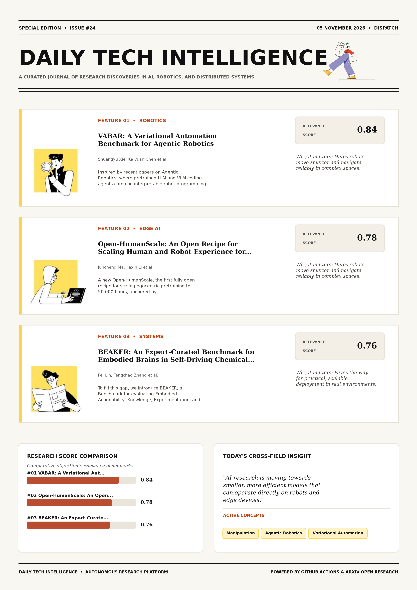

# Daily Tech Intelligence

## 05 November 2026

### Today's Overview

10 research papers analyzed.

Topics:

* Artificial Intelligence
* Computer Vision
* Natural Language Processing
* Robotics

### Visual Intelligence Templates

* **Template 3: Gen-Z Spotlight Broadside (Primary)**: [View High-Res](infographic_spotlight.png)
* **Template 2: Modern Tech Studio**: [View High-Res](infographic_modern.png)
* **Template 1: Editorial Research Journal**: [View High-Res](infographic_editorial.png)

---

## 1. VABAR: A Variational Automation Benchmark for Agentic Robotics

Authors: Shuangyu Xie, Kaiyuan Chen, Uksang Yoo, Xinyue Zhu, Meadow Shen, Jaimyn Drake, Eugen Solowjow, Lionel Gulich, Alexander Millane, Rafael Cathomen, Tuur Stuyck, Sangeeta Subramanian, Yichao Pan, Bruce McGowan, Michael Benedict, Linxi Fan, Yuke Zhu, Spencer Huang, Ken Goldberg

Publication: 2026-11-04T18:38:01Z

Category: cs.RO

Relevance Score: 0.84

Paper: [arXiv:2611.06881](https://arxiv.org/abs/2611.06881v1) | [PDF](https://arxiv.org/pdf/2611.06881v1)

### Summary

Addressing critical demands in Robotics, this research investigates for robots to operate reliably in commercial and industrial applications, they must persistently perform specific tasks with known variations in object shape and pose. Inspired by recent papers on Agentic Robotics, where pretrained LLM and VLM coding agents combine interpretable robot programming with the open-world adaptability of model free policies, we propose a general set of agentic robotics benchmark design criteria that includes accessibility, repeatability, diversity, relevance to agentic robotics and practical applications, physical realizability, resistance to benchmark saturation, and computational efficiency. We provide initial baseline evaluations using an open agentic manipulation harness, Graph-as-Policy (GaP), and Isaac Lab Arena.

### Key Concepts

* Manipulation
* Agentic Robotics
* Variational Automation
* Applications Persistently
* Tiers Success Metrics
* Tool Hanging

### Technical Insights

**Problem**

Addresses foundational constraints in Robotics and existing computational workflows.

**Approach**

Inspired by recent papers on Agentic Robotics, where pretrained LLM and VLM coding agents combine interpretable robot programming with the open-world adaptability of model free policies, we propose a general set of agentic robotics benchmark design criteria that includes accessibility, repeatability, diversity, relevance to agentic robotics and practical applications, physical realizability, resistance to benchmark saturation, and computational efficiency.

**Key Innovation**

Formulates an integrated mechanism leveraging Manipulation, Agentic Robotics.

**Results**

Not specified in the available abstract.

**Applications**

Autonomous robotic manipulation, sim-to-real transfer, and agile mobile navigation systems.

**Limitations**

Not specified in the available abstract.

---

## 2. Open-HumanScale: An Open Recipe for Scaling Human and Robot Experience for Embodied Foundation Models

Authors: Juncheng Ma, Jiaxin Li, Jiankai Tu, Bo Liang, Guodong Lv, Yufan Deng, Junzhe Tang, Liangzhu Yang, Chen Bian, Zicong Cao, Baohao Zhu, Jianxin Bi, Tengfei Yan, Yinyuan Zhang, Kewei Zhang, Xinglong Chen, Kaiqi Chen, Duomin Wang, Xiaotian Tang, Liang Tan, Li Li, Yuan Xu, Haosen Yang, Yuqi Wang, Jingfei Xia, Songyan Huang, Zhiyang Dou, Zhen Dong, Enze Xie, Tat-Seng Chua, Daquan Zhou

Publication: 2026-11-04T17:31:35Z

Category: cs.CV

Relevance Score: 0.78

Paper: [arXiv:2611.06817](https://arxiv.org/abs/2611.06817v1) | [PDF](https://arxiv.org/pdf/2611.06817v1)

### Summary

Addressing critical demands in Robotics, this research investigates egocentric human video offers a scalable source of manipulation priors for robot learning, yet translating raw data scale into generalizable robot policies demands rigorous data curation and training recipes. We introduce Open-HumanScale, the first fully open recipe for scaling egocentric pretraining to 50,000 hours, anchored by Open-HumanScale-50K---a curated egocentric video corpus densely annotated with hand motion and natural language. Leveraging this corpus, we systematically investigate pure human pretraining via closed-loop simulation evaluations and uncover an empirical log-linear scaling law linking pretraining data hours to downstream robot success rates. To support reproducible scaling research in embodied AI, we open-source the Open-HumanScale-50K corpus, data curation and pretraining pipelines, alongside the pretrained and post-trained HumanWAM checkpoints, inference code, and simulation evaluation suites.

### Key Concepts

* Scaling Law
* Zero-shot
* Manipulation
* Embodied AI
* Capability Frontier
* Translating Raw

### Technical Insights

**Problem**

Addresses foundational constraints in Robotics and existing computational workflows.

**Approach**

We introduce Open-HumanScale, the first fully open recipe for scaling egocentric pretraining to 50,000 hours, anchored by Open-HumanScale-50K---a curated egocentric video corpus densely annotated with hand motion and natural language.

**Key Innovation**

Formulates an integrated mechanism leveraging Scaling Law, Zero-shot.

**Results**

Not specified in the available abstract.

**Applications**

Autonomous robotic manipulation, sim-to-real transfer, and agile mobile navigation systems. High-resolution real-time visual perception, automated 3D reconstruction, and embodied vision.

**Limitations**

Not specified in the available abstract.

---

## 3. BEAKER: An Expert-Curated Benchmark for Embodied Brains in Self-Driving Chemical Laboratories

Authors: Fei Lin, Tengchao Zhang, Ziyang Gong, Xiaotong Yu, Bohan Zhang, Yifan Zhou, Qihao Yang, Ji Dai, Dong Li, Yining Jiang, Qinghua Ni, Jun Huang, Qiang Zhang, Yue Zhou, Zhihang Zhong, Yonglin Tian, Fei-Yue Wang, Xue Yang

Publication: 2026-11-04T18:57:17Z

Category: cs.AI

Relevance Score: 0.76

Paper: [arXiv:2611.06911](https://arxiv.org/abs/2611.06911v1) | [PDF](https://arxiv.org/pdf/2611.06911v1)

### Summary

Although Multimodal Large Language Models (MLLMs) are increasingly considered as embodied brains for such systems, existing laboratory benchmarks mainly focus on safety, anomaly detection, or general scientific understanding, leaving their execution-oriented embodied capabilities underexplored. To fill this gap, we introduce BEAKER, a Benchmark for evaluating Embodied Actionability, Knowledge, Experimentation, and Reasoning in SDCLs. Results show that current models can follow coarse experimental procedures in videos, but still struggle to ground actions into operable regions and feasible trajectories, to recognize fine-grained laboratory apparatus, states, and safety norms, and to order steps in mid-length procedures. BEAKER thus reveals a clear gap between coarse procedural understanding and the precise, action-grounded perception required for laboratory execution, providing a diagnostic benchmark for future MLLMs in SDCLs.

### Key Concepts

* Trajectory Planning
* Affordance Grounding
* Ai-assisted Generation
* Annotation Evaluate
* Annotations Manually
* Laboratory Execution

### Technical Insights

**Problem**

Although Multimodal Large Language Models (MLLMs) are increasingly considered as embodied brains for such systems, existing laboratory benchmarks mainly focus on safety, anomaly detection, or general scientific understanding, leaving their execution-oriented embodied capabilities underexplored.

**Approach**

To fill this gap, we introduce BEAKER, a Benchmark for evaluating Embodied Actionability, Knowledge, Experimentation, and Reasoning in SDCLs.

**Key Innovation**

Formulates an integrated mechanism leveraging Trajectory Planning, Affordance Grounding.

**Results**

Results show that current models can follow coarse experimental procedures in videos, but still struggle to ground actions into operable regions and feasible trajectories, to recognize fine-grained laboratory apparatus, states, and safety norms, and to order steps in mid-length procedures.

**Applications**

Autonomous agentic reasoning, multi-agent coordination, and decision-support platforms.

**Limitations**

Self-Driving Chemical Laboratories (SDCLs) are moving chemical experimentation toward embodied automation, where machines must perceive laboratory scenes, reason about experimental states, and act under physical, procedural, and safety constraints.

---

## 4. Reinforcement Learning Enables Scaling Generalist Robot Policy Improvement

Authors: Michal Korniak, Marco Bagatella, Ralf Römer, Michal Nauman, Yarden As, Pranav Vignesh, Manan Agarwal, Leander Diaz-Bone, Piotr Zalewski, Mikołaj Czarnecki, Lenart Treven, Shashwat Saxena, Sreyas Venkataraman, Sarvesh Patil, Zhiyuan Zhou, Daniel Marta, Oier Mees, Nur Muhammad Mahi Shafiullah, Carmelo Sferrazza, Bhavya Sukhija, Angela P. Schoellig, Andreas Krause, Max Simchowitz, Andrew Wagenmaker

Publication: 2026-11-04T18:52:28Z

Category: cs.LG, cs.RO

Relevance Score: 0.76

Paper: [arXiv:2611.06905](https://arxiv.org/abs/2611.06905v1) | [PDF](https://arxiv.org/pdf/2611.06905v1)

### Summary

Addressing critical demands in Robotics, this research investigates the introduction of generalist robot policies has enabled a single, large model to learn to perform a variety of tasks from a vast pre-training corpus. While these models often exhibit powerful zero-shot generalization capabilities, they typically require an adaptation phase to achieve sufficient performance in deployment. Iterated self-improvement via reinforcement learning (RL) has demonstrated promise in enabling this adaptation, yet such approaches have been largely explored in single-task settings - where the goal is to simply improve on a narrow deployment task - which lies in stark contrast to the multi-task capabilities of the base policy. To the best of our knowledge, this is among the first evidence for online generalist improvement for robot foundation models.

### Key Concepts

* Reinforcement Learning
* Zero-shot
* Generalist Robot
* Achieve Sufficient
* Adaptation Approaches
* Adaptation Phase

### Technical Insights

**Problem**

Addresses foundational constraints in Robotics and existing computational workflows.

**Approach**

While these models often exhibit powerful zero-shot generalization capabilities, they typically require an adaptation phase to achieve sufficient performance in deployment.

**Key Innovation**

Formulates an integrated mechanism leveraging Reinforcement Learning, Zero-shot.

**Results**

Not specified in the available abstract.

**Applications**

Autonomous robotic manipulation, sim-to-real transfer, and agile mobile navigation systems.

**Limitations**

Not specified in the available abstract.

---

## 5. From Pixels to Actions - Towards Native Vision-Language-Action Policies

Authors: Weichen Fan, Haiwen Diao, Penghao Wu, Siyuan Hu, Ziqi Huang, Tianqi Liu, Mingze Sun, Ziyi Wang, Zhongang Cai, Hanming Deng, Quan Wang, Lei Yang, Lewei Lu, Fangzhou Hong, Zhaoxi Chen, Dahua Lin, Ziwei Liu

Publication: 2026-11-04T18:59:58Z

Category: cs.CV

Relevance Score: 0.74

Paper: [arXiv:2611.06918](https://arxiv.org/abs/2611.06918v1) | [PDF](https://arxiv.org/pdf/2611.06918v1)

### Summary

Yet manipulation often hinges on precisely the visual signals most vulnerable to this abstraction, e.g., local geometry, boundaries, depth, and subtle state changes. We introduce NEO-VLA, a structurally encoder-free vision-language-action framework. This raises a fundamental question: should action policies inherit a fixed visual endpoint, or directly access evolving visual computation? Together, these results suggest that embodied control benefits from access to visual representations across the computational hierarchy, rather than a fixed encoder output. Vision-language-action models are typically built on a simple premise: perception is first compressed by visual encoders, and action reasoning begins only afterwards. Images are tokenized by lightweight patch convolutional layers and evolve jointly with language throughout the backbone, allowing a flow-matching action expert to draw from instruction-conditioned visual representations at different depths.

### Key Concepts

* Manipulation
* Action Policies
* Abstraction Local
* Access Evolving
* Access Visual
* Achieves Stronger

### Technical Insights

**Problem**

Yet manipulation often hinges on precisely the visual signals most vulnerable to this abstraction, e.g., local geometry, boundaries, depth, and subtle state changes.

**Approach**

We introduce NEO-VLA, a structurally encoder-free vision-language-action framework.

**Key Innovation**

Formulates an integrated mechanism leveraging Manipulation, Action Policies.

**Results**

Not specified in the available abstract.

**Applications**

Autonomous robotic manipulation, sim-to-real transfer, and agile mobile navigation systems. High-resolution real-time visual perception, automated 3D reconstruction, and embodied vision. Next-generation large language model workflows, retrieval-augmented intelligence, and structured document parsing.

**Limitations**

Not specified in the available abstract.

---

## 6. ServerBench: How can your coding agents design specialized LLM serving systems?

Authors: Xinrui Zhong, Zhiming Wang, Yongqi Liu, Zhaohui Wang, Shanglin Yang, Zikun Li, Zhuoming Chen, Beidi Chen

Publication: 2026-11-04T17:59:07Z

Category: cs.AI

Relevance Score: 0.74

Paper: [arXiv:2611.06841](https://arxiv.org/abs/2611.06841v1) | [PDF](https://arxiv.org/pdf/2611.06841v1)

### Summary

Addressing critical demands in Natural Language Processing, this research investigates large language model (llm) coding agents develop software through experimentation, offering an opportunity to design the serving systems supporting their own operation. We introduce ServerBench, a benchmark for agentic design of complete, specialized LLM serving systems. Overall, ServerBench supports systematic study of how agents translate service objectives and feedback into effective, verified serving systems for given task specifications. Large language model (LLM) coding agents develop software through experimentation, offering an opportunity to design the serving systems supporting their own operation. Effective serving requires coordinating implementation and operating decisions under session dependencies, latency constraints, and correctness requirements.

### Key Concepts

* Large Language Model
* Achieves Dollars
* Agentic Design
* Capacity Improvements
* Checks Submitted
* Claude Sonnet

### Technical Insights

**Problem**

Addresses foundational constraints in Natural Language Processing and existing computational workflows.

**Approach**

We introduce ServerBench, a benchmark for agentic design of complete, specialized LLM serving systems.

**Key Innovation**

Formulates an integrated mechanism leveraging Large Language Model, Achieves Dollars.

**Results**

Not specified in the available abstract.

**Applications**

Next-generation large language model workflows, retrieval-augmented intelligence, and structured document parsing.

**Limitations**

Effective serving requires coordinating implementation and operating decisions under session dependencies, latency constraints, and correctness requirements.

---

## 7. PyRUA-REAL: Robot Exploration and Adaptive Learning through RSI in the Real World

Authors: Qiang Wang, Jianxin Bi, Shulong Jiang, Ruiyang Si, Wenbo Huang, Kaiqi Chen, Jiaxin Li, Liyun Li, Xuanyi Li, Daquan Zhou

Publication: 2026-11-04T16:46:03Z

Category: cs.RO

Relevance Score: 0.74

Paper: [arXiv:2611.06768](https://arxiv.org/abs/2611.06768v1) | [PDF](https://arxiv.org/pdf/2611.06768v1)

### Summary

Addressing critical demands in Robotics, this research investigates coding agents powered by models such as gpt-6-astra connect spatial reasoning with executable robot behavior, raising the question of how such agents can produce lasting improvements in robot capabilities from physical interaction. In this work, we study embodied recursive self-improvement (RSI) through real-world exploration, code refinement, and deployment using PyRUA-REAL, a framework in which coding agents retain interaction experience as persistent memory and reusable executable skills that inform subsequent exploration and improvement. Our empirical study places physical manipulation at the center of the improvement process, examining how agents collaborate, what kinds of execution feedback support effective code refinement, and how task specifications and previously acquired skills influence robustness and task transfer. This study provides empirical guidance for turning physical exploration into reusable robot skills that support continued improvement and robust, efficient deployment.

### Key Concepts

* Manipulation
* Acquired Skills
* Agent Decision-making
* Astra Connect
* Behavior Raising
* Capabilities Physical Interaction

### Technical Insights

**Problem**

Addresses foundational constraints in Robotics and existing computational workflows.

**Approach**

In this work, we study embodied recursive self-improvement (RSI) through real-world exploration, code refinement, and deployment using PyRUA-REAL, a framework in which coding agents retain interaction experience as persistent memory and reusable executable skills that inform subsequent exploration and improvement.

**Key Innovation**

Formulates an integrated mechanism leveraging Manipulation, Acquired Skills.

**Results**

Not specified in the available abstract.

**Applications**

Autonomous robotic manipulation, sim-to-real transfer, and agile mobile navigation systems.

**Limitations**

Not specified in the available abstract.

---

## 8. Route First, See Later: Enabling Vision Agents to Reason Scientifically by Separating Routing Policy from Action Spaces

Authors: Shubhabrata Mukherjee, Jeffrey Donatelli, Daniela Ushizima

Publication: 2026-11-04T16:39:17Z

Category: cs.CV, cs.AI

Relevance Score: 0.73

Paper: [arXiv:2611.06760](https://arxiv.org/abs/2611.06760v1) | [PDF](https://arxiv.org/pdf/2611.06760v1)

### Summary

This lack of auditability renders agents unreliable for high-stakes scientific automation. We introduce ZETA, an extensible architecture that operationalizes the decoupling of routing policy from action execution. ZETA establishes the necessary infrastructure to isolate execution errors from interpretive ones, a critical requirement for deploying reliable scientific vision agents. Scientific image-analysis workflows require agents to select among diverse capabilities like description, detection, counting, and segmentation. Current multi-tool architectures conflate intent interpretation with visual execution, masking whether a failure arises from flawed reasoning (misrouting) or failed perception (invalid tool execution). ZETA resolves scientific intent before invoking specialized visual tools, treating measurement as a deterministic operation grounded in explicit geometry rather than generative output.

### Key Concepts

* Zero-shot
* Action Interface Fixed
* Adjacent Action
* Agent Decision-making
* Explicit Routing-policy
* Routing Accuracy

### Technical Insights

**Problem**

This lack of auditability renders agents unreliable for high-stakes scientific automation.

**Approach**

We introduce ZETA, an extensible architecture that operationalizes the decoupling of routing policy from action execution.

**Key Innovation**

Formulates an integrated mechanism leveraging Zero-shot, Action Interface Fixed.

**Results**

Not specified in the available abstract.

**Applications**

High-resolution real-time visual perception, automated 3D reconstruction, and embodied vision.

**Limitations**

Not specified in the available abstract.

---

## 9. Procedural Adversarial Learning

Authors: Jack Nugent, Jia Deng

Publication: 2026-11-04T18:42:28Z

Category: cs.CV

Relevance Score: 0.70

Paper: [arXiv:2611.06890](https://arxiv.org/abs/2611.06890v1) | [PDF](https://arxiv.org/pdf/2611.06890v1)

### Summary

We study procedural adversarial learning (PAL), a framework of minimax training and adversarial evaluation which searches the input space of a procedural generator for difficult instances. We introduce the Simple-PAT algorithm, which uses zeroth-order optimization in the procedural generator's parameter space to propose adversarial training samples that are generated on demand. Code is available at https://github.com/princeton-vl/procedural-adversarial-learning. For many computer vision tasks, neural networks can be trained to produce a low average error, yet they still fail on seemingly simple scenes. Reducing these failures requires first finding them, but they may not be in a fixed dataset. The procedural generator is an interpretable program mapping a low-dimensional vector of control parameters (e.g. layout, lighting, pose) to a rendered image and its label.

### Key Concepts

* Adversarial Learning
* Adversary Aggregate
* Aggregate Queries
* Algorithm Uses
* Available Https
* Black-box Adversary

### Technical Insights

**Problem**

We study procedural adversarial learning (PAL), a framework of minimax training and adversarial evaluation which searches the input space of a procedural generator for difficult instances.

**Approach**

We introduce the Simple-PAT algorithm, which uses zeroth-order optimization in the procedural generator's parameter space to propose adversarial training samples that are generated on demand.

**Key Innovation**

Formulates an integrated mechanism leveraging Adversarial Learning, Adversary Aggregate.

**Results**

Not specified in the available abstract.

**Applications**

High-resolution real-time visual perception, automated 3D reconstruction, and embodied vision.

**Limitations**

Not specified in the available abstract.

---

## 10. Before You Continue: Evaluating Time-Sensitive Safety Awareness in Conversational Assistants

Authors: Peidi Dong, Yunze Xiao, Yu-Lin Tsai, Yichen Zheng, Heyuan Huang, Weihao Xuan, Mark Dredze, Jen-tse Huang

Publication: 2026-11-04T17:54:49Z

Category: cs.CL

Relevance Score: 0.70

Paper: [arXiv:2611.06839](https://arxiv.org/abs/2611.06839v1) | [PDF](https://arxiv.org/pdf/2611.06839v1)

### Summary

However, users may not mention these constraints in later requests, requiring assistants to recognize and adjust their advice accordingly. To evaluate such capability, we introduce TASC (Temporal Action Safety in Conversation), a benchmark that evaluates whether LLMs apply time-dependent constraints when responding to conversational requests. Explicitly providing the timing resolves only about half of these failures, revealing a gap between temporal reasoning and its application in conversational advice. Large language model (LLM) assistants increasingly help users with everyday activities that involve time-dependent constraints. TASC consists of 3,418 inputs derived from 128 templates, along with a separate set of 33 scenarios designed to compare models' ability to calculate elapsed time with their ability to apply that information.

### Key Concepts

* Large Language Model
* Accordingly Evaluate
* Account Time-dependent
* Action Safety
* Action Violates
* Activities Involve

### Technical Insights

**Problem**

However, users may not mention these constraints in later requests, requiring assistants to recognize and adjust their advice accordingly.

**Approach**

To evaluate such capability, we introduce TASC (Temporal Action Safety in Conversation), a benchmark that evaluates whether LLMs apply time-dependent constraints when responding to conversational requests.

**Key Innovation**

Formulates an integrated mechanism leveraging Large Language Model, Accordingly Evaluate.

**Results**

Not specified in the available abstract.

**Applications**

Next-generation large language model workflows, retrieval-augmented intelligence, and structured document parsing.

**Limitations**

Large language model (LLM) assistants increasingly help users with everyday activities that involve time-dependent constraints.

---
