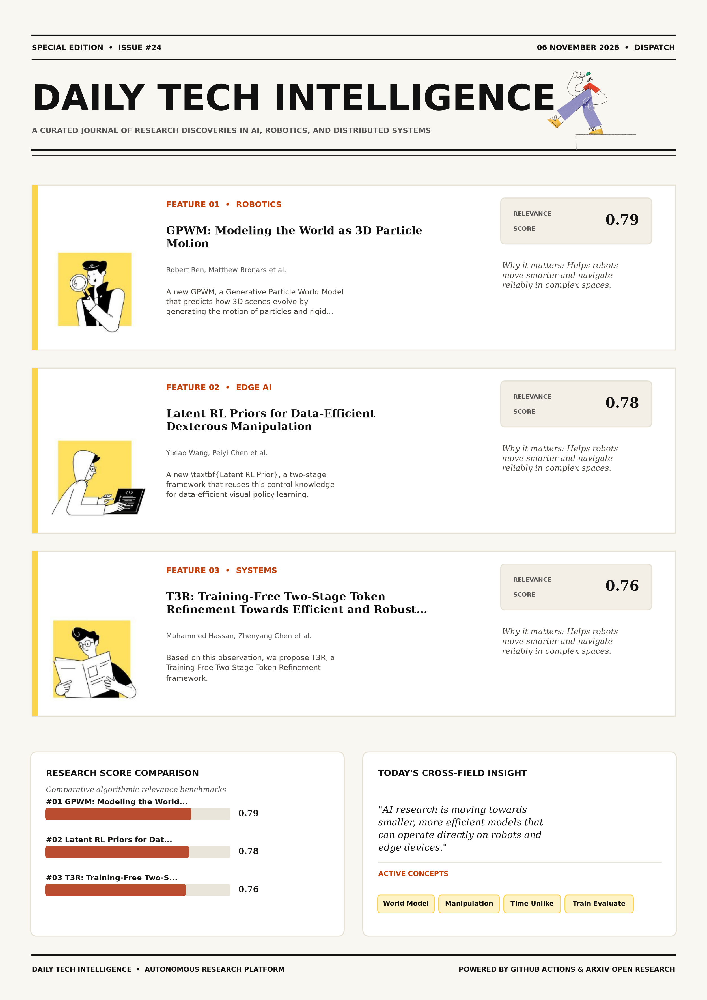

# Daily Tech Intelligence

## 06 November 2026

### Today's Overview

10 research papers analyzed.

Topics:

* Artificial Intelligence
* Machine Learning
* Natural Language Processing
* Robotics

### Visual Intelligence Templates

* **Template 3: Gen-Z Spotlight Broadside (Primary)**: [View High-Res](infographic_spotlight.png)
* **Template 2: Modern Tech Studio**: [View High-Res](infographic_modern.png)
* **Template 1: Editorial Research Journal**: [View High-Res](infographic_editorial.png)

---

## 1. GPWM: Modeling the World as 3D Particle Motion

Authors: Robert Ren, Matthew Bronars, He Zhu, Yikai Tang, Jianing Zhang, Sergey Zakharov, Pavel Tokmakov, Katerina Fragkiadaki

Publication: 2026-11-05T17:24:36Z

Category: cs.RO

Relevance Score: 0.79

Paper: [arXiv:2611.08338](https://arxiv.org/abs/2611.08338v1) | [PDF](https://arxiv.org/pdf/2611.08338v1)

### Summary

With the same world model, noise-space planning substantially outperforms action-space search on pushing and picking, where complex contact sequences are hard to discover. We introduce GPWM, a Generative Particle World Model that predicts how 3D scenes evolve by generating the motion of particles and rigid bodies over time. GPWM outperforms the best prior learned-dynamics baseline in each of six physical domains, reducing prediction error by 31% on average. Executed open-loop in simulation, the resulting plans achieve goal-directed manipulation without reference action trajectories or goal-specific policies. Unlike video world models that generate scene appearance, GPWM operates directly in 3D physical space.

### Key Concepts

* World Model
* Manipulation
* Time Unlike
* Train Evaluate
* Trajectories Far
* Trajectories Goal-specific

### Technical Insights

**Problem**

With the same world model, noise-space planning substantially outperforms action-space search on pushing and picking, where complex contact sequences are hard to discover.

**Approach**

We introduce GPWM, a Generative Particle World Model that predicts how 3D scenes evolve by generating the motion of particles and rigid bodies over time.

**Key Innovation**

Formulates an integrated mechanism leveraging World Model, Manipulation.

**Results**

GPWM outperforms the best prior learned-dynamics baseline in each of six physical domains, reducing prediction error by 31% on average.

**Applications**

Autonomous robotic manipulation, sim-to-real transfer, and agile mobile navigation systems.

**Limitations**

Not specified in the available abstract.

---

## 2. Latent RL Priors for Data-Efficient Dexterous Manipulation

Authors: Yixiao Wang, Peiyi Chen, Mustafa Mukadam, Shreekant Gayaka, Masayoshi Tomizuka, Son Tran

Publication: 2026-11-05T18:50:06Z

Category: cs.RO

Relevance Score: 0.78

Paper: [arXiv:2611.08458](https://arxiv.org/abs/2611.08458v1) | [PDF](https://arxiv.org/pdf/2611.08458v1)

### Summary

Addressing critical demands in Robotics, this research investigates learning dexterous manipulation from limited visual demonstrations is challenging because policies must acquire both perceptual grounding and precise control, while reinforcement learning (rl) in simulation can acquire rich control behaviors from large-scale interaction with privileged information. We introduce \textbf{Latent RL Prior}, a two-stage framework that reuses this control knowledge for data-efficient visual policy learning. Across three simulated tasks, our method outperforms full-parameter fine-tuning of π_{0.5} and GR00T N1.7 in the low-data regime; on door lifting and bimanual assembly, it surpasses full-data baselines using 10\times and 5\times fewer demonstrations, respectively. Project website: https://yixiaowang7.github.io/latent-rl-prior-page/.

### Key Concepts

* Reinforcement Learning
* Dexterous Manipulation
* Manipulation
* Control Knowledge
* Textbf Latent
* Times Fewer

### Technical Insights

**Problem**

Addresses foundational constraints in Robotics and existing computational workflows.

**Approach**

We introduce \textbf{Latent RL Prior}, a two-stage framework that reuses this control knowledge for data-efficient visual policy learning.

**Key Innovation**

Formulates an integrated mechanism leveraging Reinforcement Learning, Dexterous Manipulation.

**Results**

Across three simulated tasks, our method outperforms full-parameter fine-tuning of π_{0.5} and GR00T N1.7 in the low-data regime; on door lifting and bimanual assembly, it surpasses full-data baselines using 10\times and 5\times fewer demonstrations, respectively.

**Applications**

Autonomous robotic manipulation, sim-to-real transfer, and agile mobile navigation systems.

**Limitations**

Not specified in the available abstract.

---

## 3. T3R: Training-Free Two-Stage Token Refinement Towards Efficient and Robust VLA Models

Authors: Mohammed Hassan, Zhenyang Chen, Zheng Wang, Zhixin Zhu, Tianlong Chen, Yingyan, Lin, Chaojian Li

Publication: 2026-11-05T18:17:29Z

Category: cs.RO, cs.CV

Relevance Score: 0.76

Paper: [arXiv:2611.08413](https://arxiv.org/abs/2611.08413v1) | [PDF](https://arxiv.org/pdf/2611.08413v1)

### Summary

Addressing critical demands in Robotics, this research investigates vision-language-action (vla) models enable end-to-end robot control, but inference is increasingly expensive. Based on this observation, we propose T3R, a Training-Free Two-Stage Token Refinement framework. On LIBERO-Spatial, T3R removes 85% of scene-camera visual tokens while essentially matching the unpruned success rate, and improves success by up to 7 percentage points under out-of-distribution object-placement perturbations. These results demonstrate that training-free token refinement is a practical approach to efficient and robust VLA inference. Vision-Language-Action (VLA) models enable end-to-end robot control, but inference is increasingly expensive. Each decision processes hundreds of visual tokens, often across multiple cameras, leading to substantial computation while allowing irrelevant background content to distract action prediction under distribution shift.

### Key Concepts

* Pruning
* Token Refinement
* Training-free Two-stage
* Two-stage Token
* Attention Biasing
* Unpruned Success

### Technical Insights

**Problem**

Addresses foundational constraints in Robotics and existing computational workflows.

**Approach**

Based on this observation, we propose T3R, a Training-Free Two-Stage Token Refinement framework.

**Key Innovation**

Formulates an integrated mechanism leveraging Pruning, Token Refinement.

**Results**

On LIBERO-Spatial, T3R removes 85% of scene-camera visual tokens while essentially matching the unpruned success rate, and improves success by up to 7 percentage points under out-of-distribution object-placement perturbations.

**Applications**

Autonomous robotic manipulation, sim-to-real transfer, and agile mobile navigation systems. High-resolution real-time visual perception, automated 3D reconstruction, and embodied vision.

**Limitations**

Not specified in the available abstract.

---

## 4. MOMASPLAT: Dynamic Novel-View Demonstration Augmentation for Mobile Manipulation

Authors: Sateesh Kumar, Arnav Balaji, Arpit Bahety, Skand Peri, Georgios Pavlakos, Roberto Martín-Martín

Publication: 2026-11-05T17:50:35Z

Category: cs.RO, cs.AI, cs.CV

Relevance Score: 0.75

Paper: [arXiv:2611.08372](https://arxiv.org/abs/2611.08372v1) | [PDF](https://arxiv.org/pdf/2611.08372v1)

### Summary

Addressing critical demands in Robotics, this research investigates visuomotor policies trained through imitation learning are highly sensitive to changes in camera viewpoint. We present MOMASPLAT, a novel-view demonstration augmentation framework for mobile manipulation that synthesizes full manipulation trajectories from unseen robot base poses, including dynamic object interactions. Recent approaches use novel-view synthesis (NVS) to augment demonstrations with unseen viewpoints, but they assume static scenes and therefore fail to re-render the manipulated object during the post-contact interaction phase, leaving the most critical parts of the demonstration unaugmented. MOMASPLAT substantially improves robustness to unseen base poses, more than doubling the average success rate of the strongest baseline and maintaining non-trivial success at large base displacements where all baselines fail, while reducing the need for largescale real-world data collection.

### Key Concepts

* Imitation Learning
* Manipulation
* Gaussian Splatting
* Base Poses
* Manipulated Object
* Scene Manipulated

### Technical Insights

**Problem**

Addresses foundational constraints in Robotics and existing computational workflows.

**Approach**

We present MOMASPLAT, a novel-view demonstration augmentation framework for mobile manipulation that synthesizes full manipulation trajectories from unseen robot base poses, including dynamic object interactions.

**Key Innovation**

Recent approaches use novel-view synthesis (NVS) to augment demonstrations with unseen viewpoints, but they assume static scenes and therefore fail to re-render the manipulated object during the post-contact interaction phase, leaving the most critical parts of the demonstration unaugmented.

**Results**

Not specified in the available abstract.

**Applications**

Autonomous robotic manipulation, sim-to-real transfer, and agile mobile navigation systems. High-resolution real-time visual perception, automated 3D reconstruction, and embodied vision.

**Limitations**

This is particularly problematic for mobile manipulation (MoMa), where robots rarely execute manipulation from the exact same base pose used during demonstration collection due to navigation uncertainty, localization drift, and environmental constraints.

---

## 5. NPCBench: A Clinical Apprenticeship Benchmark for Multimodal Care-Pathway Reasoning in Nasopharyngeal Carcinoma

Authors: Pengkai Wang, Wei-Wei Zhang, Yan Li, Min Tang, Zhitian Hou, Zeyu Liu, Guanghao Zhu, Yuanyi Wang, Yanggan Gu, Wenjun Wang, Minheng Ni, Congkai Xie, Zhijie Sang, Jianmin Wu, Ying Sun, Hongxia Yang

Publication: 2026-11-05T17:48:55Z

Category: cs.AI

Relevance Score: 0.72

Paper: [arXiv:2611.08369](https://arxiv.org/abs/2611.08369v1) | [PDF](https://arxiv.org/pdf/2611.08369v1)

### Summary

Addressing critical demands in Artificial Intelligence, this research investigates current medical benchmarks typically break down clinical competence into isolated factual questions, single-image tasks, or static case vignettes. To close this gap, we introduce NPCBench, a clinical apprenticeship benchmark for nasopharyngeal carcinoma (NPC). Overall, NPCBench broadens the evaluation of medical artificial intelligence beyond static question-answering paradigms to an apprenticeship-oriented assessment of clinical workflows, thereby offering a testbed for evidence-based and temporally coherent reasoning in oncology care. Current medical benchmarks typically break down clinical competence into isolated factual questions, single-image tasks, or static case vignettes. These tests score individual answers, but reveal less about whether a model can integrate subspecialty knowledge with multimodal evidence and track a patient's condition throughout a course of care.

### Key Concepts

* Care Answers
* Diagnostic Care
* Jointly Correct
* Subspecialty Knowledge
* Success Reaches
* Temporally Coherent

### Technical Insights

**Problem**

Addresses foundational constraints in Artificial Intelligence and existing computational workflows.

**Approach**

To close this gap, we introduce NPCBench, a clinical apprenticeship benchmark for nasopharyngeal carcinoma (NPC).

**Key Innovation**

Formulates an integrated mechanism leveraging Care Answers, Diagnostic Care.

**Results**

Not specified in the available abstract.

**Applications**

Autonomous agentic reasoning, multi-agent coordination, and decision-support platforms.

**Limitations**

Not specified in the available abstract.

---

## 6. VFlash: Fast, Accurate Visual Planning via Flash Primitive Decoding

Authors: Yu-Cheng Chou, Shihao Wang, Jin Huang, Chi-Pin Huang, Chiao-An Yang, Xianzhe Fan, Jing Wang, Zhiqi Li, Yuanguo Kuang, Ruijie Zheng, Johan Bjorck, Sifei Liu, Hang Su, Abhishek Badki, Lei Zhang, Alan Yuille, Linxi "Jim'' Fan, Jan Kautz, Zhiding Yu

Publication: 2026-11-05T18:44:43Z

Category: cs.RO, cs.CV

Relevance Score: 0.70

Paper: [arXiv:2611.08449](https://arxiv.org/abs/2611.08449v1) | [PDF](https://arxiv.org/pdf/2611.08449v1)

### Summary

However, autoregressive vision-language models generate these plans one coordinate token at a time, making richer predictions increasingly costly. We introduce VFlash, a method for fast, accurate visual planning through Flash Primitive Decoding. A world action model conditioned on VFlash plans achieves 70.2% average success across four MolmoSpaces task suites, compared with 62.6% for the baseline. Models for physical AI tasks, such as robotics and autonomous driving, need not reason solely in language. They can use visual plans--points, bounding boxes, and trajectories--to represent spatial goals and anticipate motion. VFlash exploits the known structure of visual primitives to predict their coordinates jointly, using a lightweight drafter that generates an entire primitive in one forward pass.

### Key Concepts

* Accurate Visual
* Accepts Structurally
* Accuracy Need
* Adapts Primitive
* Agreement Evaluated
* Annotated Primitives

### Technical Insights

**Problem**

However, autoregressive vision-language models generate these plans one coordinate token at a time, making richer predictions increasingly costly.

**Approach**

We introduce VFlash, a method for fast, accurate visual planning through Flash Primitive Decoding.

**Key Innovation**

Formulates an integrated mechanism leveraging Accurate Visual, Accepts Structurally.

**Results**

Not specified in the available abstract.

**Applications**

Autonomous robotic manipulation, sim-to-real transfer, and agile mobile navigation systems. High-resolution real-time visual perception, automated 3D reconstruction, and embodied vision.

**Limitations**

Not specified in the available abstract.

---

## 7. Spectral and Subspace Dynamics of LoRA in Supervised Fine-Tuning and Reinforcement Learning

Authors: Chenruo Liu, Zihan Wang, Yijun Dong, Qi Lei

Publication: 2026-11-05T18:17:39Z

Category: cs.LG, stat.ML

Relevance Score: 0.70

Paper: [arXiv:2611.08414](https://arxiv.org/abs/2611.08414v1) | [PDF](https://arxiv.org/pdf/2611.08414v1)

### Summary

Addressing critical demands in Machine Learning, this research investigates low-rank adaptation (lora) is commonly used in both supervised fine-tuning (sft) and reinforcement learning (rl), often under similar optimizer settings. Yet, how the different dynamics of the two stages manifest in the low-rank increment that LoRA optimizes remains unclear. Tracking the singular spectrum and subspaces of LoRA updates on mathematical reasoning tasks, we find that RL concentrates the spectrum at every learning rate, while SFT expands it at moderate learning rates; moreover, RL rotates the singular subspaces much faster than SFT at small learning rates. Experiments on mathematical reasoning tasks across multiple models show that the respective configurations for SFT and RL yield the best performance among the compared methods in most evaluated settings.

### Key Concepts

* Reinforcement Learning
* Adaptation Lora
* Adaptation Singular Directions
* Balance Competing
* Compared Methods Evaluated
* Competing Forces

### Technical Insights

**Problem**

Addresses foundational constraints in Machine Learning and existing computational workflows.

**Approach**

Yet, how the different dynamics of the two stages manifest in the low-rank increment that LoRA optimizes remains unclear.

**Key Innovation**

Formulates an integrated mechanism leveraging Reinforcement Learning, Adaptation Lora.

**Results**

Not specified in the available abstract.

**Applications**

Autonomous agentic reasoning, multi-agent coordination, and decision-support platforms.

**Limitations**

Not specified in the available abstract.

---

## 8. The Power of Meta Access in the Software of the Future --- Demonstrated on LLM Chat UIs and Chat AI

Authors: Julian Kunkel, Ali Doosthosseini

Publication: 2026-11-05T18:22:24Z

Category: cs.AI

Relevance Score: 0.70

Paper: [arXiv:2611.08428](https://arxiv.org/abs/2611.08428v1) | [PDF](https://arxiv.org/pdf/2611.08428v1)

### Summary

Addressing critical demands in Natural Language Processing, this research investigates chat remains the default surface for many large language model (llm) tasks, even as agentic tools such as opencode excel at coding and automation. Yet the model sees the current dialogue but not the workspace around it. We explore meta access---giving the assistant a structured, permissioned view of the interface itself and propose a ladder of levels: feature tutoring; metadata, settings, and preference access; retrieval over summaries and messages, confirmed mutation, and full orchestration. As assistants become embedded in IDEs, dashboards, office suites, and operating systems, AI-era interfaces should expose a structured, permissioned model of their state and capabilities, ideally by opening their existing metamodels through a debugger-like interface.

### Key Concepts

* Large Language Model
* Meta Access
* Chat Client
* Structured Permissioned
* Summaries Messages
* Summaries Settings

### Technical Insights

**Problem**

Addresses foundational constraints in Natural Language Processing and existing computational workflows.

**Approach**

Yet the model sees the current dialogue but not the workspace around it.

**Key Innovation**

Formulates an integrated mechanism leveraging Large Language Model, Meta Access.

**Results**

Not specified in the available abstract.

**Applications**

Next-generation large language model workflows, retrieval-augmented intelligence, and structured document parsing.

**Limitations**

Not specified in the available abstract.

---

## 9. StrataFlux: Memory-Hierarchy-Native Low-Bit LLM Inference

Authors: Jake Hyun, Ziyu Zhao, Jae-sun Seo, Mohamed S. Abdelfattah

Publication: 2026-11-05T17:42:06Z

Category: cs.LG, cs.DC

Relevance Score: 0.70

Paper: [arXiv:2611.08363](https://arxiv.org/abs/2611.08363v1) | [PDF](https://arxiv.org/pdf/2611.08363v1)

### Summary

Addressing critical demands in Natural Language Processing, this research investigates quantization reduces the memory and bandwidth demands of large language model (llm) inference but can degrade accuracy; offloading higher-precision data can instead stall generation. We introduce StrataFlux, a framework that challenges this tradeoff by recovering accuracy lost to low-bit weight and key-value (KV) cache quantization while retaining quantization's memory and speed advantages. These results show that GPU-resident precision need not set the accuracy ceiling, nor offloading-tier latency dictate decoding speed. Quantization reduces the memory and bandwidth demands of large language model (LLM) inference but can degrade accuracy; offloading higher-precision data can instead stall generation.

### Key Concepts

* Quantization
* Large Language Model
* Bit Weights
* Gpu Memory
* Llama- Instruct
* Unified-memory Platforms

### Technical Insights

**Problem**

Addresses foundational constraints in Natural Language Processing and existing computational workflows.

**Approach**

We introduce StrataFlux, a framework that challenges this tradeoff by recovering accuracy lost to low-bit weight and key-value (KV) cache quantization while retaining quantization's memory and speed advantages.

**Key Innovation**

Formulates an integrated mechanism leveraging Quantization, Large Language Model.

**Results**

These results show that GPU-resident precision need not set the accuracy ceiling, nor offloading-tier latency dictate decoding speed.

**Applications**

Low-power edge AI devices, embedded IoT sensor networks, and distributed on-device inference. Next-generation large language model workflows, retrieval-augmented intelligence, and structured document parsing.

**Limitations**

We introduce StrataFlux, a framework that challenges this tradeoff by recovering accuracy lost to low-bit weight and key-value (KV) cache quantization while retaining quantization's memory and speed advantages.

---

## 10. SLA: Scaling Spatial-Language-Action Model via Continual Pre-training

Authors: Fuhao Li, Wenxuan Song, Qizhou Huang, Ziyang Zhou, Jingbo Wang, Junwu E, Pengwei Wang, Yan Wang, Shunbo Zhou, Haoang Li

Publication: 2026-11-05T17:52:16Z

Category: cs.RO

Relevance Score: 0.69

Paper: [arXiv:2611.08373](https://arxiv.org/abs/2611.08373v1) | [PDF](https://arxiv.org/pdf/2611.08373v1)

### Summary

However, vision-language-action (VLA) foundations largely inherit visual representations from 2D vision-language pre-training, while spatial supervision is often introduced only during task-specific adaptation. We present SLA, a Spatial-Language-Action Model that scales implicit spatial alignment to continual pre-training and maintains it during downstream post-training. Developing spatial understanding as a transferable foundation-model capability therefore calls for learning from broader robot experience. All auxiliary components are used only during training, allowing direct reuse of pretrained VLA weights and preserving the original inference architecture. Reliable robotic manipulation requires both semantic understanding and precise control in three-dimensional space. Initialized from a pretrained pi05 policy, SLA jointly optimizes action prediction and alignment between intermediate visual embeddings and spatial representations from a frozen 3D perception model.

### Key Concepts

* Manipulation
* Spatial Supervision
* Understanding Transferable
* Unify Heterogeneous
* Use Heterogeneous
* Vision-language Pre-training

### Technical Insights

**Problem**

However, vision-language-action (VLA) foundations largely inherit visual representations from 2D vision-language pre-training, while spatial supervision is often introduced only during task-specific adaptation.

**Approach**

We present SLA, a Spatial-Language-Action Model that scales implicit spatial alignment to continual pre-training and maintains it during downstream post-training.

**Key Innovation**

Formulates an integrated mechanism leveraging Manipulation, Spatial Supervision.

**Results**

Not specified in the available abstract.

**Applications**

Autonomous robotic manipulation, sim-to-real transfer, and agile mobile navigation systems. Next-generation large language model workflows, retrieval-augmented intelligence, and structured document parsing.

**Limitations**

Not specified in the available abstract.

---
