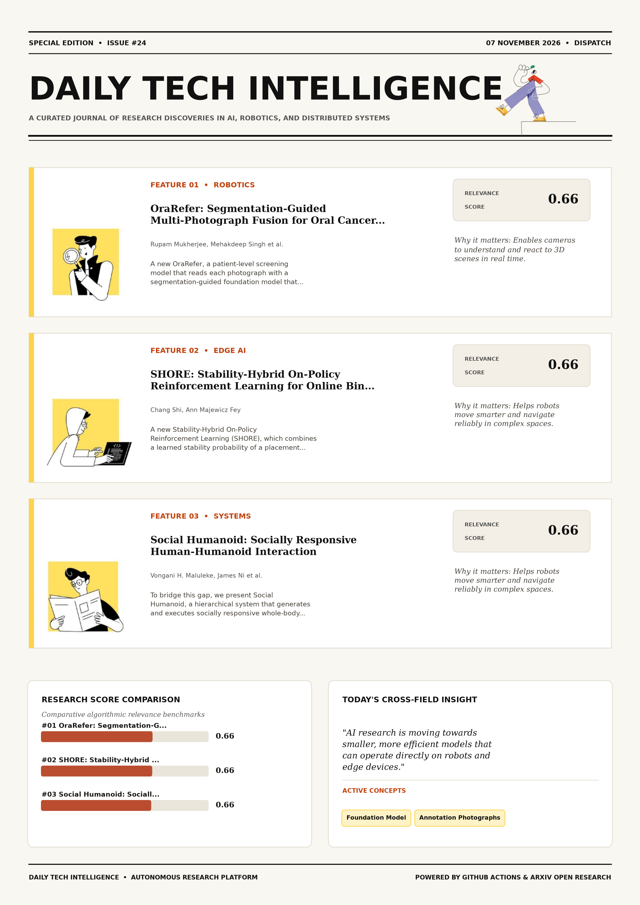

# Daily Tech Intelligence

## 07 November 2026

### Today's Overview

10 research papers analyzed.

Topics:

* Computer Vision
* Machine Learning
* Robotics

### Visual Intelligence Templates

* **Template 3: Gen-Z Spotlight Broadside (Primary)**: [View High-Res](infographic_spotlight.png)
* **Template 2: Modern Tech Studio**: [View High-Res](infographic_modern.png)
* **Template 1: Editorial Research Journal**: [View High-Res](infographic_editorial.png)

---

## 1. OraRefer: Segmentation-Guided Multi-Photograph Fusion for Oral Cancer Screening with Guaranteed Patient-Level Sensitivity

Authors: Rupam Mukherjee, Mehakdeep Singh, Shirin Dasgupta, Subhamoy Mandal

Publication: 2026-11-05T17:39:50Z

Category: cs.CV, eess.IV

Relevance Score: 0.66

Paper: [arXiv:2611.08360](https://arxiv.org/abs/2611.08360v1) | [PDF](https://arxiv.org/pdf/2611.08360v1)

### Summary

However, screening refers patients, not photographs: a patient is usually photographed several times, and the referral decision must miss no more than a set share of patients with disease. We propose OraRefer, a patient-level screening model that reads each photograph with a segmentation-guided foundation model that conditions its class decision on the predicted lesion, combines all photographs of a patient with risk factors, and refers through a threshold with a finite-sample sensitivity guarantee. On 3000 photographs of 714 patients, patient-level fusion reaches an AUROC of 0.919 and outperforms attention-based multiple-instance learning. Because the threshold is calibrated without retraining, each clinic can set its own guaranteed operating point on a local calibration sample.

### Key Concepts

* Foundation Model
* Annotation Photographs
* Attention-based Multiple-instance
* Auroc Outperforms
* Calibrated Retraining
* Calibration Sample

### Technical Insights

**Problem**

However, screening refers patients, not photographs: a patient is usually photographed several times, and the referral decision must miss no more than a set share of patients with disease.

**Approach**

We propose OraRefer, a patient-level screening model that reads each photograph with a segmentation-guided foundation model that conditions its class decision on the predicted lesion, combines all photographs of a patient with risk factors, and refers through a threshold with a finite-sample sensitivity guarantee.

**Key Innovation**

Formulates an integrated mechanism leveraging Foundation Model, Annotation Photographs.

**Results**

On 3000 photographs of 714 patients, patient-level fusion reaches an AUROC of 0.919 and outperforms attention-based multiple-instance learning.

**Applications**

High-resolution real-time visual perception, automated 3D reconstruction, and embodied vision.

**Limitations**

Not specified in the available abstract.

---

## 2. SHORE: Stability-Hybrid On-Policy Reinforcement Learning for Online Bin Packing

Authors: Chang Shi, Ann Majewicz Fey

Publication: 2026-11-05T17:42:31Z

Category: cs.RO, cs.LG

Relevance Score: 0.66

Paper: [arXiv:2611.08364](https://arxiv.org/abs/2611.08364v1) | [PDF](https://arxiv.org/pdf/2611.08364v1)

### Summary

Addressing critical demands in Machine Learning, this research investigates online 3d bin packing with a processing buffer requires choosing which box to pack, its orientation, and its placement while keeping the stack stable under unknown future arrivals. We propose Stability-Hybrid On-Policy Reinforcement Learning (SHORE), which combines a learned stability probability of a placement with an on-policy estimate of its return conditional on stability. The results show faster learning and higher utilization on the more demanding realistic box arrival set. We also demonstrate the method on a real robot to verify the simplicity of integrating the method to real bin packing pipelines.

### Key Concepts

* Reinforcement Learning
* Bin Packing
* Executed Outcomes
* Orientation Placement
* Simulated Alternatives
* Space Utilization

### Technical Insights

**Problem**

Addresses foundational constraints in Machine Learning and existing computational workflows.

**Approach**

We propose Stability-Hybrid On-Policy Reinforcement Learning (SHORE), which combines a learned stability probability of a placement with an on-policy estimate of its return conditional on stability.

**Key Innovation**

Formulates an integrated mechanism leveraging Reinforcement Learning, Bin Packing.

**Results**

The results show faster learning and higher utilization on the more demanding realistic box arrival set.

**Applications**

Autonomous robotic manipulation, sim-to-real transfer, and agile mobile navigation systems.

**Limitations**

In deployment, SHORE does not require additional search or simulation overhead.

---

## 3. Social Humanoid: Socially Responsive Human-Humanoid Interaction

Authors: Vongani H. Maluleke, James Ni, Kie Horiuchi, Lea Wilken, Jiahui Lei, Evonne Ng, Roei Herzig, Jitendra Malik, Trevor Darrell, Angjoo Kanazawa

Publication: 2026-11-05T18:14:06Z

Category: cs.RO, cs.CV, cs.LG

Relevance Score: 0.66

Paper: [arXiv:2611.08407](https://arxiv.org/abs/2611.08407v1) | [PDF](https://arxiv.org/pdf/2611.08407v1)

### Summary

Addressing critical demands in Robotics, this research investigates humanoid robots are typically trained as solitary agents, leaving them unable to coordinate physically with human partners who naturally anticipate and adjust to one another. To bridge this gap, we present Social Humanoid, a hierarchical system that generates and executes socially responsive whole-body motion on a 29-DoF Unitree G1 conditioned on a human partner's motion. Its high-level policy performs flexible sequence modeling of human and humanoid motion through a shared tokenized representation, generating reactive humanoid motion and anticipating the partner's motion when they are occluded, while a low-level whole-body tracking controller executes the generated motion on the robot. Project page: https://von31.github.io/social-humanoid/

### Key Concepts

* Social Humanoid
* Adaptive Retargeting
* Adjust Bridge
* Anticipate Adjust
* Anticipating Partner
* Apply Procedure

### Technical Insights

**Problem**

Addresses foundational constraints in Robotics and existing computational workflows.

**Approach**

To bridge this gap, we present Social Humanoid, a hierarchical system that generates and executes socially responsive whole-body motion on a 29-DoF Unitree G1 conditioned on a human partner's motion.

**Key Innovation**

Formulates an integrated mechanism leveraging Social Humanoid, Adaptive Retargeting.

**Results**

Not specified in the available abstract.

**Applications**

Autonomous robotic manipulation, sim-to-real transfer, and agile mobile navigation systems. High-resolution real-time visual perception, automated 3D reconstruction, and embodied vision.

**Limitations**

Not specified in the available abstract.

---

## 4. SCALE: Real-Time Latent Communication for Cyber-Physical Agents

Authors: Shanghao Shi, Jian Xiao, Ching-Hsiang Chan, Sanjoy Baruah, Sastry Kompella, Yevgeniy Vorobeychik, William Yeoh, Ning Zhang

Publication: 2026-11-05T18:05:58Z

Category: cs.RO, cs.MA

Relevance Score: 0.66

Paper: [arXiv:2611.08390](https://arxiv.org/abs/2611.08390v1) | [PDF](https://arxiv.org/pdf/2611.08390v1)

### Summary

Existing approaches, however, are primarily designed for LLM agents and do not consider the bandwidth constraints and heterogeneous task deadlines faced by cyber-physical agents. In this work, we propose SCALE, a real-time latent communication method tailored for cyber-physical agents. Our results show that SCALE significantly improves both task performance and on-time delivery in bandwidth-constrained networks. Our code is available at: https://anonymous.4open.science/r/SCALE-4E80/. Latent communication enables agents to collaborate efficiently by directly exchanging intermediate model representations rather than raw sensor data or text messages. Motivated by the spatio-temporal continuity of the physical world, SCALE matches tokens across consecutive latent messages using similarity scores to identify reusable information and avoid redundant transmission.

### Key Concepts

* Latent Communication
* Amounts Latent
* Anonymous Science
* Approaches Primarily
* Available Https
* Avoid Redundant

### Technical Insights

**Problem**

Existing approaches, however, are primarily designed for LLM agents and do not consider the bandwidth constraints and heterogeneous task deadlines faced by cyber-physical agents.

**Approach**

In this work, we propose SCALE, a real-time latent communication method tailored for cyber-physical agents.

**Key Innovation**

Formulates an integrated mechanism leveraging Latent Communication, Amounts Latent.

**Results**

Our results show that SCALE significantly improves both task performance and on-time delivery in bandwidth-constrained networks.

**Applications**

Autonomous robotic manipulation, sim-to-real transfer, and agile mobile navigation systems.

**Limitations**

Existing approaches, however, are primarily designed for LLM agents and do not consider the bandwidth constraints and heterogeneous task deadlines faced by cyber-physical agents.

---

## 5. User Embeddings are Superpositions of Interpretable Behavioral Modes

Authors: Jonathan Kozaczuk, Zheng Dong, Noyan Evirgen, Keivan Majidi, Eddie K. H. Ng, Chris Porter, Qi Zhao, Jia Geng, Changmao Li, Brandon R. Feng

Publication: 2026-11-05T18:59:42Z

Category: cs.LG

Relevance Score: 0.64

Paper: [arXiv:2611.08487](https://arxiv.org/abs/2611.08487v1) | [PDF](https://arxiv.org/pdf/2611.08487v1)

### Summary

Addressing critical demands in Machine Learning, this research investigates user embeddings are central components of modern recommendation, personalization, and behavioral modeling systems. Though these embeddings can compactly encode rich behavioral information, they are inherently dense and opaque, limiting interpretability. To address this gap, we argue that user embeddings can be understood as sparse superpositions of interpretable behavioral modes. The framework is post-hoc and model-agnostic, requiring no modification to the upstream embedding system. User embeddings are central components of modern recommendation, personalization, and behavioral modeling systems. This structure is directly predicted by generative models of user behavior for linear embeddings and extends approximately to deep-learning representations by the superposition hypothesis.

### Key Concepts

* Zero-shot
* Behavioral Modes
* User Embeddings
* Address Gap
* Approximately Deep-learning
* Argue User

### Technical Insights

**Problem**

Addresses foundational constraints in Machine Learning and existing computational workflows.

**Approach**

Though these embeddings can compactly encode rich behavioral information, they are inherently dense and opaque, limiting interpretability.

**Key Innovation**

Formulates an integrated mechanism leveraging Zero-shot, Behavioral Modes.

**Results**

Not specified in the available abstract.

**Applications**

Autonomous agentic reasoning, multi-agent coordination, and decision-support platforms.

**Limitations**

Not specified in the available abstract.

---

## 6. OopsieRecover: Learning Transferable VLA Corrections from Semantic Interventions

Authors: Arpit Bahety, Skand Peri, Sriniket Ambatipudi, Chen Xu, Haruki Nishimura, Masha Itkina, Roberto Martín-Martín

Publication: 2026-11-05T18:53:16Z

Category: cs.RO

Relevance Score: 0.64

Paper: [arXiv:2611.08462](https://arxiv.org/abs/2611.08462v1) | [PDF](https://arxiv.org/pdf/2611.08462v1)

### Summary

Addressing critical demands in Machine Learning, this research investigates vision-language-action (vla) models can perform a wide range of robotic manipulation tasks, but often fail during deployment. We propose OopsieRecover, a framework that uses abduction to infer the intent behind a small set of corrective demonstrations and encodes the inferred knowledge as dense spatial representations and conditional costs. We hypothesize that semantics can capture the underlying reasons for failures and their corrections, enabling policies to learn from only a handful of corrective demonstrations and generalize those corrections to novel objects, and scene variations. For instance, DAgger-like fine-tuning can require tens to hundreds of interactions, yet the resulting policy may still fail to generalize the learned corrections beyond the demonstrated scenarios. Please refer to https://robin-lab.cs.utexas.edu/oopsierecover for videos.

### Key Concepts

* Manipulation
* Abduction Infer
* Action Regions
* Actions Observations
* Associating Corrective
* Behavior Undesirable

### Technical Insights

**Problem**

Addresses foundational constraints in Machine Learning and existing computational workflows.

**Approach**

We propose OopsieRecover, a framework that uses abduction to infer the intent behind a small set of corrective demonstrations and encodes the inferred knowledge as dense spatial representations and conditional costs.

**Key Innovation**

We hypothesize that semantics can capture the underlying reasons for failures and their corrections, enabling policies to learn from only a handful of corrective demonstrations and generalize those corrections to novel objects, and scene variations.

**Results**

Not specified in the available abstract.

**Applications**

Autonomous robotic manipulation, sim-to-real transfer, and agile mobile navigation systems.

**Limitations**

Not specified in the available abstract.

---

## 7. Unpacking the Compute Efficiency of Strong-to-Weak OPD against GRPO

Authors: Zeyu Leo Liu, Yang Li, Bo Pang, Emre Can Acikgoz, Xuan-Phi Nguyen, Anurag Koul, Srijan Bansal, Erik Nijkamp, Shafiq Joty, Semih Yavuz

Publication: 2026-11-05T18:47:05Z

Category: cs.LG, cs.CL

Relevance Score: 0.64

Paper: [arXiv:2611.08453](https://arxiv.org/abs/2611.08453v1) | [PDF](https://arxiv.org/pdf/2611.08453v1)

### Summary

On a single domain, however, the GRPO checkpoint is already the desired model, so distilling it adds to total compute. Does this dense signal reduce the training FLOPs needed to reach a target accuracy compared with reinforcement learning? We systematically compare vanilla reverse-KL OPD with Group Relative Policy Optimization (GRPO) across task difficulty, student and teacher size, domain, and optimization choices, measuring held-out accuracy against training FLOPs. Counting specialist training and distillation together, this pipeline reaches joint GRPO's performance on the 2-domain mix with 42.0% fewer total FLOPs. On-policy distillation (OPD) trains a student on its own rollouts under a frozen teacher's per-token supervision.

### Key Concepts

* Reinforcement Learning
* Grpo Checkpoint
* Teacher Changes
* Teacher Opd
* Teacher Per-token
* Teacher Size

### Technical Insights

**Problem**

On a single domain, however, the GRPO checkpoint is already the desired model, so distilling it adds to total compute.

**Approach**

Does this dense signal reduce the training FLOPs needed to reach a target accuracy compared with reinforcement learning?

**Key Innovation**

Formulates an integrated mechanism leveraging Reinforcement Learning, Grpo Checkpoint.

**Results**

Not specified in the available abstract.

**Applications**

Next-generation large language model workflows, retrieval-augmented intelligence, and structured document parsing.

**Limitations**

Not specified in the available abstract.

---

## 8. InstantHand: Feed-Forward 3D Gaussian Splatting for Animatable Hand Avatar Reconstruction from a Single Image

Authors: Chanho Kim, Muhammad Salman Ali, Kyeonghwan Gwak, Muhammad Shaheryar, Incheol Park, Jeongwan On, Seungryul Baek

Publication: 2026-11-05T17:21:08Z

Category: cs.CV

Relevance Score: 0.63

Paper: [arXiv:2611.08330](https://arxiv.org/abs/2611.08330v1) | [PDF](https://arxiv.org/pdf/2611.08330v1)

### Summary

Addressing critical demands in Computer Vision, this research investigates hand avatar reconstruction typically relies on multi-view capture or per-subject optimization, limiting its scalability. We introduce InstantHand, a feed-forward framework that constructs an animatable 3D Gaussian hand avatar from a single image using off-the-shelf MANO, camera, and mask estimates, without test-time optimization. Image-averaged losses provide insufficient supervision for alpha leakage, which thickens thin finger contours. InstantHand constructs an avatar in 2.84 seconds and renders at 161 FPS, matching per-subject-optimized baselines on InterHand2.6M and remaining competitive in zero-shot evaluation on HanCo. Hand avatar reconstruction typically relies on multi-view capture or per-subject optimization, limiting its scalability.

### Key Concepts

* Zero-shot
* Gaussian Splatting
* Hand Avatar
* According Gaussian
* Address Issue
* Alpha Band

### Technical Insights

**Problem**

Addresses foundational constraints in Computer Vision and existing computational workflows.

**Approach**

We introduce InstantHand, a feed-forward framework that constructs an animatable 3D Gaussian hand avatar from a single image using off-the-shelf MANO, camera, and mask estimates, without test-time optimization.

**Key Innovation**

Formulates an integrated mechanism leveraging Zero-shot, Gaussian Splatting.

**Results**

Not specified in the available abstract.

**Applications**

High-resolution real-time visual perception, automated 3D reconstruction, and embodied vision.

**Limitations**

Not specified in the available abstract.

---

## 9. Failure Prediction and Classification in Vision-Language-Action Models Via Calibrated Latent Probing

Authors: Michal P. Podolinsky, Yunhao Yang, Daniel Little, Hong Lu, Rohan Siva, Olin Goudey, Neel P. Bhatt, Matthias Scheutz, Ufuk Topcu

Publication: 2026-11-05T18:21:07Z

Category: cs.RO, cs.AI

Relevance Score: 0.63

Paper: [arXiv:2611.08425](https://arxiv.org/abs/2611.08425v1) | [PDF](https://arxiv.org/pdf/2611.08425v1)

### Summary

Existing methods fail to fulfill these requirements. We present VLA-Tug, a lightweight probe over the latent layers of a VLA backbone that improves early failure detection and bounds the missed-detection and false-alarm rates, with minimal inference overhead. We show that supervising on the pre-failure segment of a trajectory increases early failure detection at matched false-positive rates by up to 30% over the strongest learned baseline. We release a dataset of 3,180 annotated manipulation episodes to support future work on latent failure detection in VLAs at https://vla-tug.github.io. Vision-Language-Action models (VLAs) enable general-purpose embodied intelligence, but their performance is brittle under distribution shift, where unanticipated failures can damage equipment or endanger people.

### Key Concepts

* Manipulation
* Embodied Intelligence
* Accuracy Unseen
* Backbone Improves
* Bounds Missed-detection
* Brittle Distribution

### Technical Insights

**Problem**

Existing methods fail to fulfill these requirements.

**Approach**

We present VLA-Tug, a lightweight probe over the latent layers of a VLA backbone that improves early failure detection and bounds the missed-detection and false-alarm rates, with minimal inference overhead.

**Key Innovation**

Formulates an integrated mechanism leveraging Manipulation, Embodied Intelligence.

**Results**

We show that supervising on the pre-failure segment of a trajectory increases early failure detection at matched false-positive rates by up to 30% over the strongest learned baseline.

**Applications**

Autonomous robotic manipulation, sim-to-real transfer, and agile mobile navigation systems. High-resolution real-time visual perception, automated 3D reconstruction, and embodied vision. Next-generation large language model workflows, retrieval-augmented intelligence, and structured document parsing.

**Limitations**

We present VLA-Tug, a lightweight probe over the latent layers of a VLA backbone that improves early failure detection and bounds the missed-detection and false-alarm rates, with minimal inference overhead.

---

## 10. VisionSIM: Beyond Idealized Sensors - A Multi-Modal Simulator for Robot Perception

Authors: Sacha Jungerman, Kaustubh Sadekar, Avery Gump, Sriram Narayanan, Shantanu Gupta, Bhuyashi Deka, Srinivasa Narasimhan, Atul Ingle, Mohit Gupta

Publication: 2026-11-05T17:48:00Z

Category: cs.RO, cs.AI, cs.CV

Relevance Score: 0.63

Paper: [arXiv:2611.08368](https://arxiv.org/abs/2611.08368v1) | [PDF](https://arxiv.org/pdf/2611.08368v1)

### Summary

Addressing critical demands in Robotics, this research investigates robotic perception increasingly relies on heterogeneous sensor suites combining cameras with emerging modalities (event, spad, itof/dtof, and thermal). We present VisionSIM, a unified, physically grounded simulation platform that elevates sensor realism to a first-class concern by modeling the raw physical measurement process for diverse conventional and emerging modalities. We release the platform and a large indoor dataset with synchronized raw measurements and rich ground-truth annotations. Robotic perception increasingly relies on heterogeneous sensor suites combining cameras with emerging modalities (event, SPAD, iToF/dToF, and thermal). Yet existing simulators idealize these sensors, hiding critical modality-specific failure modes that limit real-world deployment.

### Key Concepts

* Multi-modal
* Artifacts Itof
* Cameras Emerging
* Cameras Enables
* Cameras History-dependent
* Combining Cameras

### Technical Insights

**Problem**

Addresses foundational constraints in Robotics and existing computational workflows.

**Approach**

We present VisionSIM, a unified, physically grounded simulation platform that elevates sensor realism to a first-class concern by modeling the raw physical measurement process for diverse conventional and emerging modalities.

**Key Innovation**

Formulates an integrated mechanism leveraging Multi-modal, Artifacts Itof.

**Results**

Not specified in the available abstract.

**Applications**

Autonomous robotic manipulation, sim-to-real transfer, and agile mobile navigation systems. High-resolution real-time visual perception, automated 3D reconstruction, and embodied vision.

**Limitations**

Not specified in the available abstract.

---
