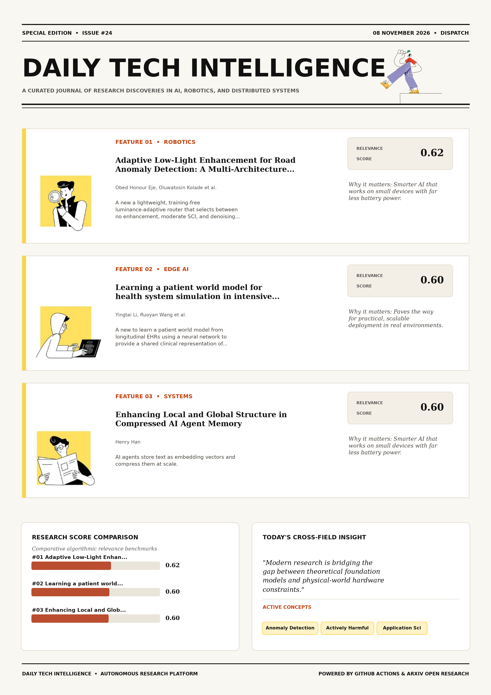

# Daily Tech Intelligence

## 08 November 2026

### Today's Overview

10 research papers analyzed.

Topics:

* Artificial Intelligence
* Computer Vision
* IoT & Edge AI
* Machine Learning
* Natural Language Processing

### Visual Intelligence Templates

* **Template 3: Gen-Z Spotlight Broadside (Primary)**: [View High-Res](infographic_spotlight.png)
* **Template 2: Modern Tech Studio**: [View High-Res](infographic_modern.png)
* **Template 1: Editorial Research Journal**: [View High-Res](infographic_editorial.png)

---

## 1. Adaptive Low-Light Enhancement for Road Anomaly Detection: A Multi-Architecture Benchmark and Edge Deployment Study

Authors: Obed Honour Eje, Oluwatosin Kolade, Glory Bagai, Taliha Abiodun Folorunso

Publication: 2026-11-05T18:06:59Z

Category: cs.CV

Relevance Score: 0.62

Paper: [arXiv:2611.08393](https://arxiv.org/abs/2611.08393v1) | [PDF](https://arxiv.org/pdf/2611.08393v1)

### Summary

Addressing critical demands in Computer Vision, this research investigates road anomaly detection systems on autonomous vehicles must function reliably under degraded visual conditions including darkness, rain, and harmattan dust haze. We propose a lightweight, training-free luminance-adaptive router that selects between no enhancement, moderate SCI, and denoising plus strong SCI based on per-frame Rec. 601 luminance, recovering most of the dusk penalty while preserving low-light gains, and we validate the full pipeline on NVIDIA Jetson Nano edge hardware. Road anomaly detection systems on autonomous vehicles must function reliably under degraded visual conditions including darkness, rain, and Harmattan dust haze. This paper benchmarks four object detection architectures, YOLOv8n, YOLOv12n, RT-DETR, and Faster R-CNN, under physically grounded lighting and weather degradation, and shows that uniform application of the SCI low-light enhancement network is actively harmful at dusk-level lighting (-16.1% to -30.7% mAP@50).

### Key Concepts

* Anomaly Detection
* Actively Harmful
* Application Sci
* Architectures Rt-detr
* Autonomous Vehicles
* Conditions Including

### Technical Insights

**Problem**

Addresses foundational constraints in Computer Vision and existing computational workflows.

**Approach**

We propose a lightweight, training-free luminance-adaptive router that selects between no enhancement, moderate SCI, and denoising plus strong SCI based on per-frame Rec.

**Key Innovation**

Formulates an integrated mechanism leveraging Anomaly Detection, Actively Harmful.

**Results**

Not specified in the available abstract.

**Applications**

Low-power edge AI devices, embedded IoT sensor networks, and distributed on-device inference. High-resolution real-time visual perception, automated 3D reconstruction, and embodied vision.

**Limitations**

Not specified in the available abstract.

---

## 2. Learning a patient world model for health system simulation in intensive care

Authors: Yingtai Li, Ruoyan Wang, Yu Li, Shaohua Kevin Zhou

Publication: 2026-11-05T18:06:42Z

Category: cs.AI

Relevance Score: 0.60

Paper: [arXiv:2611.08392](https://arxiv.org/abs/2611.08392v1) | [PDF](https://arxiv.org/pdf/2611.08392v1)

### Summary

However, conventional approaches typically tailor compact state transitions to a single policy question and omit history-dependent dynamics, thus requiring the redefinition of states and transitions when there is a new question that entails different clinical information. We propose to learn a patient world model from longitudinal EHRs using a neural network to provide a shared clinical representation of patient trajectories that can serve simulation questions across scenarios. These results indicate that a learned world model of patient dynamics has the potential to replace question-specific state models, allowing new care policies to be evaluated by reconfiguring the scenario without model rebuilding.

### Key Concepts

* World Model
* Compact State
* States Transitions
* Strategies Requires
* Support State
* Taking Icu

### Technical Insights

**Problem**

However, conventional approaches typically tailor compact state transitions to a single policy question and omit history-dependent dynamics, thus requiring the redefinition of states and transitions when there is a new question that entails different clinical information.

**Approach**

We propose to learn a patient world model from longitudinal EHRs using a neural network to provide a shared clinical representation of patient trajectories that can serve simulation questions across scenarios.

**Key Innovation**

Formulates an integrated mechanism leveraging World Model, Compact State.

**Results**

Not specified in the available abstract.

**Applications**

Autonomous agentic reasoning, multi-agent coordination, and decision-support platforms.

**Limitations**

Not specified in the available abstract.

---

## 3. Enhancing Local and Global Structure in Compressed AI Agent Memory

Authors: Henry Han

Publication: 2026-11-05T17:27:08Z

Category: cs.AI

Relevance Score: 0.60

Paper: [arXiv:2611.08341](https://arxiv.org/abs/2611.08341v1) | [PDF](https://arxiv.org/pdf/2611.08341v1)

### Summary

Addressing critical demands in IoT & Edge AI, this research investigates ai agents store text as embedding vectors and compress them at scale. A compression is accepted when each item's nearest neighbors survive, but agents also consolidate, delete, and compare memories, tasks that depend on which items lie far apart. We evaluate both ends with two label-free fidelities from our prior work: the local fidelity L at 10 neighbors and the global fidelity G at 30 to 50 percent of the memory. LAQ raises G in all 52 (p=8.5\times 10^{-4} over 13 memory-encoder groups), including the external FinDER memory, has the highest G of seven equal-size quantizers in all 12 Multi-Doc-2025 runs, scales to a million passages, and keeps evidence recall.

### Key Concepts

* Quantization
* Accepted Item
* Apart Evaluate
* Band Times
* Binary Codes
* Bit Codes

### Technical Insights

**Problem**

Addresses foundational constraints in IoT & Edge AI and existing computational workflows.

**Approach**

A compression is accepted when each item's nearest neighbors survive, but agents also consolidate, delete, and compare memories, tasks that depend on which items lie far apart.

**Key Innovation**

Formulates an integrated mechanism leveraging Quantization, Accepted Item.

**Results**

Not specified in the available abstract.

**Applications**

Low-power edge AI devices, embedded IoT sensor networks, and distributed on-device inference.

**Limitations**

Not specified in the available abstract.

---

## 4. XStack: A Benchmark for ML Repo Migration

Authors: Linrong Cai, Taiming Lu, Haozhe Chen, Zhuang Liu

Publication: 2026-11-05T18:55:54Z

Category: cs.LG, cs.AI

Relevance Score: 0.58

Paper: [arXiv:2611.08472](https://arxiv.org/abs/2611.08472v1) | [PDF](https://arxiv.org/pdf/2611.08472v1)

### Summary

Addressing critical demands in Machine Learning, this research investigates ml code should run where researchers choose, not where it was first written. We introduce XStack, a benchmark that evaluates agents on migrating ML repositories between these two ecosystems. Migrating repositories between them means building and testing across frameworks and hardware. We release XStack to make progress toward reliable migration across frameworks and hardware measurable. ML code should run where researchers choose, not where it was first written. Today, machine learning code mainly lives in two ecosystems, PyTorch on NVIDIA GPUs and JAX on Google TPUs. This migration is (1) a practical need, since it unlocks different hardware for researchers, and (2) a natural benchmark: it involves different frameworks and hardware, covers whole repositories, and is long-horizon and challenging.

### Key Concepts

* Agent Receives
* Agent Xstack
* Authenticated Calibrated
* Building Testing
* Calibrated Migration
* Challenging Introduce

### Technical Insights

**Problem**

Addresses foundational constraints in Machine Learning and existing computational workflows.

**Approach**

We introduce XStack, a benchmark that evaluates agents on migrating ML repositories between these two ecosystems.

**Key Innovation**

Formulates an integrated mechanism leveraging Agent Receives, Agent Xstack.

**Results**

Not specified in the available abstract.

**Applications**

Autonomous agentic reasoning, multi-agent coordination, and decision-support platforms.

**Limitations**

Not specified in the available abstract.

---

## 5. SM4RT: Cascaded Feed-forward Model for 4D Reconstruction

Authors: Pang-Chi Lo, Jhao-Syun Lai, Tsung-Wei Ke

Publication: 2026-11-05T18:28:38Z

Category: cs.CV

Relevance Score: 0.58

Paper: [arXiv:2611.08436](https://arxiv.org/abs/2611.08436v1) | [PDF](https://arxiv.org/pdf/2611.08436v1)

### Summary

Addressing critical demands in Artificial Intelligence, this research investigates we introduce sm4rt, a multi-task cascade feed-forward model for dynamic scene reconstruction from rgb videos. We introduce SM4RT, a multi-task cascade feed-forward model for dynamic scene reconstruction from RGB videos. By expressing each pixel's 3D motion in its corresponding camera frame, SM4RT reduces ambiguity arising from camera motion. Overall, our unified framework demonstrates that combining geometry reconstruction and motion estimation in a cascade not only avoids performance trade-offs but also enhances motion estimation through improved geometric reasoning. While existing feed-forward approaches typically address geometry reconstruction and motion estimation separately--and often predict motions in a single coordinate frame that must account for camera movement--SM4RT solves these tasks sequentially by first reconstructing 3D geometry and then bootstrapping motion estimation from the predicted structure.

### Key Concepts

* Account Camera
* Achieves Best
* Achieves Competitive
* Address Geometry
* Address Sparsity
* Ambiguity Arising

### Technical Insights

**Problem**

Addresses foundational constraints in Artificial Intelligence and existing computational workflows.

**Approach**

We introduce SM4RT, a multi-task cascade feed-forward model for dynamic scene reconstruction from RGB videos.

**Key Innovation**

Formulates an integrated mechanism leveraging Account Camera, Achieves Best.

**Results**

Not specified in the available abstract.

**Applications**

High-resolution real-time visual perception, automated 3D reconstruction, and embodied vision.

**Limitations**

Not specified in the available abstract.

---

## 6. Benchmarks as Software: Terminal-Bench and the Case for Continuous Benchmarks

Authors: E. Kelly Buchanan, Crystal Zhou, Scott W. Linderman, Christopher Ré

Publication: 2026-11-05T18:18:39Z

Category: cs.AI

Relevance Score: 0.58

Paper: [arXiv:2611.08417](https://arxiv.org/abs/2611.08417v1) | [PDF](https://arxiv.org/pdf/2611.08417v1)

### Summary

Addressing critical demands in Artificial Intelligence, this research investigates coding agents are among the most economically consequential deployments of llms to date, making reliable evaluation increasingly important. We introduce a continuous-validation workflow for agentic benchmarks that combines community reports, task artifacts, agent traces, automated oracle checks, and human-gated repairs. More broadly, benchmark maintenance debt is not just accumulated implementation bugs: our results show that as models improve, both evaluation assumptions and resource settings may need to be revalidated. Coding agents are among the most economically consequential deployments of LLMs to date, making reliable evaluation increasingly important. Yet even benchmarks that are carefully validated at release can become stale.

### Key Concepts

* Gap Gpt
* Maintenance Debt
* Terminal-bench Repairs
* Tests Resulting
* Time Limit
* Traces Automated

### Technical Insights

**Problem**

Addresses foundational constraints in Artificial Intelligence and existing computational workflows.

**Approach**

We introduce a continuous-validation workflow for agentic benchmarks that combines community reports, task artifacts, agent traces, automated oracle checks, and human-gated repairs.

**Key Innovation**

Formulates an integrated mechanism leveraging Gap Gpt, Maintenance Debt.

**Results**

More broadly, benchmark maintenance debt is not just accumulated implementation bugs: our results show that as models improve, both evaluation assumptions and resource settings may need to be revalidated.

**Applications**

Autonomous agentic reasoning, multi-agent coordination, and decision-support platforms.

**Limitations**

Not specified in the available abstract.

---

## 7. StepBack: Step-Level Error-Localized Resampling for Efficient Test-Time Reasoning

Authors: Yang Ouyang, Jung-Eun Kim

Publication: 2026-11-05T18:12:49Z

Category: cs.AI, cs.CL, cs.LG

Relevance Score: 0.58

Paper: [arXiv:2611.08403](https://arxiv.org/abs/2611.08403v1) | [PDF](https://arxiv.org/pdf/2611.08403v1)

### Summary

Addressing critical demands in Artificial Intelligence, this research investigates self-consistency (sc) is a widely used decoding strategy for improving chain-of-thought reasoning, but it requires sampling many complete reasoning trajectories with a preset budget. In this paper, we propose StepBack, a step-level error-localized resampling method for efficient test-time reasoning. Empirically, StepBack matches the accuracy of SC on average across seven mathematical reasoning and multi-hop QA benchmarks, while reducing token usage by up to 41.26%. In addition, by nature, StepBack can be combined with adaptive inference methods such as Adaptive Consistency, further improving their inference-time efficiency. Self-consistency (SC) is a widely used decoding strategy for improving chain-of-thought reasoning, but it requires sampling many complete reasoning trajectories with a preset budget.

### Key Concepts

* Adaptive Consistency
* Adaptive Inference
* Addition Nature
* Answer Voting
* Chain-of-thought Reasoning
* Combined Adaptive

### Technical Insights

**Problem**

Addresses foundational constraints in Artificial Intelligence and existing computational workflows.

**Approach**

In this paper, we propose StepBack, a step-level error-localized resampling method for efficient test-time reasoning.

**Key Innovation**

Formulates an integrated mechanism leveraging Adaptive Consistency, Adaptive Inference.

**Results**

Empirically, StepBack matches the accuracy of SC on average across seven mathematical reasoning and multi-hop QA benchmarks, while reducing token usage by up to 41.26%.

**Applications**

Next-generation large language model workflows, retrieval-augmented intelligence, and structured document parsing.

**Limitations**

Not specified in the available abstract.

---

## 8. SwarmEvolve: Latent Agent Swarms for Evolutionary Discovery and Optimization

Authors: Qile Jiang, George Em Karniadakis

Publication: 2026-11-05T18:59:29Z

Category: cs.AI, cs.NE

Relevance Score: 0.58

Paper: [arXiv:2611.08483](https://arxiv.org/abs/2611.08483v1) | [PDF](https://arxiv.org/pdf/2611.08483v1)

### Summary

However, the process is often slow because the LLM generates a long textual chain of thought for each round and must repeat this generation many times to maintain population diversity. We present SwarmEvolve, a framework in which hundreds of low-cost agents per round work in swarms, reason in latent space without decoding to text, and share information by passing KV caches. A novelty filter keeps the most distinct agent ideas by directly measuring the distances between the agents' hidden state vectors. Our work shows that agent swarms that communicate in latent space offer a fast, low-cost approach to program search for scientific problems.

### Key Concepts

* Agent Swarms
* Agent Ideas
* Agent Receives
* Alphaevolve Frontier
* Angle Novelty
* Best Scores

### Technical Insights

**Problem**

However, the process is often slow because the LLM generates a long textual chain of thought for each round and must repeat this generation many times to maintain population diversity.

**Approach**

We present SwarmEvolve, a framework in which hundreds of low-cost agents per round work in swarms, reason in latent space without decoding to text, and share information by passing KV caches.

**Key Innovation**

A novelty filter keeps the most distinct agent ideas by directly measuring the distances between the agents' hidden state vectors.

**Results**

Not specified in the available abstract.

**Applications**

Next-generation large language model workflows, retrieval-augmented intelligence, and structured document parsing.

**Limitations**

Not specified in the available abstract.

---

## 9. EgoGeneralist: Unifying Egocentric Action-Video Tasks through Video-Native Modeling

Authors: Yanlin Jin, Bowen Yang, Cheng Zhang, Yifan Yang, Zhe Li, Jianfei Cai, Kai Zhu

Publication: 2026-11-05T18:58:13Z

Category: cs.CV

Relevance Score: 0.58

Paper: [arXiv:2611.08477](https://arxiv.org/abs/2611.08477v1) | [PDF](https://arxiv.org/pdf/2611.08477v1)

### Summary

Despite adaptation only on controlled laboratory recordings, EgoGeneralist generalizes to diverse unseen scenes and interactions with effective action control and visual quality, bridging pretrained visual knowledge and metric 3D human motion. We present EgoGeneralist, which adapts pretrained video generators to unify action-conditioned egocentric video generation, pose estimation, and joint action-video generation. Our role-adaptive action renderer provides video-native representations for multidirectional action-video learning, making metric motion usable as both a spatial control signal and a recoverable generation target. Modern video models possess strong visual priors, yet do not natively represent human action in metric 3D space. Cross-stream action-video coupling establishes close correspondence between metric motion and visual dynamics through lightweight adaptation while preserving the pretrained visual prior.

### Key Concepts

* Action Control
* Action Metric
* Action Renderer
* Action-conditioned Egocentric
* Action-video Coupling
* Action-video Generation

### Technical Insights

**Problem**

Despite adaptation only on controlled laboratory recordings, EgoGeneralist generalizes to diverse unseen scenes and interactions with effective action control and visual quality, bridging pretrained visual knowledge and metric 3D human motion.

**Approach**

We present EgoGeneralist, which adapts pretrained video generators to unify action-conditioned egocentric video generation, pose estimation, and joint action-video generation.

**Key Innovation**

Formulates an integrated mechanism leveraging Action Control, Action Metric.

**Results**

Not specified in the available abstract.

**Applications**

High-resolution real-time visual perception, automated 3D reconstruction, and embodied vision.

**Limitations**

Not specified in the available abstract.

---

## 10. Where and Why is Grounded Reasoning Useful?

Authors: David Yan, Le Xue, Forrest Huang, Qiuyi Zhang, Dustin Tran, Andrew M. Dai, Yinfei Yang

Publication: 2026-11-05T18:59:32Z

Category: cs.CV

Relevance Score: 0.56

Paper: [arXiv:2611.08485](https://arxiv.org/abs/2611.08485v1) | [PDF](https://arxiv.org/pdf/2611.08485v1)

### Summary

However, the benefits and limitations of grounded reasoning are understudied. To do so, we introduce a chain-of-thought analysis method to measure how much a model uses its outputted grounding in its thinking trace and perform a detailed ablation study of a grounded reasoning training recipe. We study where and why grounded reasoning is most useful. To close this gap, we introduce BrickVision, a new benchmark that requires undescribable visual references to solve. Grounded reasoning, where a model outputs text coordinates of relevant locations in chain-of-thought reasoning, is a common strategy for solving complex visual reasoning problems. We find that grounded reasoning improves counting but shows no significant gain over baselines without coordinate grounding across a wide range of spatial reasoning and perception benchmarks.

### Key Concepts

* Grounded Reasoning
* Reasoning Useful
* Baselines Coordinate
* Benefits Limitations
* Chain-of-thought Reasoning
* Close Gap

### Technical Insights

**Problem**

However, the benefits and limitations of grounded reasoning are understudied.

**Approach**

To do so, we introduce a chain-of-thought analysis method to measure how much a model uses its outputted grounding in its thinking trace and perform a detailed ablation study of a grounded reasoning training recipe.

**Key Innovation**

Formulates an integrated mechanism leveraging Grounded Reasoning, Reasoning Useful.

**Results**

Not specified in the available abstract.

**Applications**

High-resolution real-time visual perception, automated 3D reconstruction, and embodied vision.

**Limitations**

However, the benefits and limitations of grounded reasoning are understudied.

---
