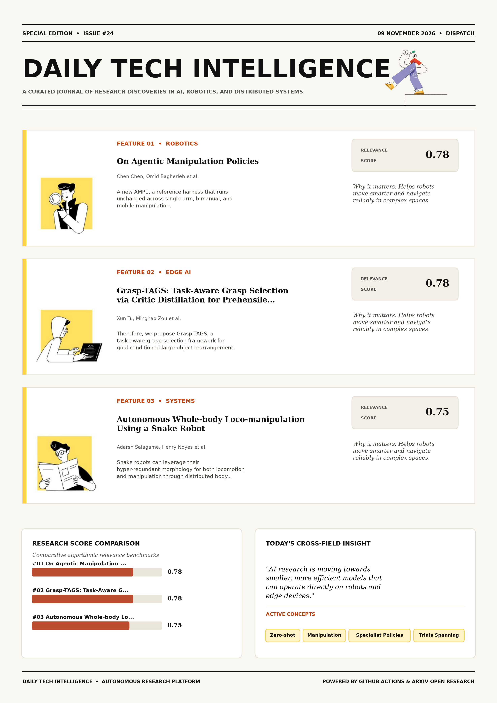

# Daily Tech Intelligence

## 09 November 2026

### Today's Overview

10 research papers analyzed.

Topics:

* Artificial Intelligence
* Machine Learning
* Natural Language Processing
* Robotics

### Visual Intelligence Templates

* **Template 3: Gen-Z Spotlight Broadside (Primary)**: [View High-Res](infographic_spotlight.png)
* **Template 2: Modern Tech Studio**: [View High-Res](infographic_modern.png)
* **Template 1: Editorial Research Journal**: [View High-Res](infographic_editorial.png)

---

## 1. On Agentic Manipulation Policies

Authors: Chen Chen, Omid Bagherieh, Naveen Nikamanth Appiah Balaji, Jesse T. Gonzalez, Negin Heravi, Fahad Islam, Xueting Li, Jean-Baptiste Regli, Kejia Ren, Petr Švec, David J. Yoon, Matthias Müller, Vladlen Koltun

Publication: 2026-11-06T18:59:34Z

Category: cs.RO, cs.AI, cs.CV, cs.LG

Relevance Score: 0.78

Paper: [arXiv:2611.09892](https://arxiv.org/abs/2611.09892v1) | [PDF](https://arxiv.org/pdf/2611.09892v1)

### Summary

Addressing critical demands in Robotics, this research investigates recent work on robot manipulation has focused on specialist policies trained on demonstrations. We present AMP1, a reference harness that runs unchanged across single-arm, bimanual, and mobile manipulation. AMP1 achieves state-of-the-art results on the RoboLab-120 and CaP-Gym benchmarks, with no demonstrations or task-specific training. Our analysis suggests that AMPs are substantially more general and robust than specialist manipulation policies, providing a promising foundation for robot manipulation. Recent work on robot manipulation has focused on specialist policies trained on demonstrations. We show that generalist AI models can control manipulators more reliably than specialist policies such as vision-language-action models (VLAs) and world-action models (WAMs).

### Key Concepts

* Zero-shot
* Manipulation
* Specialist Policies
* Trials Spanning
* Unfolds Present
* Vla WAM

### Technical Insights

**Problem**

Addresses foundational constraints in Robotics and existing computational workflows.

**Approach**

We present AMP1, a reference harness that runs unchanged across single-arm, bimanual, and mobile manipulation.

**Key Innovation**

Formulates an integrated mechanism leveraging Zero-shot, Manipulation.

**Results**

AMP1 achieves state-of-the-art results on the RoboLab-120 and CaP-Gym benchmarks, with no demonstrations or task-specific training.

**Applications**

Autonomous robotic manipulation, sim-to-real transfer, and agile mobile navigation systems. High-resolution real-time visual perception, automated 3D reconstruction, and embodied vision.

**Limitations**

Not specified in the available abstract.

---

## 2. Grasp-TAGS: Task-Aware Grasp Selection via Critic Distillation for Prehensile Loco-Manipulation

Authors: Xun Tu, Minghao Zou, Karthik Desingh

Publication: 2026-11-06T18:44:33Z

Category: cs.RO, cs.AI, cs.LG

Relevance Score: 0.78

Paper: [arXiv:2611.09864](https://arxiv.org/abs/2611.09864v1) | [PDF](https://arxiv.org/pdf/2611.09864v1)

### Summary

Despite recent progress, reliably executing these tasks remains challenging because performance depends on complex robot-object and object-environment interaction dynamics. Therefore, we propose Grasp-TAGS, a task-aware grasp selection framework for goal-conditioned large-object rearrangement. Experiments demonstrate that Grasp-TAGS improves rearrangement success over both fixed single-grasp policies and random grasp selection, achieving an average success rate of 89.84% compared with 79.87% for the best-performing single-grasp policies, an improvement of 9.97 percentage points. For more qualitative results, refer to the supplementary webpage: https://rpm-lab-umn.github.io/Grasp-TAGS-web-page/ Loco-manipulation, which requires mobile manipulators to coordinate locomotion and manipulation over long horizons, is a key capability for large-object rearrangement in applications such as service robotics and warehouse automation.

### Key Concepts

* Reinforcement Learning
* Manipulation
* Grasp Selection
* Task-aware Grasp
* Initial Grasp
* Large-object Rearrangement

### Technical Insights

**Problem**

Despite recent progress, reliably executing these tasks remains challenging because performance depends on complex robot-object and object-environment interaction dynamics.

**Approach**

Therefore, we propose Grasp-TAGS, a task-aware grasp selection framework for goal-conditioned large-object rearrangement.

**Key Innovation**

Formulates an integrated mechanism leveraging Reinforcement Learning, Manipulation.

**Results**

Experiments demonstrate that Grasp-TAGS improves rearrangement success over both fixed single-grasp policies and random grasp selection, achieving an average success rate of 89.84% compared with 79.87% for the best-performing single-grasp policies, an improvement of 9.97 percentage points.

**Applications**

Autonomous robotic manipulation, sim-to-real transfer, and agile mobile navigation systems.

**Limitations**

Existing approaches address this challenge either through model-based methods, which often require accurate dynamics models, or through learning-based methods, which reduce this requirement but typically assume a fixed or predefined initial grasp.

---

## 3. Autonomous Whole-body Loco-manipulation Using a Snake Robot

Authors: Adarsh Salagame, Henry Noyes, Haroon Hublikar, Alireza Ramezani

Publication: 2026-11-06T17:38:50Z

Category: cs.RO, eess.SY

Relevance Score: 0.75

Paper: [arXiv:2611.09777](https://arxiv.org/abs/2611.09777v1) | [PDF](https://arxiv.org/pdf/2611.09777v1)

### Summary

Addressing critical demands in Robotics, this research investigates snake robots can leverage their hyper-redundant morphology for both locomotion and manipulation through distributed body contact but whole-body loco-manipulation is particularly challenging since the entire body serves simultaneously as propulsive mechanism and manipulation tool prior work on wheeled legged and snake robot platforms has decoupled these functions through dedicated appendages body segmentation or grippers we present closed-loop loco-manipulation with our snake robot cobra without this distinction such that any part of the body may make contact we develop a contact-implicit dynamic model unifying robot-ground robot-object and object-ground interactions within a moreau-jean time-stepping framework and formulate a trajectory optimization over the full-order dynamics guided by a geometric planner and nominal proportional controller to autonomously push an object to a goal location during sidewinding we validate the planner and controller on hardware across varied configurations and present simulation results for a simplified trajectory optimization that resolves robot-object and object-ground contacts. Snake robots can leverage their hyper-redundant morphology for both locomotion and manipulation through distributed body contact but whole-body loco-manipulation is particularly challenging since the entire body serves simultaneously as propulsive mechanism and manipulation tool Prior work on wheeled legged and snake robot platforms has decoupled these functions through dedicated appendages body segmentation or grippers We present closed-loop loco-manipulation with our snake robot COBRA without this distinction such that any part of the body may make contact We develop a contact-implicit dynamic model unifying robot-ground robot-object and object-ground interactions within a Moreau-Jean time-stepping framework and formulate a trajectory optimization over the full-order dynamics guided by a geometric planner and nominal proportional controller to autonomously push an object to a goal location during sidewinding We validate the planner and controller on hardware across varied configurations and present simulation results for a simplified trajectory optimization that resolves robot-object and object-ground contacts

### Key Concepts

* Manipulation
* Snake Robot
* Appendages Body
* Autonomously Push
* Body Contact
* Body Make

### Technical Insights

**Problem**

Addresses foundational constraints in Robotics and existing computational workflows.

**Approach**

Snake robots can leverage their hyper-redundant morphology for both locomotion and manipulation through distributed body contact but whole-body loco-manipulation is particularly challenging since the entire body serves simultaneously as propulsive mechanism and manipulation tool Prior work on wheeled legged and snake robot platforms has decoupled these functions through dedicated appendages body segmentation or grippers We present closed-loop loco-manipulation with our snake robot COBRA without this distinction such that any part of the body may make contact We develop a contact-implicit dynamic model unifying robot-ground robot-object and object-ground interactions within a Moreau-Jean time-stepping framework and formulate a trajectory optimization over the full-order dynamics guided by a geometric planner and nominal proportional controller to autonomously push an object to a goal location during sidewinding We validate the planner and controller on hardware across varied configurations and present simulation results for a simplified trajectory optimization that resolves robot-object and object-ground contacts

**Key Innovation**

Formulates an integrated mechanism leveraging Manipulation, Snake Robot.

**Results**

Not specified in the available abstract.

**Applications**

Autonomous robotic manipulation, sim-to-real transfer, and agile mobile navigation systems.

**Limitations**

Not specified in the available abstract.

---

## 4. Seeing What Matters: Benchmarking Task-Conditioned Actionable Spatial Belief for Manipulation

Authors: Yina Jian, Mingkun Xu

Publication: 2026-11-06T17:49:56Z

Category: cs.RO, cs.CV

Relevance Score: 0.71

Paper: [arXiv:2611.09794](https://arxiv.org/abs/2611.09794v1) | [PDF](https://arxiv.org/pdf/2611.09794v1)

### Summary

Addressing critical demands in Robotics, this research investigates when should a robot look at the cup, and when at the portafilter?. We introduce Seeing What Matters, a benchmark for task-conditioned actionable spatial belief in simulated tabletop manipulation. A view that is informative for one task can be useless for another, even at the same workstation. These gaps suggest that spatial belief for manipulation should be evaluated not by scene-level completeness, but by whether it acquires the evidence the current command requires. When should a robot look at the cup, and when at the portafilter? Spatial-reasoning benchmarks evaluate whether a model can describe a scene, but manipulation needs something more specific: the ability to acquire the particular evidence that makes the current command executable.

### Key Concepts

* Manipulation
* Spatial Belief
* Task-conditioned Actionable
* Current Command
* Reference Pipeline
* Success Shuffling

### Technical Insights

**Problem**

Addresses foundational constraints in Robotics and existing computational workflows.

**Approach**

We introduce Seeing What Matters, a benchmark for task-conditioned actionable spatial belief in simulated tabletop manipulation.

**Key Innovation**

Formulates an integrated mechanism leveraging Manipulation, Spatial Belief.

**Results**

Not specified in the available abstract.

**Applications**

Autonomous robotic manipulation, sim-to-real transfer, and agile mobile navigation systems. High-resolution real-time visual perception, automated 3D reconstruction, and embodied vision.

**Limitations**

Not specified in the available abstract.

---

## 5. CPU-ARC: Agentic Reasoning Caching for on-CPU Reasoning Reuse

Authors: Peter Belcak, Greg Heinrich, Saurav Muralidharan, Shizhe Diao, Pavlo Molchanov

Publication: 2026-11-06T18:58:50Z

Category: cs.AI

Relevance Score: 0.70

Paper: [arXiv:2611.09891](https://arxiv.org/abs/2611.09891v1) | [PDF](https://arxiv.org/pdf/2611.09891v1)

### Summary

They conflate task-solving with the execution of the solutions, which forces them to solve every problem from scratch. We introduce agentic reasoning caching, a method for constructing robust CPU-executable agentic reasoning caches (ARCs) from LLM reasoning traces. We show that once a task has been reasoned through, the application of its solution to a new problem instance can be done very efficiently and with little involvement from language models. ARCs show on-par performance with frontier LLMs across a range of difficult mathematical and scientific tasks, are fully explainable, continually trainable, robust to input perturbations, and 16-291x cheaper to invoke than the source model.

### Key Concepts

* Agentic Reasoning
* Application Solution
* Arcs LLM
* Arcs On-par
* Caches Arcs
* Cheaper Invoke

### Technical Insights

**Problem**

They conflate task-solving with the execution of the solutions, which forces them to solve every problem from scratch.

**Approach**

We introduce agentic reasoning caching, a method for constructing robust CPU-executable agentic reasoning caches (ARCs) from LLM reasoning traces.

**Key Innovation**

Formulates an integrated mechanism leveraging Agentic Reasoning, Application Solution.

**Results**

Not specified in the available abstract.

**Applications**

Autonomous agentic reasoning, multi-agent coordination, and decision-support platforms.

**Limitations**

Not specified in the available abstract.

---

## 6. ZeoBench: A Benchmark for Self-Supervised Learning on 3D Zeolite Representations

Authors: Aaron Sun, Yachan Liu, Ping Yang, Peng Bai, Subhransu Maji

Publication: 2026-11-06T18:55:34Z

Category: cs.CV

Relevance Score: 0.70

Paper: [arXiv:2611.09880](https://arxiv.org/abs/2611.09880v1) | [PDF](https://arxiv.org/pdf/2611.09880v1)

### Summary

Although hundreds of thousands of experimentally realized and hypothetical zeolite structures are known, identifying materials optimized for a target application remains challenging because property labels are expensive to obtain and available only for limited structure-molecule pairs. We present ZeoBench, a benchmark for self-supervised learning on dense 3D representations of all-silica zeolites, and evaluate the resulting features on six existing downstream adsorption-property prediction tasks, across a range of training set sizes. While prior work has demonstrated that 3D neural representations can predict zeolite properties effectively, it remains unclear which representation-learning strategies are most effective in the low-data regime relevant to materials discovery. These results establish ZeoBench as a practical benchmark for 3D representation learning in zeolites and provide guidance for data-limited adsorption property prediction.

### Key Concepts

* Representation Learning
* Self-supervised Learning
* Hand-crafted Descriptors
* Vision Transformers
* Volumetric Zeolite
* Zeobench Practical

### Technical Insights

**Problem**

Although hundreds of thousands of experimentally realized and hypothetical zeolite structures are known, identifying materials optimized for a target application remains challenging because property labels are expensive to obtain and available only for limited structure-molecule pairs.

**Approach**

We present ZeoBench, a benchmark for self-supervised learning on dense 3D representations of all-silica zeolites, and evaluate the resulting features on six existing downstream adsorption-property prediction tasks, across a range of training set sizes.

**Key Innovation**

Formulates an integrated mechanism leveraging Representation Learning, Self-supervised Learning.

**Results**

Not specified in the available abstract.

**Applications**

High-resolution real-time visual perception, automated 3D reconstruction, and embodied vision.

**Limitations**

Not specified in the available abstract.

---

## 7. On the Reliability of Majority-Vote Pseudo-Labels in Test-Time Reinforcement Learning

Authors: Haoyu Wang, Ru Wang, Yuanyuan Wang, Jiaxian Guo, Mingming Gong

Publication: 2026-11-06T18:49:02Z

Category: cs.AI

Relevance Score: 0.70

Paper: [arXiv:2611.09872](https://arxiv.org/abs/2611.09872v1) | [PDF](https://arxiv.org/pdf/2611.09872v1)

### Summary

Addressing critical demands in Machine Learning, this research investigates test-time reinforcement learning (ttrl) adapts pretrained language models to unlabeled target-domain data using self-generated pseudo-labels, whose reliability remains poorly understood. We propose \emph{Prompt-Conditional Distributionally Robust DPO (PC-Dr.DPO)}, which conditions within-prompt robust reweighting on observed vote reliability to make updates from sampling-sensitive prompts more conservative. Across six mathematical and knowledge-intensive reasoning benchmarks and five model backbones, PC-Dr.DPO matches or outperforms the strongest TTRL baseline in 24 of 30 settings. Test-time reinforcement learning (TTRL) adapts pretrained language models to unlabeled target-domain data using self-generated pseudo-labels, whose reliability remains poorly understood. We analyze majority-vote supervision for TTRL with online Direct Preference Optimization (DPO) and decompose its error into population-majority bias and prompt-dependent finite-rollout variation.

### Key Concepts

* Reinforcement Learning
* Adaptation Mathematical
* Adapts Pretrained
* Analyze Majority-vote
* Backbones Pc-dr
* Bias Generally

### Technical Insights

**Problem**

Addresses foundational constraints in Machine Learning and existing computational workflows.

**Approach**

We propose \emph{Prompt-Conditional Distributionally Robust DPO (PC-Dr.DPO)}, which conditions within-prompt robust reweighting on observed vote reliability to make updates from sampling-sensitive prompts more conservative.

**Key Innovation**

Formulates an integrated mechanism leveraging Reinforcement Learning, Adaptation Mathematical.

**Results**

Across six mathematical and knowledge-intensive reasoning benchmarks and five model backbones, PC-Dr.DPO matches or outperforms the strongest TTRL baseline in 24 of 30 settings.

**Applications**

Autonomous agentic reasoning, multi-agent coordination, and decision-support platforms.

**Limitations**

Not specified in the available abstract.

---

## 8. Language as Trait, Politeness as Strategy: Controlled Tests of Linguistic Effects in LLM Social-Deduction Agents

Authors: Yuchen Li, Lisa Liu, Runqi Zou, Shuxuan Kuang, Qingquan Zhang, Julian Togelius

Publication: 2026-11-06T17:31:01Z

Category: cs.CL, cs.AI

Relevance Score: 0.69

Paper: [arXiv:2611.09768](https://arxiv.org/abs/2611.09768v1) | [PDF](https://arxiv.org/pdf/2611.09768v1)

### Summary

Addressing critical demands in Natural Language Processing, this research investigates large language model (llm) agents coordinate through conversation, and the same message can be phrased in simpler or more complex language, bluntly or politely. We test whether such differences change how other agents judge and act, using the LURK Werewolf framework, which separates each utterance's speech-act predicate from its natural-language realization. We rewrite only the realization, check that the game content is preserved, and replay each game day from saved checkpoints against a re-sampled control. In natural play, 88% of face-threatening speech is bald on-record regardless of role. Large language model (LLM) agents coordinate through conversation, and the same message can be phrased in simpler or more complex language, bluntly or politely.

### Key Concepts

* Large Language Model
* Manipulation
* Actions Survives
* Away Neutral
* Bald On-record
* Bluntly Politely

### Technical Insights

**Problem**

Addresses foundational constraints in Natural Language Processing and existing computational workflows.

**Approach**

We test whether such differences change how other agents judge and act, using the LURK Werewolf framework, which separates each utterance's speech-act predicate from its natural-language realization.

**Key Innovation**

Formulates an integrated mechanism leveraging Large Language Model, Manipulation.

**Results**

Not specified in the available abstract.

**Applications**

Next-generation large language model workflows, retrieval-augmented intelligence, and structured document parsing.

**Limitations**

Not specified in the available abstract.

---

## 9. FOSCAR: Accelerating Decode Attention over 2- and 4-Bit KV Caches through Affine Folding

Authors: Donglin Zhuang, Pragaash Ponnusamy, Xiaoxia Wu, Shuaiwen Leon Song, Zhongzhu Zhou

Publication: 2026-11-06T17:00:25Z

Category: cs.AI

Relevance Score: 0.67

Paper: [arXiv:2611.09722](https://arxiv.org/abs/2611.09722v1) | [PDF](https://arxiv.org/pdf/2611.09722v1)

### Summary

Converting each value and applying its scale and offset before feeding Tensor Cores is a major bottleneck because instruction-issue throughput is scarce on modern GPUs. Packing that cache into 2-bit or 4-bit quantized integers reduces memory traffic but does not automatically translate into latency saving. On long-context serving workloads, FOSCAR increases peak aggregate throughput by up to 170% and 341% over 2-bit and 16-bit baselines, respectively. We open-source FOSCAR as a kernel library at https://github.com/FutureMLS-Lab/FOSCAR. Large-language-model decode attention streams the key-value (KV) cache for every generated token. Existing 2-bit fused kernels reach under 31%/15% of peak HBM throughput on H100/B200.

### Key Concepts

* Quantization
* Manipulation
* Bit Bit
* Flashinfer Times
* Foscar Uses
* Speedups Times

### Technical Insights

**Problem**

Converting each value and applying its scale and offset before feeding Tensor Cores is a major bottleneck because instruction-issue throughput is scarce on modern GPUs.

**Approach**

Packing that cache into 2-bit or 4-bit quantized integers reduces memory traffic but does not automatically translate into latency saving.

**Key Innovation**

Formulates an integrated mechanism leveraging Quantization, Manipulation.

**Results**

On long-context serving workloads, FOSCAR increases peak aggregate throughput by up to 170% and 341% over 2-bit and 16-bit baselines, respectively.

**Applications**

Next-generation large language model workflows, retrieval-augmented intelligence, and structured document parsing.

**Limitations**

Not specified in the available abstract.

---

## 10. Can Agentic Systems Close the Gap in Radiology with Production AI Tools?

Authors: Aubin Charley, Julien Khlaut, Charles Corbière, Pierre Manceron, Corentin Dancette, Léo Machado

Publication: 2026-11-06T18:23:14Z

Category: cs.AI, cs.LG

Relevance Score: 0.67

Paper: [arXiv:2611.09836](https://arxiv.org/abs/2611.09836v1) | [PDF](https://arxiv.org/pdf/2611.09836v1)

### Summary

Addressing critical demands in Artificial Intelligence, this research investigates radiology ai has developed along two paths: specialized models that perform well on narrow tasks but cover few clinical findings, and generalist models that address a broader range of tasks but remain prone to hallucination and inaccurate measurements. Combining the two through agentic systems offers a route towards comprehensive radiology reporting, but published systems are tied to one modality or body part. We describe a radiology agentic framework that standardizes how an orchestrator calls modular tools to produce a structured report, and use it to measure what such a system can do with the tools from FDA-cleared radiology AI devices. Tool availability and effective orchestration are thus complementary constraints on comprehensive AI-assisted radiology reporting.

### Key Concepts

* Multi-modality
* Radiology Reporting
* Target Report
* Tied Modality Body
* Tool Availability
* Tool Error

### Technical Insights

**Problem**

Addresses foundational constraints in Artificial Intelligence and existing computational workflows.

**Approach**

Combining the two through agentic systems offers a route towards comprehensive radiology reporting, but published systems are tied to one modality or body part.

**Key Innovation**

Formulates an integrated mechanism leveraging Multi-modality, Radiology Reporting.

**Results**

Not specified in the available abstract.

**Applications**

Autonomous agentic reasoning, multi-agent coordination, and decision-support platforms.

**Limitations**

Tool availability and effective orchestration are thus complementary constraints on comprehensive AI-assisted radiology reporting.

---
