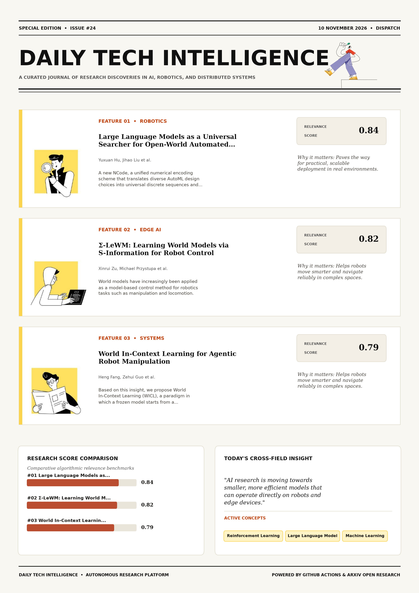

# Daily Tech Intelligence

## 10 November 2026

### Today's Overview

10 research papers analyzed.

Topics:

* Artificial Intelligence
* Machine Learning
* Robotics

### Visual Intelligence Templates

* **Template 3: Gen-Z Spotlight Broadside (Primary)**: [View High-Res](infographic_spotlight.png)
* **Template 2: Modern Tech Studio**: [View High-Res](infographic_modern.png)
* **Template 1: Editorial Research Journal**: [View High-Res](infographic_editorial.png)

---

## 1. Large Language Models as a Universal Searcher for Open-World Automated Machine Learning

Authors: Yuxuan Hu, Jihao Liu, Weikang Shi, Xijie Huang, Linda Wei, Mingjie Zhan, Aojun Zhou, Rui Liu, Hongsheng Li

Publication: 2026-11-09T17:58:38Z

Category: cs.CL

Relevance Score: 0.84

Paper: [arXiv:2611.12791](https://arxiv.org/abs/2611.12791v1) | [PDF](https://arxiv.org/pdf/2611.12791v1)

### Summary

Addressing critical demands in Machine Learning, this research investigates developing effective machine learning models requires complex manual tuning, while current automated machine learning (automl) frameworks remain domain-specific and isolate model architecture, training hyperparameter, and data ratio optimization. Here, we bridge this gap by proposing a universal, large language model (LLM)-based AutoML framework that jointly optimizes these configurations for the first time without the need for task-specific fine-tuning. Here, we bridge this gap by proposing a universal, large language model (LLM)-based AutoML framework that jointly optimizes these configurations for the first time without the need for task-specific fine-tuning. We propose NCode, a unified numerical encoding scheme that translates diverse AutoML design choices into universal discrete sequences and effectively reframes the optimization process as a unified ranking task. Our proposed framework provides a scalable, generalizable, and interpretable pathway toward general-purpose open-world machine learning optimization.

### Key Concepts

* Reinforcement Learning
* Large Language Model
* Machine Learning
* Llm-based Searcher
* Trajectories Derived
* Transformer Requiring

### Technical Insights

**Problem**

Addresses foundational constraints in Machine Learning and existing computational workflows.

**Approach**

Here, we bridge this gap by proposing a universal, large language model (LLM)-based AutoML framework that jointly optimizes these configurations for the first time without the need for task-specific fine-tuning.

**Key Innovation**

Here, we bridge this gap by proposing a universal, large language model (LLM)-based AutoML framework that jointly optimizes these configurations for the first time without the need for task-specific fine-tuning.

**Results**

Not specified in the available abstract.

**Applications**

Next-generation large language model workflows, retrieval-augmented intelligence, and structured document parsing.

**Limitations**

Not specified in the available abstract.

---

## 2. Σ-LeWM: Learning World Models via S-Information for Robot Control

Authors: Xinrui Zu, Michael Przystupa, Zhao Yang, Shujian Yu, Kevin Sebastian Luck

Publication: 2026-11-09T17:18:27Z

Category: cs.LG, cs.AI, cs.RO

Relevance Score: 0.82

Paper: [arXiv:2611.12732](https://arxiv.org/abs/2611.12732v1) | [PDF](https://arxiv.org/pdf/2611.12732v1)

### Summary

Addressing critical demands in Robotics, this research investigates world models have increasingly been applied as a model-based control method for robotics tasks such as manipulation and locomotion. While early world model architectures relied on decoders to prevent mode collapse and learn a predictable latent space, recent works on world models, such as Joint Embedding Predictive Architecture or LeWorldModel, increasingly aim to learn embeddings without a grounding decoder, utilising only a latent forward dynamics predictor and a stabilising entropy term. In this paper, we set out to demonstrate that the further introduction of two additional latent losses to LeWorldModel, a backward dynamics predictor and an inverse dynamics action predictor, enforces further structure on the latent embedding, leading to further gains in both performance and planning efficiency. We demonstrate these gains on standard world model benchmarks and two simulated robot manipulation tasks.

### Key Concepts

* World Model
* Joint Embedding Predictive Architecture
* Manipulation
* Action Predictor
* Additional Latent
* Aim Learn

### Technical Insights

**Problem**

Addresses foundational constraints in Robotics and existing computational workflows.

**Approach**

While early world model architectures relied on decoders to prevent mode collapse and learn a predictable latent space, recent works on world models, such as Joint Embedding Predictive Architecture or LeWorldModel, increasingly aim to learn embeddings without a grounding decoder, utilising only a latent forward dynamics predictor and a stabilising entropy term.

**Key Innovation**

Formulates an integrated mechanism leveraging World Model, Joint Embedding Predictive Architecture.

**Results**

Not specified in the available abstract.

**Applications**

Autonomous robotic manipulation, sim-to-real transfer, and agile mobile navigation systems.

**Limitations**

Not specified in the available abstract.

---

## 3. World In-Context Learning for Agentic Robot Manipulation

Authors: Heng Fang, Zehui Guo, Yuehan Zhang, Mingyang Du, Dingkang Liang, Xiang Bai

Publication: 2026-11-09T18:59:45Z

Category: cs.CV, cs.RO

Relevance Score: 0.79

Paper: [arXiv:2611.12885](https://arxiv.org/abs/2611.12885v1) | [PDF](https://arxiv.org/pdf/2611.12885v1)

### Summary

Addressing critical demands in Robotics, this research investigates trained action policies write manipulation skill into network weights, tying what is learned to the distribution it is learned from. Based on this insight, we propose World In-Context Learning (WICL), a paradigm in which a frozen model starts from a demonstration, rehearses the task in a world such as a simulator, and writes the feedback into its context rather than its weights. We observe that what an agent learns in context is semantic, recording task steps and object roles rather than visual appearance, so experience gathered in one world transfers to another. All code is available at https://github.com/ArcheOne-AI/RoboScript

### Key Concepts

* Foundation Model
* Manipulation
* In-context Learning
* World In-context
* Updates Exceeding Strongest
* Visual Appearance

### Technical Insights

**Problem**

Addresses foundational constraints in Robotics and existing computational workflows.

**Approach**

Based on this insight, we propose World In-Context Learning (WICL), a paradigm in which a frozen model starts from a demonstration, rehearses the task in a world such as a simulator, and writes the feedback into its context rather than its weights.

**Key Innovation**

Formulates an integrated mechanism leveraging Foundation Model, Manipulation.

**Results**

Not specified in the available abstract.

**Applications**

Autonomous robotic manipulation, sim-to-real transfer, and agile mobile navigation systems. High-resolution real-time visual perception, automated 3D reconstruction, and embodied vision.

**Limitations**

Not specified in the available abstract.

---

## 4. Learning Heterogeneous Tactile Representation for General Dexterous Manipulation

Authors: Bing Han, Yichuan Peng, Haoyu Dong, Yuanmeng Hu, Yongyi Jia, Fangjing Wang, Kecheng Zheng, Yiming Zhang, Yanhong Zeng, Xiaoqing Zhang, Chen Song, Rundong Zou, Anqi Dong, Yuan Guan, Ka Leong Cheng, Xing Zhu, Yujun Shen, Nan Xue, Wei Ning

Publication: 2026-11-09T18:12:00Z

Category: cs.RO

Relevance Score: 0.78

Paper: [arXiv:2611.12806](https://arxiv.org/abs/2611.12806v1) | [PDF](https://arxiv.org/pdf/2611.12806v1)

### Summary

However, commercially available tactile sensors are still at a relatively early stage of development, with each type of sensor offering irreplaceable strengths alongside its own drawbacks. However, commercially available tactile sensors are still at a relatively early stage of development, with each type of sensor offering irreplaceable strengths alongside its own drawbacks. A key challenge is thus to free tactile understanding from sensor-specific physics, so that embodied models can effectively leverage heterogeneous tactile data. We believe the findings in this work demonstrate the potential of leveraging cross-sensor data to scale tactile learning, and offer encouraging insights for the design of future hardware and embodied models.

### Key Concepts

* Foundation Model
* Diffusion Policy
* Dexterous Manipulation
* Manipulation
* Embodied Intelligence
* Alongside Drawbacks

### Technical Insights

**Problem**

However, commercially available tactile sensors are still at a relatively early stage of development, with each type of sensor offering irreplaceable strengths alongside its own drawbacks.

**Approach**

However, commercially available tactile sensors are still at a relatively early stage of development, with each type of sensor offering irreplaceable strengths alongside its own drawbacks.

**Key Innovation**

Formulates an integrated mechanism leveraging Foundation Model, Diffusion Policy.

**Results**

Not specified in the available abstract.

**Applications**

Autonomous robotic manipulation, sim-to-real transfer, and agile mobile navigation systems.

**Limitations**

However, commercially available tactile sensors are still at a relatively early stage of development, with each type of sensor offering irreplaceable strengths alongside its own drawbacks.

---

## 5. Reframe: Observation-Aligned Multi-Teacher On-Policy Distillation for Agentic Visual Reasoning

Authors: Haozhi Yuan, Handong Li, Yifan Zhang, Qianshan Wei

Publication: 2026-11-09T18:59:54Z

Category: cs.CV

Relevance Score: 0.76

Paper: [arXiv:2611.12886](https://arxiv.org/abs/2611.12886v1) | [PDF](https://arxiv.org/pdf/2611.12886v1)

### Summary

For visual agents, however, tool use presents two related challenges. We introduce Reframe, a post-training framework that treats the observation state, rather than only the output distribution, as an object of alignment. Extensive experiments over 14 image and video benchmarks demonstrate that Reframe outperforms both Mix-RL and vanilla MOPD. Ablation results show that GD-GRPO increases observation dependence and tool gain compared with outcome-based GRPO. Agentic reinforcement learning (RL) and multi-teacher on-policy distillation (MOPD) offer complementary routes to post-training. Models may overlook useful tool-returned observations, while poorly grounded actions can limit the evidence available for subsequent distillation. First, Ground-Drop-GRPO (GD-GRPO) trains spatial and temporal specialists with evidence-aware rewards and stochastic removal of the original visual input, encouraging them to acquire grounded evidence and use the returned observations.

### Key Concepts

* Reinforcement Learning
* Acquire Grounded
* Actions Canonical
* Actions Limit
* Agentic Reinforcement
* Alignment Ground-drop-grpo

### Technical Insights

**Problem**

For visual agents, however, tool use presents two related challenges.

**Approach**

We introduce Reframe, a post-training framework that treats the observation state, rather than only the output distribution, as an object of alignment.

**Key Innovation**

Formulates an integrated mechanism leveraging Reinforcement Learning, Acquire Grounded.

**Results**

Extensive experiments over 14 image and video benchmarks demonstrate that Reframe outperforms both Mix-RL and vanilla MOPD.

**Applications**

High-resolution real-time visual perception, automated 3D reconstruction, and embodied vision.

**Limitations**

Not specified in the available abstract.

---

## 6. Agentic-OPD: Recovering Forgotten Agent Capabilities via On-Policy Distillation for Agentic Tasks

Authors: Tingcheng Bian, Kangye Gong, Jinchang Luo, MingQuan Cheng, Feiran Liu, Ni Li, Xiaoling Xia, Haiwei Wang, Hui Li

Publication: 2026-11-09T18:07:42Z

Category: cs.LG, cs.AI

Relevance Score: 0.76

Paper: [arXiv:2611.12799](https://arxiv.org/abs/2611.12799v1) | [PDF](https://arxiv.org/pdf/2611.12799v1)

### Summary

Mining this pool raises two challenges: i) which checkpoint to distill from, as no checkpoint dominates the others and complementarity to the student is problem-specific; ii) where to trust it, as even a well-chosen teacher is only locally superior, so indiscriminate distillation overwrites behavior the student has already mastered. We propose Agentic-OPD, which treats the best-validation checkpoint as the student and all saved checkpoints as frozen teacher candidates, using the student's evolving capability gaps to guide both teacher selection and supervision filtering: the HCN policy (Highest Coverage Next) dynamically selects teachers by weighted coverage of the student's unsolved problems, while the LAD module (Locality-Aware Distillation) confines transfer to failed student rollouts on problems where the teacher performs better. Across five agentic task domains and 24 benchmarks and task subsets, Agentic-OPD improves over its initialization checkpoint by up to 7.4 points, with a 4B student surpassing the latest frontier models GPT-5.6 and DeepSeek-V4.1 on deep search. Agentic-OPD recasts a finished RL run as a reusable pool of policies and establishes post-RL capability recovery as a stage orthogonal to improvements in the RL algorithm itself.

### Key Concepts

* Reinforcement Learning
* Best-validation Checkpoint
* Teacher Candidates
* Teacher Locally
* Teacher Performs
* Teacher Pool

### Technical Insights

**Problem**

Mining this pool raises two challenges: i) which checkpoint to distill from, as no checkpoint dominates the others and complementarity to the student is problem-specific; ii) where to trust it, as even a well-chosen teacher is only locally superior, so indiscriminate distillation overwrites behavior the student has already mastered.

**Approach**

We propose Agentic-OPD, which treats the best-validation checkpoint as the student and all saved checkpoints as frozen teacher candidates, using the student's evolving capability gaps to guide both teacher selection and supervision filtering: the HCN policy (Highest Coverage Next) dynamically selects teachers by weighted coverage of the student's unsolved problems, while the LAD module (Locality-Aware Distillation) confines transfer to failed student rollouts on problems where the teacher performs better.

**Key Innovation**

Formulates an integrated mechanism leveraging Reinforcement Learning, Best-validation Checkpoint.

**Results**

Across five agentic task domains and 24 benchmarks and task subsets, Agentic-OPD improves over its initialization checkpoint by up to 7.4 points, with a 4B student surpassing the latest frontier models GPT-5.6 and DeepSeek-V4.1 on deep search.

**Applications**

Autonomous agentic reasoning, multi-agent coordination, and decision-support platforms.

**Limitations**

Not specified in the available abstract.

---

## 7. WorkflowArena: Benchmarking Executable Workflow Orchestration in LLM-Based Multi-Agent Systems

Authors: Zheng Jiang, Fang Niu, Bo Peng, Houde Qian, Wenyi Li, Deyao Hong, Mingju Gao, Yizhe Chi, Youjie Zheng, Kaisen Yang, Calvin Xiao, Lifeng Sun, Huan-ang Gao

Publication: 2026-11-09T18:45:28Z

Category: cs.CL, cs.SE

Relevance Score: 0.74

Paper: [arXiv:2611.12856](https://arxiv.org/abs/2611.12856v1) | [PDF](https://arxiv.org/pdf/2611.12856v1)

### Summary

Addressing critical demands in Artificial Intelligence, this research investigates large language model agents are increasingly deployed as multi-agent systems rather than as a standalone model operating within a single context. Recent agent harnesses allow the model to instantiate worker agents and to author the executable workflow that coordinates them, shifting the design of system structure from developers to the model at run time. The quality of this organization therefore constitutes a distinct capability, yet existing benchmarks either measure end-to-end task completion or evaluate coordination under structures specified in advance. When the executing model is held fixed on a challenging subset of tasks, workflows authored by Claude Opus 5.5 substantially improve weaker executors, indicating that workflow organization is itself a measurable determinant of task performance.

### Key Concepts

* Large Language Model
* Workflow Orchestration
* Quality Organization
* Weaker Executors
* Worker Groups
* Workflow Coordinates

### Technical Insights

**Problem**

Addresses foundational constraints in Artificial Intelligence and existing computational workflows.

**Approach**

Recent agent harnesses allow the model to instantiate worker agents and to author the executable workflow that coordinates them, shifting the design of system structure from developers to the model at run time.

**Key Innovation**

Formulates an integrated mechanism leveraging Large Language Model, Workflow Orchestration.

**Results**

Not specified in the available abstract.

**Applications**

Next-generation large language model workflows, retrieval-augmented intelligence, and structured document parsing.

**Limitations**

Not specified in the available abstract.

---

## 8. Benchmarking Real-World Robotic Manipulation through Stochastic Challenges

Authors: Elias Gläßer, Gülhan Şikaroğlu, Pavlo Kupyn, Marc Pollefeys, Zuria Bauer, Hermann Blum

Publication: 2026-11-09T18:10:28Z

Category: cs.RO

Relevance Score: 0.71

Paper: [arXiv:2611.12804](https://arxiv.org/abs/2611.12804v1) | [PDF](https://arxiv.org/pdf/2611.12804v1)

### Summary

A challenging bottleneck in manipulation research is reproducibility and comparability of methods in real-world environments. We propose stochastic challenges as a general paradigm for robot benchmarking and implement this paradigm in a novel benchmark for mobile manipulation, on which we compare two robots tested in two different labs. This paper proposes a new paradigm of stochastic challenges. Benchmarking in simulation is a common remedy, but cannot cover the whole complexity of real-world tests. Since manipulation is an interactive task, it cannot be evaluated on a static dataset of observations. Like the well-known YCB objects, it is based on reproducible real-world scenes and therefore allows system-level innovation and comparability between different platforms.

### Key Concepts

* Manipulation
* Stochastic Challenges
* Benchmarking Implement
* Benchmarking Simulation
* Challenges General
* Challenges Like

### Technical Insights

**Problem**

A challenging bottleneck in manipulation research is reproducibility and comparability of methods in real-world environments.

**Approach**

We propose stochastic challenges as a general paradigm for robot benchmarking and implement this paradigm in a novel benchmark for mobile manipulation, on which we compare two robots tested in two different labs.

**Key Innovation**

This paper proposes a new paradigm of stochastic challenges.

**Results**

Not specified in the available abstract.

**Applications**

Autonomous robotic manipulation, sim-to-real transfer, and agile mobile navigation systems.

**Limitations**

Not specified in the available abstract.

---

## 9. Safe Reinforcement Learning for Multi-Turn Clinical Agents: When Dense Rewards Beat Outcome Rewards

Authors: Brendan P. Murphy, Agustina Saenz

Publication: 2026-11-09T17:14:40Z

Category: cs.LG, cs.AI, cs.CL

Relevance Score: 0.69

Paper: [arXiv:2611.12728](https://arxiv.org/abs/2611.12728v1) | [PDF](https://arxiv.org/pdf/2611.12728v1)

### Summary

We study this problem in clinical multi-turn agents that must decide what information to request, when to stop gathering evidence, and which action to take. We introduce three controlled environments: medication refill triage, acute diagnostic work-up, and dosing titration, each with hidden clinical states, query costs, exact adaptive oracles, and deterministic outcome verifiers. Verifiable final outcomes are therefore insufficient for training reliable multi-turn agents: reward design must account for the procedure used to reach an answer, and evaluation must distinguish adaptive information gathering from reward-exploiting shortcuts. Reinforcement learning with verifiable rewards is increasingly used to improve language model reasoning, yet its effects on sequential decision procedures remain poorly understood.

### Key Concepts

* Reinforcement Learning
* Aggregate Reward
* Information Gathering
* Triage Acute Diagnostic
* Trimming Questions
* Uncertainty Improves

### Technical Insights

**Problem**

We study this problem in clinical multi-turn agents that must decide what information to request, when to stop gathering evidence, and which action to take.

**Approach**

We introduce three controlled environments: medication refill triage, acute diagnostic work-up, and dosing titration, each with hidden clinical states, query costs, exact adaptive oracles, and deterministic outcome verifiers.

**Key Innovation**

Formulates an integrated mechanism leveraging Reinforcement Learning, Aggregate Reward.

**Results**

Not specified in the available abstract.

**Applications**

Next-generation large language model workflows, retrieval-augmented intelligence, and structured document parsing.

**Limitations**

Not specified in the available abstract.

---

## 10. Mitigating Agentic Deception via Evaluation-Side Partially Observable Games

Authors: Hanxiao Li, Shutong Liu, Yongjia Ma, Jiaming Ji, Juntao Dai, Shuning Zhang, Kejian Shi, Kai Chen, Pu Feng, Yuqing Ma, Qi Dou, Yaodong Yang, Xianglong Liu, Simin Li

Publication: 2026-11-09T18:33:13Z

Category: cs.LG

Relevance Score: 0.67

Paper: [arXiv:2611.12835](https://arxiv.org/abs/2611.12835v1) | [PDF](https://arxiv.org/pdf/2611.12835v1)

### Summary

Prior mitigations address this partial observability by predefined evaluator latent belief space or one-shot monitoring, which do not extend to free-form language space and vulnerable to stronger deceptions that evade simple monitoring. In this work, we formulate deception mitigation as an Evaluation-Side Partially Observable Extensive Form Game (e-PoG), a max-min framework in which an agent maximizes reward, a monitor minimizes the agent's payoff by exposing deception from the full interaction trajectory, and a fixed verifier validates the monitor's claims and converts them into penalties. Experiments with Gemma3-4B-IT and Qwen3-4B/8B on Agentic Role-Playing, SearchQA, and WebShop show that e-PoG mitigates multiple emergent deception modes, outperforming the strongest baselines by 26.0% in deception mitigation and by up to 39.8% in task success. Code is available at https://github.com/Toyoid/deceptive-agent.

### Key Concepts

* Deception Mitigation
* Partial Observability
* Stronger Deceptions
* Strongest Baselines
* Subgame-perfect Oversight
* Success Gains

### Technical Insights

**Problem**

Prior mitigations address this partial observability by predefined evaluator latent belief space or one-shot monitoring, which do not extend to free-form language space and vulnerable to stronger deceptions that evade simple monitoring.

**Approach**

In this work, we formulate deception mitigation as an Evaluation-Side Partially Observable Extensive Form Game (e-PoG), a max-min framework in which an agent maximizes reward, a monitor minimizes the agent's payoff by exposing deception from the full interaction trajectory, and a fixed verifier validates the monitor's claims and converts them into penalties.

**Key Innovation**

Formulates an integrated mechanism leveraging Deception Mitigation, Partial Observability.

**Results**

Experiments with Gemma3-4B-IT and Qwen3-4B/8B on Agentic Role-Playing, SearchQA, and WebShop show that e-PoG mitigates multiple emergent deception modes, outperforming the strongest baselines by 26.0% in deception mitigation and by up to 39.8% in task success.

**Applications**

Autonomous agentic reasoning, multi-agent coordination, and decision-support platforms.

**Limitations**

Not specified in the available abstract.

---
