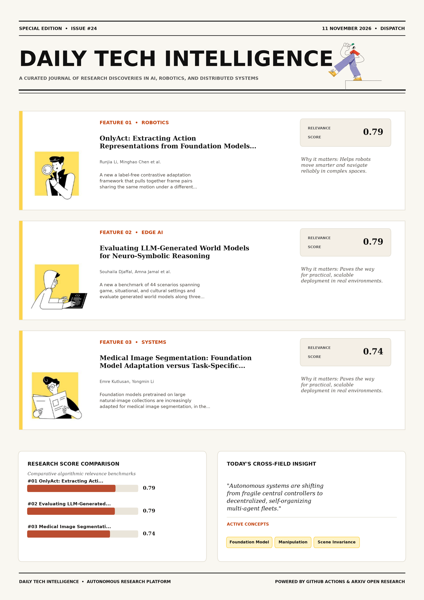

# Daily Tech Intelligence

## 11 November 2026

### Today's Overview

10 research papers analyzed.

Topics:

* Artificial Intelligence
* Machine Learning
* Natural Language Processing
* Robotics

### Visual Intelligence Templates

* **Template 3: Gen-Z Spotlight Broadside (Primary)**: [View High-Res](infographic_spotlight.png)
* **Template 2: Modern Tech Studio**: [View High-Res](infographic_modern.png)
* **Template 1: Editorial Research Journal**: [View High-Res](infographic_editorial.png)

---

## 1. OnlyAct: Extracting Action Representations from Foundation Models for World Models

Authors: Runjia Li, Minghao Chen, Junyu Xie, Philip Torr, Andrea Vedaldi, Tomas Jakab

Publication: 2026-11-10T17:59:19Z

Category: cs.CV

Relevance Score: 0.79

Paper: [arXiv:2611.14420](https://arxiv.org/abs/2611.14420v1) | [PDF](https://arxiv.org/pdf/2611.14420v1)

### Summary

This has two limitations: learning the action space from scratch can limit generalization to unseen domains, and the bottleneck trades expressiveness for separation, with tighter settings losing nuance and looser ones risking scene leakage under domain shifts. We propose a label-free contrastive adaptation framework that pulls together frame pairs sharing the same motion under a different scene and pushes apart pairs from the same scene with different motion, reshaping the geometry of the pretrained space without imposing a reconstruction bottleneck. Compared with annotation-free latent-action methods, our representations are substantially more expressive while matching their scene invariance, and they yield world models that transfer demonstrated actions to new scenes more faithfully.

### Key Concepts

* Foundation Model
* Manipulation
* Scene Invariance
* Unlabeled Video
* Unseen Adaptation
* Unseen Domains

### Technical Insights

**Problem**

This has two limitations: learning the action space from scratch can limit generalization to unseen domains, and the bottleneck trades expressiveness for separation, with tighter settings losing nuance and looser ones risking scene leakage under domain shifts.

**Approach**

We propose a label-free contrastive adaptation framework that pulls together frame pairs sharing the same motion under a different scene and pushes apart pairs from the same scene with different motion, reshaping the geometry of the pretrained space without imposing a reconstruction bottleneck.

**Key Innovation**

Formulates an integrated mechanism leveraging Foundation Model, Manipulation.

**Results**

Not specified in the available abstract.

**Applications**

Autonomous robotic manipulation, sim-to-real transfer, and agile mobile navigation systems. High-resolution real-time visual perception, automated 3D reconstruction, and embodied vision.

**Limitations**

This has two limitations: learning the action space from scratch can limit generalization to unseen domains, and the bottleneck trades expressiveness for separation, with tighter settings losing nuance and looser ones risking scene leakage under domain shifts.

---

## 2. Evaluating LLM-Generated World Models for Neuro-Symbolic Reasoning

Authors: Souhaila Djaffal, Amna Jamal, Gagana Madhugiri Devaraja, Anidipta Pal, Jobst Heitzig

Publication: 2026-11-10T17:58:12Z

Category: cs.AI

Relevance Score: 0.79

Paper: [arXiv:2611.14419](https://arxiv.org/abs/2611.14419v1) | [PDF](https://arxiv.org/pdf/2611.14419v1)

### Summary

Formal world models can support planning, verification, and safety reasoning, but constructing them from open-ended natural-language situations is difficult, particularly in multi-agent settings where several formalizations may be plausible. We introduce a benchmark of 44 scenarios spanning game, situational, and cultural settings and evaluate generated world models along three dimensions: mechanical validity, reference-relative structural agreement, and semantic criteria. These results show that executability is a necessary but insufficient criterion for LLM-generated world models: models that are mechanically valid can still differ substantially in the structure used by downstream neuro-symbolic reasoning and planning. We study whether five LLMs can generate such world models as partially observable stochastic games and whether mechanical validity is sufficient to establish that the resulting model faithfully represents the intended decision problem.

### Key Concepts

* Neuro-symbolic
* Generated World
* Agreement Semantic
* Analyze First-pass
* Audit Mean
* Authored Reference

### Technical Insights

**Problem**

Formal world models can support planning, verification, and safety reasoning, but constructing them from open-ended natural-language situations is difficult, particularly in multi-agent settings where several formalizations may be plausible.

**Approach**

We introduce a benchmark of 44 scenarios spanning game, situational, and cultural settings and evaluate generated world models along three dimensions: mechanical validity, reference-relative structural agreement, and semantic criteria.

**Key Innovation**

Formulates an integrated mechanism leveraging Neuro-symbolic, Generated World.

**Results**

These results show that executability is a necessary but insufficient criterion for LLM-generated world models: models that are mechanically valid can still differ substantially in the structure used by downstream neuro-symbolic reasoning and planning.

**Applications**

Next-generation large language model workflows, retrieval-augmented intelligence, and structured document parsing.

**Limitations**

Not specified in the available abstract.

---

## 3. Medical Image Segmentation: Foundation Model Adaptation versus Task-Specific Training

Authors: Emre Kutlusan, Yongmin Li

Publication: 2026-11-10T18:59:54Z

Category: cs.CV, cs.AI

Relevance Score: 0.74

Paper: [arXiv:2611.14519](https://arxiv.org/abs/2611.14519v1) | [PDF](https://arxiv.org/pdf/2611.14519v1)

### Summary

Most comparisons, however, use data from the training distribution and a single task-specific baseline whose configuration is rarely justified, and therefore provide limited evidence of performance at new clinical sites. Most comparisons, however, use data from the training distribution and a single task-specific baseline whose configuration is rarely justified, and therefore provide limited evidence of performance at new clinical sites. It also remains unclear how much of a foundation model must be adapted, and what determines this. Foundation-model adaptation is therefore warranted where models must work across sites, with capacity selected on the target domain. Foundation models pretrained on large natural-image collections are increasingly adapted for medical image segmentation, in the expectation that they will replace models trained for each task.

### Key Concepts

* Foundation Model
* Abundant Delineated
* Adaptation Capacity
* Adaptation Warranted
* Adapted Determines
* Adapted Foundation

### Technical Insights

**Problem**

Most comparisons, however, use data from the training distribution and a single task-specific baseline whose configuration is rarely justified, and therefore provide limited evidence of performance at new clinical sites.

**Approach**

Most comparisons, however, use data from the training distribution and a single task-specific baseline whose configuration is rarely justified, and therefore provide limited evidence of performance at new clinical sites.

**Key Innovation**

Formulates an integrated mechanism leveraging Foundation Model, Abundant Delineated.

**Results**

Not specified in the available abstract.

**Applications**

High-resolution real-time visual perception, automated 3D reconstruction, and embodied vision.

**Limitations**

Not specified in the available abstract.

---

## 4. ReTrace: Distilling Tool-Using Agents into Planner-Free Workflows

Authors: Kaiyuan Hou, Yang Ping Kuo, Indranil Bhattacharya, Rohith Nama, Arushi Gupta, Carlos D. Castillo, Prathap Ramachandra, Xiaofan Jiang, Francesco Carbone

Publication: 2026-11-10T18:49:47Z

Category: cs.AI, cs.LG, cs.MA

Relevance Score: 0.74

Paper: [arXiv:2611.14492](https://arxiv.org/abs/2611.14492v1) | [PDF](https://arxiv.org/pdf/2611.14492v1)

### Summary

Addressing critical demands in Natural Language Processing, this research investigates business process automation runs the same standard operating procedure (sop) again and again on new inputs. We present ReTrace, which turns an SOP and a few logged agent runs into a reusable workflow in which code, not an LLM, selects the next step. On eight SOP-Bench procedures, ReTrace without repair trails few-shot generation (80.6\% vs. 83.6\%), but repair from labeled training failures lifts it to 87.8\% at 0.40s per task, compared to 85.5\% in 46.6s for the agent. Business process automation runs the same Standard Operating Procedure (SOP) again and again on new inputs.

### Key Concepts

* Large Language Model
* Action Tool
* Adds Latency
* Agent Lower
* Agent Reasoning
* Agent Run

### Technical Insights

**Problem**

Addresses foundational constraints in Natural Language Processing and existing computational workflows.

**Approach**

We present ReTrace, which turns an SOP and a few logged agent runs into a reusable workflow in which code, not an LLM, selects the next step.

**Key Innovation**

Formulates an integrated mechanism leveraging Large Language Model, Action Tool.

**Results**

Not specified in the available abstract.

**Applications**

Next-generation large language model workflows, retrieval-augmented intelligence, and structured document parsing.

**Limitations**

Not specified in the available abstract.

---

## 5. An Energy-Based Perspective on Machine Learning

Authors: Bo Dai, Yilun Du

Publication: 2026-11-10T17:37:22Z

Category: cs.AI, cs.LG

Relevance Score: 0.74

Paper: [arXiv:2611.14383](https://arxiv.org/abs/2611.14383v1) | [PDF](https://arxiv.org/pdf/2611.14383v1)

### Summary

Addressing critical demands in Machine Learning, this research investigates energy-based models (ebms) define a distribution through a scalar energy, p_θ(x)\propto\exp(-e_θ(x)), and are usually presented as one model family among many. This tutorial has a broader goal: beyond introducing EBMs, it uses them as a single lens that connects the different aspects of machine learning. Any EBM is specified by three choices, the energy, which determines what the model represents; the inference procedure, which samples from or optimizes the energy; and the learning method, which fits the energy to data. This view explains existing methods, organizes them into a common framework, and suggests new algorithms by replacing one component while keeping the others, with composition of energies as a principled way to combine learned models at inference time.

### Key Concepts

* Reinforcement Learning
* Representation Learning
* Algorithms Replacing
* Aspects Machine
* Auto-encoders Diffusion
* Bert Denoising

### Technical Insights

**Problem**

Addresses foundational constraints in Machine Learning and existing computational workflows.

**Approach**

This tutorial has a broader goal: beyond introducing EBMs, it uses them as a single lens that connects the different aspects of machine learning.

**Key Innovation**

Formulates an integrated mechanism leveraging Reinforcement Learning, Representation Learning.

**Results**

Not specified in the available abstract.

**Applications**

Autonomous agentic reasoning, multi-agent coordination, and decision-support platforms.

**Limitations**

Not specified in the available abstract.

---

## 6. TimeSeek: Multi-Task and Multi-Domain Pretraining for Generalized Time Series Analytics

Authors: Peng Chen, Yihang Wang, Zhongwen Rao, Yang Shu, Yuying Qiu, Yuxuan Chen, Lujia Pan, Bin Yang, Chenjuan Guo

Publication: 2026-11-10T18:49:26Z

Category: cs.LG

Relevance Score: 0.70

Paper: [arXiv:2611.14491](https://arxiv.org/abs/2611.14491v1) | [PDF](https://arxiv.org/pdf/2611.14491v1)

### Summary

Addressing critical demands in Machine Learning, this research investigates time series analytics has been widely applied across various domains. To address these challenges, we propose TimeSeek, a novel generalized time series analytics model that adaptively models time series patterns from multi-domain data and unifies multiple tasks in pre-training. To address these challenges, we propose TimeSeek, a novel generalized time series analytics model that adaptively models time series patterns from multi-domain data and unifies multiple tasks in pre-training. After pre-training on large-scale time series data, TimeSeek achieves state-of-the-art performance in forecasting, anomaly detection, and classification tasks across both few-shot learning and zero-shot situations, together with favorable inference efficiency.

### Key Concepts

* Few-shot Learning
* Zero-shot
* Series Analytics
* Time Series
* Anomaly Detection
* Forecasting Anomaly

### Technical Insights

**Problem**

Addresses foundational constraints in Machine Learning and existing computational workflows.

**Approach**

To address these challenges, we propose TimeSeek, a novel generalized time series analytics model that adaptively models time series patterns from multi-domain data and unifies multiple tasks in pre-training.

**Key Innovation**

To address these challenges, we propose TimeSeek, a novel generalized time series analytics model that adaptively models time series patterns from multi-domain data and unifies multiple tasks in pre-training.

**Results**

After pre-training on large-scale time series data, TimeSeek achieves state-of-the-art performance in forecasting, anomaly detection, and classification tasks across both few-shot learning and zero-shot situations, together with favorable inference efficiency.

**Applications**

Autonomous agentic reasoning, multi-agent coordination, and decision-support platforms.

**Limitations**

Not specified in the available abstract.

---

## 7. SIGMO: Sigmoid Gated Interaction-Aware Motion Planning

Authors: Avinash Singh, Manish Saroya, Fatemeh Cheraghi Pouria, Faizan Tariq, Jovin D'sa, David Isele, Yosuke Sakamoto, Sangjae Bae

Publication: 2026-11-10T17:53:57Z

Category: cs.RO

Relevance Score: 0.70

Paper: [arXiv:2611.14414](https://arxiv.org/abs/2611.14414v1) | [PDF](https://arxiv.org/pdf/2611.14414v1)

### Summary

Despite the widespread adoption of autonomous vehicle technologies, reliable navigation within cluttered environments remains arduous due to the necessity of interaction-aware strategies; example scenarios include: narrow passages with multiple agents, lane changing in dense traffic, and crossing unsignalized intersections. To meet these requirements, we present SIGMO, a sigmoid-gated interaction-aware motion planner, with two main contributions. The results show that SIGMO balances proactive and defensive behavior while remaining computationally lightweight, serving as a strong baseline in a mobility stack. The simulation and hardware experiment videos are available here: https://sites.google.com/view/sigmoid-polygate. These scenarios often require highly proactive strategies, simultaneously demanding interpretability and quick adaptability, which challenge end-to-end and data-driven methods.

### Key Concepts

* Adaptability Challenge
* Adaptability Changes
* Adoption Autonomous
* Arbitrary Trajectory
* Arduous Necessity
* Autonomous Vehicle

### Technical Insights

**Problem**

Despite the widespread adoption of autonomous vehicle technologies, reliable navigation within cluttered environments remains arduous due to the necessity of interaction-aware strategies; example scenarios include: narrow passages with multiple agents, lane changing in dense traffic, and crossing unsignalized intersections.

**Approach**

To meet these requirements, we present SIGMO, a sigmoid-gated interaction-aware motion planner, with two main contributions.

**Key Innovation**

Formulates an integrated mechanism leveraging Adaptability Challenge, Adaptability Changes.

**Results**

The results show that SIGMO balances proactive and defensive behavior while remaining computationally lightweight, serving as a strong baseline in a mobility stack.

**Applications**

Autonomous robotic manipulation, sim-to-real transfer, and agile mobile navigation systems.

**Limitations**

Not specified in the available abstract.

---

## 8. AutoScaffold: AI-Guided Scaffolding for Reinforcement Learning of Language Models

Authors: Zijian Zhang, Rizhen Hu, Jiangweizhi Peng, Shiyang Li, Sujay Bhatt, Sihan Zeng, Mingyi Hong

Publication: 2026-11-10T18:58:46Z

Category: cs.LG, cs.CL

Relevance Score: 0.69

Paper: [arXiv:2611.14515](https://arxiv.org/abs/2611.14515v1) | [PDF](https://arxiv.org/pdf/2611.14515v1)

### Summary

Addressing critical demands in Machine Learning, this research investigates reinforcement learning with verifiable rewards (rlvr) produces rich training experience, yet outcome rewards reduce each attempt to a single number and leave most of this information unused. We introduce AutoScaffold, a unified AI-for-AI framework that turns a student's training experience into adaptive scaffolds, with minimal domain-specific information and no human intervention during training. On GPU kernel generation, AutoScaffold increases the fraction of tasks with a correct kernel that runs faster than the PyTorch reference by up to 5.0 points. Analyses show that the teacher identifies a different failure in each task class and shifts its scaffolds from step-by-step workflows to targeted fixes as the student improves, and that its revised scaffolds help the student learn more than keeping the previous scaffold or using no scaffold.

### Key Concepts

* Reinforcement Learning
* Gpu Kernel
* Kernel Generation
* Tailored Specific
* Targeted Fixes
* Teacher Identifies

### Technical Insights

**Problem**

Addresses foundational constraints in Machine Learning and existing computational workflows.

**Approach**

We introduce AutoScaffold, a unified AI-for-AI framework that turns a student's training experience into adaptive scaffolds, with minimal domain-specific information and no human intervention during training.

**Key Innovation**

Formulates an integrated mechanism leveraging Reinforcement Learning, Gpu Kernel.

**Results**

On GPU kernel generation, AutoScaffold increases the fraction of tasks with a correct kernel that runs faster than the PyTorch reference by up to 5.0 points.

**Applications**

Next-generation large language model workflows, retrieval-augmented intelligence, and structured document parsing.

**Limitations**

Not specified in the available abstract.

---

## 9. Accurate predictions of properties of energetic materials with tabular foundation models

Authors: Vagn Krister Nes Glomsrud, Mathias Bynke, Lars Henry Berge Olsen, Dennis Christensen

Publication: 2026-11-10T18:29:37Z

Category: cs.LG

Relevance Score: 0.69

Paper: [arXiv:2611.14462](https://arxiv.org/abs/2611.14462v1) | [PDF](https://arxiv.org/pdf/2611.14462v1)

### Summary

Addressing critical demands in Machine Learning, this research investigates we use tabpfn, a recently developed tabular foundation model, to predict three properties of energetic materials: impact sensitivity, decomposition temperature and crystal density. Without any hyperparameter tuning, TabPFN outperforms the best published models for all three properties. Without any hyperparameter tuning, TabPFN outperforms the best published models for all three properties. Finally, we interpret the predictions using Shapley values, which rank the features by their importance. We use TabPFN, a recently developed tabular foundation model, to predict three properties of energetic materials: impact sensitivity, decomposition temperature and crystal density. It also substantially outperforms a wide range of established machine-learning models, including tuned gradient boosting (XGBoost), random forests and Gaussian processes.

### Key Concepts

* Foundation Model
* Accurate Chemprop
* Applied Chemprop
* Best Published
* Boosting Xgboost
* Built-in Uncertainty

### Technical Insights

**Problem**

Addresses foundational constraints in Machine Learning and existing computational workflows.

**Approach**

Without any hyperparameter tuning, TabPFN outperforms the best published models for all three properties.

**Key Innovation**

Formulates an integrated mechanism leveraging Foundation Model, Accurate Chemprop.

**Results**

Without any hyperparameter tuning, TabPFN outperforms the best published models for all three properties.

**Applications**

Autonomous agentic reasoning, multi-agent coordination, and decision-support platforms.

**Limitations**

Not specified in the available abstract.

---

## 10. Emergent Biological Capabilities in a Foundation Model for Molecular Interactions

Authors: Adi Mashiach

Publication: 2026-11-10T18:53:01Z

Category: cs.LG, q-bio.BM

Relevance Score: 0.68

Paper: [arXiv:2611.14504](https://arxiv.org/abs/2611.14504v1) | [PDF](https://arxiv.org/pdf/2611.14504v1)

### Summary

Addressing critical demands in Machine Learning, this research investigates foundation models trained on large unlabeled corpora develop emergent capabilities, tasks that go beyond the training objective. We extend this paradigm to multimodal biology with Bonbon, a foundation model for molecular interactions trained on approximately 3.2 trillion tokens of paired protein-ligand sequences. In prospective wet-lab validation across nine disease targets spanning seven protein families, Bonbon achieves a 61.5% dose-response hit rate on de novo compounds, yielding structurally novel molecules not previously reported to inhibit these proteins, including for out-of-distribution targets. From a single representation space, Bonbon exhibits three zero-shot emergent capabilities at hierarchical levels of resolution: functional (mechanism of action), residue (binding site localization, including orthosteric/allosteric discrimination), and bond (covalent versus non-covalent engagement).

### Key Concepts

* Scaling Laws
* Foundation Model
* Zero-shot
* Emergent Capabilities
* Protein-ligand Sequences
* Tokens Paired Protein-ligand

### Technical Insights

**Problem**

Addresses foundational constraints in Machine Learning and existing computational workflows.

**Approach**

We extend this paradigm to multimodal biology with Bonbon, a foundation model for molecular interactions trained on approximately 3.2 trillion tokens of paired protein-ligand sequences.

**Key Innovation**

In prospective wet-lab validation across nine disease targets spanning seven protein families, Bonbon achieves a 61.5% dose-response hit rate on de novo compounds, yielding structurally novel molecules not previously reported to inhibit these proteins, including for out-of-distribution targets.

**Results**

Not specified in the available abstract.

**Applications**

Autonomous agentic reasoning, multi-agent coordination, and decision-support platforms.

**Limitations**

Not specified in the available abstract.

---
