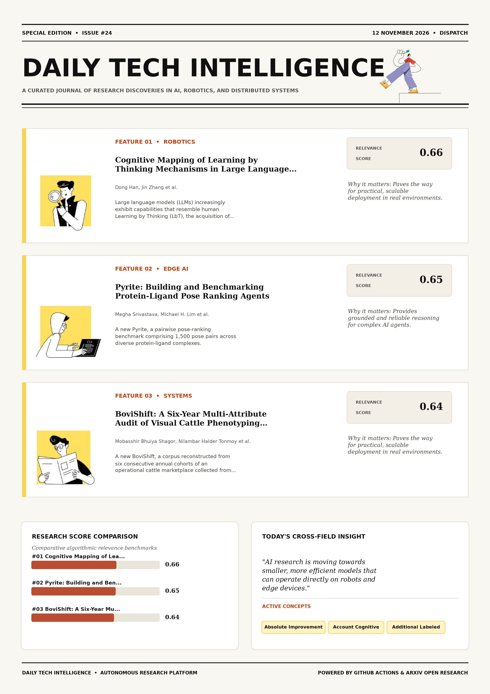

# Daily Tech Intelligence

## 12 November 2026

### Today's Overview

10 research papers analyzed.

Topics:

* Artificial Intelligence
* IoT & Edge AI
* Machine Learning
* Natural Language Processing
* Robotics

### Visual Intelligence Templates

* **Template 3: Gen-Z Spotlight Broadside (Primary)**: [View High-Res](infographic_spotlight.png)
* **Template 2: Modern Tech Studio**: [View High-Res](infographic_modern.png)
* **Template 1: Editorial Research Journal**: [View High-Res](infographic_editorial.png)

---

## 1. Cognitive Mapping of Learning by Thinking Mechanisms in Large Language Models

Authors: Dong Han, Jin Zhang, Kunyue Yang

Publication: 2026-11-10T17:37:13Z

Category: cs.AI

Relevance Score: 0.66

Paper: [arXiv:2611.14382](https://arxiv.org/abs/2611.14382v1) | [PDF](https://arxiv.org/pdf/2611.14382v1)

### Summary

Drawing on representative methods, including chain-of-thought prompting, self-consistency, self-reflection, Tree-of-Thoughts search, Self-Instruct, and self-taught reasoning, the analysis argues that selected methods can functionally approximate aspects of these mechanisms and can improve performance on some tasks without additional labeled examples, although this does not always constitute durable learning in model parameters. A systematic account of the cognitive mechanisms behind these capabilities, and of their limits, remains underdeveloped. This paper proposes a Cognitive LbT Framework that maps four mechanisms (Reflective Reasoning, Synthetic Memory Formation, Internal Simulation, and Conceptual Self-Organization) onto computational processes in LLMs. The framework yields testable propositions about when LbT in LLMs should succeed or fail and offers a structured basis for designing more reliable autonomous learning systems.

### Key Concepts

* Absolute Improvement
* Account Cognitive
* Additional Labeled
* Approximate Aspects
* Approximately Instructions
* Argues Selected

### Technical Insights

**Problem**

Drawing on representative methods, including chain-of-thought prompting, self-consistency, self-reflection, Tree-of-Thoughts search, Self-Instruct, and self-taught reasoning, the analysis argues that selected methods can functionally approximate aspects of these mechanisms and can improve performance on some tasks without additional labeled examples, although this does not always constitute durable learning in model parameters.

**Approach**

A systematic account of the cognitive mechanisms behind these capabilities, and of their limits, remains underdeveloped.

**Key Innovation**

Formulates an integrated mechanism leveraging Absolute Improvement, Account Cognitive.

**Results**

Not specified in the available abstract.

**Applications**

Next-generation large language model workflows, retrieval-augmented intelligence, and structured document parsing.

**Limitations**

The same mechanisms also produce characteristic failures, including hallucination diffusion, model collapse, concept drift, and high computational cost.

---

## 2. Pyrite: Building and Benchmarking Protein-Ligand Pose Ranking Agents

Authors: Megha Srivastava, Michael H. Lim, Allison M. Keys, Pranav Murugan, Nate Gruver

Publication: 2026-11-10T18:56:32Z

Category: cs.LG, q-bio.QM

Relevance Score: 0.65

Paper: [arXiv:2611.14511](https://arxiv.org/abs/2611.14511v1) | [PDF](https://arxiv.org/pdf/2611.14511v1)

### Summary

Addressing critical demands in Natural Language Processing, this research investigates predicting how a ligand binds to its target is central to small-molecule drug discovery. We introduce Pyrite, a pairwise pose-ranking benchmark comprising 1,500 pose pairs across diverse protein-ligand complexes. These agents achieve up to 67% and 74% accuracy, respectively, exceeding observed expert performance. These results establish Pyrite as a challenging test of pose-ranking ability and highlight LLM-guided feature discovery as a promising approach to interpret and combine the outputs of computational chemistry tools. Predicting how a ligand binds to its target is central to small-molecule drug discovery. Modern cofolding models can generate diverse candidate poses, but reliably ranking these candidates remains challenging.

### Key Concepts

* Feature Discovery
* Llm-guided Feature
* Scores Develop
* Scores Perform
* Small-molecule Drug
* Structured Representation

### Technical Insights

**Problem**

Addresses foundational constraints in Natural Language Processing and existing computational workflows.

**Approach**

We introduce Pyrite, a pairwise pose-ranking benchmark comprising 1,500 pose pairs across diverse protein-ligand complexes.

**Key Innovation**

Formulates an integrated mechanism leveraging Feature Discovery, Llm-guided Feature.

**Results**

These agents achieve up to 67% and 74% accuracy, respectively, exceeding observed expert performance.

**Applications**

Next-generation large language model workflows, retrieval-augmented intelligence, and structured document parsing.

**Limitations**

Not specified in the available abstract.

---

## 3. BoviShift: A Six-Year Multi-Attribute Audit of Visual Cattle Phenotyping Across Animals and Time

Authors: Mobasshir Bhuiya Shagor, Nilambar Halder Tonmoy, Md Saef Ullah Miah

Publication: 2026-11-10T18:38:23Z

Category: cs.CV

Relevance Score: 0.64

Paper: [arXiv:2611.14476](https://arxiv.org/abs/2611.14476v1) | [PDF](https://arxiv.org/pdf/2611.14476v1)

### Summary

Computer vision offers a scalable, non-contact means of estimating livestock traits, but correlated images and video frames make reliable evaluation difficult. We introduce BoviShift, a corpus reconstructed from six consecutive annual cohorts of an operational cattle marketplace collected from 2021 to 2026. To our knowledge, BoviShift is the longest-spanning cattle-vision resource combining consecutive annual cohorts with physical and visual attributes. Image-random splitting can place views of the same animal in both training and test sets, while deployment further requires transfer to animals captured in future years. It contains 2{,}657 cattle, 10{,}610 still images, and 2{,}566 walk-around videos across nine recorded breed categories.

### Key Concepts

* Zero-shot
* Annual Cohorts
* Consecutive Annual
* Strategies Configurations
* Task-dependent Universal
* Test Sets

### Technical Insights

**Problem**

Computer vision offers a scalable, non-contact means of estimating livestock traits, but correlated images and video frames make reliable evaluation difficult.

**Approach**

We introduce BoviShift, a corpus reconstructed from six consecutive annual cohorts of an operational cattle marketplace collected from 2021 to 2026.

**Key Innovation**

Formulates an integrated mechanism leveraging Zero-shot, Annual Cohorts.

**Results**

Not specified in the available abstract.

**Applications**

High-resolution real-time visual perception, automated 3D reconstruction, and embodied vision.

**Limitations**

Future-cohort behavior is also attribute- and cohort-specific: breed declines relative to pooled evaluation; mean weight and age performance fails to beat constant baselines in 2025; height remains above baseline; and color transfers well to 2025 but degrades in 2026.

---

## 4. The Unused Input: The Initial State as a Conditioning Interface for Recurrent TSFMs

Authors: Bernhard Voggenberger, Christian Ganhör, Levente Zólyomi, Sebastian Böck, Sepp Hochreiter

Publication: 2026-11-10T17:16:54Z

Category: cs.LG

Relevance Score: 0.64

Paper: [arXiv:2611.14357](https://arxiv.org/abs/2611.14357v1) | [PDF](https://arxiv.org/pdf/2611.14357v1)

### Summary

Addressing critical demands in Machine Learning, this research investigates time series foundation models (tsfms) forecast unseen series without task-specific training. Increasingly they are built on recurrent backbones, whose constant per-step cost makes long-context inference cheap, and which, unlike transformers, carry a state. A recurrent backbone computes its prediction from two inputs: the observed context window and the initial recurrent state. The results are preliminary and the improvements small, but they point to the initial state as a direction for further research. Time series foundation models (TSFMs) forecast unseen series without task-specific training. In practice only the first is utilised and the initial state is unused by convention.

### Key Concepts

* Zero-shot
* Initial State
* Lora Adapter
* State Lowers
* Static State
* Text Tirex

### Technical Insights

**Problem**

Addresses foundational constraints in Machine Learning and existing computational workflows.

**Approach**

Increasingly they are built on recurrent backbones, whose constant per-step cost makes long-context inference cheap, and which, unlike transformers, carry a state.

**Key Innovation**

Formulates an integrated mechanism leveraging Zero-shot, Initial State.

**Results**

Not specified in the available abstract.

**Applications**

Autonomous agentic reasoning, multi-agent coordination, and decision-support platforms.

**Limitations**

Not specified in the available abstract.

---

## 5. From Video Frames to Robot Meta-Frames: A Unified Latent Interface for World Action Models

Authors: Guoqiang Liang, Yiqi Lin, Yanzhe Chen, Kevin Yuchen Ma, Mike Zheng Shou

Publication: 2026-11-10T17:21:37Z

Category: cs.CV, cs.RO

Relevance Score: 0.63

Paper: [arXiv:2611.14365](https://arxiv.org/abs/2611.14365v1) | [PDF](https://arxiv.org/pdf/2611.14365v1)

### Summary

We argue that signal injection is instead a distribution-alignment problem: how well a representation matches the prior of the pretrained VDMs during denoising. Motivated by this diagnostic result, we propose MetaWAM, which folds all robot signals into a single unified meta-frame: each signal is assigned to a disjoint frequency-domain channel band and lifted to the spatial latent by an inverse DCT, yielding a decodable interface aligned with the pretrained VDM prior without any added module or architectural change. Code and models are available at https://github.com/showlab/MetaWAM Pretrained video diffusion models (VDMs) offer a powerful foundation for World Action Models (WAMs), which jointly predict robot actions and future observations.

### Key Concepts

* Robot Signals
* Spatial Latent
* Spending Separate
* Success Collapsing
* Success Real-world
* Support Policy

### Technical Insights

**Problem**

We argue that signal injection is instead a distribution-alignment problem: how well a representation matches the prior of the pretrained VDMs during denoising.

**Approach**

Motivated by this diagnostic result, we propose MetaWAM, which folds all robot signals into a single unified meta-frame: each signal is assigned to a disjoint frequency-domain channel band and lifted to the spatial latent by an inverse DCT, yielding a decodable interface aligned with the pretrained VDM prior without any added module or architectural change.

**Key Innovation**

Formulates an integrated mechanism leveraging Robot Signals, Spatial Latent.

**Results**

Not specified in the available abstract.

**Applications**

Autonomous robotic manipulation, sim-to-real transfer, and agile mobile navigation systems. High-resolution real-time visual perception, automated 3D reconstruction, and embodied vision.

**Limitations**

Not specified in the available abstract.

---

## 6. Discovering Equations for the Thermodynamics of South Asian Monsoon Precipitation

Authors: Savannah L. Ferretti, Jane W. Baldwin, Michael S. Pritchard, Tom Beucler

Publication: 2026-11-10T17:45:21Z

Category: cs.LG, physics.ao-ph

Relevance Score: 0.62

Paper: [arXiv:2611.14401](https://arxiv.org/abs/2611.14401v1) | [PDF](https://arxiv.org/pdf/2611.14401v1)

### Summary

Although the learned features were optimized only for precipitation prediction, the equations largely respond to each feature as expected from convective physics, consistent with the reanalysis. We use symbolic distillation, which combines neural networks and symbolic regression, to discover interpretable precipitation equations from 21 years of June-August reanalysis data. Neural networks first learn the vertical thermodynamic structure most relevant to precipitation, condensing each variable into a single interpretable feature not tied to a particular vertical grid. These responses reduce the dependence of monsoon precipitation on the entire vertical column to a few simple, testable constraints that could guide data-driven precipitation models to make them more physically consistent.

### Key Concepts

* Monsoon Precipitation
* Neural Networks
* Symbolic Regression
* Testable Constraints
* Thermodynamic Structure
* Thousand Times Fewer

### Technical Insights

**Problem**

Although the learned features were optimized only for precipitation prediction, the equations largely respond to each feature as expected from convective physics, consistent with the reanalysis.

**Approach**

We use symbolic distillation, which combines neural networks and symbolic regression, to discover interpretable precipitation equations from 21 years of June-August reanalysis data.

**Key Innovation**

Formulates an integrated mechanism leveraging Monsoon Precipitation, Neural Networks.

**Results**

Not specified in the available abstract.

**Applications**

Autonomous agentic reasoning, multi-agent coordination, and decision-support platforms.

**Limitations**

These responses reduce the dependence of monsoon precipitation on the entire vertical column to a few simple, testable constraints that could guide data-driven precipitation models to make them more physically consistent.

---

## 7. Toward Foundation Detection Models via Example-Based Grounding in EM-DETR

Authors: Sheethal Bhat, Bogdan Georgescu, Awais Mansoor, Florin C. Ghesu, Sasa Grbic, Andreas Maier

Publication: 2026-11-10T18:59:17Z

Category: cs.CV, cs.AI

Relevance Score: 0.62

Paper: [arXiv:2611.14518](https://arxiv.org/abs/2611.14518v1) | [PDF](https://arxiv.org/pdf/2611.14518v1)

### Summary

Addressing critical demands in Machine Learning, this research investigates deeplearning (dl)-based computer-aided diagnostic (cad) systems have shown great promise in supporting clinicians, but their performance heavily depends on the availability of large, well-annotated datasets. In this work, we introduce a novel approach to building a multi-domain foundation model for le sion detection by integrating diverse medical image datasets annotated for both anatomical structures and abnormalities. In this work, we introduce a novel approach to building a multi-domain foundation model for le sion detection by integrating diverse medical image datasets annotated for both anatomical structures and abnormalities. Our model achieves state-of-the-art (SOTA) results, with image-level AUC scores exceeding previous SOTA by 1% point on four key findings in CXRs. This approach paves the way for scalable foundation models in medical imaging that leverage heterogeneous data while maintaining robust and generalizable performance.

### Key Concepts

* Foundation Model
* Achieve Leading
* Adapt Jointly
* Addition Building
* Anatomical Structures
* Annotated Anatomical

### Technical Insights

**Problem**

Addresses foundational constraints in Machine Learning and existing computational workflows.

**Approach**

In this work, we introduce a novel approach to building a multi-domain foundation model for le sion detection by integrating diverse medical image datasets annotated for both anatomical structures and abnormalities.

**Key Innovation**

In this work, we introduce a novel approach to building a multi-domain foundation model for le sion detection by integrating diverse medical image datasets annotated for both anatomical structures and abnormalities.

**Results**

Our model achieves state-of-the-art (SOTA) results, with image-level AUC scores exceeding previous SOTA by 1% point on four key findings in CXRs.

**Applications**

High-resolution real-time visual perception, automated 3D reconstruction, and embodied vision.

**Limitations**

Not specified in the available abstract.

---

## 8. Blurring the Block Boundaries: Overlapping Block Denoising for Efficient Diffusion Language Models

Authors: Amir Mann, Jonathan Fhima, Shaked Brody, Or Avitan, Asif Zamir, Shahar Tsiper, Niv Nayman

Publication: 2026-11-10T17:40:24Z

Category: cs.CL, cs.AI

Relevance Score: 0.61

Paper: [arXiv:2611.14387](https://arxiv.org/abs/2611.14387v1) | [PDF](https://arxiv.org/pdf/2611.14387v1)

### Summary

Addressing critical demands in Machine Learning, this research investigates diffusion language models (dlms) have emerged as effective alternatives to autoregressive models for latency-critical tasks, enabling faster token generation. Recent advances employ block diffusion with self-editing capabilities, where each block refines tokens iteratively before advancing to the next one. We suggest Blurring the Block Boundaries (B3), a novel method with which two blocks are refined in parallel within a shared forward pass. Yet each block is only as fast as its slowest token, and the next block cannot start before it. Evaluated on state-of-the-art DLMs across 10 diverse datasets spanning varied tasks and difficulty levels, B3 results in on par generation quality and 11.5-14.5% speedup compared to the base model, pushing the Pareto frontier for latency-quality trade-offs in DLM inference.

### Key Concepts

* Diffusion Model
* Block Boundaries
* Advances Employ
* Advancing Block
* Alternatives Autoregressive
* Block Diffusion

### Technical Insights

**Problem**

Addresses foundational constraints in Machine Learning and existing computational workflows.

**Approach**

Recent advances employ block diffusion with self-editing capabilities, where each block refines tokens iteratively before advancing to the next one.

**Key Innovation**

We suggest Blurring the Block Boundaries (B3), a novel method with which two blocks are refined in parallel within a shared forward pass.

**Results**

Not specified in the available abstract.

**Applications**

Next-generation large language model workflows, retrieval-augmented intelligence, and structured document parsing.

**Limitations**

Not specified in the available abstract.

---

## 9. Is Your Robot's Memory Just a Clock? Temporal Shortcuts in Memory-Augmented VLA Policies

Authors: Chubin Zhang, Bo An

Publication: 2026-11-10T18:47:57Z

Category: cs.RO

Relevance Score: 0.61

Paper: [arXiv:2611.14488](https://arxiv.org/abs/2611.14488v1) | [PDF](https://arxiv.org/pdf/2611.14488v1)

### Summary

Many of them, however, fill memory by time: they sample frames uniformly across the episode and stamp each frame with its time step. Many of them, however, fill memory by time: they sample frames uniformly across the episode and stamp each frame with its time step. Because time passes even when nothing happens, such a memory may not tell waiting from working. A memory meant to remember what happened should count events rather than clock ticks. Memory-augmented vision-language-action (VLA) policies are meant to remember what happened. We show that it does not. On the counting tasks of RoboMME, we make the robot briefly pause or fidget its wrist.

### Key Concepts

* Vla Policies
* Meant Remember
* Null Event
* Remember Happened
* Time Stamps Makes
* Time Step

### Technical Insights

**Problem**

Many of them, however, fill memory by time: they sample frames uniformly across the episode and stamp each frame with its time step.

**Approach**

Many of them, however, fill memory by time: they sample frames uniformly across the episode and stamp each frame with its time step.

**Key Innovation**

Formulates an integrated mechanism leveraging Vla Policies, Meant Remember.

**Results**

Not specified in the available abstract.

**Applications**

Autonomous robotic manipulation, sim-to-real transfer, and agile mobile navigation systems.

**Limitations**

Across RoboMME's released designs, vulnerability follows how memory is indexed.

---

## 10. Precision on Demand: Escalating Weight Bits at Uncertain Decoding Steps in a Small Local Model

Authors: Mohammed Nayeem Khan, Logesh L, Aliyas Ahmad Misri

Publication: 2026-11-10T17:57:51Z

Category: cs.AI

Relevance Score: 0.61

Paper: [arXiv:2611.14418](https://arxiv.org/abs/2611.14418v1) | [PDF](https://arxiv.org/pdf/2611.14418v1)

### Summary

Addressing critical demands in IoT & Edge AI, this research investigates local decoding usually fixes one weight precision for the whole generation. We study a different allocation: store 8-bit weights, decode with their top 4 bits, and redo a step at 8 bits only when the low-precision output distribution looks uncertain (entropy above a threshold or a small top-two margin). Quantization is simulated, the model is Qwen3-0.6B, and the benchmark is GSM8K. A live random control, a thinking-mode phase rule, a second model and live KL were not run. Local decoding usually fixes one weight precision for the whole generation.

### Key Concepts

* Quantization
* All-high Points
* All-high Scores
* All-high Weight
* All-low Live
* All-low Mcnemar

### Technical Insights

**Problem**

Addresses foundational constraints in IoT & Edge AI and existing computational workflows.

**Approach**

We study a different allocation: store 8-bit weights, decode with their top 4 bits, and redo a step at 8 bits only when the low-precision output distribution looks uncertain (entropy above a threshold or a small top-two margin).

**Key Innovation**

Formulates an integrated mechanism leveraging Quantization, All-high Points.

**Results**

Not specified in the available abstract.

**Applications**

Low-power edge AI devices, embedded IoT sensor networks, and distributed on-device inference.

**Limitations**

Not specified in the available abstract.

---
