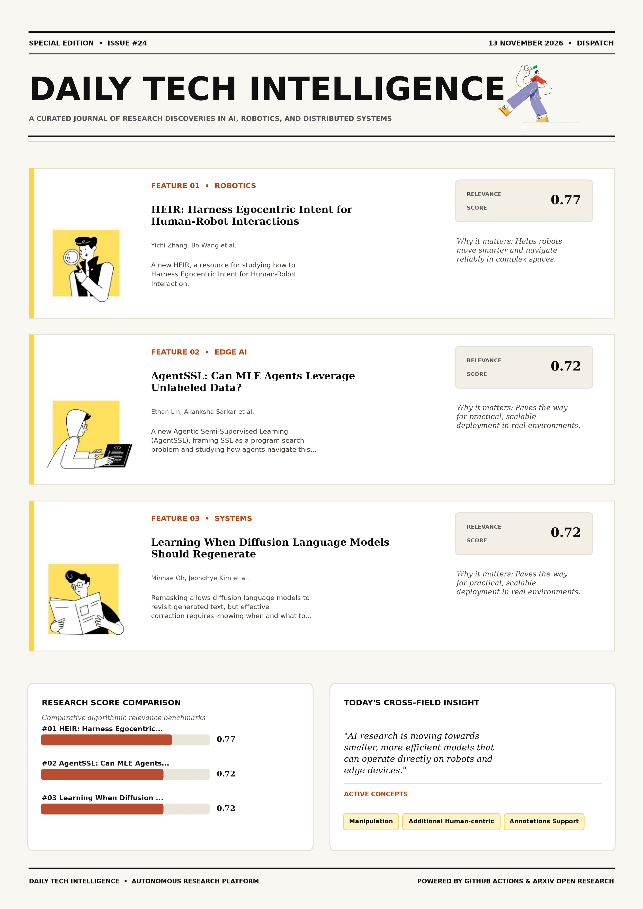

# Daily Tech Intelligence

## 13 November 2026

### Today's Overview

10 research papers analyzed.

Topics:

* Artificial Intelligence
* Machine Learning
* Natural Language Processing
* Robotics

### Visual Intelligence Templates

* **Template 3: Gen-Z Spotlight Broadside (Primary)**: [View High-Res](infographic_spotlight.png)
* **Template 2: Modern Tech Studio**: [View High-Res](infographic_modern.png)
* **Template 1: Editorial Research Journal**: [View High-Res](infographic_editorial.png)

---

## 1. HEIR: Harness Egocentric Intent for Human-Robot Interactions

Authors: Yichi Zhang, Bo Wang, Zhenghan Zhu, Yutong Han, Jiayin Zou, Gao Kejun, Chang Liu, Shaoxuan Xie, Chi Zhang, Shi Haoyang, Zongxuan Lai, Sen Cui, Guocai Yao, Miao Liu

Publication: 2026-11-12T18:25:41Z

Category: cs.RO

Relevance Score: 0.77

Paper: [arXiv:2611.17238](https://arxiv.org/abs/2611.17238v1) | [PDF](https://arxiv.org/pdf/2611.17238v1)

### Summary

Addressing critical demands in Robotics, this research investigates for robots to assist, serve, and collaborate with humans, they must not only interpret human requests conveyed through language and multimodal intentional cues, but also execute long-horizon tasks that interleave navigation and manipulation. In this paper, we introduce HEIR, a resource for studying how to Harness Egocentric Intent for Human-Robot Interaction. HEIR pairs human speech, measured gaze, and egocentric video with robot observations and teleoperated navigation-manipulation trajectories, while each session preserves successive episodes, with each request fulfilled through multiple execution subtasks. Our demo and dataset are available online. For robots to assist, serve, and collaborate with humans, they must not only interpret human requests conveyed through language and multimodal intentional cues, but also execute long-horizon tasks that interleave navigation and manipulation.

### Key Concepts

* Manipulation
* Additional Human-centric
* Annotations Support
* Assess Execution
* Assist Serve
* Available Online

### Technical Insights

**Problem**

Addresses foundational constraints in Robotics and existing computational workflows.

**Approach**

In this paper, we introduce HEIR, a resource for studying how to Harness Egocentric Intent for Human-Robot Interaction.

**Key Innovation**

Formulates an integrated mechanism leveraging Manipulation, Additional Human-centric.

**Results**

Not specified in the available abstract.

**Applications**

Autonomous robotic manipulation, sim-to-real transfer, and agile mobile navigation systems.

**Limitations**

Not specified in the available abstract.

---

## 2. AgentSSL: Can MLE Agents Leverage Unlabeled Data?

Authors: Ethan Lin, Akanksha Sarkar, Ziang Liu, Kristin Branson, Jennifer J. Sun

Publication: 2026-11-12T18:59:06Z

Category: cs.AI, cs.LG

Relevance Score: 0.72

Paper: [arXiv:2611.17323](https://arxiv.org/abs/2611.17323v1) | [PDF](https://arxiv.org/pdf/2611.17323v1)

### Summary

In this work, we introduce Agentic Semi-Supervised Learning (AgentSSL), framing SSL as a program search problem and studying how agents navigate this space under limited supervision. In this work, we introduce Agentic Semi-Supervised Learning (AgentSSL), framing SSL as a program search problem and studying how agents navigate this space under limited supervision. We further evaluate AgentSSL on real-world ecology detection tasks, highlighting the opportunities and challenges of transferring agent-discovered strategies beyond controlled benchmarks. Applying machine learning systems to new domains introduces bottlenecks in both labeled data acquisition and manual pipeline engineering. While recent MLE agents show promise in automating pipeline design, they have been studied almost exclusively in fully supervised settings, leaving them untested in realistic regimes where labeled data is scarce but unlabeled data is abundant.

### Key Concepts

* Acquisition Manual
* Active Program
* Adapts Established
* Agent Feedback
* Agent-discovered Strategies
* Agent-generated Human-engineered

### Technical Insights

**Problem**

In this work, we introduce Agentic Semi-Supervised Learning (AgentSSL), framing SSL as a program search problem and studying how agents navigate this space under limited supervision.

**Approach**

In this work, we introduce Agentic Semi-Supervised Learning (AgentSSL), framing SSL as a program search problem and studying how agents navigate this space under limited supervision.

**Key Innovation**

Formulates an integrated mechanism leveraging Acquisition Manual, Active Program.

**Results**

Not specified in the available abstract.

**Applications**

Autonomous agentic reasoning, multi-agent coordination, and decision-support platforms.

**Limitations**

Not specified in the available abstract.

---

## 3. Learning When Diffusion Language Models Should Regenerate

Authors: Minhae Oh, Jeonghye Kim, Jinwoo Koo, Yeongoon Kim, Jimin Seo, Minsik Seol, Jungwoo Lee

Publication: 2026-11-12T18:58:50Z

Category: cs.CL

Relevance Score: 0.72

Paper: [arXiv:2611.17320](https://arxiv.org/abs/2611.17320v1) | [PDF](https://arxiv.org/pdf/2611.17320v1)

### Summary

Addressing critical demands in Machine Learning, this research investigates remasking allows diffusion language models to revisit generated text, but effective correction requires knowing when and what to revise. Our diagnosis on Sudoku reveals two gaps. Hidden states contain error information that token confidence does not reliably expose, and remasking an isolated error usually reproduces it when the surrounding context remains fixed. It also complements post-training such as supervised fine-tuning and reinforcement learning, and generalizes to other generators, including Dream. Remasking allows diffusion language models to revisit generated text, but effective correction requires knowing when and what to revise. These findings motivate DiVR , a verifier that predicts whether a partially generated sequence will reach a correct answer.

### Key Concepts

* Reinforcement Learning
* Accuracy Fine-tuned
* Alternative Retain
* Base Divr
* Baselines Use
* Block Alternative

### Technical Insights

**Problem**

Addresses foundational constraints in Machine Learning and existing computational workflows.

**Approach**

Our diagnosis on Sudoku reveals two gaps.

**Key Innovation**

Formulates an integrated mechanism leveraging Reinforcement Learning, Accuracy Fine-tuned.

**Results**

Not specified in the available abstract.

**Applications**

Next-generation large language model workflows, retrieval-augmented intelligence, and structured document parsing.

**Limitations**

Not specified in the available abstract.

---

## 4. Objects as Addresses: Instance Binding in Vision Transformer Attention

Authors: Khalil Sabri, Guillaume-Alexandre Bilodeau, Nicolas Saunier, Wassim Bouachir

Publication: 2026-11-12T18:27:11Z

Category: cs.CV

Relevance Score: 0.69

Paper: [arXiv:2611.17240](https://arxiv.org/abs/2611.17240v1) | [PDF](https://arxiv.org/pdf/2611.17240v1)

### Summary

Addressing critical demands in Machine Learning, this research investigates humans naturally parse visual scenes into coherent individual objects rather than scattered features, a capability cognitive science calls object binding. While recent work shows that pretrained Vision Transformers (ViTs) intrinsically acquire this ability, how native self-attention computations mechanistically keep object instances separate remains unresolved. By studying this across eight pretrained ViTs, we found that instance separation is expressed more strongly in attention routing than in token content: selected query-key relations distinguish individual objects more reliably than value similarity or residual representations. Grouping patches by this query component separates same-category instances, reaching .615 FG-ARI versus .289 for the same clustering of final-layer features, which tend to merge them.

### Key Concepts

* Vision Transformer
* Address Identical
* Address Individual
* Address Visually
* Addresses Shared
* Arise Query

### Technical Insights

**Problem**

Addresses foundational constraints in Machine Learning and existing computational workflows.

**Approach**

While recent work shows that pretrained Vision Transformers (ViTs) intrinsically acquire this ability, how native self-attention computations mechanistically keep object instances separate remains unresolved.

**Key Innovation**

Formulates an integrated mechanism leveraging Vision Transformer, Address Identical.

**Results**

Not specified in the available abstract.

**Applications**

High-resolution real-time visual perception, automated 3D reconstruction, and embodied vision.

**Limitations**

Not specified in the available abstract.

---

## 5. AeroZoo: A Benchmark of Well-Posed Flow Problems for Foundation Models of Aerodynamics

Authors: Peter Sharpe, Carmelo Gonzales, Corey Adams, Mehdi Ataei, Sanjay Choudhry

Publication: 2026-11-12T17:36:09Z

Category: cs.LG, cs.CE, physics.flu-dyn

Relevance Score: 0.69

Paper: [arXiv:2611.17152](https://arxiv.org/abs/2611.17152v1) | [PDF](https://arxiv.org/pdf/2611.17152v1)

### Summary

Each sample poses a well-posed PDE problem in the form a solver receives it: the boundary meshes grouped by condition type, the prescribed values and the fluid properties. We introduce AeroZoo, a benchmark and training corpus of 3,815 time-mean solutions to the unsteady Reynolds-averaged Navier--Stokes (RANS) equations with a transition model, across seven geometry families, eight enclosure configurations and Reynolds numbers from 10^3 to 10^8. On DrivAerML, larger models and longer training barely lower Transolver's error; doubling the training cases cuts it by about 12% up to 400 cases, exhausting the dataset. The data and the scoring code will be released.

### Key Concepts

* Foundation Model
* Geometry Families
* Times Change
* Tokens Cut
* Transformer Boundary-driven
* Transolver Error

### Technical Insights

**Problem**

Each sample poses a well-posed PDE problem in the form a solver receives it: the boundary meshes grouped by condition type, the prescribed values and the fluid properties.

**Approach**

We introduce AeroZoo, a benchmark and training corpus of 3,815 time-mean solutions to the unsteady Reynolds-averaged Navier--Stokes (RANS) equations with a transition model, across seven geometry families, eight enclosure configurations and Reynolds numbers from 10^3 to 10^8.

**Key Innovation**

Formulates an integrated mechanism leveraging Foundation Model, Geometry Families.

**Results**

On DrivAerML, larger models and longer training barely lower Transolver's error; doubling the training cases cuts it by about 12% up to 400 cases, exhausting the dataset.

**Applications**

Autonomous agentic reasoning, multi-agent coordination, and decision-support platforms.

**Limitations**

Not specified in the available abstract.

---

## 6. K2V: Generative Keyframing For Physically Plausible Video Generation

Authors: Felix O'Mahony, Daniel Olmeda Reino, Roberto Cipolla, Ayush Tewari

Publication: 2026-11-12T18:59:09Z

Category: cs.CV

Relevance Score: 0.68

Paper: [arXiv:2611.17324](https://arxiv.org/abs/2611.17324v1) | [PDF](https://arxiv.org/pdf/2611.17324v1)

### Summary

However, content produced by these methods is known to exhibit significant physical errors. This is because, in a classical video generation setting, all physical reasoning must take place simultaneously and exclusively within the diffusion process.We propose to resolve these issues by redistributing the task of physical reasoning onto a language model-backed keyframe generation module, which allows for explicit reasoning in language, and fine-grained control over the appearance of the video at important moments in the video. Results demonstrate that our approach significantly outperforms existing approaches, achieving state-of-the-art performance on the Physics-IQ Verified benchmark and PhyGenBench. Video diffusion models are able to generate samples with high-quality appearance and textural qualities.

### Key Concepts

* Diffusion Model
* Video Generation
* Able Generate
* Appearance Textural
* Appearance Video
* Approaches Achieving

### Technical Insights

**Problem**

However, content produced by these methods is known to exhibit significant physical errors.

**Approach**

This is because, in a classical video generation setting, all physical reasoning must take place simultaneously and exclusively within the diffusion process.We propose to resolve these issues by redistributing the task of physical reasoning onto a language model-backed keyframe generation module, which allows for explicit reasoning in language, and fine-grained control over the appearance of the video at important moments in the video.

**Key Innovation**

Formulates an integrated mechanism leveraging Diffusion Model, Video Generation.

**Results**

Results demonstrate that our approach significantly outperforms existing approaches, achieving state-of-the-art performance on the Physics-IQ Verified benchmark and PhyGenBench.

**Applications**

High-resolution real-time visual perception, automated 3D reconstruction, and embodied vision.

**Limitations**

Not specified in the available abstract.

---

## 7. SpotDiff: A Plug-and-Play Framework for Zero-Shot Change Detection in Remote Sensing Imagery

Authors: Anit Upadhyaya, Ata Akbari Asanjan, Chaitanya Jalluri, Subash Yeggina, Jeremy Kravitz

Publication: 2026-11-12T17:45:37Z

Category: cs.CV

Relevance Score: 0.67

Paper: [arXiv:2611.17172](https://arxiv.org/abs/2611.17172v1) | [PDF](https://arxiv.org/pdf/2611.17172v1)

### Summary

Addressing critical demands in Machine Learning, this research investigates remote sensing change detection usually relies on large collections of temporally aligned, pixel-level annotations, which limits its scalability across regions, imaging platforms and application domains. We present SpotDiff, a training-free, plug-and-play framework for zero-shot change detection built by composing complementary vision foundation models. Our results indicate that composing modern foundation models is an effective route to scalable, label-free change detection. Remote sensing change detection usually relies on large collections of temporally aligned, pixel-level annotations, which limits its scalability across regions, imaging platforms and application domains. Recent zero-shot approaches reduce the need for supervision, but they often localize fine-grained changes poorly because their features are coarse or inconsistent across time.

### Key Concepts

* Zero-shot
* Change Detection
* Temporally Aligned
* Text-guided Region-of-interest
* Time Present
* Training-free Plug-and-play

### Technical Insights

**Problem**

Addresses foundational constraints in Machine Learning and existing computational workflows.

**Approach**

We present SpotDiff, a training-free, plug-and-play framework for zero-shot change detection built by composing complementary vision foundation models.

**Key Innovation**

Formulates an integrated mechanism leveraging Zero-shot, Change Detection.

**Results**

Not specified in the available abstract.

**Applications**

High-resolution real-time visual perception, automated 3D reconstruction, and embodied vision.

**Limitations**

Not specified in the available abstract.

---

## 8. UAV-Flow++: A Unified Suite for Benchmarking and Learning Language-Guided UAV Flight

Authors: Donglin Yang, Xiangyu Wang, Yantong Zhong, Wenhao Zheng, Zihan Ding, Yue Liao, Hongsheng Li, Ke Xu, Si Liu

Publication: 2026-11-12T17:39:43Z

Category: cs.RO, cs.CV

Relevance Score: 0.67

Paper: [arXiv:2611.17163](https://arxiv.org/abs/2611.17163v1) | [PDF](https://arxiv.org/pdf/2611.17163v1)

### Summary

Addressing critical demands in Artificial Intelligence, this research investigates language-guided uav navigation has largely focused on long-horizon route planning, leaving short-range, object-relative flight maneuvers underexplored. To address this gap, we formulate Flying-on-a-Word (Flow), a task requiring a UAV to convert concise natural-language instruction, egocentric visual observation, and current state dynamics into continuous flight actions. Together, Flow establishes a novel benchmark and learning framework for language-conditioned flight maneuvers. Physical UAV experiments demonstrate robust execution of object-relative commands in both indoor and outdoor real-world scenes. Language-guided UAV navigation has largely focused on long-horizon route planning, leaving short-range, object-relative flight maneuvers underexplored. Flow encompasses both primitive motion commands and complex object-interactive behaviors, assessing motion intent comprehension and spatial context grounding.

### Key Concepts

* Flight Maneuvers
* Simulation Trajectories
* Spatial Context
* State Dynamics
* Success Rate
* Superior Sample

### Technical Insights

**Problem**

Addresses foundational constraints in Artificial Intelligence and existing computational workflows.

**Approach**

To address this gap, we formulate Flying-on-a-Word (Flow), a task requiring a UAV to convert concise natural-language instruction, egocentric visual observation, and current state dynamics into continuous flight actions.

**Key Innovation**

Together, Flow establishes a novel benchmark and learning framework for language-conditioned flight maneuvers.

**Results**

Physical UAV experiments demonstrate robust execution of object-relative commands in both indoor and outdoor real-world scenes.

**Applications**

Autonomous robotic manipulation, sim-to-real transfer, and agile mobile navigation systems. High-resolution real-time visual perception, automated 3D reconstruction, and embodied vision. Next-generation large language model workflows, retrieval-augmented intelligence, and structured document parsing.

**Limitations**

Not specified in the available abstract.

---

## 9. ArchSpace: Recording, Reviewing, and Referencing LLM Architecture Research

Authors: Jie Wang, Tong Zhu, JiaHao Kuang, Zhe Xu, Yunkai Chai, Dehong Zheng, Yu Cheng, Tao Ji, ZhouHan Lin, Qi Zhang, Bowen Zhou

Publication: 2026-11-12T18:59:52Z

Category: cs.CL, cs.LG

Relevance Score: 0.67

Paper: [arXiv:2611.17332](https://arxiv.org/abs/2611.17332v1) | [PDF](https://arxiv.org/pdf/2611.17332v1)

### Summary

In academia, limited compute and inconsistent baselines often restrict evaluations to small-scale, single-point comparisons, making it difficult to establish whether improvements hold at larger scales or translate into broader impact. In industry, teams such as those behind DeepSeek, Qwen, and Kimi routinely introduce architectural innovations, yet public reports rarely document which ideas succeeded, which were abandoned, and why. Ideas validated through this review can in turn become new baselines, and ArchSpace thereby aims to broaden the range of ideas that shape the next generation of models. Model architecture shapes the scaling behavior, training efficiency, and inference cost of LLMs, making it a central focus of both industry and academia.

### Key Concepts

* Scaling Laws
* Abandoned Academia
* Academia Industry
* Academia Limited
* Addresses Gaps
* Adopted Industry

### Technical Insights

**Problem**

In academia, limited compute and inconsistent baselines often restrict evaluations to small-scale, single-point comparisons, making it difficult to establish whether improvements hold at larger scales or translate into broader impact.

**Approach**

In industry, teams such as those behind DeepSeek, Qwen, and Kimi routinely introduce architectural innovations, yet public reports rarely document which ideas succeeded, which were abandoned, and why.

**Key Innovation**

Formulates an integrated mechanism leveraging Scaling Laws, Abandoned Academia.

**Results**

Not specified in the available abstract.

**Applications**

Next-generation large language model workflows, retrieval-augmented intelligence, and structured document parsing.

**Limitations**

Not specified in the available abstract.

---

## 10. Inner Product Regularization for Imitation Learning

Authors: Benjamin A. Christie, Tianyu Qiu, Amy H. Choi, David Fridovich-Keil, Dylan P. Losey

Publication: 2026-11-12T17:38:48Z

Category: cs.RO

Relevance Score: 0.67

Paper: [arXiv:2611.17159](https://arxiv.org/abs/2611.17159v1) | [PDF](https://arxiv.org/pdf/2611.17159v1)

### Summary

Robots that learn from demonstrations should extrapolate their policy despite state perturbations such as sensor noise, scene variation, and compounding errors. One approach to this robustness is regularization. Prior regularizers consider each state on its own and limit how sensitive the policy is to any perturbation at that state. On a real robot arm performing three manipulation tasks, InneR raises the average success rate of a diffusion policy from 18% to 57% without additional data. By contrast, we explore how the policy's output shifts when given the same perturbation at different states. Our insight is that, locally, the robot should respond to state perturbations in a consistent manner: e.g., if changing an irrelevant object position does not impact the policy at one state, that same change should not shift the policy output at a nearby state.

### Key Concepts

* Imitation Learning
* Diffusion Policy
* Manipulation
* Inner Product
* Null Space
* Policy Output

### Technical Insights

**Problem**

Robots that learn from demonstrations should extrapolate their policy despite state perturbations such as sensor noise, scene variation, and compounding errors.

**Approach**

One approach to this robustness is regularization.

**Key Innovation**

Formulates an integrated mechanism leveraging Imitation Learning, Diffusion Policy.

**Results**

Not specified in the available abstract.

**Applications**

Autonomous robotic manipulation, sim-to-real transfer, and agile mobile navigation systems.

**Limitations**

Not specified in the available abstract.

---
