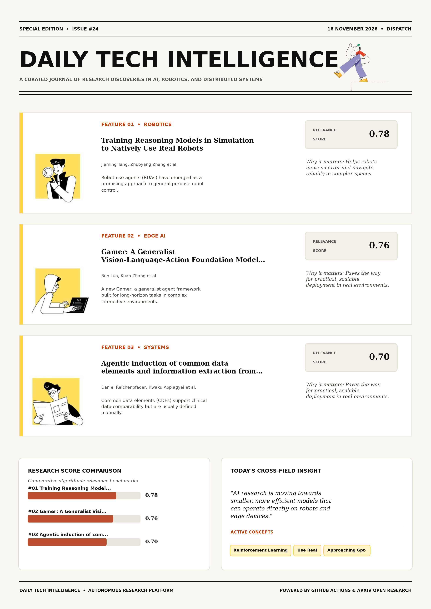

# Daily Tech Intelligence

## 16 November 2026

### Today's Overview

10 research papers analyzed.

Topics:

* Artificial Intelligence
* Machine Learning
* Natural Language Processing

### Visual Intelligence Templates

* **Template 3: Gen-Z Spotlight Broadside (Primary)**: [View High-Res](infographic_spotlight.png)
* **Template 2: Modern Tech Studio**: [View High-Res](infographic_modern.png)
* **Template 1: Editorial Research Journal**: [View High-Res](infographic_editorial.png)

---

## 1. Training Reasoning Models in Simulation to Natively Use Real Robots

Authors: Jiaming Tang, Zhuoyang Zhang, Junxian Guo, Fangzhou Zhao, Yilong Zhao, Zekai Li, Xingyang Li, Yuyang Zhao, Song Bian, Zhijian Liu, Song Han

Publication: 2026-11-13T18:59:02Z

Category: cs.RO, cs.LG

Relevance Score: 0.78

Paper: [arXiv:2611.18562](https://arxiv.org/abs/2611.18562v1) | [PDF](https://arxiv.org/pdf/2611.18562v1)

### Summary

However, strong performance has so far been achieved only by frontier proprietary models such as GPT-6 Astra and Claude Fable 5.2, whereas open-weight models remain substantially less capable. We build a Post-training Engine for Agentic Robotics (PEAR) and use it to train the model on simulated robot tasks at scale with robot-use reinforcement learning (RURL), mirroring how frontier models acquire computer use. We find that the skills acquired in simulation generalize well beyond the training tasks: they transfer to an unseen robot, to the real world, and to novel instructions. We show that an open-weight 27B reasoning model can be trained to use real robots natively through reinforcement learning, entirely in simulation and without demonstrations. These results highlight robot-use reinforcement learning as a promising component of foundation-model post-training.

### Key Concepts

* Reinforcement Learning
* Use Real
* Approaching Gpt-
* Gpt- Astra
* Robot-use Reinforcement
* Transfer Unseen

### Technical Insights

**Problem**

However, strong performance has so far been achieved only by frontier proprietary models such as GPT-6 Astra and Claude Fable 5.2, whereas open-weight models remain substantially less capable.

**Approach**

We build a Post-training Engine for Agentic Robotics (PEAR) and use it to train the model on simulated robot tasks at scale with robot-use reinforcement learning (RURL), mirroring how frontier models acquire computer use.

**Key Innovation**

We find that the skills acquired in simulation generalize well beyond the training tasks: they transfer to an unseen robot, to the real world, and to novel instructions.

**Results**

Not specified in the available abstract.

**Applications**

Autonomous robotic manipulation, sim-to-real transfer, and agile mobile navigation systems.

**Limitations**

Not specified in the available abstract.

---

## 2. Gamer: A Generalist Vision-Language-Action Foundation Model for Long-Horizon Real-Time Game Agent

Authors: Run Luo, Kuan Zhang, Qi Deng, Yukun Chen, Zhihao Yang, Yufei Zhang, Renrong Hu, Yi Zhang, Guiyu Ma, Tianyu Fan, Longze Chen, Hao Sun, Jiaming Li, Jiaming Yang, Xiaohao Liu, Tao Tan, Minzheng Wang, Hangtian Jia, Shuai Yuan, Lvdi Wang, Xiao Liu, Chao Ma, Yuting Zou, Yinhe Zheng, Xiaobo Xia, Dawei Jiang, Shaoqing Ren

Publication: 2026-11-13T16:39:30Z

Category: cs.CL, cs.AI, cs.CV

Relevance Score: 0.76

Paper: [arXiv:2611.18397](https://arxiv.org/abs/2611.18397v1) | [PDF](https://arxiv.org/pdf/2611.18397v1)

### Summary

Addressing critical demands in Machine Learning, this research investigates we introduce gamer, a generalist agent framework built for long-horizon tasks in complex interactive environments. We introduce Gamer, a generalist agent framework built for long-horizon tasks in complex interactive environments. A shared training and deployment pipeline supports interaction with both conventional 2D graphical interfaces and complex 3D simulated worlds. This approach offers a path toward generalist agents that can interact across digital and physical worlds. Its end-to-end architecture combines perception, memory management, and multi-step reasoning. We first continue pre-training on a dataset constructed from tens of thousands of hours of device-level keyboard and mouse interaction.

### Key Concepts

* Reinforcement Learning
* Foundation Model
* Keyboard Mouse
* Tens Thousands
* Thousands Hours
* Train Policy

### Technical Insights

**Problem**

Addresses foundational constraints in Machine Learning and existing computational workflows.

**Approach**

We introduce Gamer, a generalist agent framework built for long-horizon tasks in complex interactive environments.

**Key Innovation**

Formulates an integrated mechanism leveraging Reinforcement Learning, Foundation Model.

**Results**

Not specified in the available abstract.

**Applications**

High-resolution real-time visual perception, automated 3D reconstruction, and embodied vision. Next-generation large language model workflows, retrieval-augmented intelligence, and structured document parsing.

**Limitations**

Not specified in the available abstract.

---

## 3. Agentic induction of common data elements and information extraction from sarcoma case report abstracts

Authors: Daniel Reichenpfader, Kwaku Appiagyei, Manovah Nadarajah, Ahmed Reda Bahr, Irina Filchenko, Fabio Dennstädt

Publication: 2026-11-13T18:23:11Z

Category: cs.CL

Relevance Score: 0.70

Paper: [arXiv:2611.18506](https://arxiv.org/abs/2611.18506v1) | [PDF](https://arxiv.org/pdf/2611.18506v1)

### Summary

Addressing critical demands in Artificial Intelligence, this research investigates common data elements (cdes) support clinical data comparability but are usually defined manually. We investigated whether large language model agents could derive a CDE schema from sarcoma case report abstracts and apply it at scale. An agent proposed 72,909 candidate CDEs from 24,588 PubMed abstracts; agentic consolidation yielded 1,570 CDEs. These findings support agent-assisted schema drafting followed by expert curation before large-scale extraction. Common data elements (CDEs) support clinical data comparability but are usually defined manually. We retained 53 supported by at least 50 abstracts and attempted evidence-linked extraction across the corpus.

### Key Concepts

* Large Language Model
* Abstract-level Bootstrap
* Abstracts Agentic
* Abstracts Apply
* Abstracts Attempted
* Abstracts Exact

### Technical Insights

**Problem**

Addresses foundational constraints in Artificial Intelligence and existing computational workflows.

**Approach**

We investigated whether large language model agents could derive a CDE schema from sarcoma case report abstracts and apply it at scale.

**Key Innovation**

Formulates an integrated mechanism leveraging Large Language Model, Abstract-level Bootstrap.

**Results**

Not specified in the available abstract.

**Applications**

Next-generation large language model workflows, retrieval-augmented intelligence, and structured document parsing.

**Limitations**

Not specified in the available abstract.

---

## 4. ARCHER: From Rationale Imitation to Executable Reasoning in Small Language Models

Authors: Dhruv Dixit, Khushi Patel, Congcong Xu, Min Song

Publication: 2026-11-13T18:05:33Z

Category: cs.AI

Relevance Score: 0.70

Paper: [arXiv:2611.18494](https://arxiv.org/abs/2611.18494v1) | [PDF](https://arxiv.org/pdf/2611.18494v1)

### Summary

Addressing critical demands in Artificial Intelligence, this research investigates small language models are attractive for local, low-cost, and privacy-sensitive deployment, but they remain unreliable on mathematical reasoning tasks that require decomposition, exact computation, tool use, and verification. We introduce \textbf{ARCHER}: \textbf{A}ction-trace \textbf{R}einforcement for \textbf{C}alculator-grounded \textbf{H}ierarchical \textbf{E}xecutable \textbf{R}easoning, a two-stage framework for training small language models (SLMs) to produce executable and auditable reasoning trajectories. In the first stage, ARCHER compiles free-form chain-of-thought rationales into typed action traces containing reasoning steps, calculator calls, deterministic runtime observations, verification actions, and final answers. These results demonstrate that executable supervision and reward-guided behavioral refinement provide a general and effective training paradigm for compact mathematical reasoners.

### Key Concepts

* Reinforcement Learning
* Small Language
* Alculator-grounded Textbf
* Alignment Standard
* Stage Archer
* Typed Action

### Technical Insights

**Problem**

Addresses foundational constraints in Artificial Intelligence and existing computational workflows.

**Approach**

We introduce \textbf{ARCHER}: \textbf{A}ction-trace \textbf{R}einforcement for \textbf{C}alculator-grounded \textbf{H}ierarchical \textbf{E}xecutable \textbf{R}easoning, a two-stage framework for training small language models (SLMs) to produce executable and auditable reasoning trajectories.

**Key Innovation**

Formulates an integrated mechanism leveraging Reinforcement Learning, Small Language.

**Results**

Not specified in the available abstract.

**Applications**

Next-generation large language model workflows, retrieval-augmented intelligence, and structured document parsing.

**Limitations**

Not specified in the available abstract.

---

## 5. Modeling the Frictional Contact of Continuum Robots with Environments through Linear Complementarity Problem

Authors: Jia Shen, Junhyoung Ha, Yue Chen

Publication: 2026-11-13T18:51:17Z

Category: cs.RO

Relevance Score: 0.67

Paper: [arXiv:2611.18546](https://arxiv.org/abs/2611.18546v1) | [PDF](https://arxiv.org/pdf/2611.18546v1)

### Summary

However, current approaches make predictions only for the mechanism's internal friction that is limited by the boundary forces of the Coulomb friction cone, which fail to characterize the static friction and motion hysteresis. In this paper, we propose a novel friction model based on complementarity constraints under the Coulomb friction assumption. In this paper, we propose a novel friction model based on complementarity constraints under the Coulomb friction assumption. Experimental validations demonstrated that this model is able to reduce the maximum tip position error from 45.4 mm in the frictionless model to 5.85 mm in our friction-included model with a 287.9 mm-long tendon-driven continuum robot.

### Key Concepts

* Continuum Robots
* Able Reduce
* Accurate Friction
* Achieved Meeting
* Additionally Real-time
* Approaches Make

### Technical Insights

**Problem**

However, current approaches make predictions only for the mechanism's internal friction that is limited by the boundary forces of the Coulomb friction cone, which fail to characterize the static friction and motion hysteresis.

**Approach**

In this paper, we propose a novel friction model based on complementarity constraints under the Coulomb friction assumption.

**Key Innovation**

In this paper, we propose a novel friction model based on complementarity constraints under the Coulomb friction assumption.

**Results**

Not specified in the available abstract.

**Applications**

Autonomous robotic manipulation, sim-to-real transfer, and agile mobile navigation systems.

**Limitations**

In this paper, we propose a novel friction model based on complementarity constraints under the Coulomb friction assumption.

---

## 6. Imitation Bootstrapped Multi-Agent Reinforcement Learning

Authors: Tony H. Zhang, Connor Mattson, Daniel S. Brown

Publication: 2026-11-13T18:50:05Z

Category: cs.AI, cs.MA

Relevance Score: 0.65

Paper: [arXiv:2611.18543](https://arxiv.org/abs/2611.18543v1) | [PDF](https://arxiv.org/pdf/2611.18543v1)

### Summary

Demonstrations are an effective way to accelerate single-agent reinforcement learning (RL), but extending this idea to multi-agent reinforcement learning (MARL) is non-trivial as it is difficult and often impossible for a single person to teleoperate multiple agents simultaneously. We propose Imitation Bootstrapped Multi-Agent Reinforcement Learning (IBMARL), a framework that extends Imitation Bootstrapped Reinforcement Learning (IBRL) to cooperative teams and uses R2BC to train the imitation policies. On four cooperative multi-agent RL benchmarks, IBMARL surpasses its imitation policies 2.6-4.2\times faster than demonstration-based baselines on two tasks, is the only method to surpass it on the other two, and exceeds the demonstrator itself on two of the four. With real human demonstrations IBMARL still surpasses imitation learning alone, and does so more than twice as fast as the best baseline.

### Key Concepts

* Imitation Learning
* Reinforcement Learning
* Imitation Bootstrapped
* Multi-agent Reinforcement
* Accelerate Single-agent
* Agent Executes

### Technical Insights

**Problem**

Demonstrations are an effective way to accelerate single-agent reinforcement learning (RL), but extending this idea to multi-agent reinforcement learning (MARL) is non-trivial as it is difficult and often impossible for a single person to teleoperate multiple agents simultaneously.

**Approach**

We propose Imitation Bootstrapped Multi-Agent Reinforcement Learning (IBMARL), a framework that extends Imitation Bootstrapped Reinforcement Learning (IBRL) to cooperative teams and uses R2BC to train the imitation policies.

**Key Innovation**

Formulates an integrated mechanism leveraging Imitation Learning, Reinforcement Learning.

**Results**

On four cooperative multi-agent RL benchmarks, IBMARL surpasses its imitation policies 2.6-4.2\times faster than demonstration-based baselines on two tasks, is the only method to surpass it on the other two, and exceeds the demonstrator itself on two of the four.

**Applications**

Autonomous agentic reasoning, multi-agent coordination, and decision-support platforms.

**Limitations**

Not specified in the available abstract.

---

## 7. ModHarness-RL: Recasting Harnesses as Learnable and Evolving Programs for Agentic RL

Authors: Zelin He, Siyu Zhu, Jacob Helwig, Yujian Liu, Li An, Rohit Jain, Shiyu Chang, Alborz Geramifard

Publication: 2026-11-13T18:45:49Z

Category: cs.AI, cs.CL, cs.LG

Relevance Score: 0.65

Paper: [arXiv:2611.18533](https://arxiv.org/abs/2611.18533v1) | [PDF](https://arxiv.org/pdf/2611.18533v1)

### Summary

However, an effective harness depends on the domain, the data and the model, and keeps changing as the model trains. We introduce ModHarness-RL, which recasts the harness as programs that are learned from data and evolve as the model trains with RL. These results suggest that a harness for agentic RL can be learned from the task's data and evolved with the model. Agentic reinforcement learning (RL) increasingly relies on a harness, the scaffold around the model that decides what it sees of its own interaction and what guidance it receives. Most existing approaches train under a hand-written harness that stays fixed throughout.

### Key Concepts

* Reinforcement Learning
* Accumulated History
* Agentic Learned
* Agentic Reinforcement
* Alfworld Bird
* Analyze Alfworld

### Technical Insights

**Problem**

However, an effective harness depends on the domain, the data and the model, and keeps changing as the model trains.

**Approach**

We introduce ModHarness-RL, which recasts the harness as programs that are learned from data and evolve as the model trains with RL.

**Key Innovation**

Formulates an integrated mechanism leveraging Reinforcement Learning, Accumulated History.

**Results**

Not specified in the available abstract.

**Applications**

Next-generation large language model workflows, retrieval-augmented intelligence, and structured document parsing.

**Limitations**

Not specified in the available abstract.

---

## 8. Toward Resilient Self-Driving Laboratories through Telerobotic Interventions

Authors: Ziheng Wu, Adrian Vecina Tercero, Andre A. Fatehi, Abhik Sarkar, Brian Giera, Eric B. Duoss, Christopher M. Spadaccini, Nikhil Deshpande, Aldair E. Gongora

Publication: 2026-11-13T18:06:25Z

Category: cs.RO

Relevance Score: 0.65

Paper: [arXiv:2611.18496](https://arxiv.org/abs/2611.18496v1) | [PDF](https://arxiv.org/pdf/2611.18496v1)

### Summary

However, increasing SDL complexity heightens susceptibility to unexpected faults in automated workflows, highlighting the need for efficient recovery mechanisms. Biology and chemistry have adopted these systems. These findings also provide a foundation for future studies in shared autonomy and semi-autonomous intervention. Self-driving laboratories (SDLs) accelerate scientific research by integrating robotics, automated experimentation, and machine learning to execute experiments autonomously. In this study, we investigate telerobotic interventions to enhance SDL resilience against unexpected failures. We developed a teleoperation interface enabling human operators to resolve disruptions during automated tasks. The interface enables precise control of a six-degree-of-freedom (DOF) robotic arm (UR3e) using a 3D mouse (3Dconnexion SpaceMouse Pro).

### Key Concepts

* Telerobotic Interventions
* Associated Shorter
* Automated Experimentation
* Sdl Fault
* Teleoperation Interface
* Teleoperators Intervened Sdl

### Technical Insights

**Problem**

However, increasing SDL complexity heightens susceptibility to unexpected faults in automated workflows, highlighting the need for efficient recovery mechanisms.

**Approach**

Biology and chemistry have adopted these systems.

**Key Innovation**

Formulates an integrated mechanism leveraging Telerobotic Interventions, Associated Shorter.

**Results**

Not specified in the available abstract.

**Applications**

Autonomous robotic manipulation, sim-to-real transfer, and agile mobile navigation systems.

**Limitations**

Not specified in the available abstract.

---

## 9. From AI-Enabled Remote Patient Monitoring Toward Agentic Robotics: Embodiment, Governance, and Care Integration

Authors: Ivana Ragusa, Lorenzo Guiducci, Filippo Cavallo

Publication: 2026-11-13T17:59:40Z

Category: cs.RO, cs.AI, cs.MA, cs.SE, eess.SY

Relevance Score: 0.64

Paper: [arXiv:2611.18484](https://arxiv.org/abs/2611.18484v1) | [PDF](https://arxiv.org/pdf/2611.18484v1)

### Summary

Addressing critical demands in Artificial Intelligence, this research investigates ai-enabled remote patient monitoring is evolving beyond passive data collection toward agentic ai systems that interpret patient states, coordinate care, and initiate action across domestic and clinical settings. We propose agentic robotics as a future direction for supervised systems embedded in the care ecosystem, connecting AI agents and robots with clinicians, caregivers, and patients through auditable workflows that can be interrupted and remain subject to human oversight and explicit AI governance. Healthcare robotics makes the transition from monitoring to action especially visible by translating AI-generated recommendations and decisions into speech, movement, prompting, physical assistance, escalation, and care coordination, making embodiment, clinical integration, human oversight, and governance fundamental design requirements.

### Key Concepts

* Embodied AI
* Agentic Robotics
* Ai-enabled Remote
* Accountable Workflows
* Action Domestic
* Action Especially

### Technical Insights

**Problem**

Addresses foundational constraints in Artificial Intelligence and existing computational workflows.

**Approach**

We propose agentic robotics as a future direction for supervised systems embedded in the care ecosystem, connecting AI agents and robots with clinicians, caregivers, and patients through auditable workflows that can be interrupted and remain subject to human oversight and explicit AI governance.

**Key Innovation**

Formulates an integrated mechanism leveraging Embodied AI, Agentic Robotics.

**Results**

Not specified in the available abstract.

**Applications**

Autonomous robotic manipulation, sim-to-real transfer, and agile mobile navigation systems.

**Limitations**

Not specified in the available abstract.

---

## 10. Can Mechanistic Interpretability Help Explain LLM Agent Failures? A Case Study on Web Element Hallucination

Authors: Mohamed Aghzal, Mor Geva, Gregory J. Stein, Ziyu Yao

Publication: 2026-11-13T18:30:58Z

Category: cs.AI, cs.CL

Relevance Score: 0.64

Paper: [arXiv:2611.18514](https://arxiv.org/abs/2611.18514v1) | [PDF](https://arxiv.org/pdf/2611.18514v1)

### Summary

Mechanistic Interpretability (MI) has made significant progress in explaining the internal computations of Large Language Models (LLMs); however, these advances have yet to demonstrate comparable success in explaining the decision-making processes of LLM-based agents. This paper examines the challenges MI tools face when applied to realistic agentic failures. We focus on one such failure: web agents hallucinating actions that are not available on a website. We discuss how these observations challenge the assumptions underlying standard MI methods for circuit discovery and feature identification, and outline future directions for making these methods better suited to explain failures in LLM-based agents. We apply a series of mechanistic analyzes to Qwen2.5-7B-Instruct as it interacts with live websites.

### Key Concepts

* Actions Available
* Actions Represented
* Additionally Circuit
* Agent Hallucinates
* Agent Relies
* Analyzes Instruct

### Technical Insights

**Problem**

Mechanistic Interpretability (MI) has made significant progress in explaining the internal computations of Large Language Models (LLMs); however, these advances have yet to demonstrate comparable success in explaining the decision-making processes of LLM-based agents.

**Approach**

This paper examines the challenges MI tools face when applied to realistic agentic failures.

**Key Innovation**

Formulates an integrated mechanism leveraging Actions Available, Actions Represented.

**Results**

Not specified in the available abstract.

**Applications**

Next-generation large language model workflows, retrieval-augmented intelligence, and structured document parsing.

**Limitations**

Not specified in the available abstract.

---
