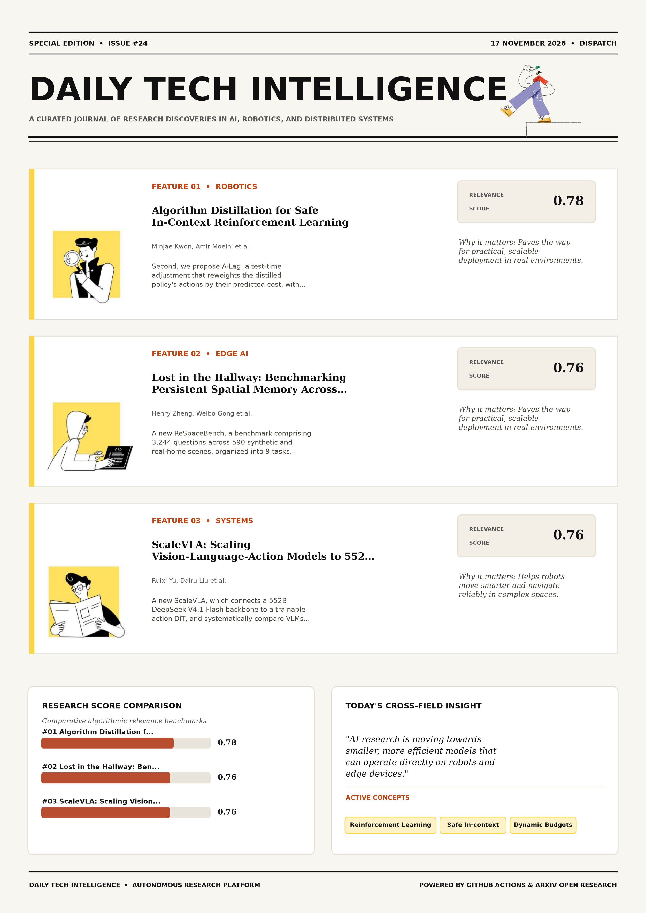

# Daily Tech Intelligence

## 17 November 2026

### Today's Overview

10 research papers analyzed.

Topics:

* Artificial Intelligence
* Machine Learning
* Natural Language Processing
* Robotics

### Visual Intelligence Templates

* **Template 3: Gen-Z Spotlight Broadside (Primary)**: [View High-Res](infographic_spotlight.png)
* **Template 2: Modern Tech Studio**: [View High-Res](infographic_modern.png)
* **Template 1: Editorial Research Journal**: [View High-Res](infographic_editorial.png)

---

## 1. Algorithm Distillation for Safe In-Context Reinforcement Learning

Authors: Minjae Kwon, Amir Moeini, Shangtong Zhang, Lu Feng

Publication: 2026-11-16T18:16:28Z

Category: cs.LG, cs.AI

Relevance Score: 0.78

Paper: [arXiv:2611.21524](https://arxiv.org/abs/2611.21524v1) | [PDF](https://arxiv.org/pdf/2611.21524v1)

### Summary

Addressing critical demands in Machine Learning, this research investigates safe in-context reinforcement learning (safe icrl) asks a policy with fixed parameters to improve on an unseen constrained task from its interaction history while aiming to keep its cost within a budget. Second, we propose A-Lag, a test-time adjustment that reweights the distilled policy's actions by their predicted cost, with an adaptive Lagrange multiplier that is updated from the costs observed. Safe Algorithm Distillation (Safe AD), trained on the learning histories of a safe RL algorithm, has shown adaptation failures in prior evaluations. In our experiments, A-Lag had lower mean episode cost than Safe AD in all five environments, with lower mean final return in four.

### Key Concepts

* Reinforcement Learning
* Safe In-context
* Dynamic Budgets
* Lower Mean
* Safe Algorithm
* Safe Icrl

### Technical Insights

**Problem**

Addresses foundational constraints in Machine Learning and existing computational workflows.

**Approach**

Second, we propose A-Lag, a test-time adjustment that reweights the distilled policy's actions by their predicted cost, with an adaptive Lagrange multiplier that is updated from the costs observed.

**Key Innovation**

Formulates an integrated mechanism leveraging Reinforcement Learning, Safe In-context.

**Results**

Not specified in the available abstract.

**Applications**

Autonomous agentic reasoning, multi-agent coordination, and decision-support platforms.

**Limitations**

Not specified in the available abstract.

---

## 2. Lost in the Hallway: Benchmarking Persistent Spatial Memory Across Revisits

Authors: Henry Zheng, Weibo Gong, Yang Yue, Rui Huang, Yang Zhang, Gao Huang

Publication: 2026-11-16T17:54:39Z

Category: cs.CV

Relevance Score: 0.76

Paper: [arXiv:2611.21485](https://arxiv.org/abs/2611.21485v1) | [PDF](https://arxiv.org/pdf/2611.21485v1)

### Summary

It requires recognizing revisited places despite viewpoint changes, distinguishing them from similar-looking rooms, and updating memories as environments change. We introduce ReSpaceBench, a benchmark comprising 3,244 questions across 590 synthetic and real-home scenes, organized into 9 tasks spanning room association, persistent state tracking, and downstream reasoning. Yet existing evaluations often leave physical place identity across separated visits implicit. Fine-tuning Qwen3-VL-8B raises overall accuracy from 35.5% to 60.4%, with the largest gains in association and improvements extending to real-life scenes. Persistent spatial understanding is essential for embodied agents to operate reliably in environments they repeatedly encounter. Controlled walkthroughs define visits by physical room entry and deliberately include same-type room distractors and cross-session object changes.

### Key Concepts

* Zero-shot
* Overall Accuracy
* Transitions Provide
* Understanding Essential
* Updating Memories
* Video Overlap

### Technical Insights

**Problem**

It requires recognizing revisited places despite viewpoint changes, distinguishing them from similar-looking rooms, and updating memories as environments change.

**Approach**

We introduce ReSpaceBench, a benchmark comprising 3,244 questions across 590 synthetic and real-home scenes, organized into 9 tasks spanning room association, persistent state tracking, and downstream reasoning.

**Key Innovation**

Formulates an integrated mechanism leveraging Zero-shot, Overall Accuracy.

**Results**

Not specified in the available abstract.

**Applications**

High-resolution real-time visual perception, automated 3D reconstruction, and embodied vision.

**Limitations**

Our evaluation of 32 models and 3 agentic video-understanding frameworks reveals substantial limitations: the strongest evaluated zero-shot model achieves 50.5% overall accuracy and 52.2% on a 450-question subset, compared with 90.1% for human annotators.

---

## 3. ScaleVLA: Scaling Vision-Language-Action Models to 552 Billion Parameters

Authors: Ruixi Yu, Dairu Liu, Xuchuan Chen, Zekun Qi, Zekai Li, Zhuo Cao, Luyang Niu, Yingsheng Zhang, Sikai Liang, Ke Fan, He Wang, Li Yi

Publication: 2026-11-16T18:59:37Z

Category: cs.RO

Relevance Score: 0.76

Paper: [arXiv:2611.21607](https://arxiv.org/abs/2611.21607v1) | [PDF](https://arxiv.org/pdf/2611.21607v1)

### Summary

Despite its scale, ScaleVLA achieves 216 ms median latency per action chunk. We introduce ScaleVLA, which connects a 552B DeepSeek-V4.1-Flash backbone to a trainable action DiT, and systematically compare VLMs from 2B to 552B under a shared training setup. We ask whether frontier-scale representations can provide a stronger foundation for robot learning. Our findings suggest that frontier VLMs can serve not only as reasoning agents, but also as powerful representational foundations for efficient and generalizable robot policies. Frontier Vision-Language Models (VLMs) such as GPT-6 Astra have demonstrated remarkable capabilities in robot control, suggesting that broad pretraining provides knowledge valuable for physical action.

### Key Concepts

* Manipulation
* Achieves Median
* Action Chunk
* Action Dit
* Action Vision-language-action
* Alignment Despite

### Technical Insights

**Problem**

Despite its scale, ScaleVLA achieves 216 ms median latency per action chunk.

**Approach**

We introduce ScaleVLA, which connects a 552B DeepSeek-V4.1-Flash backbone to a trainable action DiT, and systematically compare VLMs from 2B to 552B under a shared training setup.

**Key Innovation**

Formulates an integrated mechanism leveraging Manipulation, Achieves Median.

**Results**

Not specified in the available abstract.

**Applications**

Autonomous robotic manipulation, sim-to-real transfer, and agile mobile navigation systems. High-resolution real-time visual perception, automated 3D reconstruction, and embodied vision. Next-generation large language model workflows, retrieval-augmented intelligence, and structured document parsing.

**Limitations**

Not specified in the available abstract.

---

## 4. Lazy-MOSAIC: Accelerating Skill-Centric Manipulation Planning with Learned Skill-Effect World Models

Authors: Itamar Mishani, Mukund Krishnakumar, Oren Salzman, Maxim Likhachev

Publication: 2026-11-16T18:10:52Z

Category: cs.RO, cs.AI

Relevance Score: 0.74

Paper: [arXiv:2611.21517](https://arxiv.org/abs/2611.21517v1) | [PDF](https://arxiv.org/pdf/2611.21517v1)

### Summary

MOSAIC, a recent skill-centric approach, lets the skills guide a non-sequential search toward the regions of this space where they are likely to succeed; however, it pays the full cost of simulation for every parameterized skill it considers. In this work, we introduce Lazy-MOSAIC, a lazy planning framework that instead searches over hypothesized skill outcomes. Visit skill-mosaic.github.io. Long-horizon manipulation tasks require a robot to perform a sequence of physical interactions with its environment, typically combining several different skills. Planning such behaviors efficiently is challenging: given a library of parameterized skills, solutions lie in a vast hybrid space of skill sequences and their parameters, and evaluating each candidate skill's feasibility and effect with a high-fidelity world model such as a physics simulator is computationally expensive.

### Key Concepts

* World Model
* Manipulation
* Skill Feasibility
* Succeed Pays
* Success Rate
* Typically Combining

### Technical Insights

**Problem**

MOSAIC, a recent skill-centric approach, lets the skills guide a non-sequential search toward the regions of this space where they are likely to succeed; however, it pays the full cost of simulation for every parameterized skill it considers.

**Approach**

In this work, we introduce Lazy-MOSAIC, a lazy planning framework that instead searches over hypothesized skill outcomes.

**Key Innovation**

Formulates an integrated mechanism leveraging World Model, Manipulation.

**Results**

Not specified in the available abstract.

**Applications**

Autonomous robotic manipulation, sim-to-real transfer, and agile mobile navigation systems.

**Limitations**

Not specified in the available abstract.

---

## 5. Evaluating Cultural Reasoning and Robustness in LLMs for Spanish Political Discourse

Authors: Jorge Valverde-Rebaza, Nathan Garcia-Larios, Karime Ruvalcaba-Perez, Alejandro Rendon, Santiago Sanchez-Ballesteros, Alejandro Martin del Campo

Publication: 2026-11-16T18:24:48Z

Category: cs.CL, cs.CY, cs.SI

Relevance Score: 0.73

Paper: [arXiv:2611.21535](https://arxiv.org/abs/2611.21535v1) | [PDF](https://arxiv.org/pdf/2611.21535v1)

### Summary

Although sentiment analysis is a common task in this area, affective meaning in social media discourse is often conveyed through culturally situated and pragmatically indirect cues that are not well captured by label-centric evaluation alone. We introduce a diagnostic protocol that combines three independent human annotation views into Gold and Ambiguous subsets, and extends the corpus with a Synthetic subset built from sentiment-flipped counterfactuals selected through model-conditioned perplexity and LLM-as-a-judge criteria. Our results show that annotation ambiguity and counterfactual perturbation reveal failure modes that conventional evaluation on the original corpus tends to obscure. Overall, the paper contributes a reproducible protocol for robustness-oriented evaluation in political sentiment analysis, an empirical characterization of model behavior under ambiguity and sentiment-flipped counterfactuals, and a publicly available Spanish social media dataset with three-way human sentiment annotations.

### Key Concepts

* Zero-shot
* Spanish Political
* Culturally Situated
* Few-shot Prompting
* Sentiment-flipped Counterfactuals
* Social Media

### Technical Insights

**Problem**

Although sentiment analysis is a common task in this area, affective meaning in social media discourse is often conveyed through culturally situated and pragmatically indirect cues that are not well captured by label-centric evaluation alone.

**Approach**

We introduce a diagnostic protocol that combines three independent human annotation views into Gold and Ambiguous subsets, and extends the corpus with a Synthetic subset built from sentiment-flipped counterfactuals selected through model-conditioned perplexity and LLM-as-a-judge criteria.

**Key Innovation**

Formulates an integrated mechanism leveraging Zero-shot, Spanish Political.

**Results**

Our results show that annotation ambiguity and counterfactual perturbation reveal failure modes that conventional evaluation on the original corpus tends to obscure.

**Applications**

Next-generation large language model workflows, retrieval-augmented intelligence, and structured document parsing.

**Limitations**

Not specified in the available abstract.

---

## 6. Warm Starting Neural Dynamics Models From Few Jacobian Samples

Authors: Maxime Rochkoulets, Joppe De Jonghe, Mariya Ishteva

Publication: 2026-11-16T17:46:39Z

Category: cs.LG, cs.AI, eess.SY

Relevance Score: 0.73

Paper: [arXiv:2611.21465](https://arxiv.org/abs/2611.21465v1) | [PDF](https://arxiv.org/pdf/2611.21465v1)

### Summary

Addressing critical demands in Machine Learning, this research investigates model-based reinforcement learning (mbrl) leverages a model of the environment, used for planning and generating samples without interacting with the real world. Motivated by evidence that informed initialization significantly improves the efficiency of MBRL, we propose TDec-Init, an algorithm to warm-start neural dynamics models using transition Jacobians. Motivated by evidence that informed initialization significantly improves the efficiency of MBRL, we propose TDec-Init, an algorithm to warm-start neural dynamics models using transition Jacobians. In the low-data regime, we show on several benchmark environments that our approach outperforms random initialization and value training, and either matches or outperforms Sobolev training, while requiring fewer training steps between episodes.

### Key Concepts

* Reinforcement Learning
* Algorithm Warm-start
* Decomposition Tensor
* Decoupling Algorithm
* Efficiency Mbrl
* Environment Used

### Technical Insights

**Problem**

Addresses foundational constraints in Machine Learning and existing computational workflows.

**Approach**

Motivated by evidence that informed initialization significantly improves the efficiency of MBRL, we propose TDec-Init, an algorithm to warm-start neural dynamics models using transition Jacobians.

**Key Innovation**

Formulates an integrated mechanism leveraging Reinforcement Learning, Algorithm Warm-start.

**Results**

Motivated by evidence that informed initialization significantly improves the efficiency of MBRL, we propose TDec-Init, an algorithm to warm-start neural dynamics models using transition Jacobians.

**Applications**

Autonomous agentic reasoning, multi-agent coordination, and decision-support platforms.

**Limitations**

Not specified in the available abstract.

---

## 7. Beyond Job Titles: Interpreting Early-Career Job Advertisements with Sparse Autoencoders and Semantic Clustering

Authors: Yisong Cao, Leah Kim, Brian Wright, Ali Rivera

Publication: 2026-11-16T18:54:40Z

Category: cs.CL

Relevance Score: 0.70

Paper: [arXiv:2611.21586](https://arxiv.org/abs/2611.21586v1) | [PDF](https://arxiv.org/pdf/2611.21586v1)

### Summary

We also observe differences in the applications described by Data Analyst and Business Analyst advertisements across selected months, although our dataset's scale and uneven coverage limit their interpretation. To assess how such roles differ in their work and industry applications, we design and compare two methods based on deep learning and transformer representations using 36,081 early-career job postings collected from LinkedIn in the United States between December 2025 and October 2026. We first apply PERC, short for Preprocessing (P), Embedding (E), Dimensionality Reduction (R) and Clustering (C). Overall, we present a realistic application of SAEs and PERC to unstructured textual data and examine how automated insight extraction could support manual analysis of job descriptions.

### Key Concepts

* Analyst Advertisements
* Employ Gpt-
* Gpt- Luna
* Job Descriptions
* Job Roles
* Machine Learning

### Technical Insights

**Problem**

We also observe differences in the applications described by Data Analyst and Business Analyst advertisements across selected months, although our dataset's scale and uneven coverage limit their interpretation.

**Approach**

To assess how such roles differ in their work and industry applications, we design and compare two methods based on deep learning and transformer representations using 36,081 early-career job postings collected from LinkedIn in the United States between December 2025 and October 2026.

**Key Innovation**

Formulates an integrated mechanism leveraging Analyst Advertisements, Employ Gpt-.

**Results**

Not specified in the available abstract.

**Applications**

Next-generation large language model workflows, retrieval-augmented intelligence, and structured document parsing.

**Limitations**

Not specified in the available abstract.

---

## 8. Latent Lattice Language Models

Authors: Shivam Duggal, Zongze Wu, William T. Freeman, Antonio Torralba, Richard Zhang, Eli Shechtman

Publication: 2026-11-16T18:59:38Z

Category: cs.LG, cs.AI, cs.CL

Relevance Score: 0.67

Paper: [arXiv:2611.21608](https://arxiv.org/abs/2611.21608v1) | [PDF](https://arxiv.org/pdf/2611.21608v1)

### Summary

Addressing critical demands in Machine Learning, this research investigates language models typically increase per-token computation through deeper or looped layers and latent reasoning steps, while richer residual connections improve information flow across layers. We introduce the Lattice of Latents, a set of per-layer horizontal latent streams that run recurrently along time, alongside the vertical residual stream that flows through depth. These results identify persistent per-layer state as a complementary axis for scaling language-model computation. Language models typically increase per-token computation through deeper or looped layers and latent reasoning steps, while richer residual connections improve information flow across layers. We instead increase computational capacity: the number of active computational states a model maintains.

### Key Concepts

* Computational States
* Lowers Validation
* Residual Stream
* Tokens Unlike Hybrid
* Transformer Enhancements
* Transformer-ssm Architectures

### Technical Insights

**Problem**

Addresses foundational constraints in Machine Learning and existing computational workflows.

**Approach**

We introduce the Lattice of Latents, a set of per-layer horizontal latent streams that run recurrently along time, alongside the vertical residual stream that flows through depth.

**Key Innovation**

Formulates an integrated mechanism leveraging Computational States, Lowers Validation.

**Results**

Not specified in the available abstract.

**Applications**

Next-generation large language model workflows, retrieval-augmented intelligence, and structured document parsing.

**Limitations**

Not specified in the available abstract.

---

## 9. ViRA: Toward Ultra-High-Resolution Visual Agents via Cross-Input Relative Policy Optimization

Authors: Huawei Lin, Jinting Liu, Tongyan Wang, Xuyang Chen, Ruihua Shi, Zhichao Xu, Jiaxin Qin, Guoshenghui Zhao, Baijian Yang, Yingjie Victor Chen, Tan Yu, Weijie Zhao

Publication: 2026-11-16T18:59:04Z

Category: cs.CV, cs.AI

Relevance Score: 0.67

Paper: [arXiv:2611.21605](https://arxiv.org/abs/2611.21605v1) | [PDF](https://arxiv.org/pdf/2611.21605v1)

### Summary

However, existing agents often answer from common sense instead of reading the evidence. We propose Cross-Input Relative Policy Optimization (CrossRPO), which trains agents on contrast sets. ViRA-9B is the most accurate open model of its size on all benchmarks, and ViRA-27B outperforms Claude Haiku 5.5 and GPT-6-Luna, both at their highest thinking level, on most benchmarks. Visual agents answer questions about ultra-high-resolution photos by zooming into the relevant regions. Reinforcement learning (RL) on the final answer cannot correct this, because a guess earns the same reward as reading. A contrast set asks one question about several versions of an image that differ only in a small region with the evidence and have different answers, so only reading the evidence solves the whole set.

### Key Concepts

* Reinforcement Learning
* Accuracy Vira-bench
* Accurate Open
* Achieves Set
* Answer Common
* Answer Correct Guess

### Technical Insights

**Problem**

However, existing agents often answer from common sense instead of reading the evidence.

**Approach**

We propose Cross-Input Relative Policy Optimization (CrossRPO), which trains agents on contrast sets.

**Key Innovation**

Formulates an integrated mechanism leveraging Reinforcement Learning, Accuracy Vira-bench.

**Results**

ViRA-9B is the most accurate open model of its size on all benchmarks, and ViRA-27B outperforms Claude Haiku 5.5 and GPT-6-Luna, both at their highest thinking level, on most benchmarks.

**Applications**

High-resolution real-time visual perception, automated 3D reconstruction, and embodied vision.

**Limitations**

Not specified in the available abstract.

---

## 10. Reference Forcing: Long Video Generation with Region-Guided Drift Correction

Authors: Sheng Zhao, Haitian Zheng, Weikai Lin, Junjie Zhao, Yuhao Zhu

Publication: 2026-11-16T18:39:47Z

Category: cs.CV

Relevance Score: 0.65

Paper: [arXiv:2611.21559](https://arxiv.org/abs/2611.21559v1) | [PDF](https://arxiv.org/pdf/2611.21559v1)

### Summary

However, autoregressive models are often distilled with distribution matching distillation (DMD) over short windows, which does not train them to keep this consistency over long ranges. We propose Reference Forcing, which uses the initial frames as an appearance reference. Experiments show that Reference Forcing achieves state-of-the-art subject and background consistency among long-video methods on different base models, and its advantage grows with video length. More visualizations and code are available at https://zhaosheng-thu.github.io/reference-force/ Long video generation should keep the subject and background consistent while supporting rich, natural motion. As a result, the subject and background can drift over time. Methods that manage the key-value (KV) cache retain or retrieve history to reduce drift.

### Key Concepts

* Reference Forcing
* Ablations Components
* Advantage Grows
* Appearance Reference
* Attend Region
* Attention Masks

### Technical Insights

**Problem**

However, autoregressive models are often distilled with distribution matching distillation (DMD) over short windows, which does not train them to keep this consistency over long ranges.

**Approach**

We propose Reference Forcing, which uses the initial frames as an appearance reference.

**Key Innovation**

Formulates an integrated mechanism leveraging Reference Forcing, Ablations Components.

**Results**

Experiments show that Reference Forcing achieves state-of-the-art subject and background consistency among long-video methods on different base models, and its advantage grows with video length.

**Applications**

High-resolution real-time visual perception, automated 3D reconstruction, and embodied vision.

**Limitations**

Not specified in the available abstract.

---
