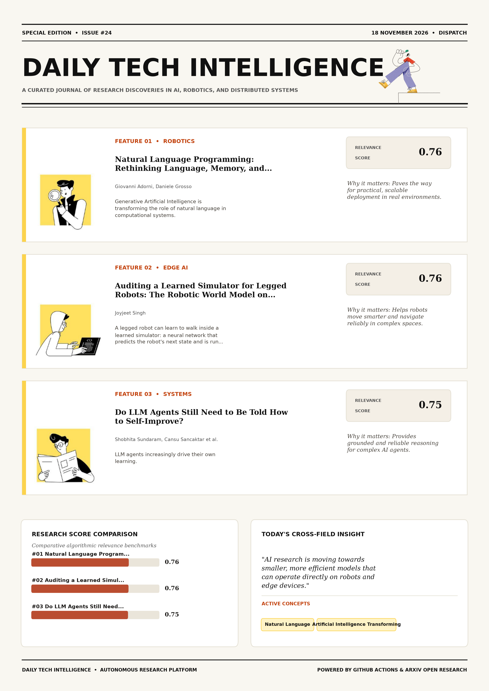

# Daily Tech Intelligence

## 18 November 2026

### Today's Overview

10 research papers analyzed.

Topics:

* Artificial Intelligence
* Machine Learning
* Natural Language Processing
* Robotics

### Visual Intelligence Templates

* **Template 3: Gen-Z Spotlight Broadside (Primary)**: [View High-Res](infographic_spotlight.png)
* **Template 2: Modern Tech Studio**: [View High-Res](infographic_modern.png)
* **Template 1: Editorial Research Journal**: [View High-Res](infographic_editorial.png)

---

## 1. Natural Language Programming: Rethinking Language, Memory, and Cognition in the Era of Generative AI

Authors: Giovanni Adorni, Daniele Grosso

Publication: 2026-11-17T17:27:01Z

Category: cs.CL, cs.AI

Relevance Score: 0.76

Paper: [arXiv:2611.23106](https://arxiv.org/abs/2611.23106v1) | [PDF](https://arxiv.org/pdf/2611.23106v1)

### Summary

Large Language Models (LLMs) challenge this perspective, enabling natural language to function increasingly as an executable cognitive medium through which humans structure reasoning, orchestrate problem solving, and regulate hybrid human/AI workflows. In classical Natural Language Processing (NLP), language was treated as an object of computation: something to analyse, classify, translate, or generate. Finally, implications for computational linguistics and AI/mediated knowledge systems are discussed, suggesting a post symbolic and post interface paradigm in which natural language operates simultaneously as communication medium, executable specification, cognitive scaffold, and distributed memory architecture. Generative Artificial Intelligence is transforming the role of natural language in computational systems.

### Key Concepts

* Natural Language
* Artificial Intelligence Transforming
* Assumptions Validation
* Btma Skge
* Building Theories
* Memory Architectures

### Technical Insights

**Problem**

Large Language Models (LLMs) challenge this perspective, enabling natural language to function increasingly as an executable cognitive medium through which humans structure reasoning, orchestrate problem solving, and regulate hybrid human/AI workflows.

**Approach**

In classical Natural Language Processing (NLP), language was treated as an object of computation: something to analyse, classify, translate, or generate.

**Key Innovation**

Formulates an integrated mechanism leveraging Natural Language, Artificial Intelligence Transforming.

**Results**

Not specified in the available abstract.

**Applications**

Next-generation large language model workflows, retrieval-augmented intelligence, and structured document parsing.

**Limitations**

Rather than focusing on language understanding alone, NLPg conceptualises prompts as dynamic cognitive artefacts that externalise goals, constraints, assumptions, validation criteria, and intermediate reasoning states.

---

## 2. Auditing a Learned Simulator for Legged Robots: The Robotic World Model on ANYmal D

Authors: Joyjeet Singh

Publication: 2026-11-17T17:36:40Z

Category: cs.RO, cs.LG

Relevance Score: 0.76

Paper: [arXiv:2611.23118](https://arxiv.org/abs/2611.23118v1) | [PDF](https://arxiv.org/pdf/2611.23118v1)

### Summary

They are usually trained and checked one step ahead, although a policy uses them for a hundred steps or more. They are usually trained and checked one step ahead, although a policy uses them for a hundred steps or more. We audit one published system end to end, without a GPU: the dynamics model of the Robotic World Model (RWM) for the ANYmal D quadruped, and the uncertainty estimate of its follow-up, RWM-U. Scope: one robot, one gait, simulated data, no hardware. A legged robot can learn to walk inside a learned simulator: a neural network that predicts the robot's next state and is run forward on its own predictions.

### Key Concepts

* World Model
* Pruning
* Anymal Quadruped
* Audit Published
* Better Step
* Step Ahead

### Technical Insights

**Problem**

They are usually trained and checked one step ahead, although a policy uses them for a hundred steps or more.

**Approach**

They are usually trained and checked one step ahead, although a policy uses them for a hundred steps or more.

**Key Innovation**

Formulates an integrated mechanism leveraging World Model, Pruning.

**Results**

Not specified in the available abstract.

**Applications**

Autonomous robotic manipulation, sim-to-real transfer, and agile mobile navigation systems.

**Limitations**

Not specified in the available abstract.

---

## 3. Do LLM Agents Still Need to Be Told How to Self-Improve?

Authors: Shobhita Sundaram, Cansu Sancaktar, Phillip Isola

Publication: 2026-11-17T18:57:10Z

Category: cs.LG, cs.AI

Relevance Score: 0.75

Paper: [arXiv:2611.23219](https://arxiv.org/abs/2611.23219v1) | [PDF](https://arxiv.org/pdf/2611.23219v1)

### Summary

Addressing critical demands in Natural Language Processing, this research investigates llm agents increasingly drive their own learning. Self-improvement methods delegate various components of model optimization to the models themselves. As models become more capable, this motivates a basic question: do these increasingly capable models still need us to specify how they should self-improve? Furthermore, we study the extent to which the learned text artifacts transfer to external benchmarks, observing improvement across different game horizons, mechanics, and 3D navigation. LLM agents increasingly drive their own learning. In this paper we study an autonomous paradigm in which, given basic primitives, resources, and a general goal for self-improvement, agents construct their own self-learning algorithm for context-based optimization.

### Key Concepts

* Access Real-world
* Agent Given
* Algorithm Context-based
* Align Classic
* Allowed Freely
* Artifacts Transfer

### Technical Insights

**Problem**

Addresses foundational constraints in Natural Language Processing and existing computational workflows.

**Approach**

Self-improvement methods delegate various components of model optimization to the models themselves.

**Key Innovation**

Formulates an integrated mechanism leveraging Access Real-world, Agent Given.

**Results**

Not specified in the available abstract.

**Applications**

Next-generation large language model workflows, retrieval-augmented intelligence, and structured document parsing.

**Limitations**

Not specified in the available abstract.

---

## 4. CADENCE: Learning Acyclic Gaits for Model-Based Quadruped Locomotion

Authors: Owen Sullivan, Sourav Selvaraj, Mahdi Agheli

Publication: 2026-11-17T17:25:29Z

Category: cs.RO

Relevance Score: 0.74

Paper: [arXiv:2611.23102](https://arxiv.org/abs/2611.23102v1) | [PDF](https://arxiv.org/pdf/2611.23102v1)

### Summary

Addressing critical demands in Robotics, this research investigates model-based quadruped controllers usually step on a cyclic gait, which lifts the legs in a fixed order on a fixed period, wherever the safe footholds are. We present CADENCE, a learned step planner with a small action space. Every 40 ms, it picks one of at most 65 discrete choices: no step, or one leg's step to a safe foothold. At 49% voids, it succeeded in 72.9%, against 43.0% for OCS2-Trot. Model-based quadruped controllers usually step on a cyclic gait, which lifts the legs in a fixed order on a fixed period, wherever the safe footholds are.

### Key Concepts

* Reinforcement Learning
* Acyclic Gait
* Ablation Cadence
* Action Space
* Analyzed Developed
* Cadence Learned

### Technical Insights

**Problem**

Addresses foundational constraints in Robotics and existing computational workflows.

**Approach**

We present CADENCE, a learned step planner with a small action space.

**Key Innovation**

Formulates an integrated mechanism leveraging Reinforcement Learning, Acyclic Gait.

**Results**

Not specified in the available abstract.

**Applications**

Autonomous robotic manipulation, sim-to-real transfer, and agile mobile navigation systems.

**Limitations**

The one structural constraint is that at most two legs may swing at once.

---

## 5. Ambient LLMs: Data-Efficient Supervised Fine-tuning via Temperature Matching

Authors: Giannis Daras, Marios Papachristou, Adam Klivans, Antonio Torralba, Constantinos Daskalakis

Publication: 2026-11-17T18:59:37Z

Category: cs.LG, cs.AI, cs.CL

Relevance Score: 0.72

Paper: [arXiv:2611.23229](https://arxiv.org/abs/2611.23229v1) | [PDF](https://arxiv.org/pdf/2611.23229v1)

### Summary

Addressing critical demands in Machine Learning, this research investigates collecting large-scale, diverse, and high-quality post-training datasets for autoregressive language models is challenging. To prevent this collapse, we introduce Ambient SFT, a principled framework for leveraging imperfect predictions to augment the fine-tuning set. We demonstrate that our approach outperforms standard SFT across domain adaptation, instruction-tuning, and reasoning, leading for up to 21\% average relative improvement to standard SFT. Collecting large-scale, diverse, and high-quality post-training datasets for autoregressive language models is challenging. Consequently, Supervised Fine-Tuning (SFT) is typically applied to datasets significantly smaller than those used for pre-training, which leads to overfitting and the catastrophic forgetting of the tails of the data distribution.

### Key Concepts

* Knowledge Distillation
* Domain Adaptation
* Adaptation Instruction-tuning
* Ambient Sft
* Augment Fine-tuning
* Autoregressive Language

### Technical Insights

**Problem**

Addresses foundational constraints in Machine Learning and existing computational workflows.

**Approach**

To prevent this collapse, we introduce Ambient SFT, a principled framework for leveraging imperfect predictions to augment the fine-tuning set.

**Key Innovation**

Formulates an integrated mechanism leveraging Knowledge Distillation, Domain Adaptation.

**Results**

We demonstrate that our approach outperforms standard SFT across domain adaptation, instruction-tuning, and reasoning, leading for up to 21\% average relative improvement to standard SFT.

**Applications**

Next-generation large language model workflows, retrieval-augmented intelligence, and structured document parsing.

**Limitations**

Not specified in the available abstract.

---

## 6. TCP4D: A Unified Tool-Center-Point Tracking and Generation Model for Robot Manipulation

Authors: Haosong Peng, Xiangyang Liu, Zhengshen Zhang, Yunfeng Fan, Tianyu Qi, Xin Xia, Yufeng Zhan, Wenchao Xu

Publication: 2026-11-17T17:59:42Z

Category: cs.RO, cs.CV

Relevance Score: 0.71

Paper: [arXiv:2611.23143](https://arxiv.org/abs/2611.23143v1) | [PDF](https://arxiv.org/pdf/2611.23143v1)

### Summary

Addressing critical demands in Robotics, this research investigates robot manipulation videos provide a rich visual experience, yet recovering robot action and gripper-state annotations from rgb observations still remains challenging. Using the embodiment-agnostic tool-center-point (TCP) pose as the action space, we present TCP4D, a unified model in which a shared 4D scene representation both tracks observed TCP motion and generates future TCP trajectories. The generator achieves 69.19% mean success on RoboTwin and outperforms well-established policy models on two real-world tasks, while joint training on source and augmented demonstrations improves target-robot success by 41.5% over augmented-only training. Robot manipulation videos provide a rich visual experience, yet recovering robot action and gripper-state annotations from RGB observations still remains challenging.

### Key Concepts

* Manipulation
* Absolute Trajectory
* Achieves Absolute
* Achieves Mean
* Action Gripper-state
* Action Space

### Technical Insights

**Problem**

Addresses foundational constraints in Robotics and existing computational workflows.

**Approach**

Using the embodiment-agnostic tool-center-point (TCP) pose as the action space, we present TCP4D, a unified model in which a shared 4D scene representation both tracks observed TCP motion and generates future TCP trajectories.

**Key Innovation**

Formulates an integrated mechanism leveraging Manipulation, Absolute Trajectory.

**Results**

The generator achieves 69.19% mean success on RoboTwin and outperforms well-established policy models on two real-world tasks, while joint training on source and augmented demonstrations improves target-robot success by 41.5% over augmented-only training.

**Applications**

Autonomous robotic manipulation, sim-to-real transfer, and agile mobile navigation systems. High-resolution real-time visual perception, automated 3D reconstruction, and embodied vision.

**Limitations**

Not specified in the available abstract.

---

## 7. Spool: Low-Latency Streaming Inference for Hybrid Vision-Language Models

Authors: Rui Ning, Om Chabra, Hari Balakrishnan

Publication: 2026-11-17T18:59:27Z

Category: cs.CV, cs.LG

Relevance Score: 0.69

Paper: [arXiv:2611.23228](https://arxiv.org/abs/2611.23228v1) | [PDF](https://arxiv.org/pdf/2611.23228v1)

### Summary

Addressing critical demands in Artificial Intelligence, this research investigates applications such as visual accessibility agents and robotics require answering questions about recent video content promptly, over a bounded window of past frames (e.g., the last two minutes). We present Spool, a training-free framework that caches per-frame state transformations and composes them efficiently as the window advances, removing expired frames from each recurrent layer's state without replaying frames through the backbone. The reason is that recurrent layers combine all past frames into a shared state, so expiring old frames normally requires re-running the entire window through the model. Across five open-source hybrid VLMs and four video reasoning benchmarks, Spool achieves the lowest p95 time-to-first-token in all 20 model-benchmark tests, reducing it by a geometric mean of 6.6\times over the faster of two recent vLLM baselines, while improving accuracy by 2.3 percentage points on average.

### Key Concepts

* Affine State
* Answering Questions
* Expired Frames
* Past Frames
* Recurrent Layers
* Transformation Composes

### Technical Insights

**Problem**

Addresses foundational constraints in Artificial Intelligence and existing computational workflows.

**Approach**

We present Spool, a training-free framework that caches per-frame state transformations and composes them efficiently as the window advances, removing expired frames from each recurrent layer's state without replaying frames through the backbone.

**Key Innovation**

Formulates an integrated mechanism leveraging Affine State, Answering Questions.

**Results**

Not specified in the available abstract.

**Applications**

High-resolution real-time visual perception, automated 3D reconstruction, and embodied vision. Next-generation large language model workflows, retrieval-augmented intelligence, and structured document parsing.

**Limitations**

We design a dedicated data structure and GPU kernels to achieve low caching and composition overhead.

---

## 8. π^4: A Foundation Model for 4D Scene Geometry and Motion

Authors: Yifan Wang, Weiguang Zhao, Ni Yang, Haoyu Guo, Junting Dong, Weinan Zhang, Chunhua Shen

Publication: 2026-11-17T17:59:52Z

Category: cs.CV

Relevance Score: 0.69

Paper: [arXiv:2611.23144](https://arxiv.org/abs/2611.23144v1) | [PDF](https://arxiv.org/pdf/2611.23144v1)

### Summary

It produces joint reconstructions and tracks in one forward pass, including large-scale scenes with thousands of input images despite training with contexts of at most 64 views. From diverse, uncalibrated RGB observations in the wild---a single image, an unordered collection, or a video sequence---it recovers dense geometry, camera poses, and metric scale, together with 2D/3D point tracks and moving-object masks for multi-image inputs. It couples a geometry branch with a geometry-conditioned motion branch, which predicts image-space correspondences that are lifted into 3D using reconstructed target-view geometry. Code and models are available at https://github.com/yyfz/Pi4. π^4 is a unified foundation model for 4D scene perception.

### Key Concepts

* Foundation Model
* Achieves Best
* Alongside Competitive
* Approximately Parameters---less
* Available Https
* Backbone Geometry-and-motion

### Technical Insights

**Problem**

It produces joint reconstructions and tracks in one forward pass, including large-scale scenes with thousands of input images despite training with contexts of at most 64 views.

**Approach**

From diverse, uncalibrated RGB observations in the wild---a single image, an unordered collection, or a video sequence---it recovers dense geometry, camera poses, and metric scale, together with 2D/3D point tracks and moving-object masks for multi-image inputs.

**Key Innovation**

Formulates an integrated mechanism leveraging Foundation Model, Achieves Best.

**Results**

Not specified in the available abstract.

**Applications**

High-resolution real-time visual perception, automated 3D reconstruction, and embodied vision.

**Limitations**

Not specified in the available abstract.

---

## 9. Multimodal Masked Diffusion Autoencoder for Modeling Impaired Driving

Authors: John Gideon, Anshul Gupta, Megan Applegate-Kenton, Kayli Battel, Todd J Rowell, Patricio Reyes Gomez, Laporsha Dees, Emily Sumner, Avinash Balachandran, Guy Rosman

Publication: 2026-11-17T18:50:22Z

Category: cs.CV, cs.LG, cs.RO

Relevance Score: 0.67

Paper: [arXiv:2611.23211](https://arxiv.org/abs/2611.23211v1) | [PDF](https://arxiv.org/pdf/2611.23211v1)

### Summary

Human cognitive state (e.g., distraction, stress), gaze, and behavior interact with the driving environment in subtle ways that AI could use to assist drivers, but ground-truth labels for human cognitive state levels are costly to obtain at scale. We propose a multimodal masked-diffusion autoencoder, ID-MAE, that adds a self-supervised objective to impairment prediction: alongside predicting the impairment label as a masked token, it reconstructs masked gaze and trajectory. To probe the effects of different modalities and types of impairments on model inference, we introduce DIVERT, a driving-simulator dataset containing 103 hours of driving data (n = 109) with ten impairment inductions spanning cognitive, visual, and emotional states, recorded with gaze, vehicle state, and scene video. Code and data will be available upon acceptance.

### Key Concepts

* Attention Mechanism
* Assist Drivers
* Auc Impairment
* Cognitive State
* Subtle Ways
* Token Reconstructs

### Technical Insights

**Problem**

Human cognitive state (e.g., distraction, stress), gaze, and behavior interact with the driving environment in subtle ways that AI could use to assist drivers, but ground-truth labels for human cognitive state levels are costly to obtain at scale.

**Approach**

We propose a multimodal masked-diffusion autoencoder, ID-MAE, that adds a self-supervised objective to impairment prediction: alongside predicting the impairment label as a masked token, it reconstructs masked gaze and trajectory.

**Key Innovation**

Formulates an integrated mechanism leveraging Attention Mechanism, Assist Drivers.

**Results**

Not specified in the available abstract.

**Applications**

Autonomous robotic manipulation, sim-to-real transfer, and agile mobile navigation systems. High-resolution real-time visual perception, automated 3D reconstruction, and embodied vision.

**Limitations**

Not specified in the available abstract.

---

## 10. Pressure Drop: Gravity Vector Estimation from a Distributed Barometric Pressure Sensor Array

Authors: William Dubois, Nicolas Lauzon, Johann Laconte, François Pomerleau

Publication: 2026-11-17T17:38:28Z

Category: cs.RO

Relevance Score: 0.67

Paper: [arXiv:2611.23120](https://arxiv.org/abs/2611.23120v1) | [PDF](https://arxiv.org/pdf/2611.23120v1)

### Summary

Addressing critical demands in Robotics, this research investigates while gravity is often used in mobile robotics as a global constraint for simultaneous localization and mapping (slam) algorithms, most estimation methods rely on indirect observation of the gravity vector. In this paper, we propose the use of altimeter measurements to directly observe the direction of the gravity vector. We provide a theoretical evaluation of the estimation noise and validate it through extensive experimental data, along with an evaluation of the impact of intersensor distance on our gravity vector estimates. Finally, an additional experiment shows the potential use within a robotic system through the integration into an Iterative Closest Point (ICP) algorithm.

### Key Concepts

* SLAM
* Gravity Vector
* Accelerometer Measurement
* Achieve Similar
* Achieved Semi-static
* Additional Experiment

### Technical Insights

**Problem**

Addresses foundational constraints in Robotics and existing computational workflows.

**Approach**

In this paper, we propose the use of altimeter measurements to directly observe the direction of the gravity vector.

**Key Innovation**

Formulates an integrated mechanism leveraging SLAM, Gravity Vector.

**Results**

Not specified in the available abstract.

**Applications**

Autonomous robotic manipulation, sim-to-real transfer, and agile mobile navigation systems.

**Limitations**

While gravity is often used in mobile robotics as a global constraint for Simultaneous Localization and Mapping (SLAM) algorithms, most estimation methods rely on indirect observation of the gravity vector.

---
