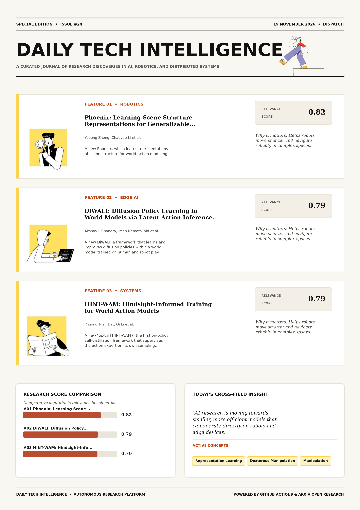

# Daily Tech Intelligence

## 19 November 2026

### Today's Overview

10 research papers analyzed.

Topics:

* Artificial Intelligence
* Machine Learning
* Natural Language Processing
* Robotics

### Visual Intelligence Templates

* **Template 3: Gen-Z Spotlight Broadside (Primary)**: [View High-Res](infographic_spotlight.png)
* **Template 2: Modern Tech Studio**: [View High-Res](infographic_modern.png)
* **Template 1: Editorial Research Journal**: [View High-Res](infographic_editorial.png)

---

## 1. Phoenix: Learning Scene Structure Representations for Generalizable World-Action Models

Authors: Yupeng Zheng, Chaoyue Li, Linbo Wang, Xiang Li, Yuhang Zheng, Xiaotong Su, Songen Gu, Yichen Zhang, Zebin Xing, Shuai Tian, Jingxiang Guo, Jing Li, Zhiyong Zhao, Zhongpu Xia, Qichao Zhang, Haoran Li, Shuicheng Yan, Dongbin Zhao

Publication: 2026-11-18T18:59:04Z

Category: cs.RO

Relevance Score: 0.82

Paper: [arXiv:2611.24938](https://arxiv.org/abs/2611.24938v1) | [PDF](https://arxiv.org/pdf/2611.24938v1)

### Summary

Addressing critical demands in Robotics, this research investigates world-action models jointly predict future observations and actions, yet reconstruction-oriented visual representations do not explicitly emphasize the spatial relationships and object-state changes needed for manipulation. We introduce Phoenix, which learns representations of scene structure for world-action modeling. Following benchmark-specific post-training, Phoenix achieves state-of-the-art performance across simulation and real-robot benchmarks spanning single-arm, bimanual, and dexterous manipulation. Our code, pretraining data, and models are available on the project page to help the community reproduce our results. World-action models jointly predict future observations and actions, yet reconstruction-oriented visual representations do not explicitly emphasize the spatial relationships and object-state changes needed for manipulation.

### Key Concepts

* Representation Learning
* Dexterous Manipulation
* Manipulation
* Phoenix Encoder
* Simulation Real-robot
* Single-arm Bimanual

### Technical Insights

**Problem**

Addresses foundational constraints in Robotics and existing computational workflows.

**Approach**

We introduce Phoenix, which learns representations of scene structure for world-action modeling.

**Key Innovation**

Formulates an integrated mechanism leveraging Representation Learning, Dexterous Manipulation.

**Results**

Following benchmark-specific post-training, Phoenix achieves state-of-the-art performance across simulation and real-robot benchmarks spanning single-arm, bimanual, and dexterous manipulation.

**Applications**

Autonomous robotic manipulation, sim-to-real transfer, and agile mobile navigation systems.

**Limitations**

Not specified in the available abstract.

---

## 2. DiWALI: Diffusion Policy Learning in World Models via Latent Action Inference from Human and Robot Play

Authors: Akshay L Chandra, Iman Nematollahi, Lingyue Zhao, Daria Kulikova, Angela P. Schoellig, Fabien Despinoy, Abhinav Valada

Publication: 2026-11-18T18:03:14Z

Category: cs.RO

Relevance Score: 0.79

Paper: [arXiv:2611.24836](https://arxiv.org/abs/2611.24836v1) | [PDF](https://arxiv.org/pdf/2611.24836v1)

### Summary

Addressing critical demands in Robotics, this research investigates learning robot manipulation is constrained by the availability of action-labeled robot data, for both imitation and world models. We introduce DiWALI, a framework that learns and improves diffusion policies within a world model trained on human and robot play. Videos, dataset and code are available at https://diwali.cs.uni-freiburg.de. Learning robot manipulation is constrained by the availability of action-labeled robot data, for both imitation and world models. Humans can demonstrate skills in seconds, but their demonstrations lack the required robot actions. DiWALI infers latent actions from consecutive frames using an inverse dynamics model, enabling world model training without action labels, and grounds them in robot commands through a decoder trained separately on robot play.

### Key Concepts

* World Model
* Reinforcement Learning
* Diffusion Policy
* Manipulation
* Robot Play
* Action-labeled Robot

### Technical Insights

**Problem**

Addresses foundational constraints in Robotics and existing computational workflows.

**Approach**

We introduce DiWALI, a framework that learns and improves diffusion policies within a world model trained on human and robot play.

**Key Innovation**

Formulates an integrated mechanism leveraging World Model, Reinforcement Learning.

**Results**

Not specified in the available abstract.

**Applications**

Autonomous robotic manipulation, sim-to-real transfer, and agile mobile navigation systems.

**Limitations**

Not specified in the available abstract.

---

## 3. HINT-WAM: Hindsight-Informed Training for World Action Models

Authors: Phuong Tuan Dat, Qi Li, Xinchao Wang

Publication: 2026-11-18T17:36:15Z

Category: cs.RO

Relevance Score: 0.79

Paper: [arXiv:2611.24789](https://arxiv.org/abs/2611.24789v1) | [PDF](https://arxiv.org/pdf/2611.24789v1)

### Summary

Translating these capabilities into reliable task execution, however, remains a challenge for existing post-training methods. We introduce \textbf{HINT-WAM}, the first on-policy self-distillation framework that supervises the action expert on its own sampling trajectories using hindsight, the future video of the demonstration, as privileged information available to the WAM itself. Offline supervised fine-tuning provides dense supervision on expert trajectories, but its flow-matching action expert is trained only on noised demonstration actions and never on the intermediate states produced by its own sampler; task-specific adaptation can also compromise pretrained capabilities. The project web is available in https://tuandattt.github.io/hintwam/. World action models (WAMs) have shown promising generalization and data efficiency in robot manipulation by coupling action generation with predictions of future visual dynamics.

### Key Concepts

* Reinforcement Learning
* Manipulation
* Action Distribution
* Action Expert
* Flow-matching Action
* Textbf Hint-wam

### Technical Insights

**Problem**

Translating these capabilities into reliable task execution, however, remains a challenge for existing post-training methods.

**Approach**

We introduce \textbf{HINT-WAM}, the first on-policy self-distillation framework that supervises the action expert on its own sampling trajectories using hindsight, the future video of the demonstration, as privileged information available to the WAM itself.

**Key Innovation**

Formulates an integrated mechanism leveraging Reinforcement Learning, Manipulation.

**Results**

Not specified in the available abstract.

**Applications**

Autonomous robotic manipulation, sim-to-real transfer, and agile mobile navigation systems.

**Limitations**

Not specified in the available abstract.

---

## 4. ReCoCo: From Patches to Compositions for Visual Representation Learning

Authors: Juan Gutiérrez, Saman Zadtootaghaj, José Luis Blanco-Murillo, Sara Atito

Publication: 2026-11-18T17:45:04Z

Category: cs.CV

Relevance Score: 0.77

Paper: [arXiv:2611.24806](https://arxiv.org/abs/2611.24806v1) | [PDF](https://arxiv.org/pdf/2611.24806v1)

### Summary

Addressing critical demands in Machine Learning, this research investigates self-supervised learning has produced powerful visual representations, yet learning strong dense features remains challenging. We introduce ReCoCo (Regional Composition Consistency), a principled approach that extends cross-view consistency to the regional level without requiring such correspondences or semantic grouping. Extensive experiments demonstrate substantial improvements in frozen-feature segmentation, clustering, and regional retrieval while maintaining competitive image-level recognition, alleviating the trade-off between dense and global representation quality. Self-supervised learning has produced powerful visual representations, yet learning strong dense features remains challenging. While consistency between augmented views provides strong image-level supervision, extending this principle to local visual content is less straightforward.

### Key Concepts

* Representation Learning
* Self-supervised Learning
* Additional Learned
* Aligning Compositions
* Alleviating Trade-off
* Approaches Match

### Technical Insights

**Problem**

Addresses foundational constraints in Machine Learning and existing computational workflows.

**Approach**

We introduce ReCoCo (Regional Composition Consistency), a principled approach that extends cross-view consistency to the regional level without requiring such correspondences or semantic grouping.

**Key Innovation**

Formulates an integrated mechanism leveraging Representation Learning, Self-supervised Learning.

**Results**

Extensive experiments demonstrate substantial improvements in frozen-feature segmentation, clustering, and regional retrieval while maintaining competitive image-level recognition, alleviating the trade-off between dense and global representation quality.

**Applications**

High-resolution real-time visual perception, automated 3D reconstruction, and embodied vision.

**Limitations**

Extensive experiments demonstrate substantial improvements in frozen-feature segmentation, clustering, and regional retrieval while maintaining competitive image-level recognition, alleviating the trade-off between dense and global representation quality.

---

## 5. Grana: Compositional Reward Modeling for Long-Horizon Robot Manipulation

Authors: Zi-ang Cao, Kaiyuan Zheng, Yinzhen Xu, Haonan Duan, Jiasheng Gu, Fengyuan Hu, Nan Zhu, Kun Lei, Kevin Lin, Ruijie Zheng, Shenyuan Gao, Fangqi Zhu, Zhe Zhang, Radha Poovendran, Linxi Fan, Guanzhi Wang, Yuke Zhu

Publication: 2026-11-18T18:53:53Z

Category: cs.RO

Relevance Score: 0.76

Paper: [arXiv:2611.24926](https://arxiv.org/abs/2611.24926v1) | [PDF](https://arxiv.org/pdf/2611.24926v1)

### Summary

Addressing critical demands in Robotics, this research investigates robot reward modeling faces two challenges: generalizing across tasks and accurately tracking progress in long-horizon manipulation. To address these challenges, we introduce Grana, a vision-language robot reward model that learns to identify unfinished subtasks and estimate their continuous progress using open-vocabulary subtask descriptions. Experiments demonstrate (i) generalizable reward prediction, including adaptation to five long-horizon tasks, (ii) benefits from pretraining and composing subtask progress estimates, and (iii) improved downstream policy performance. Robot reward modeling faces two challenges: generalizing across tasks and accurately tracking progress in long-horizon manipulation. General-purpose reward models demonstrate broad task transfer, but transfer from short-task pretraining to long-horizon tasks remains underexplored.

### Key Concepts

* Zero-shot
* Manipulation
* Progress Prediction
* Reward Prediction
* Robot Reward
* Subtasks Estimate

### Technical Insights

**Problem**

Addresses foundational constraints in Robotics and existing computational workflows.

**Approach**

To address these challenges, we introduce Grana, a vision-language robot reward model that learns to identify unfinished subtasks and estimate their continuous progress using open-vocabulary subtask descriptions.

**Key Innovation**

Formulates an integrated mechanism leveraging Zero-shot, Manipulation.

**Results**

Experiments demonstrate (i) generalizable reward prediction, including adaptation to five long-horizon tasks, (ii) benefits from pretraining and composing subtask progress estimates, and (iii) improved downstream policy performance.

**Applications**

Autonomous robotic manipulation, sim-to-real transfer, and agile mobile navigation systems.

**Limitations**

Not specified in the available abstract.

---

## 6. Render the Robot, Generate the World: One Video World Model Across Embodiments

Authors: Yash Jangir, Karan Mirakhor, Renos Zabounidis, Muhammad Zubair Irshad, Sergey Zakharov, Yonatan Bisk, Homanga Bharadhwaj

Publication: 2026-11-18T18:52:28Z

Category: cs.RO

Relevance Score: 0.76

Paper: [arXiv:2611.24925](https://arxiv.org/abs/2611.24925v1) | [PDF](https://arxiv.org/pdf/2611.24925v1)

### Summary

Addressing critical demands in Robotics, this research investigates predicting the consequences of an agent's actions requires modeling both the body's motion and the environment's response. We introduce Doppel, an embodiment-agnostic video world model conditioned on camera-aligned renderings of future body configurations and numerical action trajectories. Project page: https://doppelwm.github.io/. Predicting the consequences of an agent's actions requires modeling both the body's motion and the environment's response. Most video world models attempt to learn both from numerical actions, even though geometry and kinematics already specify the intended motion. By explicitly providing the intended motion, Doppel can focus on predicting object motion and interaction-driven changes in the environment.

### Key Concepts

* World Model
* Video World
* Action Spaces
* Action Trajectories
* Action-only Baselines
* Actions Geometry

### Technical Insights

**Problem**

Addresses foundational constraints in Robotics and existing computational workflows.

**Approach**

We introduce Doppel, an embodiment-agnostic video world model conditioned on camera-aligned renderings of future body configurations and numerical action trajectories.

**Key Innovation**

Formulates an integrated mechanism leveraging World Model, Video World.

**Results**

Not specified in the available abstract.

**Applications**

Autonomous robotic manipulation, sim-to-real transfer, and agile mobile navigation systems.

**Limitations**

Not specified in the available abstract.

---

## 7. Does the Action Matter? Probing Action-Conditioned Semantic Forecasting as a World Model for Autonomous Driving

Authors: Binay Kumar Singh, Niels Da Vitoria Lobo

Publication: 2026-11-18T18:06:20Z

Category: cs.CV, cs.AI, cs.LG, cs.RO

Relevance Score: 0.74

Paper: [arXiv:2611.24840](https://arxiv.org/abs/2611.24840v1) | [PDF](https://arxiv.org/pdf/2611.24840v1)

### Summary

However, existing evaluations focus on prediction fidelity and planning performance, and rarely verify that the predictions depend on the conditioning action. However, existing evaluations focus on prediction fidelity and planning performance, and rarely verify that the predictions depend on the conditioning action. Experiments show that the executed action improves mid-term mIoU by at most 2.5 points on Cityscapes and 0.6 points on BDD100K, whereas a wrong action reduces it by up to 23.2 and 7.0 points, below the model without action input. Code is available at https://github.com/binayksingh/does-action-matter. World models are increasingly used in autonomous driving to predict how a scene evolves under the ego vehicle's actions, supporting counterfactual reasoning and model-based planning.

### Key Concepts

* World Model
* Accuracy Depend
* Accuracy Gain
* Action Compare
* Action Conditioning
* Action Dependence

### Technical Insights

**Problem**

However, existing evaluations focus on prediction fidelity and planning performance, and rarely verify that the predictions depend on the conditioning action.

**Approach**

However, existing evaluations focus on prediction fidelity and planning performance, and rarely verify that the predictions depend on the conditioning action.

**Key Innovation**

Formulates an integrated mechanism leveraging World Model, Accuracy Depend.

**Results**

Experiments show that the executed action improves mid-term mIoU by at most 2.5 points on Cityscapes and 0.6 points on BDD100K, whereas a wrong action reduces it by up to 23.2 and 7.0 points, below the model without action input.

**Applications**

Autonomous robotic manipulation, sim-to-real transfer, and agile mobile navigation systems. High-resolution real-time visual perception, automated 3D reconstruction, and embodied vision.

**Limitations**

Not specified in the available abstract.

---

## 8. RoboMorpher: Scaling Robot Morphology Representations for Cross-Embodiment Action Prediction

Authors: Wenwei Lin, Yan Qin, Weiliang Deng, Zixuan Li, Kaixuan Wang, Zanxin Chen, Yue Chen, Tianshuo Yang, Junting Chen, Zhixuan Liang, Yao Mu, Ximin Lyu, Renjing Xu, Ping Luo, Tianxing Chen

Publication: 2026-11-18T17:47:57Z

Category: cs.RO

Relevance Score: 0.74

Paper: [arXiv:2611.24816](https://arxiv.org/abs/2611.24816v1) | [PDF](https://arxiv.org/pdf/2611.24816v1)

### Summary

However, identical joint values can produce different spatial configurations across robots, limiting representations learned from joint values alone. We introduce RoboMorpher, a morphology-conditioned action tokenizer that jointly reconstructs joint angles and link poses to associate control coordinates with their kinematic effects. Removing link-pose supervision reduces EmbodiBench success by 17.94 percentage points, supporting morphology-aware geometric supervision for joint-action representation learning. Learning shared action representations is central to cross-embodiment manipulation. MorphGen supplies scalable kinematic supervision by generating serial-arm descriptions from survey-derived geometric priors. We pretrain RoboMorpher on 40 million morphology-state pairs and integrate the frozen tokenizer into a vision-language-action policy for discrete prediction and continuous refinement.

### Key Concepts

* Representation Learning
* Manipulation
* Achieves Success
* Action Representations
* Action Tokenizer
* Angles Link

### Technical Insights

**Problem**

However, identical joint values can produce different spatial configurations across robots, limiting representations learned from joint values alone.

**Approach**

We introduce RoboMorpher, a morphology-conditioned action tokenizer that jointly reconstructs joint angles and link poses to associate control coordinates with their kinematic effects.

**Key Innovation**

Formulates an integrated mechanism leveraging Representation Learning, Manipulation.

**Results**

Not specified in the available abstract.

**Applications**

Autonomous robotic manipulation, sim-to-real transfer, and agile mobile navigation systems.

**Limitations**

Not specified in the available abstract.

---

## 9. NereidVLA: Learning to Understand and Navigate the Underwater World

Authors: Chenjie Zhao, Zhiliang Zhu, Quan Chen, Yuquan Xue, Xingxue Shi, Puyue Wang, Zhiqiang Zhao, Kangye Zheng, Boyang Xu, Mingwei Lin, Dejun Li

Publication: 2026-11-18T18:19:00Z

Category: cs.CV, cs.RO

Relevance Score: 0.72

Paper: [arXiv:2611.24864](https://arxiv.org/abs/2611.24864v1) | [PDF](https://arxiv.org/pdf/2611.24864v1)

### Summary

Addressing critical demands in Robotics, this research investigates underwater navigation requires translating visual spatial cues into motion, yet marine vision-language datasets rarely include paired robot trajectories. We present NereidVLA, a vision-language-action model that transfers marine spatial knowledge to language-conditioned 3D navigation. These results show that marine spatial supervision can support downstream motion learning and physical underwater navigation. Underwater navigation requires translating visual spatial cues into motion, yet marine vision-language datasets rarely include paired robot trajectories. We first train Sea2Know on approximately two million marine examples to learn target grounding, spatial relations, and scene structure without paired robot-motion supervision. We then adapt it using expert trajectories executed under simulated underwater vehicle dynamics.

### Key Concepts

* Achieves Success
* Approximately Million
* Closed-loop Navigation
* Closed-loop Tracking
* Combines Independent
* Compared Internvla-

### Technical Insights

**Problem**

Addresses foundational constraints in Robotics and existing computational workflows.

**Approach**

We present NereidVLA, a vision-language-action model that transfers marine spatial knowledge to language-conditioned 3D navigation.

**Key Innovation**

Formulates an integrated mechanism leveraging Achieves Success, Approximately Million.

**Results**

These results show that marine spatial supervision can support downstream motion learning and physical underwater navigation.

**Applications**

Autonomous robotic manipulation, sim-to-real transfer, and agile mobile navigation systems. High-resolution real-time visual perception, automated 3D reconstruction, and embodied vision.

**Limitations**

Not specified in the available abstract.

---

## 10. Auditing black-box clinical prediction models with a large language model through queries alone: a blinded test with planted flaws

Authors: Zhiyu Liu, Xinyu Yang

Publication: 2026-11-18T18:24:54Z

Category: cs.LG, cs.AI

Relevance Score: 0.72

Paper: [arXiv:2611.24877](https://arxiv.org/abs/2611.24877v1) | [PDF](https://arxiv.org/pdf/2611.24877v1)

### Summary

Addressing critical demands in Natural Language Processing, this research investigates large language models (llms) are used to explain clinical prediction models, on the promise that they can say what a model computes, find its faults and even reveal new knowledge in it. We tested the three promises where the answers could be checked. From the International Stroke Trial we trained four kinds of model (logistic regression, explainable boosting machine, gradient-boosted trees, neural network) for two outcomes on patients randomised earlier, planted one flaw in each of 24 copies (an under-predicted subgroup, a reversed risk factor or an implausible step) and mixed them with the 8 clean models. With query access alone, an LLM can describe a black-box model faithfully and find nearly every planted flaw, as a purpose-written script also did; its reports of problems must be checked on the model and its discoveries on data.

### Key Concepts

* Large Language Model
* Planted Flaw
* Checkable Reports
* Patients Randomised
* Scan Shorter
* Script Did

### Technical Insights

**Problem**

Addresses foundational constraints in Natural Language Processing and existing computational workflows.

**Approach**

We tested the three promises where the answers could be checked.

**Key Innovation**

Formulates an integrated mechanism leveraging Large Language Model, Planted Flaw.

**Results**

Not specified in the available abstract.

**Applications**

Next-generation large language model workflows, retrieval-augmented intelligence, and structured document parsing.

**Limitations**

Not specified in the available abstract.

---
