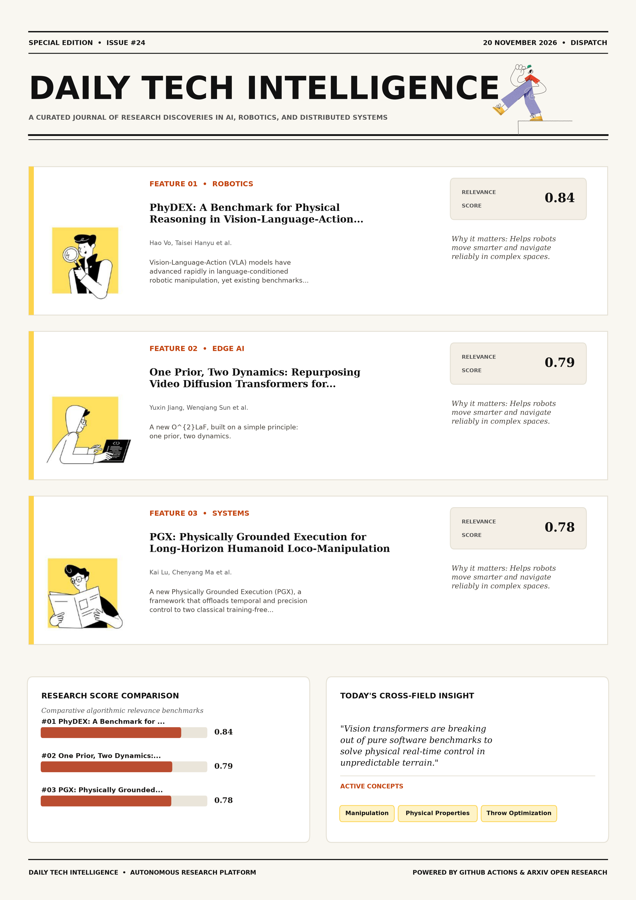

# Daily Tech Intelligence

## 20 November 2026

### Today's Overview

10 research papers analyzed.

Topics:

* Artificial Intelligence
* Machine Learning
* Natural Language Processing
* Robotics

### Visual Intelligence Templates

* **Template 3: Gen-Z Spotlight Broadside (Primary)**: [View High-Res](infographic_spotlight.png)
* **Template 2: Modern Tech Studio**: [View High-Res](infographic_modern.png)
* **Template 1: Editorial Research Journal**: [View High-Res](infographic_editorial.png)

---

## 1. PhyDEX: A Benchmark for Physical Reasoning in Vision-Language-Action Models via Dynamic Extrinsic Dexterity

Authors: Hao Vo, Taisei Hanyu, Yuki Ikebe, Pham Tri Quang, Sreevenkata Anjani Tishita Godavarthi, Nghi D. Q. Bui, Daniel Sonntag, Chase Rainwater, Duy Minh Ho Nguyen, Anh Nguyen, Ngan Le

Publication: 2026-11-19T18:33:43Z

Category: cs.RO

Relevance Score: 0.84

Paper: [arXiv:2611.26565](https://arxiv.org/abs/2611.26565v1) | [PDF](https://arxiv.org/pdf/2611.26565v1)

### Summary

Addressing critical demands in Robotics, this research investigates vision-language-action (vla) models have advanced rapidly in language-conditioned robotic manipulation, yet existing benchmarks mainly evaluate gripper--object contact and largely ignore how objects interact with the environment through gravity, friction, inertia, and mass distribution. As a result, it remains unclear whether current policies truly understand physics or merely interpolate from their training data. We address this gap through the lens of dynamic extrinsic dexterity and introduce PhyDEX, a throwing benchmark in which a robot must infer an object's mass, center of mass, and friction to send it to a destination beyond its kinematic workspace. We hope PhyDEX will drive the development of physically grounded robot policies.

### Key Concepts

* Manipulation
* Physical Properties
* Throw Optimization
* Throw Physical
* Trajectories Hours
* Truly Understand

### Technical Insights

**Problem**

Addresses foundational constraints in Robotics and existing computational workflows.

**Approach**

As a result, it remains unclear whether current policies truly understand physics or merely interpolate from their training data.

**Key Innovation**

Formulates an integrated mechanism leveraging Manipulation, Physical Properties.

**Results**

Not specified in the available abstract.

**Applications**

Autonomous robotic manipulation, sim-to-real transfer, and agile mobile navigation systems. High-resolution real-time visual perception, automated 3D reconstruction, and embodied vision. Next-generation large language model workflows, retrieval-augmented intelligence, and structured document parsing.

**Limitations**

Not specified in the available abstract.

---

## 2. One Prior, Two Dynamics: Repurposing Video Diffusion Transformers for Self-Supervised Latent Action Learning

Authors: Yuxin Jiang, Wenqiang Sun, Jiaqi Li, Yuchao Gu, Lvmin Zhang, Ivor Tsang, Mike Zheng Shou

Publication: 2026-11-19T18:58:14Z

Category: cs.CV, cs.AI, cs.LG, cs.RO

Relevance Score: 0.79

Paper: [arXiv:2611.26617](https://arxiv.org/abs/2611.26617v1) | [PDF](https://arxiv.org/pdf/2611.26617v1)

### Summary

By controlling information access and optimizing both dynamics end-to-end through a compact bottleneck, O^{2}LaF learns transferable actions from unlabeled videos. We introduce O^{2}LaF, built on a simple principle: one prior, two dynamics. We ask whether a pretrained video generator can instead provide the prior for both inverse and forward dynamics. Our findings suggest a broader paradigm for latent-action learning: repurposing pretrained video models to discover transferable actions and predict their consequences. Videos reveal how the world changes, but rarely the actions that cause those changes. Latent action learning recovers such supervision from visual transitions, yet often learns the underlying dynamics largely from scratch.

### Key Concepts

* Zero-shot
* Manipulation
* Action Learning
* Access Optimizing
* Achieving Competitive
* Action Probing

### Technical Insights

**Problem**

By controlling information access and optimizing both dynamics end-to-end through a compact bottleneck, O^{2}LaF learns transferable actions from unlabeled videos.

**Approach**

We introduce O^{2}LaF, built on a simple principle: one prior, two dynamics.

**Key Innovation**

Formulates an integrated mechanism leveraging Zero-shot, Manipulation.

**Results**

Not specified in the available abstract.

**Applications**

Autonomous robotic manipulation, sim-to-real transfer, and agile mobile navigation systems. High-resolution real-time visual perception, automated 3D reconstruction, and embodied vision.

**Limitations**

Not specified in the available abstract.

---

## 3. PGX: Physically Grounded Execution for Long-Horizon Humanoid Loco-Manipulation

Authors: Kai Lu, Chenyang Ma, Ioannis Havoutis

Publication: 2026-11-19T18:52:18Z

Category: cs.RO, cs.AI

Relevance Score: 0.78

Paper: [arXiv:2611.26596](https://arxiv.org/abs/2611.26596v1) | [PDF](https://arxiv.org/pdf/2611.26596v1)

### Summary

Addressing critical demands in Robotics, this research investigates robotic vision-language-action (vla) models can execute diverse individual manipulation skills, yet they still struggle with long-horizon loco-manipulation tasks, where temporal structure, skills, and precision are tightly coupled within a monolithic model. We propose Physically Grounded Execution (PGX), a framework that offloads temporal and precision control to two classical training-free components, allowing the VLA to focus on stage-specific skill dynamics. PGX decomposes long-horizon loco-manipulation into three layers: (i) a predicate-based state machine governs task progression, using physical predicates to gate phase transitions, trigger recovery, and coordinate navigation and waiting. Project page is available at: https://kl-research.github.io/pgx

### Key Concepts

* Manipulation
* Actions Iii
* Available Https
* Base Station
* Classical Training-free
* Concentrating Task-relevant

### Technical Insights

**Problem**

Addresses foundational constraints in Robotics and existing computational workflows.

**Approach**

We propose Physically Grounded Execution (PGX), a framework that offloads temporal and precision control to two classical training-free components, allowing the VLA to focus on stage-specific skill dynamics.

**Key Innovation**

Formulates an integrated mechanism leveraging Manipulation, Actions Iii.

**Results**

Not specified in the available abstract.

**Applications**

Autonomous robotic manipulation, sim-to-real transfer, and agile mobile navigation systems.

**Limitations**

Not specified in the available abstract.

---

## 4. AgentRoboCritic: Understanding the Capability of Frontier Agents on Direct Robot Control

Authors: Yiyang Du, Yuxuan Kuang, Qitao Zhao, Yixuan Wang, Zhanqiu Guo, Yi Xu, Xin Li, Wenbin He, Liu Ren, Chenyan Xiong

Publication: 2026-11-19T18:57:25Z

Category: cs.RO, cs.CL, cs.CV

Relevance Score: 0.76

Paper: [arXiv:2611.26613](https://arxiv.org/abs/2611.26613v1) | [PDF](https://arxiv.org/pdf/2611.26613v1)

### Summary

However, existing benchmarks report only episode-level success rates, which show neither how these agents succeed nor where they fail. In this paper, we present a systematic action-level analysis of frontier agents on direct robot control across 12 manipulation benchmarks. Finally, we validate our critic on a 400-action human-annotated benchmark and release a dataset of 12,844 annotated actions alongside a fine-tuned open-source critic, Muse-Glimmer-30B, whose failure-mode accuracy rises from 32.58% to 74.24%, enabling low-cost action-level analysis. Frontier multimodal language agents such as GPT-6 Astra have demonstrated strong capabilities in controlling robots directly via low-level numerical actions without high-level primitives. We introduce AgentRoboCritic, an intent-grounded critique framework in which the policy agent states a local intent alongside each action, and a critic evaluates the action's outcome and failure mode against this intent.

### Key Concepts

* Zero-shot
* Manipulation
* Direct Robot
* Robot Control
* Accuracy Rises
* Action Critic

### Technical Insights

**Problem**

However, existing benchmarks report only episode-level success rates, which show neither how these agents succeed nor where they fail.

**Approach**

In this paper, we present a systematic action-level analysis of frontier agents on direct robot control across 12 manipulation benchmarks.

**Key Innovation**

Formulates an integrated mechanism leveraging Zero-shot, Manipulation.

**Results**

Not specified in the available abstract.

**Applications**

Autonomous robotic manipulation, sim-to-real transfer, and agile mobile navigation systems. High-resolution real-time visual perception, automated 3D reconstruction, and embodied vision. Next-generation large language model workflows, retrieval-augmented intelligence, and structured document parsing.

**Limitations**

It also identifies their current limitations, including task-relevant physical execution bottlenecks such as grasping and alignment, and uneven recovery across failure modes.

---

## 5. Mind2Act World: A Diagnostic Benchmark for Embodied Mind, Physical Action, and Mind-Action Composition in Robotic Manipulation

Authors: Yuzhi Huang, Jie Wu, Fanding Huang, Junchao Lin, Weichen Zhang, Ziyi Xiong, Yang Li, Zhengwei Xie, Zhimin Wang, Zhen Liu, Jiazhen Huang, Yuzheng Zhang, Yuche Liu, Hongyi Yang, Chen Tang, Shixiang Tang, Hakan Aktas, Adam Wu, Duo Wu, Kangye Ji, Shuzhao Xie, Huanan Liu, Weijue Bu, Chenxin Li, Xinyuan Wang, Tianyi Bai, Yinan Mao, Jiawei Wang, Minglei Li, Heng Yu, Ehsan Adeli, Minchen Li, Yong-Lu Li, Cengiz Öztireli, Huazhe Xu, Chao Yu, Jing Zhang, Shanghang Zhang, Weitao Zhou, Wenwu Zhu, Cheng Chi, Jingyan Jiang, Zhi Wang

Publication: 2026-11-19T17:15:38Z

Category: cs.RO, cs.AI, cs.CV

Relevance Score: 0.74

Paper: [arXiv:2611.26444](https://arxiv.org/abs/2611.26444v1) | [PDF](https://arxiv.org/pdf/2611.26444v1)

### Summary

These findings point to composing reasoning and execution through environmental feedback as the main open problem. We introduce Mind2Act World, a diagnostic benchmark of 30 simulated manipulation tasks from five real-world application domains. Embodied intelligence aims to let robots perform complex physical tasks with human-like adaptability and reliability, which requires three complementary capabilities: history-based cognitive reasoning, precise and timely physical execution, and the composition of reasoning and execution through environmental feedback. Yet existing benchmarks either evaluate reasoning and execution within the same tasks or assess them separately without their composition, so they reveal little about whether a failure comes from reasoning, execution, or their composition.

### Key Concepts

* Manipulation
* Embodied Intelligence
* Environmental Feedback
* Execution Composition
* Execution Environmental
* Mind Act

### Technical Insights

**Problem**

These findings point to composing reasoning and execution through environmental feedback as the main open problem.

**Approach**

We introduce Mind2Act World, a diagnostic benchmark of 30 simulated manipulation tasks from five real-world application domains.

**Key Innovation**

Formulates an integrated mechanism leveraging Manipulation, Embodied Intelligence.

**Results**

Not specified in the available abstract.

**Applications**

Autonomous robotic manipulation, sim-to-real transfer, and agile mobile navigation systems. High-resolution real-time visual perception, automated 3D reconstruction, and embodied vision.

**Limitations**

Comparing the three views shows whether a system lacks a capability or fails to compose capabilities it already has.

---

## 6. Multi-institutional grading of Barrett's esophagus dysplasia without stain normalization using a pathology foundation model and multiple instance learning

Authors: Amirali Khosravi, Jaidip M. Jagtap, D. Chamil Codipilly, Catherine E. Hagen, Jason T. Lewis, Rickey E. Carter, Shahriar Faghani, Vani J. A. Konda, Fouad Otaki, Shajan Peter, Nicholas Shaheen, Sachin Wani, Prasad G. Iyer, Bradley J. Erickson

Publication: 2026-11-19T18:27:59Z

Category: cs.CV, cs.AI

Relevance Score: 0.69

Paper: [arXiv:2611.26562](https://arxiv.org/abs/2611.26562v1) | [PDF](https://arxiv.org/pdf/2611.26562v1)

### Summary

Addressing critical demands in Machine Learning, this research investigates barrett's esophagus dysplasia grading suffers substantial inter-observer variability, particularly for low-grade dysplasia, complicating clinical decision-making. We conducted a retrospective multi-institutional diagnostic accuracy study of a foundation model-based deep learning system for dysplasia grading, using 969 H\&E-stained whole slide images from four institutions. Patch-level classifiers trained on expert annotations identified diagnostically relevant regions, followed by attribute-aware multiple instance learning for slide-level classification as non-dysplastic Barrett's esophagus (NDBE), low-grade dysplasia, or high-grade dysplasia. Performance was consistent across institutions without stain normalization, indicating that stain-robust foundation-model representations may remove the site-specific preprocessing that has constrained prior systems to institution-specific deployment.

### Key Concepts

* Foundation Model
* Annotations Identified
* Attribute-aware Multiple
* Auc Binary
* Barrett Esophagus
* Binary Dysplasia

### Technical Insights

**Problem**

Addresses foundational constraints in Machine Learning and existing computational workflows.

**Approach**

We conducted a retrospective multi-institutional diagnostic accuracy study of a foundation model-based deep learning system for dysplasia grading, using 969 H\&E-stained whole slide images from four institutions.

**Key Innovation**

Formulates an integrated mechanism leveraging Foundation Model, Annotations Identified.

**Results**

Not specified in the available abstract.

**Applications**

High-resolution real-time visual perception, automated 3D reconstruction, and embodied vision.

**Limitations**

Not specified in the available abstract.

---

## 7. AutoMaster: Autonomous Post-Training by Making the Same Model a Better Teacher

Authors: Guoxin Chen, Shuang Sun, Fanzhe Meng, Xinyu Tang, Ruihua Song, Wayne Xin Zhao

Publication: 2026-11-19T17:57:59Z

Category: cs.CL

Relevance Score: 0.69

Paper: [arXiv:2611.26510](https://arxiv.org/abs/2611.26510v1) | [PDF](https://arxiv.org/pdf/2611.26510v1)

### Summary

We further find that retaining skill instructions during SFT yields higher mean performance than removing them across all six settings, despite their absence at evaluation and identical supervised outputs. We propose Skill-FT (Skill-Guided Fine-Tuning), which uses natural-language skills to suppress undesirable habits and elicit underrepresented effective behaviors during teacher rollouts, then fine-tunes a target model on the resulting trajectories. These findings suggest that preserving skill context as part of a training demonstration can support better behavioral internalization. Task success alone does not specify which behaviors post-training should reinforce. Even successful teacher trajectories can contain unsupported assumptions, unproductive repetition, or superficial verification.

### Key Concepts

* Autonomous Post-training
* Ablations Trajectory
* Agent Develops
* Assumptions Unproductive
* Automaster Autonomous
* Automaster Improves

### Technical Insights

**Problem**

We further find that retaining skill instructions during SFT yields higher mean performance than removing them across all six settings, despite their absence at evaluation and identical supervised outputs.

**Approach**

We propose Skill-FT (Skill-Guided Fine-Tuning), which uses natural-language skills to suppress undesirable habits and elicit underrepresented effective behaviors during teacher rollouts, then fine-tunes a target model on the resulting trajectories.

**Key Innovation**

Formulates an integrated mechanism leveraging Autonomous Post-training, Ablations Trajectory.

**Results**

Not specified in the available abstract.

**Applications**

Next-generation large language model workflows, retrieval-augmented intelligence, and structured document parsing.

**Limitations**

Not specified in the available abstract.

---

## 8. ACE-Brain-0.7: Learning Execution-Grounded Reasoning for Embodied Agents

Authors: Yinhe Wang, Shijun Shi, Feng Pan, Tao Tao, Wei Mao, Jiangning Zhang, Zhiyao Ren, Yihang Jiao, Haoming Gu, Yunpeng Qing, Jiyu Guo, Zhi Hou, Dacheng Tao, Xiaogang Wang

Publication: 2026-11-19T17:59:37Z

Category: cs.RO

Relevance Score: 0.67

Paper: [arXiv:2611.26519](https://arxiv.org/abs/2611.26519v1) | [PDF](https://arxiv.org/pdf/2611.26519v1)

### Summary

Addressing critical demands in Artificial Intelligence, this research investigates reliable reasoning for long-horizon embodied tasks requires predictions grounded in the observed execution state. We present ACE-Brain-0.7, a 9B vision--language model that combines spatial grounding, task understanding, and progress estimation. Together, these results show that ACE-Brain-0.7 effectively combines spatial perception with temporal understanding, delivering strong execution-grounded reasoning and comparing favorably with closed-source models. Reliable reasoning for long-horizon embodied tasks requires predictions grounded in the observed execution state. To train the model, we curate 3.7 million question--answer pairs, drawing execution supervision from egocentric human videos, robot episodes, and simulation. These questions span different stages of an execution and connect task-level judgments with observed progress and outcomes.

### Key Concepts

* Acc Refcocog
* Accurately Distinguishes
* Ace-brain- Achieves
* Ace-brain- Effectively
* Ace-brain- Vision--language
* Ahead Gpt-

### Technical Insights

**Problem**

Addresses foundational constraints in Artificial Intelligence and existing computational workflows.

**Approach**

We present ACE-Brain-0.7, a 9B vision--language model that combines spatial grounding, task understanding, and progress estimation.

**Key Innovation**

Formulates an integrated mechanism leveraging Acc Refcocog, Accurately Distinguishes.

**Results**

Together, these results show that ACE-Brain-0.7 effectively combines spatial perception with temporal understanding, delivering strong execution-grounded reasoning and comparing favorably with closed-source models.

**Applications**

Autonomous robotic manipulation, sim-to-real transfer, and agile mobile navigation systems.

**Limitations**

Not specified in the available abstract.

---

## 9. GLiDE: A Fast, Calibrated Decision Model Distilled from Reasoning Teachers

Authors: Sahibzada Allahyar, Julia White, Dhruv Atreja, George Hurn-Maloney, Urchade Zaratiana

Publication: 2026-11-19T17:56:44Z

Category: cs.AI, cs.CL

Relevance Score: 0.67

Paper: [arXiv:2611.26509](https://arxiv.org/abs/2611.26509v1) | [PDF](https://arxiv.org/pdf/2611.26509v1)

### Summary

Addressing critical demands in Artificial Intelligence, this research investigates decision models enable fast, confidence-aware decisions by scoring candidate answers in a single forward pass, without generating text or intermediate reasoning. Yet reasoning can substantially improve decision quality, raising the question of whether its benefits can be retained without the cost of generating it. We investigate this question with \textbf{GLiDE}, a family of decision models spanning 0.4B to 27B parameters. Further checkpoint averaging and parameter-free recurrent depth yield GLiDE~27B, which reaches 73.37 with an expected calibration error of 2.1\%. Decision models enable fast, confidence-aware decisions by scoring candidate answers in a single forward pass, without generating text or intermediate reasoning.

### Key Concepts

* Achieves Hidden-set
* Answers Removing
* Averaging Parameter-free
* Benefits Retained
* Bidirectional Interactions
* Building Qwen

### Technical Insights

**Problem**

Addresses foundational constraints in Artificial Intelligence and existing computational workflows.

**Approach**

Yet reasoning can substantially improve decision quality, raising the question of whether its benefits can be retained without the cost of generating it.

**Key Innovation**

Formulates an integrated mechanism leveraging Achieves Hidden-set, Answers Removing.

**Results**

Not specified in the available abstract.

**Applications**

Next-generation large language model workflows, retrieval-augmented intelligence, and structured document parsing.

**Limitations**

Not specified in the available abstract.

---

## 10. Multimodal Error Detection in Chest X-ray Reports: A Large Language Model Reading Image Evidence

Authors: Yanda Cheng, Bo Wen, Yuhao Lu

Publication: 2026-11-19T17:46:42Z

Category: cs.CL

Relevance Score: 0.67

Paper: [arXiv:2611.26492](https://arxiv.org/abs/2611.26492v1) | [PDF](https://arxiv.org/pdf/2611.26492v1)

### Summary

Addressing critical demands in Natural Language Processing, this research investigates rad-linter checks chest x-ray reports against image-derived evidence to flag potential errors for review. A pretrained image classifier supplies scores for nine pathologies, and a 1.5B-parameter language model, fine-tuned with LoRA on 1,816 examples, checks their consistency with the report. These controlled results show that, given the same image-derived scores, a trained language model detects report-score inconsistencies more accurately than the tested rule baseline, with the advantage concentrated in interpreting how findings are worded. Rad-Linter checks chest X-ray reports against image-derived evidence to flag potential errors for review. We compare it with a keyword-and-negation rule baseline given the same reports and scores.

### Key Concepts

* Large Language Model
* Accuracy Versus
* Interpreting Findings
* Pair Accuracy
* Set Quads
* Thresholds Counterfactual

### Technical Insights

**Problem**

Addresses foundational constraints in Natural Language Processing and existing computational workflows.

**Approach**

A pretrained image classifier supplies scores for nine pathologies, and a 1.5B-parameter language model, fine-tuned with LoRA on 1,816 examples, checks their consistency with the report.

**Key Innovation**

Formulates an integrated mechanism leveraging Large Language Model, Accuracy Versus.

**Results**

These controlled results show that, given the same image-derived scores, a trained language model detects report-score inconsistencies more accurately than the tested rule baseline, with the advantage concentrated in interpreting how findings are worded.

**Applications**

High-resolution real-time visual perception, automated 3D reconstruction, and embodied vision. Next-generation large language model workflows, retrieval-augmented intelligence, and structured document parsing.

**Limitations**

Not specified in the available abstract.

---
