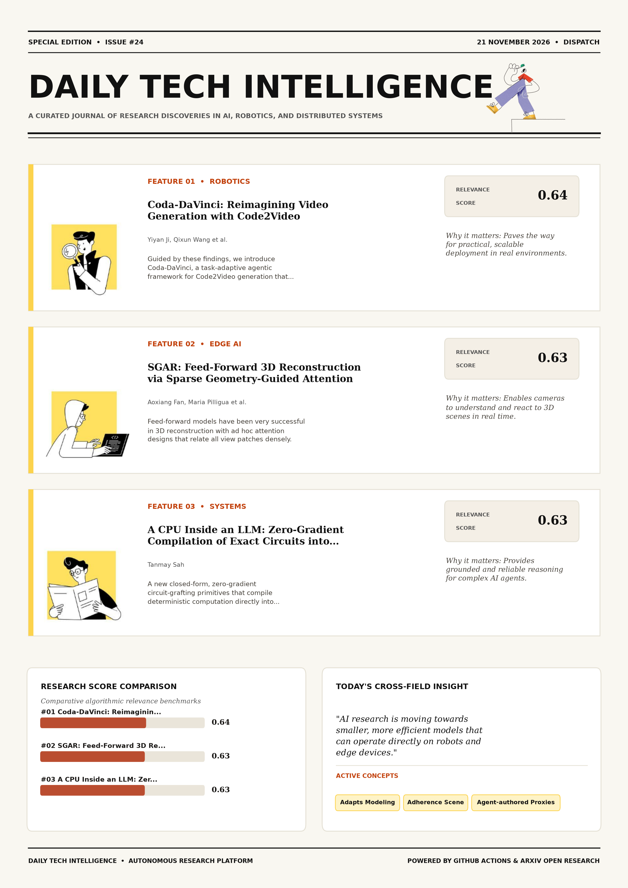

# Daily Tech Intelligence

## 21 November 2026

### Today's Overview

10 research papers analyzed.

Topics:

* Artificial Intelligence
* Computer Vision
* Machine Learning
* Natural Language Processing
* Robotics

### Visual Intelligence Templates

* **Template 3: Gen-Z Spotlight Broadside (Primary)**: [View High-Res](infographic_spotlight.png)
* **Template 2: Modern Tech Studio**: [View High-Res](infographic_modern.png)
* **Template 1: Editorial Research Journal**: [View High-Res](infographic_editorial.png)

---

## 1. Coda-DaVinci: Reimagining Video Generation with Code2Video

Authors: Yiyan Ji, Qixun Wang, Yang Shi, Zhuoran Zhang, Yifan Xu, Tengfei Liu, Yuqi Tang, Xiaohan Zhang, Shujie Li, Jiafu Tang, Xuanyu Zhu, Xinyu Liu, Yan He, Yushuo Guan, Zihao Wang, Xianghua Ying, Shixuan Liu, Haotian Wang, Wenjing Yang, Zhaoxiang Zhang, Yuanxing Zhang, Pengfei Wan, Jiaheng Liu

Publication: 2026-11-19T18:51:58Z

Category: cs.CV

Relevance Score: 0.64

Paper: [arXiv:2611.26595](https://arxiv.org/abs/2611.26595v1) | [PDF](https://arxiv.org/pdf/2611.26595v1)

### Summary

However, how to construct proxies and prompts for optimal downstream quality remains underexplored, as do the capabilities and limitations of this paradigm. Guided by these findings, we introduce Coda-DaVinci, a task-adaptive agentic framework for Code2Video generation that selects between proxy-guided and direct generation, adapts modeling granularity to each entity, and coordinates simulation with proxy-grounded prompting. Experiments demonstrate leading instruction following on VTR and scene consistency on R2M, improved physical plausibility over direct generation, and higher visual realism than the compared Code2Video baselines. Long-video evaluations further show gains in event structure and consistency across successive interactions, while revealing limitations in transition stability and adherence to scene settings.

### Key Concepts

* Adapts Modeling
* Adherence Scene
* Agent-authored Proxies
* Assets Guides
* Baselines Long-video
* Capabilities Limitations

### Technical Insights

**Problem**

However, how to construct proxies and prompts for optimal downstream quality remains underexplored, as do the capabilities and limitations of this paradigm.

**Approach**

Guided by these findings, we introduce Coda-DaVinci, a task-adaptive agentic framework for Code2Video generation that selects between proxy-guided and direct generation, adapts modeling granularity to each entity, and coordinates simulation with proxy-grounded prompting.

**Key Innovation**

Formulates an integrated mechanism leveraging Adapts Modeling, Adherence Scene.

**Results**

Experiments demonstrate leading instruction following on VTR and scene consistency on R2M, improved physical plausibility over direct generation, and higher visual realism than the compared Code2Video baselines.

**Applications**

High-resolution real-time visual perception, automated 3D reconstruction, and embodied vision.

**Limitations**

However, how to construct proxies and prompts for optimal downstream quality remains underexplored, as do the capabilities and limitations of this paradigm.

---

## 2. SGAR: Feed-Forward 3D Reconstruction via Sparse Geometry-Guided Attention

Authors: Aoxiang Fan, Maria Pilligua, Corentin Dumery, Oliver Heinimann, Pascal Fua

Publication: 2026-11-19T17:46:57Z

Category: cs.CV

Relevance Score: 0.63

Paper: [arXiv:2611.26493](https://arxiv.org/abs/2611.26493v1) | [PDF](https://arxiv.org/pdf/2611.26493v1)

### Summary

However, the cost of this dense global attention grows quadratically with the number of views, preventing the model from applying to larger-scale reconstruction settings. However, the cost of this dense global attention grows quadratically with the number of views, preventing the model from applying to larger-scale reconstruction settings. It runs up to 12-times faster than dense attention at 1,000 views with stable pose accuracy where existing sparse methods fail, and shows the best performance in reconstructing more complete geometries on the same time budget. Feed-forward models have been very successful in 3D reconstruction with ad hoc attention designs that relate all view patches densely.

### Key Concepts

* Argue Dense
* Attends Small
* Attention Computations
* Attention Grows
* Attention Reconstruction
* Attention Replaced

### Technical Insights

**Problem**

However, the cost of this dense global attention grows quadratically with the number of views, preventing the model from applying to larger-scale reconstruction settings.

**Approach**

However, the cost of this dense global attention grows quadratically with the number of views, preventing the model from applying to larger-scale reconstruction settings.

**Key Innovation**

Formulates an integrated mechanism leveraging Argue Dense, Attends Small.

**Results**

It runs up to 12-times faster than dense attention at 1,000 views with stable pose accuracy where existing sparse methods fail, and shows the best performance in reconstructing more complete geometries on the same time budget.

**Applications**

High-resolution real-time visual perception, automated 3D reconstruction, and embodied vision.

**Limitations**

Not specified in the available abstract.

---

## 3. A CPU Inside an LLM: Zero-Gradient Compilation of Exact Circuits into Pretrained Weights

Authors: Tanmay Sah

Publication: 2026-11-19T17:18:38Z

Category: cs.AI

Relevance Score: 0.63

Paper: [arXiv:2611.26450](https://arxiv.org/abs/2611.26450v1) | [PDF](https://arxiv.org/pdf/2611.26450v1)

### Summary

Addressing critical demands in Natural Language Processing, this research investigates pretrained language models (lms) remain unreliable on exact multi-digit arithmetic without gradient fine-tuning or external tool interpreters. We introduce closed-form, zero-gradient circuit-grafting primitives that compile deterministic computation directly into pretrained LM weights using zero training examples and zero runtime hooks, while bounding per-layer normalization drift and preserving natural-language (NL) competence. Our construction combines three analytical mechanisms: (1) two-layer Mellin-GLU quadrature over bias-free SwiGLU/GeGLU layers, turning unknown per-token RMSNorm scaling into translation along a log-spaced gate grid (>250\times dynamic range) with IEEE 754 error bounds; (2) cross-token scale cancellation via signed Chebyshev Indefinite-RoPE self-sink attention and memoryless SiLU-antisymmetric GatedDeltaNet shifts; and (3) axis-aligned width extension (d \to d+K) with \sqrt{d/(d+K)} norm compensation, Base-1000 canonical BPE emission, and differential (+254,-256) tied unembeddings. A factorized block-sparse sidecar holds A100 memory at 7.89 / 10.65 GiB (4.60 / 8.14 GiB under INT8/INT4 + FP32 sidecar) while passing all 14/14 pre-registered >2K-token Tango splits (N=4{,}392; 0/11,134 OOD triggers).

### Key Concepts

* Accuracy Sidecar
* Active Non-zeros
* Alibaba Qwen
* Alongside Literal
* Alu-prefix Accuracy
* Analytical Mechanisms

### Technical Insights

**Problem**

Addresses foundational constraints in Natural Language Processing and existing computational workflows.

**Approach**

We introduce closed-form, zero-gradient circuit-grafting primitives that compile deterministic computation directly into pretrained LM weights using zero training examples and zero runtime hooks, while bounding per-layer normalization drift and preserving natural-language (NL) competence.

**Key Innovation**

Formulates an integrated mechanism leveraging Accuracy Sidecar, Active Non-zeros.

**Results**

Not specified in the available abstract.

**Applications**

Next-generation large language model workflows, retrieval-augmented intelligence, and structured document parsing.

**Limitations**

Not specified in the available abstract.

---

## 4. Cost-Aware Agentic Feature Optimization System for Fleet-Scale Ranking Models

Authors: Chang Yang, Yao Xuan, Wendan Yan, Nhat Le, Jiang Liu, Longhao Jin, Zhen Peggy Yao, Alireza Vahdatpour, Djordje Gligorijevic

Publication: 2026-11-19T18:12:04Z

Category: cs.IR, cs.AI, cs.LG

Relevance Score: 0.63

Paper: [arXiv:2611.26531](https://arxiv.org/abs/2611.26531v1) | [PDF](https://arxiv.org/pdf/2611.26531v1)

### Summary

Addressing critical demands in Artificial Intelligence, this research investigates large web platforms operate large fleets of ranking models, each selecting features from a shared pool of tens of thousands. We present an end-to-end agentic system that optimizes features across the fleet under resource constraints shared across models and those set per model, such as feature pipeline cost and serving throughput (QPS), respectively. In this system, LLM agents propose hypotheses, and deterministic tools execute experiments and verify them. The optimized models were launched, and in online A/B tests they improved a primary online metric by 0.20%. Large Web platforms operate large fleets of ranking models, each selecting features from a shared pool of tens of thousands.

### Key Concepts

* Agent Tunes
* Agentic Optimizes
* Asynchronous Trials
* Blending Mixes
* Budget Production
* Budget Trimming

### Technical Insights

**Problem**

Addresses foundational constraints in Artificial Intelligence and existing computational workflows.

**Approach**

We present an end-to-end agentic system that optimizes features across the fleet under resource constraints shared across models and those set per model, such as feature pipeline cost and serving throughput (QPS), respectively.

**Key Innovation**

Formulates an integrated mechanism leveraging Agent Tunes, Agentic Optimizes.

**Results**

Not specified in the available abstract.

**Applications**

Autonomous agentic reasoning, multi-agent coordination, and decision-support platforms.

**Limitations**

We present an end-to-end agentic system that optimizes features across the fleet under resource constraints shared across models and those set per model, such as feature pipeline cost and serving throughput (QPS), respectively.

---

## 5. Probing the "Conscious" Mind: Selective Access and Global Workspace in Vision-Language Models

Authors: Jiahao Huang, Jun Wang

Publication: 2026-11-19T18:46:50Z

Category: cs.AI, cs.CV, cs.LG

Relevance Score: 0.61

Paper: [arXiv:2611.26590](https://arxiv.org/abs/2611.26590v1) | [PDF](https://arxiv.org/pdf/2611.26590v1)

### Summary

Across VLM families and sizes, we find shared patterns of concept accessibility, query-dependent selectivity and cross-task intervention effects despite differences in internal organisation. We introduce the Multimodal Concept Lens (MC-Lens), a multimodal Jacobian lens, to study these functions in VLM concept processing. These findings offer an experimental basis to study GWT in multimodal artificial systems and how it can guide cross-modal alignment improvements. Vision-language models (VLMs) integrate visual and textual information, but their outputs do not reveal internal concept representations. Global workspace theory (GWT) proposes that information is selected from parallel brain processes, integrated in a shared workspace, and made available to specialised processes.

### Key Concepts

* Selective Access
* Concept Accessibility
* Concept Information
* Concepts Downstream
* Cross-modal Alignment
* Development Cross-modal

### Technical Insights

**Problem**

Across VLM families and sizes, we find shared patterns of concept accessibility, query-dependent selectivity and cross-task intervention effects despite differences in internal organisation.

**Approach**

We introduce the Multimodal Concept Lens (MC-Lens), a multimodal Jacobian lens, to study these functions in VLM concept processing.

**Key Innovation**

Formulates an integrated mechanism leveraging Selective Access, Concept Accessibility.

**Results**

Not specified in the available abstract.

**Applications**

High-resolution real-time visual perception, automated 3D reconstruction, and embodied vision. Next-generation large language model workflows, retrieval-augmented intelligence, and structured document parsing.

**Limitations**

Not specified in the available abstract.

---

## 6. The Geometry of Lies: Knowledge and Persona Directions for Detecting Deception in Large Language Models

Authors: Md. Abdullah Al Zami, Suraiya Shanaz, Mahdi Hasan, Shoaib Ahmed Dipu, Farig Yousuf Sadeque, Md. Sabbir Ahmed

Publication: 2026-11-19T18:20:01Z

Category: cs.AI

Relevance Score: 0.61

Paper: [arXiv:2611.26545](https://arxiv.org/abs/2611.26545v1) | [PDF](https://arxiv.org/pdf/2611.26545v1)

### Summary

Addressing critical demands in Natural Language Processing, this research investigates linear probes are the cheapest llm lie detectors but often fail to transfer across kinds of lie. Label-free directions from honest and deceptive role-play are untested at 70B scale and on lies about knowledge, where a lie and an honest denial can be identical. We widen a published persona bank with roles that deny knowledge they have, plus honest counterparts. More varied role-play questions do not help the persona direction on Liars' Bench. Linear probes are the cheapest LLM lie detectors but often fail to transfer across kinds of lie.

### Key Concepts

* Persona Direction
* Honest Denials
* Liars Bench
* Lies Knowledge
* Persona Bank
* Ranks Lies

### Technical Insights

**Problem**

Addresses foundational constraints in Natural Language Processing and existing computational workflows.

**Approach**

Label-free directions from honest and deceptive role-play are untested at 70B scale and on lies about knowledge, where a lie and an honest denial can be identical.

**Key Innovation**

Formulates an integrated mechanism leveraging Persona Direction, Honest Denials.

**Results**

Not specified in the available abstract.

**Applications**

Low-power edge AI devices, embedded IoT sensor networks, and distributed on-device inference. Next-generation large language model workflows, retrieval-augmented intelligence, and structured document parsing.

**Limitations**

Not specified in the available abstract.

---

## 7. A Tutorial on Complementarity-Based Contact Models for Robotics

Authors: Onur Beker, A. René Geist, Michael Posa, Marc Toussaint, Justin Carpentier, Georg Martius

Publication: 2026-11-19T18:54:07Z

Category: cs.RO, cs.GR, math.OC

Relevance Score: 0.60

Paper: [arXiv:2611.26600](https://arxiv.org/abs/2611.26600v1) | [PDF](https://arxiv.org/pdf/2611.26600v1)

### Summary

Addressing critical demands in Robotics, this research investigates simulating rigid-body dynamics with contact is fundamental to robotics, from motion synthesis and control to mechanism design. Many widely used simulators rely on cone complementarity formulations, whose physical assumptions and numerical solution require substantial background. While excellent surveys, monographs, and course notes exist, they mostly address computational mechanics or computer graphics or document a single simulator. Connections to widely used simulators, optimal control, and differentiable simulation help readers interpret simulation results, choose suitable formulations and solvers, and develop their own contact dynamics routines. Simulating rigid-body dynamics with contact is fundamental to robotics, from motion synthesis and control to mechanism design.

### Key Concepts

* Formulations Solvers
* Rigid-body Dynamics
* Solvers Develop
* Sticking Sliding
* Suitable Formulations
* Surveys Monographs

### Technical Insights

**Problem**

Addresses foundational constraints in Robotics and existing computational workflows.

**Approach**

Many widely used simulators rely on cone complementarity formulations, whose physical assumptions and numerical solution require substantial background.

**Key Innovation**

Formulates an integrated mechanism leveraging Formulations Solvers, Rigid-body Dynamics.

**Results**

Not specified in the available abstract.

**Applications**

Autonomous robotic manipulation, sim-to-real transfer, and agile mobile navigation systems.

**Limitations**

We then compare first-order and Newton-based methods, explain regularization and proximal strategies, and discuss trade-offs between computational cost, robustness, and physical fidelity.

---

## 8. RL Post-Training in Diffusion Transformers Is Activation Steering

Authors: Tuna Han Salih Meral, Kaan Oktay, Alec Helbling, Atakan Kara, Duen Horng Chau, Pinar Yanardag

Publication: 2026-11-19T18:59:53Z

Category: cs.CV, cs.LG

Relevance Score: 0.60

Paper: [arXiv:2611.26627](https://arxiv.org/abs/2611.26627v1) | [PDF](https://arxiv.org/pdf/2611.26627v1)

### Summary

Although the vectors are identical for every prompt, token, and sampling seed, they recover 90.0-96.3% of the reward gains of six RL-tuned image models, and 89.8% and 111.9% on two RL-tuned video models. Because capabilities such as rendering requested text or composing multiple objects are inherently prompt-dependent, a natural hypothesis is that improving them requires learning complex, input-dependent transformations. To isolate how much of these gains an input-independent shift explains, we probe each RL-tuned model with a deliberately simple parameterization: a fixed set of steering vectors added to the block outputs of the frozen base model. A constant shift thus suffices for most of the gain of policy-gradient RL post-training: without new input-dependent transformations, it steers the pretrained generator toward what it can already compute.

### Key Concepts

* Reinforcement Learning
* Diffusion Transformers
* Accuracy Diffusion
* Added Block
* Block Outputs
* Capabilities Rendering

### Technical Insights

**Problem**

Although the vectors are identical for every prompt, token, and sampling seed, they recover 90.0-96.3% of the reward gains of six RL-tuned image models, and 89.8% and 111.9% on two RL-tuned video models.

**Approach**

Because capabilities such as rendering requested text or composing multiple objects are inherently prompt-dependent, a natural hypothesis is that improving them requires learning complex, input-dependent transformations.

**Key Innovation**

Formulates an integrated mechanism leveraging Reinforcement Learning, Diffusion Transformers.

**Results**

Not specified in the available abstract.

**Applications**

High-resolution real-time visual perception, automated 3D reconstruction, and embodied vision.

**Limitations**

Not specified in the available abstract.

---

## 9. Represented but misread: Post-training changes how language models read out what they represent

Authors: Jochen Laubrock

Publication: 2026-11-19T18:43:56Z

Category: cs.CL, cs.LG

Relevance Score: 0.59

Paper: [arXiv:2611.26584](https://arxiv.org/abs/2611.26584v1) | [PDF](https://arxiv.org/pdf/2611.26584v1)

### Summary

Addressing critical demands in Machine Learning, this research investigates does post-training change what a language model represents, or how this representation is read out into an answer?. We compared linear probes with the models' own answers, analyzed with signal detection theory, in six open-weight base models and their post-trained versions. For judgments of whether German texts were written by a human or an AI, probes and word n-gram classifiers separated the classes well, but the answers did not and often ordered the texts inversely. Post-training thus changed how a judgment is read out of what a model represents, and a small training signal can set its direction.

### Key Concepts

* Supervised Fine-tuning
* Text Text
* Text Transferred
* Textbook Corpora
* Texts Identical
* Texts Inversely

### Technical Insights

**Problem**

Addresses foundational constraints in Machine Learning and existing computational workflows.

**Approach**

We compared linear probes with the models' own answers, analyzed with signal detection theory, in six open-weight base models and their post-trained versions.

**Key Innovation**

Formulates an integrated mechanism leveraging Supervised Fine-tuning, Text Text.

**Results**

Not specified in the available abstract.

**Applications**

Next-generation large language model workflows, retrieval-augmented intelligence, and structured document parsing.

**Limitations**

Not specified in the available abstract.

---

## 10. Direct3D-V3: Latent-Free Diffusion Transformers in the Native Voxel Domain

Authors: Shuang Wu, Jiachen Qian, Youtian Lin, Feihu Zhang, Philip Torr, Yao Yao, Xun Cao

Publication: 2026-11-19T17:58:20Z

Category: cs.CV

Relevance Score: 0.59

Paper: [arXiv:2611.26511](https://arxiv.org/abs/2611.26511v1) | [PDF](https://arxiv.org/pdf/2611.26511v1)

### Summary

Despite their architectural differences, these methods all share the same premise: geometry is first compressed into a latent space and only then modeled by the generator. To make this direct voxel formulation geometrically reliable, we introduce an implicit manifold regularization over neighboring voxels to suppress non-watertight surfaces, and convert predicted SDF grids into meshes via Marching Cubes so that rendered normal losses can supervise the model directly from its predicted SDF. We take a different route and propose Direct3D-V3, a latent-free diffusion transformer (DiT) framework that discards the VAE altogether and operates in the native voxel domain, directly modeling raw SDF voxel grids during both training and sampling. Project page: https://dreamtechai.github.io/Direct3D-V3.

### Key Concepts

* Native Voxel
* Voxel Domain
* Conditioning Image
* Improve Alignment
* Predicted Sdf
* Sdf Voxel

### Technical Insights

**Problem**

Despite their architectural differences, these methods all share the same premise: geometry is first compressed into a latent space and only then modeled by the generator.

**Approach**

To make this direct voxel formulation geometrically reliable, we introduce an implicit manifold regularization over neighboring voxels to suppress non-watertight surfaces, and convert predicted SDF grids into meshes via Marching Cubes so that rendered normal losses can supervise the model directly from its predicted SDF.

**Key Innovation**

Formulates an integrated mechanism leveraging Native Voxel, Voxel Domain.

**Results**

Not specified in the available abstract.

**Applications**

High-resolution real-time visual perception, automated 3D reconstruction, and embodied vision.

**Limitations**

Not specified in the available abstract.

---
