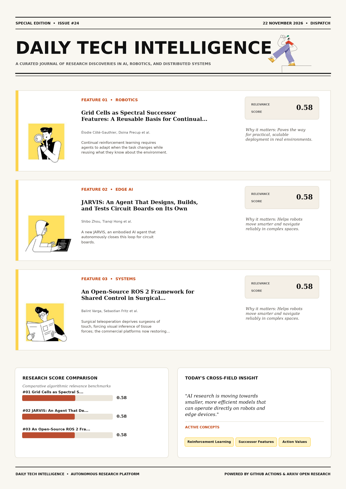

# Daily Tech Intelligence

## 22 November 2026

### Today's Overview

10 research papers analyzed.

Topics:

* Machine Learning
* Natural Language Processing
* Robotics

### Visual Intelligence Templates

* **Template 3: Gen-Z Spotlight Broadside (Primary)**: [View High-Res](infographic_spotlight.png)
* **Template 2: Modern Tech Studio**: [View High-Res](infographic_modern.png)
* **Template 1: Editorial Research Journal**: [View High-Res](infographic_editorial.png)

---

## 1. Grid Cells as Spectral Successor Features: A Reusable Basis for Continual Reinforcement Learning

Authors: Élodie Côté-Gauthier, Doina Precup, Isabeau Prémont-Schwarz

Publication: 2026-11-19T17:54:04Z

Category: cs.LG

Relevance Score: 0.58

Paper: [arXiv:2611.26504](https://arxiv.org/abs/2611.26504v1) | [PDF](https://arxiv.org/pdf/2611.26504v1)

### Summary

Addressing critical demands in Machine Learning, this research investigates continual reinforcement learning requires agents to adapt when the task changes while reusing what they know about the environment. Taking the identification of entorhinal grid cells with eigenvectors of the successor representation as a design principle, we build this basis from eigenvectors of the transition matrix of a fixed reference policy. In a two-goal gridworld, with the uniform random walk as reference policy, whose eigenvectors are the low-frequency Laplacian eigenvectors, agents built this way maintain near-maximal return across every change of goal, whereas SimpleSF and DQN lose most of their return at each change.

### Key Concepts

* Reinforcement Learning
* Successor Features
* Action Values
* Acts Greedily
* Agent Acts
* Base Feature Multiplied

### Technical Insights

**Problem**

Addresses foundational constraints in Machine Learning and existing computational workflows.

**Approach**

Taking the identification of entorhinal grid cells with eigenvectors of the successor representation as a design principle, we build this basis from eigenvectors of the transition matrix of a fixed reference policy.

**Key Innovation**

Formulates an integrated mechanism leveraging Reinforcement Learning, Successor Features.

**Results**

Not specified in the available abstract.

**Applications**

Autonomous agentic reasoning, multi-agent coordination, and decision-support platforms.

**Limitations**

Not specified in the available abstract.

---

## 2. JARVIS: An Agent That Designs, Builds, and Tests Circuit Boards on Its Own

Authors: Shibo Zhou, Tianqi Hong, Zheng Yan, He Yang

Publication: 2026-11-19T17:53:30Z

Category: cs.RO, eess.SY

Relevance Score: 0.58

Paper: [arXiv:2611.26503](https://arxiv.org/abs/2611.26503v1) | [PDF](https://arxiv.org/pdf/2611.26503v1)

### Summary

Addressing critical demands in Robotics, this research investigates power electronics is central to the energy transition, but developing new hardware still relies on human-led design, fabrication, testing, and iteration. We present JARVIS, an embodied AI agent that autonomously closes this loop for circuit boards. JARVIS maintains machine-specific capabilities and constraints, scans its workspace using a robot-mounted 3D scanner, and constructs an executable digital twin in which it rehearses robot motions, fabrication steps, and circuit behavior before consuming materials. To our knowledge, JARVIS is the first system in power electronics in which an agent closes the physical design-build-test-learn loop for circuit boards.

### Key Concepts

* Embodied AI
* Circuit Boards
* Design Fabrication
* Loop Circuit
* Power Electronics
* Solder Paste

### Technical Insights

**Problem**

Addresses foundational constraints in Robotics and existing computational workflows.

**Approach**

We present JARVIS, an embodied AI agent that autonomously closes this loop for circuit boards.

**Key Innovation**

Formulates an integrated mechanism leveraging Embodied AI, Circuit Boards.

**Results**

Not specified in the available abstract.

**Applications**

Autonomous robotic manipulation, sim-to-real transfer, and agile mobile navigation systems.

**Limitations**

JARVIS maintains machine-specific capabilities and constraints, scans its workspace using a robot-mounted 3D scanner, and constructs an executable digital twin in which it rehearses robot motions, fabrication steps, and circuit behavior before consuming materials.

---

## 3. An Open-Source ROS 2 Framework for Shared Control in Surgical Teleoperation: Integrating the Haply Inverse3 with the da Vinci Research Kit

Authors: Balint Varga, Sebastian Fritz, Gergely Kiss, Kristof Takacs, Peter Galambos

Publication: 2026-11-19T17:41:08Z

Category: cs.RO, eess.SY

Relevance Score: 0.58

Paper: [arXiv:2611.26485](https://arxiv.org/abs/2611.26485v1) | [PDF](https://arxiv.org/pdf/2611.26485v1)

### Summary

Addressing critical demands in Robotics, this research investigates surgical teleoperation deprives surgeons of touch, forcing visual inference of tissue forces; the commercial platforms now restoring force feedback remain closed, preventing open research on haptic shared control. This paper provides a system contribution: it presents an open-source, ROS 2-native framework that integrates the compact, three-degree-of-freedom (3-DOF) Haply Inverse3 haptic device with the da~Vinci Research Kit (dVRK). The framework includes a novel mapping strategy that combines 3-DOF translational device input with separately tracked VerseGrip orientation into 6-DOF patient-side manipulator commands. They further suggest that simpler linear feedback may be more robust for inexperienced operators than more complex profiles.

### Key Concepts

* Shared Control
* Guidance Modes
* Haptic Shared
* Teleoperated Hot-wire
* Three-degree-of-freedom Dof Haply
* Time Progressive-stiffness

### Technical Insights

**Problem**

Addresses foundational constraints in Robotics and existing computational workflows.

**Approach**

This paper provides a system contribution: it presents an open-source, ROS 2-native framework that integrates the compact, three-degree-of-freedom (3-DOF) Haply Inverse3 haptic device with the da~Vinci Research Kit (dVRK).

**Key Innovation**

The framework includes a novel mapping strategy that combines 3-DOF translational device input with separately tracked VerseGrip orientation into 6-DOF patient-side manipulator commands.

**Results**

Not specified in the available abstract.

**Applications**

Autonomous robotic manipulation, sim-to-real transfer, and agile mobile navigation systems.

**Limitations**

Not specified in the available abstract.

---

## 4. TideCache: Efficient Hybrid LLM Serving with Transparent Cache Management and Layer-Wise Streaming

Authors: Jinbin Luo, Xiaozhe Yao, Shang Yang, Zhijian Liu, Song Han, Qinghao Hu

Publication: 2026-11-19T18:58:31Z

Category: cs.DC, cs.LG

Relevance Score: 0.58

Paper: [arXiv:2611.26619](https://arxiv.org/abs/2611.26619v1) | [PDF](https://arxiv.org/pdf/2611.26619v1)

### Summary

Addressing critical demands in Natural Language Processing, this research investigates hybrid architectures have become mainstream among open-weight language models. We present TideCache, a serving system on CPU--GPU superchips with three components for allocating GPU memory among caches and managing their residency across GPU and host memory. Implemented in SGLang and evaluated on GB300 and GH200 across seven model/platform configurations, TideCache completes up to 2.04x as many agent turns, reduces overall P50 per-token latency by 20--59%, and improves agent P50 TTFT by 1.40--3.05x compared with SGLang with HiCache. Hybrid architectures have become mainstream among open-weight language models. Their global-attention and bounded-state layers maintain heterogeneous caches whose demands vary with context length and concurrency.

### Key Concepts

* Accommodate Cache
* According Request
* Additional Requests
* Addresses Preserving
* Adjustments According
* Agent Ttft

### Technical Insights

**Problem**

Addresses foundational constraints in Natural Language Processing and existing computational workflows.

**Approach**

We present TideCache, a serving system on CPU--GPU superchips with three components for allocating GPU memory among caches and managing their residency across GPU and host memory.

**Key Innovation**

Formulates an integrated mechanism leveraging Accommodate Cache, According Request.

**Results**

Implemented in SGLang and evaluated on GB300 and GH200 across seven model/platform configurations, TideCache completes up to 2.04x as many agent turns, reduces overall P50 per-token latency by 20--59%, and improves agent P50 TTFT by 1.40--3.05x compared with SGLang with HiCache.

**Applications**

Low-power edge AI devices, embedded IoT sensor networks, and distributed on-device inference. Next-generation large language model workflows, retrieval-augmented intelligence, and structured document parsing.

**Limitations**

Not specified in the available abstract.

---

## 5. A new algorithmic approach for finding flat minima: critically damped Polyak stepsizes

Authors: Francesco Caporali, Jason M. Altschuler, Boris Hanin

Publication: 2026-11-19T17:35:37Z

Category: cs.LG, cs.AI, math.OC

Relevance Score: 0.57

Paper: [arXiv:2611.26475](https://arxiv.org/abs/2611.26475v1) | [PDF](https://arxiv.org/pdf/2611.26475v1)

### Summary

Addressing critical demands in Machine Learning, this research investigates we present a new adaptive stepsize rule that biases gradient descent toward flatter minima in both theory and practice, and establish the first uniform-in-time guarantees for both sharpness and loss reduction for a broad class of locally quadratic objectives. We present a new adaptive stepsize rule that biases gradient descent toward flatter minima in both theory and practice, and establish the first uniform-in-time guarantees for both sharpness and loss reduction for a broad class of locally quadratic objectives. The factor 4 is critical in that it produces equioscillations around the manifold of minimizers \mathcal{M} to leading order. Empirically, CDP stepsizes produce a flattening effect similar to that of Sharpness-Aware Minimization (SAM, Foret et al., 2021), reducing sharpness even in settings beyond our theory, including nonlinear teacher-student networks and fine-tuning of pre-trained LLMs.

### Key Concepts

* Broad Class
* Cdp Stepsizes
* Gradient Descent
* Leading Order
* Locally Quadratic
* Mathcal Leading

### Technical Insights

**Problem**

Addresses foundational constraints in Machine Learning and existing computational workflows.

**Approach**

We present a new adaptive stepsize rule that biases gradient descent toward flatter minima in both theory and practice, and establish the first uniform-in-time guarantees for both sharpness and loss reduction for a broad class of locally quadratic objectives.

**Key Innovation**

Formulates an integrated mechanism leveraging Broad Class, Cdp Stepsizes.

**Results**

Not specified in the available abstract.

**Applications**

Autonomous agentic reasoning, multi-agent coordination, and decision-support platforms.

**Limitations**

Not specified in the available abstract.

---

## 6. Posterior Matching Distillation

Authors: Hidir Yesiltepe, Julius Berner, Arash Vahdat, Pinar Yanardag

Publication: 2026-11-19T18:59:57Z

Category: cs.CV

Relevance Score: 0.56

Paper: [arXiv:2611.26629](https://arxiv.org/abs/2611.26629v1) | [PDF](https://arxiv.org/pdf/2611.26629v1)

### Summary

Addressing critical demands in Machine Learning, this research investigates diffusion distillation accelerates image and video generation by compressing a pretrained teacher's iterative sampling process into a few network evaluations. We introduce Posterior Matching Distillation (PMD), a new member of the distribution-based distillation family that combines mode-covering posterior sampling with any-step generation. We prove that, matching tilted means over an open neighborhood uniquely identifies the full posterior. This matching is often driven by reverse-KL objectives, whose mode-seeking bias favors dominant teacher modes at the expense of diversity across samples. Experiments on SDXL and FLUX.2 [klein] 4B demonstrate that PMD achieves the best FID among 4-step methods on both models, while maintaining competitive or leading performance across prompt-alignment and perceptual-quality metrics.

### Key Concepts

* Sdxl Flux Klein
* Stochastic Student
* Student Output
* Student Samples
* Student Supports
* Student-score Network

### Technical Insights

**Problem**

Addresses foundational constraints in Machine Learning and existing computational workflows.

**Approach**

We introduce Posterior Matching Distillation (PMD), a new member of the distribution-based distillation family that combines mode-covering posterior sampling with any-step generation.

**Key Innovation**

We prove that, matching tilted means over an open neighborhood uniquely identifies the full posterior.

**Results**

Not specified in the available abstract.

**Applications**

High-resolution real-time visual perception, automated 3D reconstruction, and embodied vision.

**Limitations**

PMD thus supervises the entire conditional distribution through a family of mean constraints, without any auxiliary student-score network.

---

## 7. ScaleWorld: High-Resolution World Generation through Shared Prediction and Refinement

Authors: Yansong Qu, Wesker Zheng, Quanjian Song, Zhiyuan Zhang, Xiao Cao, Shengchuan Zhang, Liujuan Cao

Publication: 2026-11-19T18:58:04Z

Category: cs.CV

Relevance Score: 0.56

Paper: [arXiv:2611.26615](https://arxiv.org/abs/2611.26615v1) | [PDF](https://arxiv.org/pdf/2611.26615v1)

### Summary

Addressing critical demands in Machine Learning, this research investigates high-resolution generation enables video world models to render fine-grained scene structures and textures, but directly generating high-resolution video incurs substantial computational and memory costs. We present ScaleWorld, a causal video model that unifies low-resolution world prediction and high-resolution refinement within a single shared backbone. {Extensive experiments demonstrate that ScaleWorld achieves high-quality world generation with improved computational and memory efficiency. High-resolution generation enables video world models to render fine-grained scene structures and textures, but directly generating high-resolution video incurs substantial computational and memory costs. By refining its own predictions, ScaleWorld produces high-resolution world videos without requiring a separate refinement model.

### Key Concepts

* Achieves High-quality
* Backbone Completes
* Backbone Refining
* Behaviors Specialized
* Capability Consolidation
* Causal States

### Technical Insights

**Problem**

Addresses foundational constraints in Machine Learning and existing computational workflows.

**Approach**

We present ScaleWorld, a causal video model that unifies low-resolution world prediction and high-resolution refinement within a single shared backbone.

**Key Innovation**

Formulates an integrated mechanism leveraging Achieves High-quality, Backbone Completes.

**Results**

{Extensive experiments demonstrate that ScaleWorld achieves high-quality world generation with improved computational and memory efficiency.

**Applications**

High-resolution real-time visual perception, automated 3D reconstruction, and embodied vision.

**Limitations**

Not specified in the available abstract.

---

## 8. Bio-PM-Guided Synthetic IMU Generation

Authors: Deepali Singh, Deepesh Parpani, Aviral Gupta

Publication: 2026-11-19T18:56:25Z

Category: cs.LG

Relevance Score: 0.56

Paper: [arXiv:2611.26607](https://arxiv.org/abs/2611.26607v1) | [PDF](https://arxiv.org/pdf/2611.26607v1)

### Summary

Addressing critical demands in Machine Learning, this research investigates collecting and labeling inertial measurement unit (imu) data for human activity recognition (har) is expensive, and models trained on one group of subjects often fail to generalize to unseen individuals. Even with balanced data, classifiers struggle to distinguish dynamically similar activity classes and benefit from targeted augmentation. We explore whether synthetic IMU data generated in the representation space of a pretrained biosignal encoder, Bio-PM \cite{b1}, can serve as a practical augmentation source. These results demonstrate that high-fidelity generation in a pretrained encoder's representation space is achievable and practically useful for cross-subject HAR augmentation.

### Key Concepts

* Activity Classes
* Diffusion Decoder
* Representation Space
* Train Classifier Transfers
* Train-on-synthetic-test-on-real Tstr
* Transformer Decoder Predicts

### Technical Insights

**Problem**

Addresses foundational constraints in Machine Learning and existing computational workflows.

**Approach**

Even with balanced data, classifiers struggle to distinguish dynamically similar activity classes and benefit from targeted augmentation.

**Key Innovation**

Formulates an integrated mechanism leveraging Activity Classes, Diffusion Decoder.

**Results**

Not specified in the available abstract.

**Applications**

Autonomous agentic reasoning, multi-agent coordination, and decision-support platforms.

**Limitations**

Not specified in the available abstract.

---

## 9. AURA: AUdio-dRiven streaming Avatar

Authors: Nathaniel Cohen, Nicolas Dufour, Amélie Royer, Alasdair Newson, Patrick Pérez

Publication: 2026-11-19T18:17:38Z

Category: cs.CV, cs.AI

Relevance Score: 0.56

Paper: [arXiv:2611.26540](https://arxiv.org/abs/2611.26540v1) | [PDF](https://arxiv.org/pdf/2611.26540v1)

### Summary

Addressing critical demands in Machine Learning, this research investigates current audio-driven video diffusion models can synthesize realistic talking-head videos but generally require dozens of diffusion denoising steps over multi-second video chunks, making them unsuitable for streaming applications such as voice assistants and virtual avatars, where low-latency and online causal generation are required properties. AURA generates video chunk by chunk with a rolling KV cache, requiring only the audio of the current chunk to start generating, rather than a multi-second audio look-ahead like bidirectional models. It comes in two sizes: AURA 1.3B streams 576p video in real time on a single GPU (20.7 fps for a 16 Hz playback rate), making it suited to interactive avatar applications, and AURA 5B streams 720p video at 9.7 fps. To support reproducibility and further research on streaming avatar generation, we release the weights of both models along with a dataset of 30K synthetic videos and their precomputed teacher trajectories.

### Key Concepts

* Aura Streams
* Streams Video
* Teacher Running Faster
* Teacher Trajectories
* Time Single
* Trajectories Fewer

### Technical Insights

**Problem**

Addresses foundational constraints in Machine Learning and existing computational workflows.

**Approach**

AURA generates video chunk by chunk with a rolling KV cache, requiring only the audio of the current chunk to start generating, rather than a multi-second audio look-ahead like bidirectional models.

**Key Innovation**

Formulates an integrated mechanism leveraging Aura Streams, Streams Video.

**Results**

Not specified in the available abstract.

**Applications**

High-resolution real-time visual perception, automated 3D reconstruction, and embodied vision.

**Limitations**

Not specified in the available abstract.

---

## 10. The Window Lever: Longer Observation Windows Outweigh the Observed Effects of Data, Capacity, and Architecture in Customer Behavior Forecasting

Authors: Tara Sowrirajan, Yanqiao Wang

Publication: 2026-11-19T18:00:11Z

Category: cs.LG, cs.IR

Relevance Score: 0.56

Paper: [arXiv:2611.26521](https://arxiv.org/abs/2611.26521v1) | [PDF](https://arxiv.org/pdf/2611.26521v1)

### Summary

Addressing critical demands in Machine Learning, this research investigates in our experiments on long-horizon customer-behavior forecasting, a longer observation window outweighed the observed effects of more data, more capacity and newer architectures. The window is the weeks of history a model sees before the week it forecasts from. On our internal data, longer windows admit up to 10% more and colder training customers, which matching does not fix. A team building on this class of data should start by lengthening the window. In our experiments on long-horizon customer-behavior forecasting, a longer observation window outweighed the observed effects of more data, more capacity and newer architectures.

### Key Concepts

* Observed Effects
* Longer Windows
* Sequence Families
* Weeks Clocks
* Weeks History
* Weeks Weekly-aggregate

### Technical Insights

**Problem**

Addresses foundational constraints in Machine Learning and existing computational workflows.

**Approach**

The window is the weeks of history a model sees before the week it forecasts from.

**Key Innovation**

Formulates an integrated mechanism leveraging Observed Effects, Longer Windows.

**Results**

On our internal data, longer windows admit up to 10% more and colder training customers, which matching does not fix.

**Applications**

Autonomous agentic reasoning, multi-agent coordination, and decision-support platforms.

**Limitations**

Not specified in the available abstract.

---
