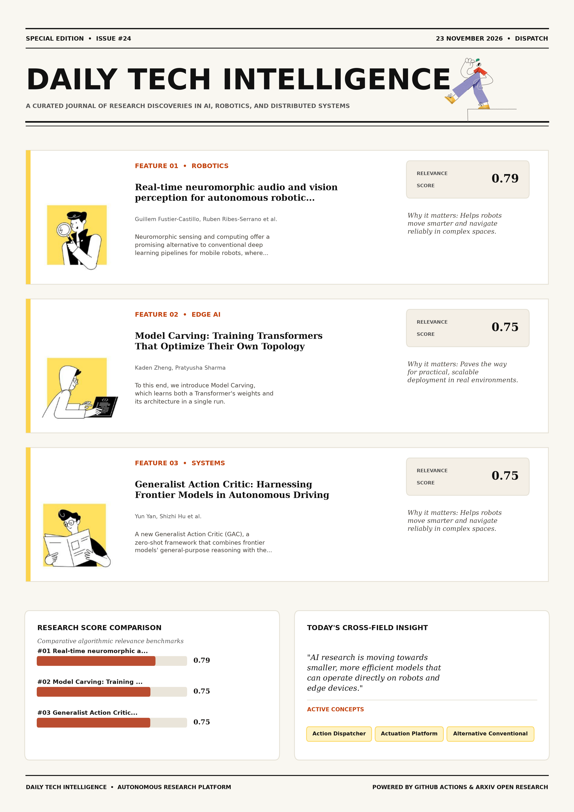

# Daily Tech Intelligence

## 23 November 2026

### Today's Overview

10 research papers analyzed.

Topics:

* Artificial Intelligence
* IoT & Edge AI
* Machine Learning
* Natural Language Processing
* Robotics

### Visual Intelligence Templates

* **Template 3: Gen-Z Spotlight Broadside (Primary)**: [View High-Res](infographic_spotlight.png)
* **Template 2: Modern Tech Studio**: [View High-Res](infographic_modern.png)
* **Template 1: Editorial Research Journal**: [View High-Res](infographic_editorial.png)

---

## 1. Real-time neuromorphic audio and vision perception for autonomous robotic applications: Integration and experimental evaluation on a rover platform

Authors: Guillem Fustier-Castillo, Ruben Ribes-Serrano, Javier Naranjo-Alcazar, Vicent Ortiz-Castello, Pedro Zuccarello

Publication: 2026-11-20T18:27:26Z

Category: cs.RO

Relevance Score: 0.79

Paper: [arXiv:2611.27953](https://arxiv.org/abs/2611.27953v1) | [PDF](https://arxiv.org/pdf/2611.27953v1)

### Summary

However, most neuromorphic solutions are still evaluated offline or on isolated benchmarks, and their integration into complete robotic systems remains largely unexplored. However, most neuromorphic solutions are still evaluated offline or on isolated benchmarks, and their integration into complete robotic systems remains largely unexplored. In this technical report, a four-wheel rover platform is presented that combines three real-time perception pipelines: a classical audio tagging pipeline based on Pretrained Audio Neural Networks (PANNs) running on an NVIDIA Jetson GPU, a neuromorphic audio pipeline in which a spiking neural network (SNN) is deployed on the SynSense Xylo Audio~2 chip, and a neuromorphic vision pipeline in which events from an event-based camera are processed by the SpikeYOLO spiking detector for traffic cone detection. The platform is demonstrated in a proof-of-concept scenario in which the robot reacts to sound classes detected by both audio pipelines and detects traffic cones with the event camera, showing the feasibility of integrating neuromorphic hardware into a multimodal robotic platform operating in real time.

### Key Concepts

* Action Dispatcher
* Actuation Platform
* Alternative Conventional
* Audio Chip
* Audio Neural
* Audio Pipeline

### Technical Insights

**Problem**

However, most neuromorphic solutions are still evaluated offline or on isolated benchmarks, and their integration into complete robotic systems remains largely unexplored.

**Approach**

However, most neuromorphic solutions are still evaluated offline or on isolated benchmarks, and their integration into complete robotic systems remains largely unexplored.

**Key Innovation**

Formulates an integrated mechanism leveraging Action Dispatcher, Actuation Platform.

**Results**

Not specified in the available abstract.

**Applications**

Autonomous robotic manipulation, sim-to-real transfer, and agile mobile navigation systems. Low-power edge AI devices, embedded IoT sensor networks, and distributed on-device inference. High-resolution real-time visual perception, automated 3D reconstruction, and embodied vision.

**Limitations**

Neuromorphic sensing and computing offer a promising alternative to conventional deep learning pipelines for mobile robots, where perception must run continuously under tight latency and energy constraints.

---

## 2. Model Carving: Training Transformers That Optimize Their Own Topology

Authors: Kaden Zheng, Pratyusha Sharma

Publication: 2026-11-20T18:41:39Z

Category: cs.LG, cs.AI

Relevance Score: 0.75

Paper: [arXiv:2611.27962](https://arxiv.org/abs/2611.27962v1) | [PDF](https://arxiv.org/pdf/2611.27962v1)

### Summary

Addressing critical demands in Machine Learning, this research investigates machine learning has largely kept separate the choice of architecture and the process of training. To this end, we introduce Model Carving, which learns both a Transformer's weights and its architecture in a single run. At equal training compute, carved models reach a lower validation loss than dense models trained with up to 1.7 times more compute. Our results show that architecture, like weights, should be learned and not fixed in advance, and that inside every large transformer is a smaller, faster, stronger one waiting to be carved out. Machine learning has largely kept separate the choice of architecture and the process of training.

### Key Concepts

* Pruning
* Trains Fixed
* Transformer Instance
* Transformer Smaller
* Transformer Weights
* Transformers Equal

### Technical Insights

**Problem**

Addresses foundational constraints in Machine Learning and existing computational workflows.

**Approach**

To this end, we introduce Model Carving, which learns both a Transformer's weights and its architecture in a single run.

**Key Innovation**

Formulates an integrated mechanism leveraging Pruning, Trains Fixed.

**Results**

At equal training compute, carved models reach a lower validation loss than dense models trained with up to 1.7 times more compute.

**Applications**

Autonomous agentic reasoning, multi-agent coordination, and decision-support platforms.

**Limitations**

Not specified in the available abstract.

---

## 3. Generalist Action Critic: Harnessing Frontier Models in Autonomous Driving

Authors: Yun Yan, Shizhi Hu, Zhichao Li, Yang Guan, Shiqi Liu, Jiaxin Gao, Xiangteng Zhang, Wenbo Ding, Jiuhua Zhao, Hui Guo, Xintao Yan, Keqiang Li, Shengbo Eben Li

Publication: 2026-11-20T16:32:53Z

Category: cs.RO

Relevance Score: 0.75

Paper: [arXiv:2611.27804](https://arxiv.org/abs/2611.27804v1) | [PDF](https://arxiv.org/pdf/2611.27804v1)

### Summary

Addressing critical demands in Artificial Intelligence, this research investigates frontier models have demonstrated remarkable general-purpose reasoning capabilities, opening new possibilities for intelligent decision making in the physical world. We introduce Generalist Action Critic (GAC), a zero-shot framework that combines frontier models' general-purpose reasoning with the planning competence of specialized driving models through an inference-time harness. GAC also consistently improves closed-loop driving safety across three planners, with relative HD-Score gains of up to 32.1%. These results demonstrate the potential of harnessing frontier models to improve driving safety through inference-time cooperation with specialized planners. Frontier models have demonstrated remarkable general-purpose reasoning capabilities, opening new possibilities for intelligent decision making in the physical world.

### Key Concepts

* Zero-shot
* Action Critic
* Driving Safety
* General-purpose Reasoning
* Specialized Planners
* Stage Support

### Technical Insights

**Problem**

Addresses foundational constraints in Artificial Intelligence and existing computational workflows.

**Approach**

We introduce Generalist Action Critic (GAC), a zero-shot framework that combines frontier models' general-purpose reasoning with the planning competence of specialized driving models through an inference-time harness.

**Key Innovation**

Formulates an integrated mechanism leveraging Zero-shot, Action Critic.

**Results**

GAC also consistently improves closed-loop driving safety across three planners, with relative HD-Score gains of up to 32.1%.

**Applications**

Autonomous robotic manipulation, sim-to-real transfer, and agile mobile navigation systems.

**Limitations**

Not specified in the available abstract.

---

## 4. QuantStream3D: Geometry-Aligned Low-Bit KV Cache Quantization for Streaming Visual Geometry Transformers

Authors: Zunhai Su, Keyu Fan, Ruishan Guo, Zhongzhu Zhou, Jingzehua Xu, Bohan Sun, Hansen Feng, Ruihan Hu, Yik-Chung Wu, Ngai Wong

Publication: 2026-11-20T17:38:48Z

Category: cs.CV

Relevance Score: 0.75

Paper: [arXiv:2611.27901](https://arxiv.org/abs/2611.27901v1) | [PDF](https://arxiv.org/pdf/2611.27901v1)

### Summary

Addressing critical demands in IoT & Edge AI, this research investigates streaming visual geometry transformers retain historical key-value (kv) states as cross-view geometric memory, but growing caches constrain long-sequence inference. Guided by these findings, we propose QuantStream3D, to our knowledge the first dedicated KV quantization framework for streaming visual geometry transformers. Compared with LLM-oriented KV quantizers, it reduces TUM absolute trajectory error and NeuralRGBD completeness error by up to 57.4% and 69.7%, respectively. Code and pretrained checkpoints will be made publicly available. Streaming visual geometry transformers retain historical key-value (KV) states as cross-view geometric memory, but growing caches constrain long-sequence inference.

### Key Concepts

* Quantization
* Pruning
* Geometry Transformers
* Streaming Visual
* Visual Geometry
* Batch Size

### Technical Insights

**Problem**

Addresses foundational constraints in IoT & Edge AI and existing computational workflows.

**Approach**

Guided by these findings, we propose QuantStream3D, to our knowledge the first dedicated KV quantization framework for streaming visual geometry transformers.

**Key Innovation**

Formulates an integrated mechanism leveraging Quantization, Pruning.

**Results**

Compared with LLM-oriented KV quantizers, it reduces TUM absolute trajectory error and NeuralRGBD completeness error by up to 57.4% and 69.7%, respectively.

**Applications**

Low-power edge AI devices, embedded IoT sensor networks, and distributed on-device inference. High-resolution real-time visual perception, automated 3D reconstruction, and embodied vision.

**Limitations**

Not specified in the available abstract.

---

## 5. Auditable Financial Knowledge Graphs: Schema-Driven Construction and Intrinsic Quality Evaluation

Authors: Samarth Sarin, Lovepreet Singh, Dhagash Mehta

Publication: 2026-11-20T16:54:47Z

Category: cs.AI, cs.CE

Relevance Score: 0.71

Paper: [arXiv:2611.27835](https://arxiv.org/abs/2611.27835v1) | [PDF](https://arxiv.org/pdf/2611.27835v1)

### Summary

Financial documents combine narrative disclosures, accounting metrics, corporate structures, management commentary, and time-dependent facts, making them difficult to represent using conventional chunk-based retrieval-augmented generation systems. This paper presents an auditable, schema-driven methodology for constructing temporal financial knowledge graphs from page-delimited documents parsed using a general purpose document intelligence service. Overlapping document windows undergo phased large language model extraction of structural entities, quantitative observations, and domain-specific relationships. By separating graph-quality assessment from downstream retrieval and answer generation, the framework supports systematic diagnosis and iterative refinement of the constructed graph. Candidate graph elements are validated against predefined schemas and consolidated through scope-aware exact, normalized, fuzzy, embedding-based, and LLM-assisted entity resolution.

### Key Concepts

* Retrieval-augmented Generation
* Large Language Model
* Financial Knowledge
* Knowledge Graph
* Financial Documents
* Structural Diagnostics

### Technical Insights

**Problem**

Financial documents combine narrative disclosures, accounting metrics, corporate structures, management commentary, and time-dependent facts, making them difficult to represent using conventional chunk-based retrieval-augmented generation systems.

**Approach**

This paper presents an auditable, schema-driven methodology for constructing temporal financial knowledge graphs from page-delimited documents parsed using a general purpose document intelligence service.

**Key Innovation**

Formulates an integrated mechanism leveraging Retrieval-augmented Generation, Large Language Model.

**Results**

Not specified in the available abstract.

**Applications**

Low-power edge AI devices, embedded IoT sensor networks, and distributed on-device inference. Next-generation large language model workflows, retrieval-augmented intelligence, and structured document parsing.

**Limitations**

Temporal merge constraints, deterministic edge deduplication, conflict-aware property management, and fine-grained provenance preserve issuer identity, reporting-period validity, and traceability to source evidence.

---

## 6. SLICR: Strategy Logic-Guided Multi-Agent Reinforcement Learning

Authors: Arshia Rafieioskouie, Matthew Lucas, Tzu-Han Hsu, Borzoo Bonakdarpour

Publication: 2026-11-20T17:13:50Z

Category: cs.AI, cs.LO

Relevance Score: 0.70

Paper: [arXiv:2611.27865](https://arxiv.org/abs/2611.27865v1) | [PDF](https://arxiv.org/pdf/2611.27865v1)

### Summary

Addressing critical demands in Artificial Intelligence, this research investigates specification-guided reinforcement learning (rl) translates formal specifications of desired behavior of agents into shaped rewards. This paper introduces SLICR, a significant paradigm shift that advances the state of the art to specification-guided RL in adversarial settings under partial observability. We employ Strategy Logic (SL), which allows explicit quantification over agents' strategies and uses the linear temporal logic (LTL) to specify the agents' objectives and constraints. We evaluate SLICR on three popular benchmarks: Predator-Prey, Google Research Football, and our home-grown extension of SMAC-HARD, demonstrating its effectiveness, scalability, and ability to adapt to diverse adversarial strategies.

### Key Concepts

* Reinforcement Learning
* Act Satisfy
* Adapt Diverse
* Advances State
* Adversarial Settings
* Adversarial Strategies

### Technical Insights

**Problem**

Addresses foundational constraints in Artificial Intelligence and existing computational workflows.

**Approach**

This paper introduces SLICR, a significant paradigm shift that advances the state of the art to specification-guided RL in adversarial settings under partial observability.

**Key Innovation**

Formulates an integrated mechanism leveraging Reinforcement Learning, Act Satisfy.

**Results**

Not specified in the available abstract.

**Applications**

Autonomous agentic reasoning, multi-agent coordination, and decision-support platforms.

**Limitations**

We employ Strategy Logic (SL), which allows explicit quantification over agents' strategies and uses the linear temporal logic (LTL) to specify the agents' objectives and constraints.

---

## 7. Task2Hand: A Contact-Grounded Skill for Parametric Dexterous-Hand Morphology Design

Authors: Haoyang Wang, Weibo Gao, Zhengxiong Li, Lingfeng Tao

Publication: 2026-11-20T18:48:12Z

Category: cs.RO

Relevance Score: 0.69

Paper: [arXiv:2611.27967](https://arxiv.org/abs/2611.27967v1) | [PDF](https://arxiv.org/pdf/2611.27967v1)

### Summary

Addressing critical demands in Robotics, this research investigates dexterous hand design demands repeated expert work across geometry, robot-description code, collision debugging, grasp initialization, and policy training. We present Task2Hand, a Skill: a specification package that turns a functional manipulation brief into a parameterized hand model and routes every candidate through cost-ordered contact, dynamics, and learning gates. Each gate returns a status and an evidence record; on failure, the Skill records the earliest blocker, revises one bounded parameter group, and reruns the cheaper gates. Accepted candidates pack with URDF/MJCF, metrics, checkpoints, and a provenance manifest. Dexterous hand design demands repeated expert work across geometry, robot-description code, collision debugging, grasp initialization, and policy training.

### Key Concepts

* Manipulation
* Sage Hand
* Skill Records
* Skill Specification
* Skill-aware Generative
* Specification Package

### Technical Insights

**Problem**

Addresses foundational constraints in Robotics and existing computational workflows.

**Approach**

We present Task2Hand, a Skill: a specification package that turns a functional manipulation brief into a parameterized hand model and routes every candidate through cost-ordered contact, dynamics, and learning gates.

**Key Innovation**

Formulates an integrated mechanism leveraging Manipulation, Sage Hand.

**Results**

Not specified in the available abstract.

**Applications**

Autonomous robotic manipulation, sim-to-real transfer, and agile mobile navigation systems.

**Limitations**

Not specified in the available abstract.

---

## 8. SLP-Bench: Evaluating and Improving Acoustic Claims of Reasoning Audio Language Models on Clinical Speech

Authors: Côme Hosxe, Rachid Riad, Quentin Spinat

Publication: 2026-11-20T16:36:57Z

Category: cs.AI, cs.CL, cs.LG, cs.SD

Relevance Score: 0.69

Paper: [arXiv:2611.27810](https://arxiv.org/abs/2611.27810v1) | [PDF](https://arxiv.org/pdf/2611.27810v1)

### Summary

Addressing critical demands in Artificial Intelligence, this research investigates audio language models (alms) can answer clinical questions from speech, outperforming baselines built on handcrafted acoustic features. We introduce Speech Language Pathologist Bench (SLP-Bench), a benchmark grading each acoustic claim in the chain of thought against clinicians' perceptual ratings of the same recording. Each statement the model makes about the voice needs to be checked against clinicians' perceptual ratings of the same recording. SLP-Bench is available upon request, subject to approval by the providers of each dataset. Audio language models (ALMs) can answer clinical questions from speech, outperforming baselines built on handcrafted acoustic features.

### Key Concepts

* Zero-shot
* Accuracy Mean
* Acoustic Features
* Agree Clinicians
* Alms Evaluated
* Alms Generate

### Technical Insights

**Problem**

Addresses foundational constraints in Artificial Intelligence and existing computational workflows.

**Approach**

We introduce Speech Language Pathologist Bench (SLP-Bench), a benchmark grading each acoustic claim in the chain of thought against clinicians' perceptual ratings of the same recording.

**Key Innovation**

Formulates an integrated mechanism leveraging Zero-shot, Accuracy Mean.

**Results**

Not specified in the available abstract.

**Applications**

Next-generation large language model workflows, retrieval-augmented intelligence, and structured document parsing.

**Limitations**

Not specified in the available abstract.

---

## 9. What Must a Model Tell a Planner? Outcome Interfaces for Risk-Aware Planning After Robot Damage

Authors: Hassan Iqbal, Krishna Kumar

Publication: 2026-11-20T18:12:49Z

Category: cs.RO

Relevance Score: 0.68

Paper: [arXiv:2611.27939](https://arxiv.org/abs/2611.27939v1) | [PDF](https://arxiv.org/pdf/2611.27939v1)

### Summary

Addressing critical demands in Robotics, this research investigates when a robot is damaged, it must decide which routes it can still afford, and the amount of risk it may accept can change from one mission to the next. We argue that whether a learned model helps such a robot depends on its decision interface, that is, on what the model hands to the planner. A decision policy tells the planner what to do, whereas an outcome model, a kind of world model, predicts the consequences of each route. Predicting outcomes lets the planner preserve missions by changing routes as risk requirements tighten.

### Key Concepts

* World Model
* Accept Change
* Afford Risk
* Best Penalty
* Calibrated Limit
* Capability Contract

### Technical Insights

**Problem**

Addresses foundational constraints in Robotics and existing computational workflows.

**Approach**

We argue that whether a learned model helps such a robot depends on its decision interface, that is, on what the model hands to the planner.

**Key Innovation**

Formulates an integrated mechanism leveraging World Model, Accept Change.

**Results**

Not specified in the available abstract.

**Applications**

Autonomous robotic manipulation, sim-to-real transfer, and agile mobile navigation systems.

**Limitations**

Not specified in the available abstract.

---

## 10. StereoVLM: Binocular Vision-Language Models for Metric 3D Spatial Reasoning

Authors: Chi Yan, Guoyang Zhao, Wentao Yuan, Yixiao Ge, Yanning Zhou, Dan Xu

Publication: 2026-11-20T17:52:02Z

Category: cs.CV, cs.AI, cs.RO

Relevance Score: 0.67

Paper: [arXiv:2611.27915](https://arxiv.org/abs/2611.27915v1) | [PDF](https://arxiv.org/pdf/2611.27915v1)

### Summary

Addressing critical demands in Artificial Intelligence, this research investigates vision-language models (vlms) exhibit strong semantic understanding but remain limited in their ability to reason about metric 3d space in the physical world. To this end, we introduce StereoVLM, the first geometry-aware binocular VLM for metric 3D spatial reasoning. This makes metric 3D inference inherently ambiguous and leaves it unclear whether their spatial predictions are grounded in visual evidence or driven primarily by semantic priors. Hierarchical geometric supervision also yields average gains of 3.54 points across five spatial benchmarks and 4.3 percentage points in RoboCasa manipulation success. Vision-language models (VLMs) exhibit strong semantic understanding but remain limited in their ability to reason about metric 3D space in the physical world.

### Key Concepts

* Manipulation
* Spatial Reasoning
* Cross-view Geometry
* Semantic Priors
* Strong Semantic Understanding
* Structure Images

### Technical Insights

**Problem**

Addresses foundational constraints in Artificial Intelligence and existing computational workflows.

**Approach**

To this end, we introduce StereoVLM, the first geometry-aware binocular VLM for metric 3D spatial reasoning.

**Key Innovation**

Formulates an integrated mechanism leveraging Manipulation, Spatial Reasoning.

**Results**

Not specified in the available abstract.

**Applications**

Autonomous robotic manipulation, sim-to-real transfer, and agile mobile navigation systems. High-resolution real-time visual perception, automated 3D reconstruction, and embodied vision. Next-generation large language model workflows, retrieval-augmented intelligence, and structured document parsing.

**Limitations**

Existing VLMs typically infer 3D scene structure from one or more images without known camera calibration or cross-view geometric constraints.

---
