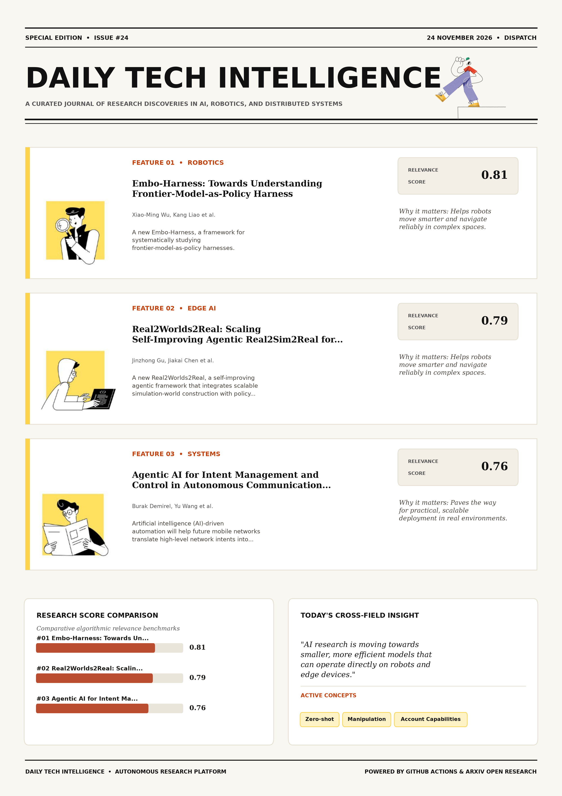

# Daily Tech Intelligence

## 24 November 2026

### Today's Overview

10 research papers analyzed.

Topics:

* Artificial Intelligence
* Machine Learning
* Robotics

### Visual Intelligence Templates

* **Template 3: Gen-Z Spotlight Broadside (Primary)**: [View High-Res](infographic_spotlight.png)
* **Template 2: Modern Tech Studio**: [View High-Res](infographic_modern.png)
* **Template 1: Editorial Research Journal**: [View High-Res](infographic_editorial.png)

---

## 1. Embo-Harness: Towards Understanding Frontier-Model-as-Policy Harness

Authors: Xiao-Ming Wu, Kang Liao, Yuexiao Ma, Taolin Zhang, Mingqian Zhou, Nuo Chen, Ziming Li, Yihang Luo, Rui Li, Zhonghua Wu, Tianyu Xie, Xiawu Zheng, Zhongang Cai, Zhi Hou, Chen Change Loy

Publication: 2026-11-23T18:48:54Z

Category: cs.RO

Relevance Score: 0.81

Paper: [arXiv:2611.31201](https://arxiv.org/abs/2611.31201v1) | [PDF](https://arxiv.org/pdf/2611.31201v1)

### Summary

However, the design principles of such harnesses, and the capabilities underlying their strong performance, remain unclear. We present Embo-Harness, a framework for systematically studying frontier-model-as-policy harnesses. Frontier multimodal models exhibit extraordinary generalization in generating robot actions from observations and instructions, enabling a new paradigm in which they serve directly as policies within closed-loop robotic harnesses. These results provide both a practical recipe for building strong frontier-model-as-policy harnesses and a clearer account of the capabilities that drive their performance. We investigate four components of the robotic agentic loop, namely, prompting, planning, action execution, and tool use, and distill six empirical findings into a practical recipe.

### Key Concepts

* Zero-shot
* Manipulation
* Account Capabilities
* Accurate Spatial
* Achieves Success
* Action Execution

### Technical Insights

**Problem**

However, the design principles of such harnesses, and the capabilities underlying their strong performance, remain unclear.

**Approach**

We present Embo-Harness, a framework for systematically studying frontier-model-as-policy harnesses.

**Key Innovation**

Frontier multimodal models exhibit extraordinary generalization in generating robot actions from observations and instructions, enabling a new paradigm in which they serve directly as policies within closed-loop robotic harnesses.

**Results**

Not specified in the available abstract.

**Applications**

Autonomous robotic manipulation, sim-to-real transfer, and agile mobile navigation systems.

**Limitations**

Not specified in the available abstract.

---

## 2. Real2Worlds2Real: Scaling Self-Improving Agentic Real2Sim2Real for Robot Manipulation

Authors: Jinzhong Gu, Jiakai Chen, Xinyi Cao, Yan Shen, Hangke Sui, Shutian Zheng, Xiang Xiao, Haoran Lu, Fan Xu, Lu Shi, Daochen Shi, Ruihua Zhang, Wei Zhan, Masayoshi Tomizuka, Ruihai Wu

Publication: 2026-11-23T17:39:59Z

Category: cs.RO

Relevance Score: 0.79

Paper: [arXiv:2611.31098](https://arxiv.org/abs/2611.31098v1) | [PDF](https://arxiv.org/pdf/2611.31098v1)

### Summary

Real-to-Sim-to-Real (Real2Sim2Real) offers a promising route by enabling policy learning in simulation grounded in real-world observations, yet scaling this paradigm across diverse tasks and physical interactions remains difficult. We introduce Real2Worlds2Real, a self-improving agentic framework that integrates scalable simulation-world construction with policy development. Experiments demonstrate improved world fidelity and successful real-world policy transfer, with performance gains from increasing world diversity and interaction-data volume. Skill reuse further improves world-building efficiency and long-horizon task success. Scaling robot manipulation learning remains challenging due to the high cost of collecting real-world interaction data. Given limited visual observations and task descriptions, its tool-orchestration harness constructs faithful digital twins and expands them into diverse, physically executable digital cousins.

### Key Concepts

* Sim-to-Real Transfer
* Manipulation
* Adaptively Selects
* Agent Adaptively
* Agent Distills
* Agent Orchestrates

### Technical Insights

**Problem**

Real-to-Sim-to-Real (Real2Sim2Real) offers a promising route by enabling policy learning in simulation grounded in real-world observations, yet scaling this paradigm across diverse tasks and physical interactions remains difficult.

**Approach**

We introduce Real2Worlds2Real, a self-improving agentic framework that integrates scalable simulation-world construction with policy development.

**Key Innovation**

Formulates an integrated mechanism leveraging Sim-to-Real Transfer, Manipulation.

**Results**

Experiments demonstrate improved world fidelity and successful real-world policy transfer, with performance gains from increasing world diversity and interaction-data volume.

**Applications**

Autonomous robotic manipulation, sim-to-real transfer, and agile mobile navigation systems.

**Limitations**

Not specified in the available abstract.

---

## 3. Agentic AI for Intent Management and Control in Autonomous Communication Networks

Authors: Burak Demirel, Yu Wang, Pablo Soldati

Publication: 2026-11-23T18:57:32Z

Category: cs.LG

Relevance Score: 0.76

Paper: [arXiv:2611.31223](https://arxiv.org/abs/2611.31223v1) | [PDF](https://arxiv.org/pdf/2611.31223v1)

### Summary

However, existing approaches often focus on intent management and orchestration, leaving the adaptation of underlying network optimization and control functions largely unaddressed. However, existing approaches often focus on intent management and orchestration, leaving the adaptation of underlying network optimization and control functions largely unaddressed. This article proposes a triadic agentic AI framework that co-designs intent management and intent fulfillment through three agents: an interpreter, powered by a language model, that translates and refines intents into machine-readable optimization templates; an optimizer that adapts controller policies to intent specifications; and a controller that performs fast decision-making. Results demonstrate how the agentic AI framework can connect high-level intents with runtime network control, showing adaptability of intent specifications and control policies to service requirements and changing network conditions.

### Key Concepts

* Reinforcement Learning
* Intent Management
* Adaptability Intent
* Adaptation Underlying
* Adapts Controller Policies
* Agent Workflow

### Technical Insights

**Problem**

However, existing approaches often focus on intent management and orchestration, leaving the adaptation of underlying network optimization and control functions largely unaddressed.

**Approach**

However, existing approaches often focus on intent management and orchestration, leaving the adaptation of underlying network optimization and control functions largely unaddressed.

**Key Innovation**

Formulates an integrated mechanism leveraging Reinforcement Learning, Intent Management.

**Results**

Not specified in the available abstract.

**Applications**

Autonomous agentic reasoning, multi-agent coordination, and decision-support platforms.

**Limitations**

Not specified in the available abstract.

---

## 4. ACAP: Asynchronous Coding Agents for Efficient Robot Control

Authors: Zexin He, Rui Li, Yushi Lan, Chengkai Jin, Zhi Hou, Xingang Pan

Publication: 2026-11-23T18:52:19Z

Category: cs.RO, cs.MA

Relevance Score: 0.76

Paper: [arXiv:2611.31205](https://arxiv.org/abs/2611.31205v1) | [PDF](https://arxiv.org/pdf/2611.31205v1)

### Summary

However, different robot components often have physical dependencies that require coordination. We introduce Asynchronous Coding Agents as Policy (ACAP), an asynchronous framework that organizes one robot as a team of persistent agents. Each member reasons and acts for a configurable control group, such as an arm with its gripper or the torso and chassis, enabling asynchronous reasoning and execution. We present the framework and a real-world rollout dataset containing observations, generated programs, actions, and feedback to support research on how coding agents reason and act in the physical world. Coding agents can construct and revise robot behavior during execution, but using one agent for the whole robot can delay otherwise independent work.

### Key Concepts

* Manipulation
* Actions Feedback
* Acts Configurable
* Lower Mean
* Settings Acap
* Task-balanced Time Cost

### Technical Insights

**Problem**

However, different robot components often have physical dependencies that require coordination.

**Approach**

We introduce Asynchronous Coding Agents as Policy (ACAP), an asynchronous framework that organizes one robot as a team of persistent agents.

**Key Innovation**

Formulates an integrated mechanism leveraging Manipulation, Actions Feedback.

**Results**

Not specified in the available abstract.

**Applications**

Autonomous robotic manipulation, sim-to-real transfer, and agile mobile navigation systems.

**Limitations**

Not specified in the available abstract.

---

## 5. WeaveVLA: 3D Relational Grounding for Vision-Language-Action Models

Authors: Zien Wang, Yuhao Pan, Yunfeng Fan, Nan Cheng, Xin Xia, Wenchao Xu

Publication: 2026-11-23T17:59:32Z

Category: cs.RO, cs.CV

Relevance Score: 0.76

Paper: [arXiv:2611.31126](https://arxiv.org/abs/2611.31126v1) | [PDF](https://arxiv.org/pdf/2611.31126v1)

### Summary

To address this challenge, we introduce \textbf{WeaveVLA}, a framework that enhances VLA action generation by explicitly modeling task-relevant relative 3D relations and maintaining relational context across observations. To address this challenge, we introduce \textbf{WeaveVLA}, a framework that enhances VLA action generation by explicitly modeling task-relevant relative 3D relations and maintaining relational context across observations. WeaveVLA employs a task-conditioned sparse graph neural network to encode relative 3D relations among objects, the gripper, and nearby references. On three real-world tasks, the StarVLA-GR00T-based variant improves average success from 55.6\% to 70.0\% under standard conditions and from 33.3\% to 53.3\% under OOD perturbations, surpassing the π_{0.5} baseline in both settings.

### Key Concepts

* Graph Neural Network
* Manipulation
* Action Expert
* Action Generation
* Additional Improvements
* Address Challenge

### Technical Insights

**Problem**

To address this challenge, we introduce \textbf{WeaveVLA}, a framework that enhances VLA action generation by explicitly modeling task-relevant relative 3D relations and maintaining relational context across observations.

**Approach**

To address this challenge, we introduce \textbf{WeaveVLA}, a framework that enhances VLA action generation by explicitly modeling task-relevant relative 3D relations and maintaining relational context across observations.

**Key Innovation**

Formulates an integrated mechanism leveraging Graph Neural Network, Manipulation.

**Results**

Not specified in the available abstract.

**Applications**

Autonomous robotic manipulation, sim-to-real transfer, and agile mobile navigation systems. High-resolution real-time visual perception, automated 3D reconstruction, and embodied vision. Next-generation large language model workflows, retrieval-augmented intelligence, and structured document parsing.

**Limitations**

Not specified in the available abstract.

---

## 6. EmboEagle: An Efficient Agentic Embodied Framework for Long-horizon Robotic Manipulation

Authors: Fan Xu, Zhongtao Wang, Hao Wu, Yitong Zhu, Wenzhuo Ma, Long Li, Zhuohao Li, Zhisheng Chen, Rui Su, Kun Wang, Xian Wu, Wanli Ouyang

Publication: 2026-11-23T18:31:43Z

Category: cs.RO

Relevance Score: 0.73

Paper: [arXiv:2611.31173](https://arxiv.org/abs/2611.31173v1) | [PDF](https://arxiv.org/pdf/2611.31173v1)

### Summary

Long-horizon robotic manipulation demands reliable execution across interdependent stages, yet standalone World-Action Models (WAMs) suffer from compounding physical errors, while stateless Vision-Language Model (VLM) supervision incurs prohibitive chunkwise latency and lacks 3D spatial persistence. We present EmboEagle, a closed-loop agentic framework that unifies subtask-conditioned WAM control, latent-space adaptive supervision, and memory-guided geometric recovery. First, we adapt sequential WAMs via decoupled two-stage flow matching that preserves cross-stage visual history while calibrating truncated action supervision at subtask boundaries. Moreover, adaptive gating cuts VLM calls by 74.2\% versus chunkwise monitoring (91.3\% vs. 93.7\% success). Second, without an auxiliary vision encoder, we distill teacher intervention decisions into a lightweight routing gate driven solely by the WAM Action Expert's pre- and post-chunk latent transitions and subtask embeddings.

### Key Concepts

* Manipulation
* Action Expert
* Action Supervision
* Actions Executes
* Active Grasp
* Adapt Sequential

### Technical Insights

**Problem**

Long-horizon robotic manipulation demands reliable execution across interdependent stages, yet standalone World-Action Models (WAMs) suffer from compounding physical errors, while stateless Vision-Language Model (VLM) supervision incurs prohibitive chunkwise latency and lacks 3D spatial persistence.

**Approach**

We present EmboEagle, a closed-loop agentic framework that unifies subtask-conditioned WAM control, latent-space adaptive supervision, and memory-guided geometric recovery.

**Key Innovation**

Formulates an integrated mechanism leveraging Manipulation, Action Expert.

**Results**

Not specified in the available abstract.

**Applications**

Autonomous robotic manipulation, sim-to-real transfer, and agile mobile navigation systems.

**Limitations**

Not specified in the available abstract.

---

## 7. VITA-WAM: Manifold-Aligned World-Action Modeling for Real-Time Robot Control

Authors: Boqi Zhao, Dechen Gao, Hanchu Zhou, Hang Wang, Junshan Zhang

Publication: 2026-11-23T18:46:15Z

Category: cs.RO

Relevance Score: 0.71

Paper: [arXiv:2611.31195](https://arxiv.org/abs/2611.31195v1) | [PDF](https://arxiv.org/pdf/2611.31195v1)

### Summary

The resulting architecture also eliminates costly attention for observation conditioning during repeated denoising steps. Building on this insight, we introduce VITA-WAM, a WAM architecture with manifold-aligned flow-matching (VITA flow matching) that directly transports latent observation representations containing visual, language, and proprioceptive information into latent actions. Notably, with a single ODE step, VITA-WAM outperforms 10-step FastWAM by 21.47 pp on LIBERO-Plus and by 1.65 pp on LIBERO, achieving these gains through the FLA objective without distillation, while inferring at 55.67~ms latency, a 2.10\times speedup compared to FastWAM. World action model (WAM) is a promising paradigm for visuomotor control by jointly modeling world dynamics and actions.

### Key Concepts

* Action Generation
* Action Representations
* Flow Matching
* Latent Observation
* Ode Steps
* Transport Substantially Accelerating

### Technical Insights

**Problem**

The resulting architecture also eliminates costly attention for observation conditioning during repeated denoising steps.

**Approach**

Building on this insight, we introduce VITA-WAM, a WAM architecture with manifold-aligned flow-matching (VITA flow matching) that directly transports latent observation representations containing visual, language, and proprioceptive information into latent actions.

**Key Innovation**

Formulates an integrated mechanism leveraging Action Generation, Action Representations.

**Results**

Notably, with a single ODE step, VITA-WAM outperforms 10-step FastWAM by 21.47 pp on LIBERO-Plus and by 1.65 pp on LIBERO, achieving these gains through the FLA objective without distillation, while inferring at 55.67~ms latency, a 2.10\times speedup compared to FastWAM.

**Applications**

Autonomous robotic manipulation, sim-to-real transfer, and agile mobile navigation systems.

**Limitations**

Not specified in the available abstract.

---

## 8. Self-Supervised Dataset Distillation via Mutual Information Maximization

Authors: Mohammad Hossein Moslemi, Mahdi Beitollahi, Zhimin Mei, Jiale Cai, Bissan Ghaddar, Boyu Wang

Publication: 2026-11-23T18:58:27Z

Category: cs.CV, cs.LG

Relevance Score: 0.70

Paper: [arXiv:2611.31225](https://arxiv.org/abs/2611.31225v1) | [PDF](https://arxiv.org/pdf/2611.31225v1)

### Summary

Despite its success in supervised learning, DD remains underexplored in self-supervised learning (SSL), where distilled data must preserve the information needed to learn representations that remain consistent across augmentations. To bridge this gap, we introduce Mutual Information Prototype Alignment (MIPA), an efficient SSL dataset distillation approach that optimizes synthetic images to preserve augmentation-invariant information. Evaluations on image classification benchmarks show that synthetic data generated by MIPA yield higher-quality representations than existing distillation approaches while reducing time and storage demands during distillation. Dataset distillation (DD) aims to compress a large dataset into a small synthetic one that remains effective for training neural networks.

### Key Concepts

* Self-supervised Learning
* Mutual Information
* Aims Compress
* Alignment Mipa
* Approaches Reducing
* Assign Real

### Technical Insights

**Problem**

Despite its success in supervised learning, DD remains underexplored in self-supervised learning (SSL), where distilled data must preserve the information needed to learn representations that remain consistent across augmentations.

**Approach**

To bridge this gap, we introduce Mutual Information Prototype Alignment (MIPA), an efficient SSL dataset distillation approach that optimizes synthetic images to preserve augmentation-invariant information.

**Key Innovation**

Formulates an integrated mechanism leveraging Self-supervised Learning, Mutual Information.

**Results**

Not specified in the available abstract.

**Applications**

High-resolution real-time visual perception, automated 3D reconstruction, and embodied vision.

**Limitations**

Not specified in the available abstract.

---

## 9. Precision-Aware Learning Rate Transfer Across Block Count in LLM Post-Training

Authors: Nan Chen, Soledad Villar, Soufiane Hayou

Publication: 2026-11-23T18:27:57Z

Category: cs.LG, cs.CL

Relevance Score: 0.70

Paper: [arXiv:2611.31166](https://arxiv.org/abs/2611.31166v1) | [PDF](https://arxiv.org/pdf/2611.31166v1)

### Summary

The post-training of pretrained large language models, including supervised finetuning (SFT), direct preference optimization (DPO), and reinforcement learning with verifiable reward (RLVR), is very sensitive to the learning rate, and tuning it through grid search is costly in both computation and memory. In this work, we propose \textbf{TipSweep}, a method to transfer the learning rate across the number of trainable transformer blocks. To do so efficiently, we search for the best learning rate by training only the last k_0 blocks (in our experiments, typically k_0=1), and provide scaling rules that predict the optimal learning rate when training any set of k blocks, including when k=L (the full transformer). The second speeds up the search on a high-end GPU by evaluating all candidate learning rates in a single pass over the data, so that a five-candidate search takes about half the GPU hours of one full-depth (k=L) run.

### Key Concepts

* Reinforcement Learning
* Learning Rate
* Accounts Update
* Applied Directly
* Assumptions Supported
* Best Learning

### Technical Insights

**Problem**

The post-training of pretrained large language models, including supervised finetuning (SFT), direct preference optimization (DPO), and reinforcement learning with verifiable reward (RLVR), is very sensitive to the learning rate, and tuning it through grid search is costly in both computation and memory.

**Approach**

In this work, we propose \textbf{TipSweep}, a method to transfer the learning rate across the number of trainable transformer blocks.

**Key Innovation**

Formulates an integrated mechanism leveraging Reinforcement Learning, Learning Rate.

**Results**

Not specified in the available abstract.

**Applications**

Next-generation large language model workflows, retrieval-augmented intelligence, and structured document parsing.

**Limitations**

Not specified in the available abstract.

---

## 10. Modern Self-Supervised Vision Transformers Are Pareidolic

Authors: Zihang Lin, Huaiyuan Qin, Liangli Zhen, Qing Guo, Jun Liu, Yew-Soon Ong, Hongyuan Zhu

Publication: 2026-11-23T18:59:41Z

Category: cs.CV

Relevance Score: 0.69

Paper: [arXiv:2611.31238](https://arxiv.org/abs/2611.31238v1) | [PDF](https://arxiv.org/pdf/2611.31238v1)

### Summary

In human perception, pareidolia is the tendency to perceive a meaningful pattern, such as a face, in a random or ambiguous stimulus.We find a similar phenomenon in modern self-supervised Vision Transformers (ViTs): on white noise, which contains neither objects nor spatial structure, a few directions of their features still form spatially coherent patterns across the patches, imposed by the features themselves.We call this behavior pareidolia, and the span of these directions the pareidolic subspace.On natural images, it holds most of the feature variance in DINOv2 and DINOv3 but little in DINO.This excess explains why DINOv2 and DINOv3, despite stronger dense features, fall far behind DINO in object emergence, the hallmark ability of self-supervised ViTs to identify the patches of an object on their own.Our experiments further show that scaling down their pareidolic subspaces steadily restores their ability to discover objects, so their object emergence is hindered rather than lost.These findings naturally lead to a training-free calibration: Pareidolia Subspace Calibration(PSC) measures the pareidolic subspace only on a noise input and then calibrates the features of natural inputs by scaling its directions down to the variance level of the remaining directions.Across diverse object emergence tasks, PSC improves DINOv2 and DINOv3 by up to 31.7 CorLoc on object discovery, 30.2 maxF on saliency detection and 59.9~\mathcal{J} on video object segmentation.To identify the cause of pareidolia, we trace it block by block and find that it forms in the middle blocks of every self-supervised model we examine but stays strong to the last block only in models trained with a patch-level loss; controlled training confirms that an image-level loss alone lets it fade. In human perception, pareidolia is the tendency to perceive a meaningful pattern, such as a face, in a random or ambiguous stimulus.We find a similar phenomenon in modern self-supervised Vision Transformers (ViTs): on white noise, which contains neither objects nor spatial structure, a few directions of their features still form spatially coherent patterns across the patches, imposed by the features themselves.We call this behavior pareidolia, and the span of these directions the pareidolic subspace.On natural images, it holds most of the feature variance in DINOv2 and DINOv3 but little in DINO.This excess explains why DINOv2 and DINOv3, despite stronger dense features, fall far behind DINO in object emergence, the hallmark ability of self-supervised ViTs to identify the patches of an object on their own.Our experiments further show that scaling down their pareidolic subspaces steadily restores their ability to discover objects, so their object emergence is hindered rather than lost.These findings naturally lead to a training-free calibration: Pareidolia Subspace Calibration(PSC) measures the pareidolic subspace only on a noise input and then calibrates the features of natural inputs by scaling its directions down to the variance level of the remaining directions.Across diverse object emergence tasks, PSC improves DINOv2 and DINOv3 by up to 31.7 CorLoc on object discovery, 30.2 maxF on saliency detection and 59.9~\mathcal{J} on video object segmentation.To identify the cause of pareidolia, we trace it block by block and find that it forms in the middle blocks of every self-supervised model we examine but stays strong to the last block only in models trained with a patch-level loss; controlled training confirms that an image-level loss alone lets it fade.

### Key Concepts

* Block Block Forms
* Block Forms Middle
* Blocks Self-supervised
* Object Emergence
* Pareidolic Subspace
* Trace Block

### Technical Insights

**Problem**

In human perception, pareidolia is the tendency to perceive a meaningful pattern, such as a face, in a random or ambiguous stimulus.We find a similar phenomenon in modern self-supervised Vision Transformers (ViTs): on white noise, which contains neither objects nor spatial structure, a few directions of their features still form spatially coherent patterns across the patches, imposed by the features themselves.We call this behavior pareidolia, and the span of these directions the pareidolic subspace.On natural images, it holds most of the feature variance in DINOv2 and DINOv3 but little in DINO.This excess explains why DINOv2 and DINOv3, despite stronger dense features, fall far behind DINO in object emergence, the hallmark ability of self-supervised ViTs to identify the patches of an object on their own.Our experiments further show that scaling down their pareidolic subspaces steadily restores their ability to discover objects, so their object emergence is hindered rather than lost.These findings naturally lead to a training-free calibration: Pareidolia Subspace Calibration(PSC) measures the pareidolic subspace only on a noise input and then calibrates the features of natural inputs by scaling its directions down to the variance level of the remaining directions.Across diverse object emergence tasks, PSC improves DINOv2 and DINOv3 by up to 31.7 CorLoc on object discovery, 30.2 maxF on saliency detection and 59.9~\mathcal{J} on video object segmentation.To identify the cause of pareidolia, we trace it block by block and find that it forms in the middle blocks of every self-supervised model we examine but stays strong to the last block only in models trained with a patch-level loss; controlled training confirms that an image-level loss alone lets it fade.

**Approach**

Not specified in the available abstract.

**Key Innovation**

Formulates an integrated mechanism leveraging Block Block Forms, Block Forms Middle.

**Results**

In human perception, pareidolia is the tendency to perceive a meaningful pattern, such as a face, in a random or ambiguous stimulus.We find a similar phenomenon in modern self-supervised Vision Transformers (ViTs): on white noise, which contains neither objects nor spatial structure, a few directions of their features still form spatially coherent patterns across the patches, imposed by the features themselves.We call this behavior pareidolia, and the span of these directions the pareidolic subspace.On natural images, it holds most of the feature variance in DINOv2 and DINOv3 but little in DINO.This excess explains why DINOv2 and DINOv3, despite stronger dense features, fall far behind DINO in object emergence, the hallmark ability of self-supervised ViTs to identify the patches of an object on their own.Our experiments further show that scaling down their pareidolic subspaces steadily restores their ability to discover objects, so their object emergence is hindered rather than lost.These findings naturally lead to a training-free calibration: Pareidolia Subspace Calibration(PSC) measures the pareidolic subspace only on a noise input and then calibrates the features of natural inputs by scaling its directions down to the variance level of the remaining directions.Across diverse object emergence tasks, PSC improves DINOv2 and DINOv3 by up to 31.7 CorLoc on object discovery, 30.2 maxF on saliency detection and 59.9~\mathcal{J} on video object segmentation.To identify the cause of pareidolia, we trace it block by block and find that it forms in the middle blocks of every self-supervised model we examine but stays strong to the last block only in models trained with a patch-level loss; controlled training confirms that an image-level loss alone lets it fade.

**Applications**

High-resolution real-time visual perception, automated 3D reconstruction, and embodied vision.

**Limitations**

Not specified in the available abstract.

---
