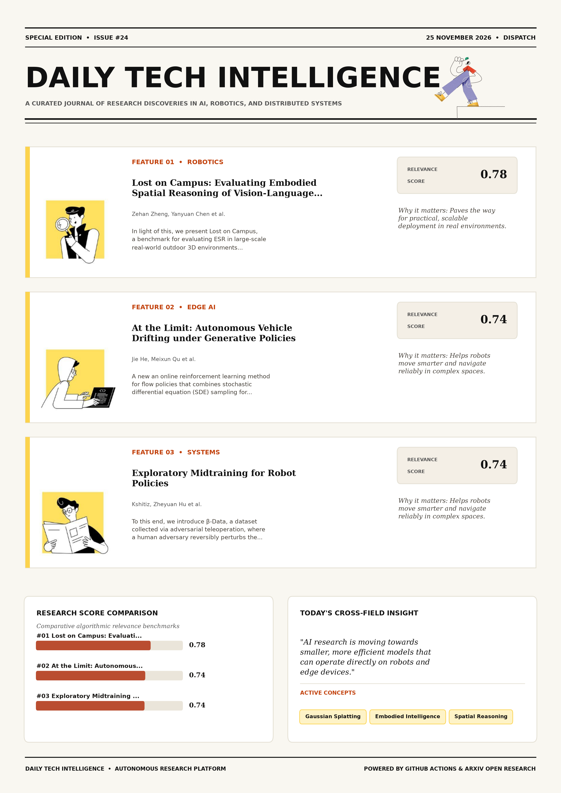

# Daily Tech Intelligence

## 25 November 2026

### Today's Overview

10 research papers analyzed.

Topics:

* Artificial Intelligence
* Computer Vision
* IoT & Edge AI
* Machine Learning
* Natural Language Processing
* Robotics

### Visual Intelligence Templates

* **Template 3: Gen-Z Spotlight Broadside (Primary)**: [View High-Res](infographic_spotlight.png)
* **Template 2: Modern Tech Studio**: [View High-Res](infographic_modern.png)
* **Template 1: Editorial Research Journal**: [View High-Res](infographic_editorial.png)

---

## 1. Lost on Campus: Evaluating Embodied Spatial Reasoning of Vision-Language Models in the Wild

Authors: Zehan Zheng, Yanyuan Chen, Deming Li, Yutao Tang, Jianwen Xie, Alan Yuille, Jieneng Chen, Cheng Peng

Publication: 2026-11-24T18:57:48Z

Category: cs.CV

Relevance Score: 0.78

Paper: [arXiv:2611.33145](https://arxiv.org/abs/2611.33145v1) | [PDF](https://arxiv.org/pdf/2611.33145v1)

### Summary

Existing benchmarks primarily assess spatial reasoning in static images or synthetic indoor environments, where semantic shortcuts often suffice, making it difficult to faithfully evaluate spatial reasoning capabilities in the wild. In light of this, we present Lost on Campus, a benchmark for evaluating ESR in large-scale real-world outdoor 3D environments reconstructed by 3D Gaussian Splatting. These findings highlight that faithful evaluation of ESR demands benchmarks tightly coupling perception, reasoning and action within realistic and continuous environments. Embodied Spatial Reasoning (ESR) is central to deploying Vision-Language Models (VLMs) in real-world embodied tasks, yet remains inadequately evaluated. Our benchmark introduces a unified reasoning-action evaluation framework that seamlessly integrates diagnostic QA for isolated reasoning with closed-loop interactive navigation for active reasoning under multimodal instructions.

### Key Concepts

* Gaussian Splatting
* Embodied Intelligence
* Spatial Reasoning
* Ego-allocentric Localization
* Outdoor Environments
* Real-world Outdoor

### Technical Insights

**Problem**

Existing benchmarks primarily assess spatial reasoning in static images or synthetic indoor environments, where semantic shortcuts often suffice, making it difficult to faithfully evaluate spatial reasoning capabilities in the wild.

**Approach**

In light of this, we present Lost on Campus, a benchmark for evaluating ESR in large-scale real-world outdoor 3D environments reconstructed by 3D Gaussian Splatting.

**Key Innovation**

Formulates an integrated mechanism leveraging Gaussian Splatting, Embodied Intelligence.

**Results**

Not specified in the available abstract.

**Applications**

High-resolution real-time visual perception, automated 3D reconstruction, and embodied vision. Next-generation large language model workflows, retrieval-augmented intelligence, and structured document parsing.

**Limitations**

Not specified in the available abstract.

---

## 2. At the Limit: Autonomous Vehicle Drifting under Generative Policies

Authors: Jie He, Meixun Qu, Cheng Hu, Lei Xie, Ezio Bartocci, Radu Grosu

Publication: 2026-11-24T17:50:47Z

Category: cs.RO

Relevance Score: 0.74

Paper: [arXiv:2611.33040](https://arxiv.org/abs/2611.33040v1) | [PDF](https://arxiv.org/pdf/2611.33040v1)

### Summary

Autonomous drifting requires agile control despite tire-force saturation and highly nonlinear vehicle dynamics. We propose an online reinforcement learning method for flow policies that combines stochastic differential equation (SDE) sampling for exploration with value-based policy optimization. This method supports both training from scratch and fine-tuning a policy pretrained on expert demonstrations. Experiments on circular and eight-shaped drifting in an F1TENTH digital twin platform show that both training strategies can achieve effective real-time drift control, with tighter tracking, higher success rates, and better robustness under noisy conditions. After training, control actions can be generated using either SDEs or ordinary differential equations (ODEs).

### Key Concepts

* Reinforcement Learning
* Actions Generated
* Agile Control
* Autonomous Drifting
* Better Robustness
* Circular Eight-shaped

### Technical Insights

**Problem**

Autonomous drifting requires agile control despite tire-force saturation and highly nonlinear vehicle dynamics.

**Approach**

We propose an online reinforcement learning method for flow policies that combines stochastic differential equation (SDE) sampling for exploration with value-based policy optimization.

**Key Innovation**

Formulates an integrated mechanism leveraging Reinforcement Learning, Actions Generated.

**Results**

Not specified in the available abstract.

**Applications**

Autonomous robotic manipulation, sim-to-real transfer, and agile mobile navigation systems.

**Limitations**

Not specified in the available abstract.

---

## 3. Exploratory Midtraining for Robot Policies

Authors: Kshitiz, Zheyuan Hu, Robyn Wu, Yizhou Li, Yunchu Zhang, Vattanary Tevy, Kavya Tayal, Shawn Yin, Aykut Onol, Kushal Arora, Dhruv Shah, Abhishek Gupta, Zackory Erickson, Aviral Kumar

Publication: 2026-11-24T18:52:34Z

Category: cs.RO, cs.LG

Relevance Score: 0.74

Paper: [arXiv:2611.33130](https://arxiv.org/abs/2611.33130v1) | [PDF](https://arxiv.org/pdf/2611.33130v1)

### Summary

Addressing critical demands in Robotics, this research investigates robot policies predominantly learn from human-collected data emphasizing competent behavior, limiting coverage of the low-level behaviors needed to support autonomous improvement. To this end, we introduce β-Data, a dataset collected via adversarial teleoperation, where a human adversary reversibly perturbs the environment while a human operator continues toward completion without resetting. We also examine how this coverage supports downstream adaptation and online improvement. Our project page and robot videos are available at https://kshitiz-1225.github.io/exploratory-midtraining-robot-policies/. Robot policies predominantly learn from human-collected data emphasizing competent behavior, limiting coverage of the low-level behaviors needed to support autonomous improvement.

### Key Concepts

* Scaling Laws
* Zero-shot
* Manipulation
* Autonomous Improvement
* Low-level Behaviors
* Successful Experience

### Technical Insights

**Problem**

Addresses foundational constraints in Robotics and existing computational workflows.

**Approach**

To this end, we introduce β-Data, a dataset collected via adversarial teleoperation, where a human adversary reversibly perturbs the environment while a human operator continues toward completion without resetting.

**Key Innovation**

Formulates an integrated mechanism leveraging Scaling Laws, Zero-shot.

**Results**

Not specified in the available abstract.

**Applications**

Autonomous robotic manipulation, sim-to-real transfer, and agile mobile navigation systems.

**Limitations**

Not specified in the available abstract.

---

## 4. GRAPE-Bench: When Vision Degrades, Does Video Reasoning Hold?

Authors: Ce Zhang, Junyi He, Tianshi Ming, Jinxi He, Jianshu Zhang, Xiyuan Yang, Jianuo Zhu, Yicheng Tao, Xiyu Luo, Minghao Fu, Jiahui Zhu, Kehan Guo, Yunzhong Xiao, Jingyang Lin, Wei Chow, Lingdong Kong, Katia Sycara, Yaqi Xie

Publication: 2026-11-24T17:35:38Z

Category: cs.CV

Relevance Score: 0.72

Paper: [arXiv:2611.33020](https://arxiv.org/abs/2611.33020v1) | [PDF](https://arxiv.org/pdf/2611.33020v1)

### Summary

Despite strong performance on standard benchmarks, video reasoning models remain vulnerable to visual degradation, raising concerns about their reliability in safety-critical scenarios. To this end, we introduce GRAPE-Bench, which jointly evaluates video reasoning across visual degradation conditions and question difficulty. Together, GRAPE-Bench provides a unified testbed for evaluating, improving, and controlling video reasoning under degraded visual conditions. Existing benchmarks address this concern in part by simulating visual degradation or probing model reasoning with challenging questions, leaving open how well models handle naturally degraded video and whether they can make the simpler judgments that matter for safe driving. It combines a synthetic set spanning twelve corruption types across daily-life and driving videos with real-world footage of driving at night or in rain, snow, or fog.

### Key Concepts

* Video Reasoning
* Challenging Questions
* Overall Accuracy
* Synthetic Real-world Conditions
* Synthetic Set
* Synthetic-data Fine-tuning

### Technical Insights

**Problem**

Despite strong performance on standard benchmarks, video reasoning models remain vulnerable to visual degradation, raising concerns about their reliability in safety-critical scenarios.

**Approach**

To this end, we introduce GRAPE-Bench, which jointly evaluates video reasoning across visual degradation conditions and question difficulty.

**Key Innovation**

Formulates an integrated mechanism leveraging Video Reasoning, Challenging Questions.

**Results**

Not specified in the available abstract.

**Applications**

High-resolution real-time visual perception, automated 3D reconstruction, and embodied vision.

**Limitations**

Through preference steering, we further demonstrate continuous control over a frozen model's trade-off between safety-relevant judgments and challenging reasoning, with little change in overall accuracy.

---

## 5. Can a Frontier LLM Repair a Quantized Network by Tool-Free Weight-Space Programming?

Authors: Steffen Urban

Publication: 2026-11-24T17:43:09Z

Category: cs.LG, cs.AI, cs.CL

Relevance Score: 0.71

Paper: [arXiv:2611.33031](https://arxiv.org/abs/2611.33031v1) | [PDF](https://arxiv.org/pdf/2611.33031v1)

### Summary

Addressing critical demands in Natural Language Processing, this research investigates we give four large language models (llms) of the claude family the complete weights of a 20k-parameter cifar-10 cnn as text and ask them to produce a 4-bit network without tools, data or the ability to run inference. We design four evaluation protocols that differ in the input and task description given to the LLMs and analyze their responses. Code and prompts can be found at https://github.com/urbste/weight-space-programming-ptq We give four large language models (LLMs) of the Claude family the complete weights of a 20k-parameter CIFAR-10 CNN as text and ask them to produce a 4-bit network without tools, data or the ability to run inference.

### Key Concepts

* Quantization
* Accuracy Bit
* Accuracy Design
* Accuracy Dropped
* Accuracy Given
* Adaround Learns

### Technical Insights

**Problem**

Addresses foundational constraints in Natural Language Processing and existing computational workflows.

**Approach**

We design four evaluation protocols that differ in the input and task description given to the LLMs and analyze their responses.

**Key Innovation**

Formulates an integrated mechanism leveraging Quantization, Accuracy Bit.

**Results**

Not specified in the available abstract.

**Applications**

Next-generation large language model workflows, retrieval-augmented intelligence, and structured document parsing.

**Limitations**

Not specified in the available abstract.

---

## 6. CoT-Proxy: Cross-Format Transfer for Distilling Long-Horizon Policies

Authors: Dawid J. Kopiczko, Tijmen Blankevoort, Yuki M. Asano

Publication: 2026-11-24T18:58:53Z

Category: cs.CL

Relevance Score: 0.70

Paper: [arXiv:2611.33148](https://arxiv.org/abs/2611.33148v1) | [PDF](https://arxiv.org/pdf/2611.33148v1)

### Summary

Addressing critical demands in Artificial Intelligence, this research investigates reasoning models become long-horizon agents through reinforcement learning or, more cheaply, through fine-tuning on a stronger teacher's trajectories, which contain the teacher's chain-of-thought as well as its actions. The standard fine-tuning approach imitates both, yet the strongest teachers are closed models whose chain-of-thought is hidden behind an API. We show that the chain-of-thought can be left out altogether and that the long-horizon policy can be distilled from the teacher's actions alone. Distilling GPT-5.6 Luna from its visible outputs and the reasoning summaries its API returns raises Qwen3-4B from 7% to 48% on AppWorld and from 3% to 28% on SWE-bench Verified.

### Key Concepts

* Reinforcement Learning
* Acting Like
* Actions Cot-proxies
* Actions Raises
* Actions Standard
* Actions Student

### Technical Insights

**Problem**

Addresses foundational constraints in Artificial Intelligence and existing computational workflows.

**Approach**

The standard fine-tuning approach imitates both, yet the strongest teachers are closed models whose chain-of-thought is hidden behind an API.

**Key Innovation**

Formulates an integrated mechanism leveraging Reinforcement Learning, Acting Like.

**Results**

Not specified in the available abstract.

**Applications**

Next-generation large language model workflows, retrieval-augmented intelligence, and structured document parsing.

**Limitations**

Not specified in the available abstract.

---

## 7. Hybrid AI for AI-Native RAN Control: A Functional Perspective

Authors: Sabrine Aroua, Osama Arouk, Pegah Alizadeh

Publication: 2026-11-24T17:47:24Z

Category: cs.AI

Relevance Score: 0.70

Paper: [arXiv:2611.33035](https://arxiv.org/abs/2611.33035v1) | [PDF](https://arxiv.org/pdf/2611.33035v1)

### Summary

Addressing critical demands in Artificial Intelligence, this research investigates ai-native radio access network (ran) control involves interdependent decisions across network entities, protocol layers, and timescales. Understanding how AI and conventional methods can jointly support these decisions requires a common basis for comparing their functional roles. This survey introduces a technique-agnostic taxonomy of RAN decision-making organized around four complementary capabilities: Representation and Reasoning, Prediction and Simulation, Adaptive Control, and Decision Synthesis. A curated list of surveyed works and evaluation resources is available at https://github.com/pegahani/Hybrid-AI-RAN-Survey. AI-native radio access network (RAN) control involves interdependent decisions across network entities, protocol layers, and timescales. These capabilities are defined by their roles in the control process, independently of the techniques used to implement them.

### Key Concepts

* Reinforcement Learning
* Ran Control
* Roles Control
* Roles Survey
* Simulation Adaptive
* Simulators Digital

### Technical Insights

**Problem**

Addresses foundational constraints in Artificial Intelligence and existing computational workflows.

**Approach**

Understanding how AI and conventional methods can jointly support these decisions requires a common basis for comparing their functional roles.

**Key Innovation**

Formulates an integrated mechanism leveraging Reinforcement Learning, Ran Control.

**Results**

Not specified in the available abstract.

**Applications**

Autonomous agentic reasoning, multi-agent coordination, and decision-support platforms.

**Limitations**

The review highlights a gap between the availability of resources for closed-loop experimentation and the standardization of tasks, metrics, and evaluation protocols needed for meaningful comparisons.Finally, we identify research directions for hybrid AI in AI-native RAN, including capability integration, multi-agent and cross-timescale coordination, constraint handling, and reproducible closed-loop evaluation.

---

## 8. PointX: Multi-View Consistent Intrinsics by Querying Surface Points

Authors: Miguel Farinha, Sam Sartor, Iliyan Georgiev, Giuseppe Vecchio, Ronald Clark, Michael Fischer

Publication: 2026-11-24T18:59:42Z

Category: cs.CV

Relevance Score: 0.70

Paper: [arXiv:2611.33157](https://arxiv.org/abs/2611.33157v1) | [PDF](https://arxiv.org/pdf/2611.33157v1)

### Summary

Addressing critical demands in Computer Vision, this research investigates the appearance of a scene is determined by the albedo, roughness, metallicity and normal of every point on its surface, and by the light that reaches it, its irradiance. We introduce PointX, a simple feed-forward model that predicts intrinsics per 3D surface point instead. Project page: https://pointx-paper.github.io/ The appearance of a scene is determined by the albedo, roughness, metallicity and normal of every point on its surface, and by the light that reaches it, its irradiance. Recovering these intrinsics from images is ambiguous, and methods that predict them per pixel give the same surface point a different decomposition in every view.

### Key Concepts

* Point Cloud
* Surface Point
* Accuracy Single
* Added Project
* Agree Views
* Albedo Roughness

### Technical Insights

**Problem**

Addresses foundational constraints in Computer Vision and existing computational workflows.

**Approach**

We introduce PointX, a simple feed-forward model that predicts intrinsics per 3D surface point instead.

**Key Innovation**

Formulates an integrated mechanism leveraging Point Cloud, Surface Point.

**Results**

Not specified in the available abstract.

**Applications**

High-resolution real-time visual perception, automated 3D reconstruction, and embodied vision.

**Limitations**

Not specified in the available abstract.

---

## 9. PyRUA-Dex: Learning Programmatic Policies for Dexterous Bimanual Manipulation with Coding Agents

Authors: Feixiang Ruan, Guodong Lv, Kewei Zhang, Wenbo Huang, Yintianrun Zhang, Qiang Wang, Ruiyang Si, Shunyu Yang, Shulong Jiang, Weicheng Duan, Rui Ni, Jianxin Bi, Lekai Wang, Yuze Fan, Haobo Li, Zeliang Fu, Jiankun Zhang, Duomin Wang, Enze Xie, Daquan Zhou

Publication: 2026-11-24T18:56:44Z

Category: cs.RO

Relevance Score: 0.69

Paper: [arXiv:2611.33144](https://arxiv.org/abs/2611.33144v1) | [PDF](https://arxiv.org/pdf/2611.33144v1)

### Summary

Learning for dexterous manipulation is limited by the scarcity of high-quality demonstrations: retargeting from human video is imprecise, teleoperation gives no force feedback to the operator, and exoskeleton-based collection is hard to scale up. We present PyRUA-Dex, a framework that enables coding agents to develop dexterous manipulation through programmatic policy, without the need of demonstrations. In simulated environments, PyRUA-Dex achieves SOTA on Bench2Dex with a score of 72.9 and reaches 81.0% success on DexJoCo under full randomization, ahead of every trained policy on both benchmarks. These results suggest that PyRUA-Dex is an effective framework for developing dexterous manipulation policies with coding agents in the absence of high quality dexterous manipulation demonstrations.

### Key Concepts

* Dexterous Manipulation
* Manipulation
* Agent Condenses
* Bimanual Platform
* Programmatic Policy

### Technical Insights

**Problem**

Learning for dexterous manipulation is limited by the scarcity of high-quality demonstrations: retargeting from human video is imprecise, teleoperation gives no force feedback to the operator, and exoskeleton-based collection is hard to scale up.

**Approach**

We present PyRUA-Dex, a framework that enables coding agents to develop dexterous manipulation through programmatic policy, without the need of demonstrations.

**Key Innovation**

Formulates an integrated mechanism leveraging Dexterous Manipulation, Manipulation.

**Results**

In simulated environments, PyRUA-Dex achieves SOTA on Bench2Dex with a score of 72.9 and reaches 81.0% success on DexJoCo under full randomization, ahead of every trained policy on both benchmarks.

**Applications**

Autonomous robotic manipulation, sim-to-real transfer, and agile mobile navigation systems.

**Limitations**

Not specified in the available abstract.

---

## 10. Blockchain-IoT Convergence for Spatiotemporal Data Systems: Challenges, Solutions, and Research Gaps

Authors: Natalia Chaudhry, Muhammad Murtaza Yousaf

Publication: 2026-11-24T17:35:14Z

Category: cs.DC

Relevance Score: 0.69

Paper: [arXiv:2611.33019](https://arxiv.org/abs/2611.33019v1) | [PDF](https://arxiv.org/pdf/2611.33019v1)

### Summary

Addressing critical demands in IoT & Edge AI, this research investigates blockchain in conjunction with the internet of things (iot) is changing the management of spatiotemporal data in a way that has never been possible before now. In the process of gathering geospatial and time-stamped data from a large network of IoT devices, data authenticity, accuracy, and timely processing are major issues. Spatiotemporal indexing in a blockchain environment is necessary for ensure quick data retrieval; supporting real time data processing requirement. Literature solutions will be reviewed and compared to highlight challenges and insights for future blockchain-integrated IoT in resilient spatiotemporal data ecosystems.

### Key Concepts

* Access Single
* Accuracy Timely
* Aims Blockchain
* Authenticity Accuracy
* Blockchain Conjunction
* Blockchain Decentralized

### Technical Insights

**Problem**

Addresses foundational constraints in IoT & Edge AI and existing computational workflows.

**Approach**

In the process of gathering geospatial and time-stamped data from a large network of IoT devices, data authenticity, accuracy, and timely processing are major issues.

**Key Innovation**

Formulates an integrated mechanism leveraging Access Single, Accuracy Timely.

**Results**

Not specified in the available abstract.

**Applications**

Low-power edge AI devices, embedded IoT sensor networks, and distributed on-device inference.

**Limitations**

Not specified in the available abstract.

---
