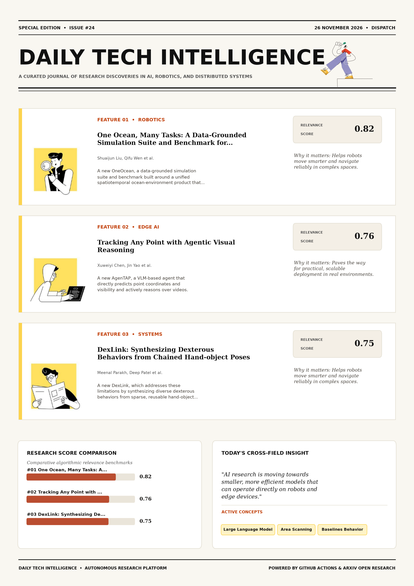

# Daily Tech Intelligence

## 26 November 2026

### Today's Overview

10 research papers analyzed.

Topics:

* Artificial Intelligence
* Machine Learning
* Robotics

### Visual Intelligence Templates

* **Template 3: Gen-Z Spotlight Broadside (Primary)**: [View High-Res](infographic_spotlight.png)
* **Template 2: Modern Tech Studio**: [View High-Res](infographic_modern.png)
* **Template 1: Editorial Research Journal**: [View High-Res](infographic_editorial.png)

---

## 1. One Ocean, Many Tasks: A Data-Grounded Simulation Suite and Benchmark for Marine Robotics

Authors: Shuaijun Liu, Qifu Wen, Xingwei Chen, Xinwen Hu, Feiyang You, Sijia Chen, Ningxin Su

Publication: 2026-11-25T18:58:56Z

Category: cs.RO, cs.DB

Relevance Score: 0.82

Paper: [arXiv:2611.34925](https://arxiv.org/abs/2611.34925v1) | [PDF](https://arxiv.org/pdf/2611.34925v1)

### Summary

Addressing critical demands in Robotics, this research investigates simulation is essential for marine robotics, yet existing platforms often trade off between visually realistic worlds, high-throughput experimentation, and ocean-condition realism grounded in real data. We present OneOcean, a data-grounded simulation suite and benchmark built around a unified spatiotemporal ocean-environment product that harmonizes bathymetry with data-driven currents and tides, with optional pollution fields for cleanup-related evaluation. On top of this environment representation, OneOcean defines a task ladder spanning navigation and station-keeping under currents, waypoint and route following, depth-profile tracking, area scanning, pipeline inspection, and multi-agent coordination, including formation transit, fish protection and patrol (herding), and surface pollution localization, containment, and cleanup. Experiments across dataset variants and scenes systematically stress planning and control under data-grounded disturbances and reveal trade-offs among heuristic baselines, Behavior Cloning (BC), and a Large Language Model (LLM)-based planner.

### Key Concepts

* Large Language Model
* Area Scanning
* Baselines Behavior
* Bathymetry Data-driven
* Behavior Cloning
* Built Unified

### Technical Insights

**Problem**

Addresses foundational constraints in Robotics and existing computational workflows.

**Approach**

We present OneOcean, a data-grounded simulation suite and benchmark built around a unified spatiotemporal ocean-environment product that harmonizes bathymetry with data-driven currents and tides, with optional pollution fields for cleanup-related evaluation.

**Key Innovation**

Formulates an integrated mechanism leveraging Large Language Model, Area Scanning.

**Results**

Not specified in the available abstract.

**Applications**

Autonomous robotic manipulation, sim-to-real transfer, and agile mobile navigation systems.

**Limitations**

Not specified in the available abstract.

---

## 2. Tracking Any Point with Agentic Visual Reasoning

Authors: Xuweiyi Chen, Jin Yao, Linzhan Mou, Lei Gong, Di Liu, Cheng Zhang, Ziqiao Ma, Sihan Xu, Adam W. Harley, Shengyi Qian, Zezhou Cheng

Publication: 2026-11-25T18:59:58Z

Category: cs.CV

Relevance Score: 0.76

Paper: [arXiv:2611.34943](https://arxiv.org/abs/2611.34943v1) | [PDF](https://arxiv.org/pdf/2611.34943v1)

### Summary

However, point correspondence is known to be challenging for VLMs since it goes beyond object-level recognition: it requires pixel-level localization of the same physical surface point across observations, even when appearance changes or the point disappears and later reappears. In this paper, we introduce AgenTAP, a VLM-based agent that directly predicts point coordinates and visibility and actively reasons over videos. With GPT-6 Astra, it surpasses expert vision models in both point localization and visibility prediction, without correspondence-specific fine-tuning. On sampled reappearing points, its predictions approach human agreement, and adding EgoTAP-4D to D4RT training improves average 3D tracking performance. A general-purpose Vision-Language Model (VLM) has surpassed expert vision models in many domains such as object detection and video recognition.

### Key Concepts

* Actively Reasons
* Adding Egotap-
* Agent Autonomously
* Agent Directly
* Agentap Re-identify
* Agentap Vlm-based

### Technical Insights

**Problem**

However, point correspondence is known to be challenging for VLMs since it goes beyond object-level recognition: it requires pixel-level localization of the same physical surface point across observations, even when appearance changes or the point disappears and later reappears.

**Approach**

In this paper, we introduce AgenTAP, a VLM-based agent that directly predicts point coordinates and visibility and actively reasons over videos.

**Key Innovation**

Formulates an integrated mechanism leveraging Actively Reasons, Adding Egotap-.

**Results**

With GPT-6 Astra, it surpasses expert vision models in both point localization and visibility prediction, without correspondence-specific fine-tuning.

**Applications**

High-resolution real-time visual perception, automated 3D reconstruction, and embodied vision.

**Limitations**

Not specified in the available abstract.

---

## 3. DexLink: Synthesizing Dexterous Behaviors from Chained Hand-object Poses

Authors: Meenal Parakh, Deep Patel, Beining Han, Jia Deng

Publication: 2026-11-25T18:59:36Z

Category: cs.RO

Relevance Score: 0.75

Paper: [arXiv:2611.34936](https://arxiv.org/abs/2611.34936v1) | [PDF](https://arxiv.org/pdf/2611.34936v1)

### Summary

Synthesizing diverse dexterous manipulation policies is challenging: existing simulation-based approaches rely on human demonstrations which are difficult to scale, or use generic reward functions, which provide limited control over the hand-object interactions. We propose DexLink, which addresses these limitations by synthesizing diverse dexterous behaviors from sparse, reusable hand-object interaction templates. Given key task waypoints, DexLink retargets static interaction templates to target objects using an optimization that preserves spatial hand-object relationships. Finally, zero-shot deployment of policies trained purely in simulation shows promise for the simulation-based framework. It then links the retargeted poses into an approximate reference trajectory and uses residual reinforcement learning to refine this reference into a closed-loop policy in simulation.

### Key Concepts

* Reinforcement Learning
* Zero-shot Deployment
* Dexterous Manipulation
* Manipulation
* Addresses Limitations
* Approaches Rely

### Technical Insights

**Problem**

Synthesizing diverse dexterous manipulation policies is challenging: existing simulation-based approaches rely on human demonstrations which are difficult to scale, or use generic reward functions, which provide limited control over the hand-object interactions.

**Approach**

We propose DexLink, which addresses these limitations by synthesizing diverse dexterous behaviors from sparse, reusable hand-object interaction templates.

**Key Innovation**

Formulates an integrated mechanism leveraging Reinforcement Learning, Zero-shot Deployment.

**Results**

Not specified in the available abstract.

**Applications**

Autonomous robotic manipulation, sim-to-real transfer, and agile mobile navigation systems.

**Limitations**

We propose DexLink, which addresses these limitations by synthesizing diverse dexterous behaviors from sparse, reusable hand-object interaction templates.

---

## 4. FineDex: Bridging Fine-Grained Human-Object Interaction Generation to Dexterous Humanoid Manipulation

Authors: Yujia Zeng, Yuxin Chen, Yuzhen Song, Runhan Huang, Chensheng Peng, Yiyang Shao, Koushil Sreenath, Masayoshi Tomizuka, Yilun Du

Publication: 2026-11-25T18:40:47Z

Category: cs.RO, cs.CV

Relevance Score: 0.75

Paper: [arXiv:2611.34884](https://arxiv.org/abs/2611.34884v1) | [PDF](https://arxiv.org/pdf/2611.34884v1)

### Summary

Addressing critical demands in Robotics, this research investigates dexterity is, at its core, finger-level control, yet existing dexterous manipulation and human-object interaction (hoi) generation methods rarely let one specify how an interaction is performed: five-fingered hands are often reduced to grippers, or finger usage is copied from individual human demonstrations. We present FineDex, a framework that makes finger-level intent both expressible and executable. Experiments demonstrate state-of-the-art HOI generation quality and fine-grained controllability, substantial improvements in dexterous manipulation success, and successful deployment on a real dexterous humanoid robot. Dexterity is, at its core, finger-level control, yet existing dexterous manipulation and human-object interaction (HOI) generation methods rarely let one specify how an interaction is performed: five-fingered hands are often reduced to grippers, or finger usage is copied from individual human demonstrations.

### Key Concepts

* Dexterous Manipulation
* Manipulation
* Actionable Priors
* Adapting Test
* Agent Discovers
* Articulated Objects

### Technical Insights

**Problem**

Addresses foundational constraints in Robotics and existing computational workflows.

**Approach**

We present FineDex, a framework that makes finger-level intent both expressible and executable.

**Key Innovation**

Formulates an integrated mechanism leveraging Dexterous Manipulation, Manipulation.

**Results**

Experiments demonstrate state-of-the-art HOI generation quality and fine-grained controllability, substantial improvements in dexterous manipulation success, and successful deployment on a real dexterous humanoid robot.

**Applications**

Autonomous robotic manipulation, sim-to-real transfer, and agile mobile navigation systems. High-resolution real-time visual perception, automated 3D reconstruction, and embodied vision.

**Limitations**

Not specified in the available abstract.

---

## 5. MERLoc: Robust Robot Localization in Dynamic Environments with Pose-Based Retrieval over 3D Gaussian Splatting References

Authors: Michael Baumgartner, Dario Mylonopoulos, Sammy Christen, Markus Gross, Moritz Bacher

Publication: 2026-11-25T18:59:23Z

Category: cs.RO

Relevance Score: 0.74

Paper: [arXiv:2611.34932](https://arxiv.org/abs/2611.34932v1) | [PDF](https://arxiv.org/pdf/2611.34932v1)

### Summary

Robots operating in previously mapped spaces must localize accurately despite moving people and rearranged objects. We present MERLoc, which turns a single metric 3D Gaussian Splatting scan into a dense Functional Reference Memory. Across one classical and four learned localizers in simulated and real dynamic scenes, pose-based retrieval matches or outperforms appearance retrieval in most cases, even when the latter is gated by the same prior. The system runs onboard a Jetson Orin NX at 5 Hz, enabling a navigation policy to successfully traverse a hallway with people roaming and rearranging objects. Most localization pipelines match the query against a sparse set of captured reference images retrieved by appearance, which is brittle under scene change and repeating structures.

### Key Concepts

* Gaussian Splatting
* Pose-based Retrieval
* Accurately Despite
* Ambiguities Prior
* Appearance Brittle
* Appearance Retrieval

### Technical Insights

**Problem**

Robots operating in previously mapped spaces must localize accurately despite moving people and rearranged objects.

**Approach**

We present MERLoc, which turns a single metric 3D Gaussian Splatting scan into a dense Functional Reference Memory.

**Key Innovation**

Formulates an integrated mechanism leveraging Gaussian Splatting, Pose-based Retrieval.

**Results**

Across one classical and four learned localizers in simulated and real dynamic scenes, pose-based retrieval matches or outperforms appearance retrieval in most cases, even when the latter is gated by the same prior.

**Applications**

Autonomous robotic manipulation, sim-to-real transfer, and agile mobile navigation systems.

**Limitations**

Not specified in the available abstract.

---

## 6. Agentic LongLive: Asynchronous Agentic Memory for Long Video Generation

Authors: Shaoteng Liu, Shuai Yang, Wei Huang, Luozhou Wang, Song Han, Yukang Chen

Publication: 2026-11-25T18:54:03Z

Category: cs.CV

Relevance Score: 0.72

Paper: [arXiv:2611.34907](https://arxiv.org/abs/2611.34907v1) | [PDF](https://arxiv.org/pdf/2611.34907v1)

### Summary

Addressing critical demands in Artificial Intelligence, this research investigates real-time autoregressive video generators stream minutes of video and accept new prompts on the fly, but struggle to keep people, objects, and places consistent over a long interactive story. We present Agentic LongLive, an asynchronous agentic memory for long video generation. To our knowledge, it is the first real-time video generator with text and image memory kept by an LLM agent. Real-time autoregressive video generators stream minutes of video and accept new prompts on the fly, but struggle to keep people, objects, and places consistent over a long interactive story. Agent systems provide such memory for offline multi-shot generation, yet they read the whole script in advance, plan each shot before generating it, and regenerate failed shots, which a live stream does not allow.

### Key Concepts

* Reinforcement Learning
* Agentic Longlive
* Video Generation
* Real Time
* Time Streams Faster
* Video Accept

### Technical Insights

**Problem**

Addresses foundational constraints in Artificial Intelligence and existing computational workflows.

**Approach**

We present Agentic LongLive, an asynchronous agentic memory for long video generation.

**Key Innovation**

Formulates an integrated mechanism leveraging Reinforcement Learning, Agentic Longlive.

**Results**

Not specified in the available abstract.

**Applications**

High-resolution real-time visual perception, automated 3D reconstruction, and embodied vision.

**Limitations**

Not specified in the available abstract.

---

## 7. Memory Is Not Ground Truth: Revising Navigation Authority under Unreliable VLM Evidence for Persistent Semantic Navigation

Authors: Sumukh Shrote, Shenbagaraj Kannapiran, Eric Eaton, Camillo Jose Taylor

Publication: 2026-11-25T18:57:52Z

Category: cs.RO

Relevance Score: 0.72

Paper: [arXiv:2611.34915](https://arxiv.org/abs/2611.34915v1) | [PDF](https://arxiv.org/pdf/2611.34915v1)

### Summary

Addressing critical demands in Robotics, this research investigates vision-language models (vlms) enable robots to reason about semantic and spatio-temporal context, verify task-relevant objects, and guide sensing and navigation. We introduce a dependence-aware, reversible memory-update mechanism that avoids double-counting correlated misses and stops using unsupported memories as direct navigation goals without claiming that the object is absent. Repeated misses may suggest that a memory is stale. These results support revising memory actionability rather than interpreting failed detection as object absence. Vision-language models (VLMs) enable robots to reason about semantic and spatio-temporal context, verify task-relevant objects, and guide sensing and navigation. Persistent memory can reduce redundant search for field robots, but when should a memory continue to guide behavior?

### Key Concepts

* Absent Later
* Actionability Interpreting
* Ambiguity Persists
* Ambiguous Vlm-based
* Avoids Double-counting
* Behavior Repeated

### Technical Insights

**Problem**

Addresses foundational constraints in Robotics and existing computational workflows.

**Approach**

We introduce a dependence-aware, reversible memory-update mechanism that avoids double-counting correlated misses and stops using unsupported memories as direct navigation goals without claiming that the object is absent.

**Key Innovation**

Formulates an integrated mechanism leveraging Absent Later, Actionability Interpreting.

**Results**

Not specified in the available abstract.

**Applications**

Autonomous robotic manipulation, sim-to-real transfer, and agile mobile navigation systems.

**Limitations**

Not specified in the available abstract.

---

## 8. Solve Vision with Code: Coding Agents Are Stronger Visual Reasoners Than Video Models

Authors: Dezhi Luo, Fengyuan Yu, Haotian Zhang, Zehong Zhao, Ran Ji, Siyuan An, Huayi Qin, Qingying Gao, Zhongang Cai, Lei Yang, Ziqi Huang, Ruisi Wang, Maijunxian Wang, Hokin Deng

Publication: 2026-11-25T18:01:22Z

Category: cs.CV, cs.AI, cs.LG, cs.MM

Relevance Score: 0.70

Paper: [arXiv:2611.34813](https://arxiv.org/abs/2611.34813v1) | [PDF](https://arxiv.org/pdf/2611.34813v1)

### Summary

Addressing critical demands in Artificial Intelligence, this research investigates video generation models are increasingly evaluated as visual reasoners: given a first frame and a natural-language prompt, can the model produce the video in which the specified task is carried out?. The paradigm is considered advantageous because the reasoning is native to the visual medium, unfolding directly in the frames rather than through language or code. Whether this native route is in fact the more reliable path to visual reasoning has not been tested against a symbolic alternative under the same conditions. We further distinguish depictive programs, which navigate the image to recover a transferable scheme, from propositional programs, which operate on hard-coded values, revealing how visual reasoning unfolds in agent-written programs and what it implies for its nature of reasoning in general.

### Key Concepts

* Ground Truth
* Synthesis Currently
* Tested Symbolic
* Transferable Scheme
* Truth Agent
* Truth Metadata

### Technical Insights

**Problem**

Addresses foundational constraints in Artificial Intelligence and existing computational workflows.

**Approach**

The paradigm is considered advantageous because the reasoning is native to the visual medium, unfolding directly in the frames rather than through language or code.

**Key Innovation**

Formulates an integrated mechanism leveraging Ground Truth, Synthesis Currently.

**Results**

Not specified in the available abstract.

**Applications**

High-resolution real-time visual perception, automated 3D reconstruction, and embodied vision.

**Limitations**

Not specified in the available abstract.

---

## 9. Deep Reinforcement Learning for Multi-UAV Data Harvesting Under Variable Team Sizes and Agent Loss

Authors: Thiago de Souza Lamenza, Bruno José Olivieri de Souza, Markus Endler

Publication: 2026-11-25T18:03:00Z

Category: cs.LG, cs.DC

Relevance Score: 0.69

Paper: [arXiv:2611.34818](https://arxiv.org/abs/2611.34818v1) | [PDF](https://arxiv.org/pdf/2611.34818v1)

### Summary

However, training separate policies for different team and sensor populations is costly, and fixed-population policies may be vulnerable to agent failures. In such settings, unmanned aerial vehicles (UAVs) can exploit their mobility to harvest data locally, while coordinated UAV teams can provide efficient and redundant coverage of remote areas. The results show that F-MADDPG learns across the evaluated population sizes, completes missions faster than the baseline on average, benefits from inverse-cardinality team-size sampling compared with uniform sampling, remains effective after permanent agent losses, and gains no consistent benefit from exposure to failures during training. Collecting data from wireless sensors can be challenging when limited communication infrastructure prevents them from offloading their measurements.

### Key Concepts

* Reinforcement Learning
* Accommodates Unexpected
* Aerial Vehicles
* Agent Failures
* Agent Losses
* Agent Terminations

### Technical Insights

**Problem**

However, training separate policies for different team and sensor populations is costly, and fixed-population policies may be vulnerable to agent failures.

**Approach**

In such settings, unmanned aerial vehicles (UAVs) can exploit their mobility to harvest data locally, while coordinated UAV teams can provide efficient and redundant coverage of remote areas.

**Key Innovation**

Formulates an integrated mechanism leveraging Reinforcement Learning, Accommodates Unexpected.

**Results**

The results show that F-MADDPG learns across the evaluated population sizes, completes missions faster than the baseline on average, benefits from inverse-cardinality team-size sampling compared with uniform sampling, remains effective after permanent agent losses, and gains no consistent benefit from exposure to failures during training.

**Applications**

Low-power edge AI devices, embedded IoT sensor networks, and distributed on-device inference.

**Limitations**

Not specified in the available abstract.

---

## 10. LuxAvatar: Real-Time Relightable Head Avatars via Causal Neural Shading of 3D Intrinsic Proxies

Authors: Yipengjing Sun, Chenyang Wang, Boyao Zhou, Jiapeng Zhu, Ka Leong Cheng, Shengping Zhang

Publication: 2026-11-25T18:59:46Z

Category: cs.CV

Relevance Score: 0.67

Paper: [arXiv:2611.34940](https://arxiv.org/abs/2611.34940v1) | [PDF](https://arxiv.org/pdf/2611.34940v1)

### Summary

Addressing critical demands in Machine Learning, this research investigates we present luxavatar, a feed-forward framework for real-time head avatar animation and relighting from a single portrait. We present LuxAvatar, a feed-forward framework for real-time head avatar animation and relighting from a single portrait. This proxy disentangles canonical geometry and reflectance attributes, rapidly rasterizing deformed Gaussians into view- and motion-consistent PBR buffers. Extensive experiments show that our framework enables 3D-controllable, real-time portrait animation and relighting, outperforming state-of-the-art methods in visual fidelity, motion control, and lighting accuracy. To achieve both 3D controllability and complex facial light transport, we factorize avatar synthesis into an animatable 3D intrinsic Gaussian proxy and a causal autoregressive neural shader.

### Key Concepts

* Achieve Real-time
* Animatable Intrinsic
* Animation Relighting
* Attributes Rapidly
* Authentic Facial
* Autoregressive Neural

### Technical Insights

**Problem**

Addresses foundational constraints in Machine Learning and existing computational workflows.

**Approach**

We present LuxAvatar, a feed-forward framework for real-time head avatar animation and relighting from a single portrait.

**Key Innovation**

Formulates an integrated mechanism leveraging Achieve Real-time, Animatable Intrinsic.

**Results**

Not specified in the available abstract.

**Applications**

High-resolution real-time visual perception, automated 3D reconstruction, and embodied vision.

**Limitations**

Not specified in the available abstract.

---
