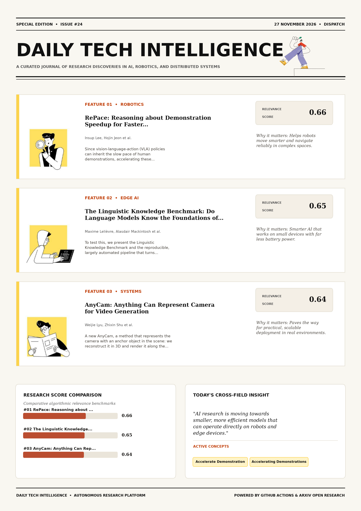

# Daily Tech Intelligence

## 27 November 2026

### Today's Overview

10 research papers analyzed.

Topics:

* Artificial Intelligence
* Computer Vision
* Machine Learning
* Natural Language Processing

### Visual Intelligence Templates

* **Template 3: Gen-Z Spotlight Broadside (Primary)**: [View High-Res](infographic_spotlight.png)
* **Template 2: Modern Tech Studio**: [View High-Res](infographic_modern.png)
* **Template 1: Editorial Research Journal**: [View High-Res](infographic_editorial.png)

---

## 1. RePace: Reasoning about Demonstration Speedup for Faster Vision-Language-Action Policies

Authors: Insup Lee, Hojin Jeon, Sunguk Shin, Seoungbin Bae, Taekwan Kim, Jinwoo Shin, Dongsu Han

Publication: 2026-11-25T18:30:43Z

Category: cs.RO, cs.AI

Relevance Score: 0.66

Paper: [arXiv:2611.34864](https://arxiv.org/abs/2611.34864v1) | [PDF](https://arxiv.org/pdf/2611.34864v1)

### Summary

However, even within a single segment, a speedup factor suitable for steady motion may be too high when precise alignment is required. To this end, this paper presents RePace, an offline reasoning framework that determines how much to accelerate each part of a demonstration. Experimental results demonstrate that RePace outperforms the baselines in overall task execution efficiency on both LIBERO and RoboCasa-Kitchen. On all three tasks with a gripper-equipped Franka Research 3 arm, RePace matches or exceeds the acceleration baselines in success rate and completes successful trials faster. Since vision-language-action (VLA) policies can inherit the slow pace of human demonstrations, accelerating these demonstrations before fine-tuning can lead to faster VLA policies without an additional speed-selection module at deployment.

### Key Concepts

* Accelerate Demonstration
* Accelerating Demonstrations
* Acceleration Baselines
* Additional Speed-selection
* Alignment Required
* Arm Repace

### Technical Insights

**Problem**

However, even within a single segment, a speedup factor suitable for steady motion may be too high when precise alignment is required.

**Approach**

To this end, this paper presents RePace, an offline reasoning framework that determines how much to accelerate each part of a demonstration.

**Key Innovation**

Formulates an integrated mechanism leveraging Accelerate Demonstration, Accelerating Demonstrations.

**Results**

Experimental results demonstrate that RePace outperforms the baselines in overall task execution efficiency on both LIBERO and RoboCasa-Kitchen.

**Applications**

Autonomous robotic manipulation, sim-to-real transfer, and agile mobile navigation systems. High-resolution real-time visual perception, automated 3D reconstruction, and embodied vision. Next-generation large language model workflows, retrieval-augmented intelligence, and structured document parsing.

**Limitations**

Not specified in the available abstract.

---

## 2. The Linguistic Knowledge Benchmark: Do Language Models Know the Foundations of Early-Grade Literacy?

Authors: Maxime Lelièvre, Alasdair Mackintosh, Dominic Andrews, Tobias Murray, Moritz Boos, Oliver G. B. Garrod

Publication: 2026-11-25T18:07:44Z

Category: cs.CL

Relevance Score: 0.65

Paper: [arXiv:2611.34823](https://arxiv.org/abs/2611.34823v1) | [PDF](https://arxiv.org/pdf/2611.34823v1)

### Summary

Addressing critical demands in Natural Language Processing, this research investigates many languages of instruction in low- and middle-income countries (lmics) are poorly represented in the data used to train language models. To test this, we present the Linguistic Knowledge Benchmark and the reproducible, largely automated pipeline that turns curriculum documents, teacher guides and pupil books into a vetted question set organised on a fixed grid of nine linguistic domains and seven grade levels. This is the first rung of a three-level evaluation ladder for measuring and generating decodable text to support foundational literacy. Many languages of instruction in low- and middle-income countries (LMICs) are poorly represented in the data used to train language models.

### Key Concepts

* Linguistic Knowledge
* Billion Parameters
* Books Vetted
* English Kiswahili
* Teacher Guides Pupil
* Teaching Relies

### Technical Insights

**Problem**

Addresses foundational constraints in Natural Language Processing and existing computational workflows.

**Approach**

To test this, we present the Linguistic Knowledge Benchmark and the reproducible, largely automated pipeline that turns curriculum documents, teacher guides and pupil books into a vetted question set organised on a fixed grid of nine linguistic domains and seven grade levels.

**Key Innovation**

Formulates an integrated mechanism leveraging Linguistic Knowledge, Billion Parameters.

**Results**

Not specified in the available abstract.

**Applications**

Low-power edge AI devices, embedded IoT sensor networks, and distributed on-device inference. Next-generation large language model workflows, retrieval-augmented intelligence, and structured document parsing.

**Limitations**

Not specified in the available abstract.

---

## 3. AnyCam: Anything Can Represent Camera for Video Generation

Authors: Weijie Lyu, Zhixin Shu, Yuntian Ke, Ming-Hsuan Yang

Publication: 2026-11-25T18:59:59Z

Category: cs.CV

Relevance Score: 0.64

Paper: [arXiv:2611.34944](https://arxiv.org/abs/2611.34944v1) | [PDF](https://arxiv.org/pdf/2611.34944v1)

### Summary

Camera-controlled video generation re-renders a video along a target camera trajectory, yet moving the camera around an object, the most natural way to change the viewpoint of an object-centric scene, remains difficult. We present AnyCam, a method that represents the camera with an anchor object in the scene: we reconstruct it in 3D and render it along the target trajectory, a camera signal that is scale-aware, view-complete and easy to specify relative to the object. Experiments on diverse datasets and trajectories show that AnyCam performs favorably against camera-controlled video generation and 3D reconstruction methods in camera control and visual quality.

### Key Concepts

* Diffusion Model
* Video Generation
* Aligns Source
* Anchor Object
* Anchor Renderings
* Anycam Performs

### Technical Insights

**Problem**

Camera-controlled video generation re-renders a video along a target camera trajectory, yet moving the camera around an object, the most natural way to change the viewpoint of an object-centric scene, remains difficult.

**Approach**

We present AnyCam, a method that represents the camera with an anchor object in the scene: we reconstruct it in 3D and render it along the target trajectory, a camera signal that is scale-aware, view-complete and easy to specify relative to the object.

**Key Innovation**

Formulates an integrated mechanism leveraging Diffusion Model, Video Generation.

**Results**

Not specified in the available abstract.

**Applications**

High-resolution real-time visual perception, automated 3D reconstruction, and embodied vision.

**Limitations**

Not specified in the available abstract.

---

## 4. Can image generation help visual reasoning? An empirical study

Authors: Xueyang Yu, Yifan Jing, Taiming Lu, Linrong Cai, Zhipeng Cai, Yunyang Xiong, Gabriel Sarch, Zhuang Liu

Publication: 2026-11-25T18:59:31Z

Category: cs.LG, cs.CL, cs.CV

Relevance Score: 0.64

Paper: [arXiv:2611.34935](https://arxiv.org/abs/2611.34935v1) | [PDF](https://arxiv.org/pdf/2611.34935v1)

### Summary

Addressing critical demands in Artificial Intelligence, this research investigates language models think in words; then multimodal models might think in images. We test whether a generated helper improves the answer to a visual question. A model describes the helper it needs and then answers using the original and generated images together. ChartQAPro and MathVista stay below their no-generation baselines, while ERQA gains three points after ten edits. Language models think in words; then multimodal models might think in images. Across 13 vision-language model and generator pairs, generation lowers mean accuracy by 3.7 percentage points, with declines on nine of ten tasks.

### Key Concepts

* Accuracy Percentage
* Accuracy Points
* Adding Generated
* Answer Visual
* Bagel Janus-pro-
* Baselines Erqa

### Technical Insights

**Problem**

Addresses foundational constraints in Artificial Intelligence and existing computational workflows.

**Approach**

We test whether a generated helper improves the answer to a visual question.

**Key Innovation**

Formulates an integrated mechanism leveraging Accuracy Percentage, Accuracy Points.

**Results**

Not specified in the available abstract.

**Applications**

High-resolution real-time visual perception, automated 3D reconstruction, and embodied vision. Next-generation large language model workflows, retrieval-augmented intelligence, and structured document parsing.

**Limitations**

Not specified in the available abstract.

---

## 5. Attack Policy Selection can Mislead Monitor Evaluators

Authors: Charlie Griffin, Oliver Makins, Asa Cooper Stickland, Alessandro Abate, Yarin Gal, Abby D'Cruz, Xander Davies

Publication: 2026-11-25T18:59:28Z

Category: cs.LG, cs.AI

Relevance Score: 0.64

Paper: [arXiv:2611.34934](https://arxiv.org/abs/2611.34934v1) | [PDF](https://arxiv.org/pdf/2611.34934v1)

### Summary

The sensitivity to attack-policy choice raises a problem: interpreting any particular result as evidence about deployment performance requires justification. We evaluate an ex-production OpenAI monitor as a case study and find that measured false negative rate is highly sensitive to both the method used to generate attack policies and the level of optimisation applied within that method. Every attack policy was developed against proxy monitors only: all reported results show attacks transferring to the held-out GPT-5.4 target monitor. Making convincing arguments remains an open problem. AI monitors, classifiers that flag dangerous behaviour by AI agents, are often evaluated against transcripts generated by attack policies acting as proxies for dangerous behaviour in deployment.

### Key Concepts

* Reinforcement Learning
* Artefacts Reasoning
* Attack Policies
* Dangerous Behaviour
* Evidence Deployment
* Proxies Dangerous

### Technical Insights

**Problem**

The sensitivity to attack-policy choice raises a problem: interpreting any particular result as evidence about deployment performance requires justification.

**Approach**

We evaluate an ex-production OpenAI monitor as a case study and find that measured false negative rate is highly sensitive to both the method used to generate attack policies and the level of optimisation applied within that method.

**Key Innovation**

Formulates an integrated mechanism leveraging Reinforcement Learning, Artefacts Reasoning.

**Results**

Every attack policy was developed against proxy monitors only: all reported results show attacks transferring to the held-out GPT-5.4 target monitor.

**Applications**

Autonomous agentic reasoning, multi-agent coordination, and decision-support platforms.

**Limitations**

Not specified in the available abstract.

---

## 6. Cairn: Object-Centric 3D Trajectory Priors for Steering Frozen VLAs

Authors: Agelos Kratimenos, Kostas Daniilidis, Evangelos Chatzipantazis

Publication: 2026-11-25T18:57:29Z

Category: cs.RO, cs.CV

Relevance Score: 0.64

Paper: [arXiv:2611.34914](https://arxiv.org/abs/2611.34914v1) | [PDF](https://arxiv.org/pdf/2611.34914v1)

### Summary

Addressing critical demands in Machine Learning, this research investigates vision-language-action models (vlas) are capable low-level controllers, but they tie where objects go to the layouts they were trained on: when objects are moved or obstacles block the way, they carry them to the wrong place or into collisions. We introduce Cairn, which keeps the VLA frozen and steers it at test time along learned 3D trajectories of the object in its gripper. All code, models and data will be made public. Vision-language-action models (VLAs) are capable low-level controllers, but they tie where objects go to the layouts they were trained on: when objects are moved or obstacles block the way, they carry them to the wrong place or into collisions.

### Key Concepts

* Cairn Keeps Vla
* Cairn Raises
* Capable Low-level
* Carry Wrong
* Held Object
* Raises Success

### Technical Insights

**Problem**

Addresses foundational constraints in Machine Learning and existing computational workflows.

**Approach**

We introduce Cairn, which keeps the VLA frozen and steers it at test time along learned 3D trajectories of the object in its gripper.

**Key Innovation**

Formulates an integrated mechanism leveraging Cairn Keeps Vla, Cairn Raises.

**Results**

Not specified in the available abstract.

**Applications**

Autonomous robotic manipulation, sim-to-real transfer, and agile mobile navigation systems. High-resolution real-time visual perception, automated 3D reconstruction, and embodied vision.

**Limitations**

Not specified in the available abstract.

---

## 7. Stranger Things: When Objects Appear Without Their Typical Neighbors

Authors: Siddhartha Gairola, Jiahao Xie, Anna Kukleva, Francesco Locatello, Bernt Schiele

Publication: 2026-11-25T18:39:28Z

Category: cs.CV, cs.LG

Relevance Score: 0.64

Paper: [arXiv:2611.34881](https://arxiv.org/abs/2611.34881v1) | [PDF](https://arxiv.org/pdf/2611.34881v1)

### Summary

Addressing critical demands in Machine Learning, this research investigates visual context is a powerful cue for object recognition: scenes inform what, where, and at what scale objects are likely to appear. We propose Anchor-Atypicality Sampling (AAS), a simple sampling rule for paste-based augmentations that uses the NPMI signal to tilt the training-time co-occurrence distribution toward atypical partners. AAS reduces the typicality gap by up to 1.6 p.p. on synthetic STRANGE-Bench across three model families, without sacrificing overall performance. Visual context is a powerful cue for object recognition: scenes inform what, where, and at what scale objects are likely to appear.

### Key Concepts

* Typical Neighbors
* Appear Outside Typical
* Appear Over-reliance
* Assumed Architectural
* Object Pairs
* Typical Company

### Technical Insights

**Problem**

Addresses foundational constraints in Machine Learning and existing computational workflows.

**Approach**

We propose Anchor-Atypicality Sampling (AAS), a simple sampling rule for paste-based augmentations that uses the NPMI signal to tilt the training-time co-occurrence distribution toward atypical partners.

**Key Innovation**

Formulates an integrated mechanism leveraging Typical Neighbors, Appear Outside Typical.

**Results**

AAS reduces the typicality gap by up to 1.6 p.p.

**Applications**

High-resolution real-time visual perception, automated 3D reconstruction, and embodied vision.

**Limitations**

Not specified in the available abstract.

---

## 8. Towards Closing the Performance Gap in Cross-Modal Place Recognition

Authors: Ofer Idan, Dan Badur, Yoli Shavit

Publication: 2026-11-25T18:38:09Z

Category: cs.CV

Relevance Score: 0.64

Paper: [arXiv:2611.34877](https://arxiv.org/abs/2611.34877v1) | [PDF](https://arxiv.org/pdf/2611.34877v1)

### Summary

Despite its potential for language-guided navigation, existing vision-language models lag far behind visual place recognition (VPR) baselines, even after task adaptation. To address this challenge, we propose CrossPlace, a two-stage CMPR framework. Unlike general-purpose text-to-image retrieval, place recognition relies on subtle local cues to distinguish visually similar locations. Code and benchmarks are available at https://github.com/oferidan1/CrossPlace Cross-modal place recognition (CMPR) matches natural language descriptions against databases of geo-tagged reference images, enabling localization without visual queries. We therefore hypothesize that a primary bottleneck in CMPR is capturing fine-grained correspondences between image regions and text details, which requires higher visual token granularity, strong text representation capacity, and local cross-modal matching.

### Key Concepts

* Place Recognition
* Aligned Visual Backbone
* Available Https
* Backbone Progressively
* Text Encoder
* Visual Place

### Technical Insights

**Problem**

Despite its potential for language-guided navigation, existing vision-language models lag far behind visual place recognition (VPR) baselines, even after task adaptation.

**Approach**

To address this challenge, we propose CrossPlace, a two-stage CMPR framework.

**Key Innovation**

Formulates an integrated mechanism leveraging Place Recognition, Aligned Visual Backbone.

**Results**

Not specified in the available abstract.

**Applications**

High-resolution real-time visual perception, automated 3D reconstruction, and embodied vision.

**Limitations**

Not specified in the available abstract.

---

## 9. Not all world models can doubt: how training objective and architecture shape epistemic uncertainty in JEPA and RSSM world models

Authors: Simon Baur, Wojciech Samek, Jackie Ma

Publication: 2026-11-25T18:11:49Z

Category: cs.LG, cs.AI

Relevance Score: 0.61

Paper: [arXiv:2611.34830](https://arxiv.org/abs/2611.34830v1) | [PDF](https://arxiv.org/pdf/2611.34830v1)

### Summary

Addressing critical demands in Artificial Intelligence, this research investigates world models predict how an environment responds to actions, so that candidate actions can be evaluated before execution. More precisely, we present a controlled comparison of post-hoc EU (last-layer Laplace and ensembles) between two dominant models of different paradigms: 1) LeWorldModel (LeWM): A joint-embedding predictive architecture (JEPA), which predicts the next embedding without a decoder, and 2) DreamerV3: A recurrent state-space model (RSSM), which reconstructs the observation from a recurrent latent state. Epistemic uncertainty (EU) is the signal that marks where that experience ends. We further show that this translates to gaps in five uncertainty related downstream tasks, from unfamiliar-state detection to uncertainty-penalised planning: the RSSM uncertainty misses deviations that its own posterior registers, whereas the JEPA uncertainty reports what its model sees.

### Key Concepts

* Epistemic Uncertainty
* Averages Context
* Candidate Actions
* Capabilities Predictions
* State Perturbation
* Translates Gaps Uncertainty

### Technical Insights

**Problem**

Addresses foundational constraints in Artificial Intelligence and existing computational workflows.

**Approach**

More precisely, we present a controlled comparison of post-hoc EU (last-layer Laplace and ensembles) between two dominant models of different paradigms: 1) LeWorldModel (LeWM): A joint-embedding predictive architecture (JEPA), which predicts the next embedding without a decoder, and 2) DreamerV3: A recurrent state-space model (RSSM), which reconstructs the observation from a recurrent latent state.

**Key Innovation**

Formulates an integrated mechanism leveraging Epistemic Uncertainty, Averages Context.

**Results**

Not specified in the available abstract.

**Applications**

Autonomous agentic reasoning, multi-agent coordination, and decision-support platforms.

**Limitations**

Not specified in the available abstract.

---

## 10. Focus Only on What's Important: Training-Free Focus Maps for Frozen Vision Transformers in Long-Video Object Segmentation

Authors: Harsha Karipineni, Rajesh Reddy Chintha

Publication: 2026-11-25T18:30:28Z

Category: cs.CV, cs.LG

Relevance Score: 0.61

Paper: [arXiv:2611.34863](https://arxiv.org/abs/2611.34863v1) | [PDF](https://arxiv.org/pdf/2611.34863v1)

### Summary

Vision transformers are strong but costly image encoders for video object segmentation. Training-free token merging cuts compute uniformly across the frame, including on tracked objects. We give a frozen DINOv3 ViT inside a trained Cutie head a training-free focus map: full resolution where the segmenter expects its objects and coarser merging elsewhere. Code: https://github.com/boletoms/focused-cv Protecting only the previous frame's mask works on short clips but fails on long videos, where fast motion pushes targets outside the margin and into background merging, locking in loss. Our policy instead takes the union of velocity-shifted and block-matched masks, runs a camera-compensated surprise check, delegates uncertain regions to the compared merger, and falls back to it when all objects are lost.

### Key Concepts

* Vision Transformers
* Beats Algm
* Block-matched Masks
* Counted Encoder
* Encoder Compute
* Long Videos

### Technical Insights

**Problem**

Vision transformers are strong but costly image encoders for video object segmentation.

**Approach**

Training-free token merging cuts compute uniformly across the frame, including on tracked objects.

**Key Innovation**

Formulates an integrated mechanism leveraging Vision Transformers, Beats Algm.

**Results**

Not specified in the available abstract.

**Applications**

High-resolution real-time visual perception, automated 3D reconstruction, and embodied vision.

**Limitations**

Not specified in the available abstract.

---
