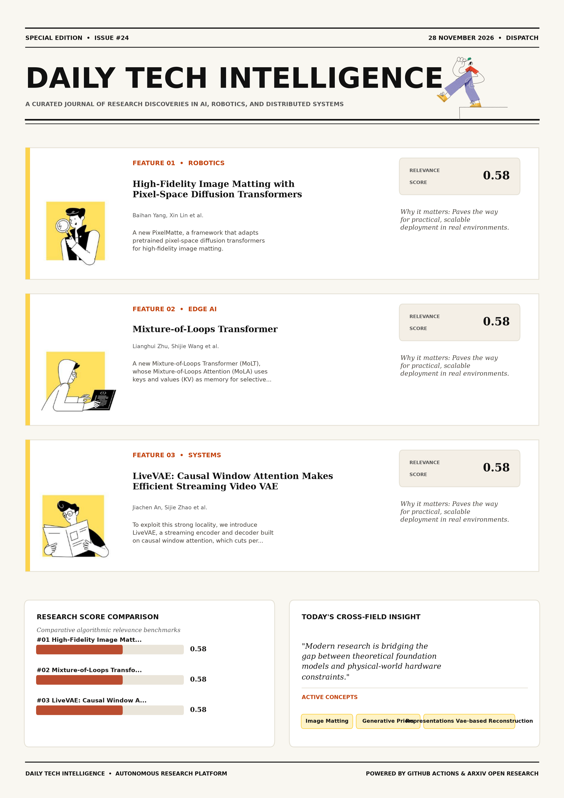

# Daily Tech Intelligence

## 28 November 2026

### Today's Overview

10 research papers analyzed.

Topics:

* Artificial Intelligence
* Machine Learning
* Natural Language Processing
* Robotics

### Visual Intelligence Templates

* **Template 3: Gen-Z Spotlight Broadside (Primary)**: [View High-Res](infographic_spotlight.png)
* **Template 2: Modern Tech Studio**: [View High-Res](infographic_modern.png)
* **Template 1: Editorial Research Journal**: [View High-Res](infographic_editorial.png)

---

## 1. High-Fidelity Image Matting with Pixel-Space Diffusion Transformers

Authors: Baihan Yang, Xin Lin, Yufan Wei, Baiang Li, Yuheng Liu, Juanxi Tian, Xiaohui Xie, Truong Nguyen

Publication: 2026-11-25T18:59:12Z

Category: cs.CV

Relevance Score: 0.58

Paper: [arXiv:2611.34929](https://arxiv.org/abs/2611.34929v1) | [PDF](https://arxiv.org/pdf/2611.34929v1)

### Summary

However, existing approaches largely rely on latent diffusion models, whose compressed representations and VAE-based reconstruction introduce a mismatch with the high-frequency precision required for matting. We present PixelMatte, a framework that adapts pretrained pixel-space diffusion transformers for high-fidelity image matting. Project page: https://white-yc.github.io/pixelmatte/. Diffusion models have shown strong potential for image matting by transferring generative priors learned from large-scale pretraining. We show that strong image-conditioned matting capabilities can be acquired even from a pure text-to-image model without paired image-to-image pretraining. Our approach reuses the backbone's native patch embedding to jointly process the input image, trimap, and noisy alpha matte as spatially aligned tokens, enabling direct pixel-space prediction without additional condition encoders or adapters.

### Key Concepts

* Image Matting
* Generative Priors
* Representations Vae-based Reconstruction
* Required Matting
* Reuses Backbone
* Sad Gradient Errors

### Technical Insights

**Problem**

However, existing approaches largely rely on latent diffusion models, whose compressed representations and VAE-based reconstruction introduce a mismatch with the high-frequency precision required for matting.

**Approach**

We present PixelMatte, a framework that adapts pretrained pixel-space diffusion transformers for high-fidelity image matting.

**Key Innovation**

Formulates an integrated mechanism leveraging Image Matting, Generative Priors.

**Results**

Not specified in the available abstract.

**Applications**

High-resolution real-time visual perception, automated 3D reconstruction, and embodied vision.

**Limitations**

Not specified in the available abstract.

---

## 2. Mixture-of-Loops Transformer

Authors: Lianghui Zhu, Shijie Wang, Xinggang Wang, Jinze Bai, Bo Wang, Xiang Bai

Publication: 2026-11-25T18:58:53Z

Category: cs.LG, cs.CL

Relevance Score: 0.58

Paper: [arXiv:2611.34923](https://arxiv.org/abs/2611.34923v1) | [PDF](https://arxiv.org/pdf/2611.34923v1)

### Summary

Addressing critical demands in Machine Learning, this research investigates looped transformers boost expressivity by reusing shared layers across loops, yet at the cost of efficiency. We introduce Mixture-of-Loops Transformer (MoLT), whose Mixture-of-Loops Attention (MoLA) uses keys and values (KV) as memory for selective reuse across depths and loops. In 400B-token pretraining, U-MoLT outperforms OLMo3 across 700M/1.5B dense and 3B MoE models, achieving 1.7x validation cross-entropy (CE) token efficiency at 700M while improving 3B MoE 10-domain perplexity by 0.75 and 10-task accuracy by 2.1 percentage points. Code is available at https://github.com/hustvl/MoLT Looped Transformers boost expressivity by reusing shared layers across loops, yet at the cost of efficiency.

### Key Concepts

* Rethinking Core Mechanism
* Same-position Cross-loop Dependence
* Selective Reuse
* Separates Memory
* Shared Layers
* Single-traversal Mixture-of-loops

### Technical Insights

**Problem**

Addresses foundational constraints in Machine Learning and existing computational workflows.

**Approach**

We introduce Mixture-of-Loops Transformer (MoLT), whose Mixture-of-Loops Attention (MoLA) uses keys and values (KV) as memory for selective reuse across depths and loops.

**Key Innovation**

Formulates an integrated mechanism leveraging Rethinking Core Mechanism, Same-position Cross-loop Dependence.

**Results**

In 400B-token pretraining, U-MoLT outperforms OLMo3 across 700M/1.5B dense and 3B MoE models, achieving 1.7x validation cross-entropy (CE) token efficiency at 700M while improving 3B MoE 10-domain perplexity by 0.75 and 10-task accuracy by 2.1 percentage points.

**Applications**

Next-generation large language model workflows, retrieval-augmented intelligence, and structured document parsing.

**Limitations**

Not specified in the available abstract.

---

## 3. LiveVAE: Causal Window Attention Makes Efficient Streaming Video VAE

Authors: Jiachen An, Sijie Zhao, Le Li, Hongyu Liu, Zhiyuan Li, Tianyu Yang, Xiaoyu Kong, Xunliang Cai, Yong Zhang, Chi-Man Pun, Xiaoming Wei, Xiaodong Cun

Publication: 2026-11-25T18:57:14Z

Category: cs.CV

Relevance Score: 0.58

Paper: [arXiv:2611.34912](https://arxiv.org/abs/2611.34912v1) | [PDF](https://arxiv.org/pdf/2611.34912v1)

### Summary

While video diffusion models have grown faster and increasingly streamable, the video VAE remains a primary latency bottleneck across interactive generation and editing pipelines. To exploit this strong locality, we introduce LiveVAE, a streaming encoder and decoder built on causal window attention, which cuts per frame compute while keeping the temporal KV cache bounded for streaming. This raises a natural question: Do video VAE encoding and decoding actually require such global spatiotemporal modeling? Code and models will be released. Existing VAEs and their acceleration methods rely mainly on heavy convolutions or full frame attention, and most focus only on decoding, leaving encoding costly for streaming conditional generation and editing.

### Key Concepts

* Causal Window
* Video Vae
* Acceleration Methods
* Achieves Faster
* Actually Require
* Attention Cuts

### Technical Insights

**Problem**

While video diffusion models have grown faster and increasingly streamable, the video VAE remains a primary latency bottleneck across interactive generation and editing pipelines.

**Approach**

To exploit this strong locality, we introduce LiveVAE, a streaming encoder and decoder built on causal window attention, which cuts per frame compute while keeping the temporal KV cache bounded for streaming.

**Key Innovation**

Formulates an integrated mechanism leveraging Causal Window, Video Vae.

**Results**

Not specified in the available abstract.

**Applications**

High-resolution real-time visual perception, automated 3D reconstruction, and embodied vision.

**Limitations**

Not specified in the available abstract.

---

## 4. From Prediction to Decision: Decision-Focused Fine-Tuning of Autoregressive Tabular Transformers for Cost-Sensitive Financial Events

Authors: Ashkan Golgoon, Giacomo Domeniconi, Samuel Atkins, Sergio Servantez, Zain Khandwala

Publication: 2026-11-25T18:27:48Z

Category: cs.LG, cs.AI

Relevance Score: 0.58

Paper: [arXiv:2611.34858](https://arxiv.org/abs/2611.34858v1) | [PDF](https://arxiv.org/pdf/2611.34858v1)

### Summary

Addressing critical demands in Machine Learning, this research investigates autoregressive transformers trained on tokenized tabular event streams are a simple and strong baseline for predicting financial events such as fraud. Yet institutions do not act on probabilities; they act on decisions whose consequences are asymmetric and heteroscedastic: the cost of a missed high-value fraud and that of a wrongly declined small purchase are not the same. The standard bridge is post-hoc Bayes-optimal thresholding of calibrated probabilities under a cost matrix. A sampled, group-normalized (GRPO-style) variant provides the extension point to trajectory-level rewards. Autoregressive transformers trained on tokenized tabular event streams are a simple and strong baseline for predicting financial events such as fraud.

### Key Concepts

* Act Decisions
* Act Probabilities
* Action Outcome
* Actions Maximizes
* Advantage Estimation
* Amount-scaled Cost

### Technical Insights

**Problem**

Addresses foundational constraints in Machine Learning and existing computational workflows.

**Approach**

Yet institutions do not act on probabilities; they act on decisions whose consequences are asymmetric and heteroscedastic: the cost of a missed high-value fraud and that of a wrongly declined small purchase are not the same.

**Key Innovation**

Formulates an integrated mechanism leveraging Act Decisions, Act Probabilities.

**Results**

Not specified in the available abstract.

**Applications**

Autonomous agentic reasoning, multi-agent coordination, and decision-support platforms.

**Limitations**

Not specified in the available abstract.

---

## 5. Repairing the Trustworthiness of Distilled Language Models

Authors: Kumar Shubham, Devendra Vyas, Vidushi Agarwal, Jayin Khanna, Prathosh AP

Publication: 2026-11-25T18:12:20Z

Category: cs.CL, cs.AI

Relevance Score: 0.58

Paper: [arXiv:2611.34831](https://arxiv.org/abs/2611.34831v1) | [PDF](https://arxiv.org/pdf/2611.34831v1)

### Summary

Addressing critical demands in Machine Learning, this research investigates knowledge distillation enables the deployment of large language models through smaller student models, but the compression process can introduce regressions in trustworthiness even when downstream performance is preserved. We propose a targeted repair framework based on the proximal Bregman response function (PBRF) that addresses both limitations. Our results show that the proposed approach improves targeted trustworthiness behaviors for both pre-training and post-training models while largely preserving downstream performance, providing a practical alternative to re-distillation or unconstrained preference optimization. Our experiment results show that across different distilled models, the trustworthy regression can be improved by up to 8% with less than 1% decrement in perplexity.

### Key Concepts

* Knowledge Distillation
* Addresses Limitations
* Alter Capabilities
* Alternative Re-distillation
* Behaviors Pre-training
* Bregman Response

### Technical Insights

**Problem**

Addresses foundational constraints in Machine Learning and existing computational workflows.

**Approach**

We propose a targeted repair framework based on the proximal Bregman response function (PBRF) that addresses both limitations.

**Key Innovation**

Formulates an integrated mechanism leveraging Knowledge Distillation, Addresses Limitations.

**Results**

Our results show that the proposed approach improves targeted trustworthiness behaviors for both pre-training and post-training models while largely preserving downstream performance, providing a practical alternative to re-distillation or unconstrained preference optimization.

**Applications**

Next-generation large language model workflows, retrieval-augmented intelligence, and structured document parsing.

**Limitations**

We propose a targeted repair framework based on the proximal Bregman response function (PBRF) that addresses both limitations.

---

## 6. Provably Efficient Offline Discounted Reinforcement Learning under Recursive Entropic Risk

Authors: Amirparsa Bahrami, Oliver Mortensen, Mohammad Sadegh Talebi

Publication: 2026-11-25T18:18:53Z

Category: cs.LG, eess.SY, stat.ML

Relevance Score: 0.58

Paper: [arXiv:2611.34840](https://arxiv.org/abs/2611.34840v1) | [PDF](https://arxiv.org/pdf/2611.34840v1)

### Summary

Addressing critical demands in Machine Learning, this research investigates we study risk-sensitive reinforcement learning in finite discounted infinite-horizon markov decision processes with recursive entropic risk measures (erm), parameterized by β\neq 0. We introduce a model-based algorithm, called ERM Value Iteration Lower Confidence Bound (ERM-VI-LCB) and derive a PAC-type bound on its sample complexity. We consider the offline RL setting, where the agent is provided with a fixed dataset and wishes to learn a near-optimal policy using this dataset. The presented bounds provide the first rigorous sample complexity guarantees for offline RL under recursive ERM across both risk-averse and risk-seeking regimes.

### Key Concepts

* Reinforcement Learning
* Agent Provided
* Algorithm Called
* Asserted Upper
* Bound Demonstrating
* Bound Erm-vi-lcb

### Technical Insights

**Problem**

Addresses foundational constraints in Machine Learning and existing computational workflows.

**Approach**

We introduce a model-based algorithm, called ERM Value Iteration Lower Confidence Bound (ERM-VI-LCB) and derive a PAC-type bound on its sample complexity.

**Key Innovation**

Formulates an integrated mechanism leveraging Reinforcement Learning, Agent Provided.

**Results**

Not specified in the available abstract.

**Applications**

Autonomous agentic reasoning, multi-agent coordination, and decision-support platforms.

**Limitations**

Not specified in the available abstract.

---

## 7. Routeability Before Routing: Routeability Audit Protocol (RAP) and RouteabilityBench for Audited LLM Model Selection

Authors: Yihang Lu, Denica Kjorvezir, Ana Gjorgjevikj, Carola Doerr, Tome Eftimov

Publication: 2026-11-25T18:08:01Z

Category: cs.LG

Relevance Score: 0.58

Paper: [arXiv:2611.34825](https://arxiv.org/abs/2611.34825v1) | [PDF](https://arxiv.org/pdf/2611.34825v1)

### Summary

On coarse-scored LLM benchmarks, however, many models often tie for the best score, and the single best model may already leave little room for improvement. This only makes sense when the benchmark contains enough prompt-specific variation for different models to be best on different inputs. Our practical recommendation is that routing gains should be reported together with routeability diagnostics, tied-best analysis, portfolio construction details, and family-corrected statistical tests. LLM routing aims to choose, for each prompt, which model in a portfolio is most likely to answer correctly. We therefore propose a routeability-first audit, instantiated as RAP and RouteabilityBench, a runnable claim-verification package.

### Key Concepts

* Abstention Clustering
* Aims Choose
* Answer Correctly
* Audit Instantiated
* Audit Retrospective
* Benchmark-portfolio Score Matrix

### Technical Insights

**Problem**

On coarse-scored LLM benchmarks, however, many models often tie for the best score, and the single best model may already leave little room for improvement.

**Approach**

This only makes sense when the benchmark contains enough prompt-specific variation for different models to be best on different inputs.

**Key Innovation**

Formulates an integrated mechanism leveraging Abstention Clustering, Aims Choose.

**Results**

Not specified in the available abstract.

**Applications**

Next-generation large language model workflows, retrieval-augmented intelligence, and structured document parsing.

**Limitations**

Not specified in the available abstract.

---

## 8. What a Drop Reveals: Sim-to-Real Material Estimation for Deformable Objects from Video

Authors: Ziyue Peng, Yanxi Hu, Junyoung Kim, Andrew Chen, Jin Yang, Chandrajit L. Bajaj, Etienne Vouga, William T. Freeman, Qixing Huang, Brandon Y. Feng

Publication: 2026-11-25T18:47:56Z

Category: cs.CV, cs.GR, cs.LG

Relevance Score: 0.56

Paper: [arXiv:2611.34894](https://arxiv.org/abs/2611.34894v1) | [PDF](https://arxiv.org/pdf/2611.34894v1)

### Summary

However, on real drops they are the least accurate, and better depth does not repair them: the failure persists with simulator depth in training, LiDAR depth at test time, and exact depth on rendered replays of the real drops. To measure transfer, we introduce PhysReader-Real: 16 everyday objects dropped five times each, with reference materials fit jointly to each object's drops and checked against tensile tests. Real videos carry no material labels, so such predictors are developed and validated on synthetic data alone. The one exception is a per-scene optimizer started from PhysReader's prediction, which ends slightly closer but takes 49 minutes per video instead of 12 seconds.

### Key Concepts

* Sim-to-Real Transfer
* Real Drops
* Reference Materials
* Simulation Real
* Takes Minutes
* Teacher Sees

### Technical Insights

**Problem**

However, on real drops they are the least accurate, and better depth does not repair them: the failure persists with simulator depth in training, LiDAR depth at test time, and exact depth on rendered replays of the real drops.

**Approach**

To measure transfer, we introduce PhysReader-Real: 16 everyday objects dropped five times each, with reference materials fit jointly to each object's drops and checked against tensile tests.

**Key Innovation**

Formulates an integrated mechanism leveraging Sim-to-Real Transfer, Real Drops.

**Results**

Not specified in the available abstract.

**Applications**

Autonomous robotic manipulation, sim-to-real transfer, and agile mobile navigation systems. High-resolution real-time visual perception, automated 3D reconstruction, and embodied vision.

**Limitations**

Not specified in the available abstract.

---

## 9. Diverse Alternative Reasoning Traces for Hard Math Problems

Authors: Lukas Aichberger, Adam Golinski, Arno Blaas, Arwen Bradley, Jacob Springer, Mehrdad Farajtabar, Michael Kirchhof, Sinead Williamson

Publication: 2026-11-25T18:59:11Z

Category: cs.CL, cs.AI, cs.LG

Relevance Score: 0.56

Paper: [arXiv:2611.34928](https://arxiv.org/abs/2611.34928v1) | [PDF](https://arxiv.org/pdf/2611.34928v1)

### Summary

For hard math problems, however, such traces can be rare under independent Monte Carlo (MC) sampling. To address this, we propose Diverse Alternative Reasoning Traces (DART), a trace-mining method that starts from a rejected trace, decomposes it into reasoning steps, and ranks them by position-weighted uncertainty. These results demonstrate that revisiting rejected traces with DART can expand problem coverage and provide effective post-training data. Post-training large language models (LLMs) for mathematical reasoning often relies on accepted traces whose final answers pass a verifier. It then generates deliberately distinct alternative candidates for highly ranked steps using reference-answer guidance and a meta-thought before completing the resulting traces.

### Key Concepts

* Alternative Reasoning
* Accepted Trace
* Achieves Highest
* Alternative Candidates
* Answers Pass
* Candidates Highly

### Technical Insights

**Problem**

For hard math problems, however, such traces can be rare under independent Monte Carlo (MC) sampling.

**Approach**

To address this, we propose Diverse Alternative Reasoning Traces (DART), a trace-mining method that starts from a rejected trace, decomposes it into reasoning steps, and ranks them by position-weighted uncertainty.

**Key Innovation**

Formulates an integrated mechanism leveraging Alternative Reasoning, Accepted Trace.

**Results**

Not specified in the available abstract.

**Applications**

Next-generation large language model workflows, retrieval-augmented intelligence, and structured document parsing.

**Limitations**

Not specified in the available abstract.

---

## 10. Enhancing Maritime Domain Awareness using Latent Space Representations

Authors: Rikard Vinge, Miguel A. Belenguer-Plomer, Isabelle Wittmann, Octavian Dumitru, Michele Lazzarini, Sergio Albani, Conrad M Albrecht

Publication: 2026-11-25T18:51:36Z

Category: cs.CV, cs.AI, cs.LG

Relevance Score: 0.56

Paper: [arXiv:2611.34899](https://arxiv.org/abs/2611.34899v1) | [PDF](https://arxiv.org/pdf/2611.34899v1)

### Summary

By operating directly on compressed latent-space representations rather than on the original Sentinel-1 imagery, this approach directly addresses the data gravity bottleneck that increasingly constrains operational EO processing, in line with the objectives of the Embed2Scale project. By operating directly on compressed latent-space representations rather than on the original Sentinel-1 imagery, this approach directly addresses the data gravity bottleneck that increasingly constrains operational EO processing, in line with the objectives of the Embed2Scale project. This work presents a novel application of Earth Observation (EO) embeddings for Maritime Domain Awareness (MDA) from the perspective of the geospatial foundation model TerraMind. In particular, linear and non-linear probing of compressed embeddings, latent space representations of synthetic aperture radar (SAR) imagery, is used to detect, localise, and characterise vessels from Sentinel-1 GRD images. The dataset was made ready for use with the NeuCo-Bench neural compression benchmark framework, publicly available on HuggingFace through https://huggingface.co/datasets/embed2scale/S1-single-ship-downstream .

### Key Concepts

* Foundation Model
* Geospatial Foundation
* Publicly Available
* Type-code Classification Achieves
* Understanding Real-world
* Use Neuco-bench

### Technical Insights

**Problem**

By operating directly on compressed latent-space representations rather than on the original Sentinel-1 imagery, this approach directly addresses the data gravity bottleneck that increasingly constrains operational EO processing, in line with the objectives of the Embed2Scale project.

**Approach**

By operating directly on compressed latent-space representations rather than on the original Sentinel-1 imagery, this approach directly addresses the data gravity bottleneck that increasingly constrains operational EO processing, in line with the objectives of the Embed2Scale project.

**Key Innovation**

This work presents a novel application of Earth Observation (EO) embeddings for Maritime Domain Awareness (MDA) from the perspective of the geospatial foundation model TerraMind.

**Results**

Not specified in the available abstract.

**Applications**

High-resolution real-time visual perception, automated 3D reconstruction, and embodied vision.

**Limitations**

These results reveal both the potential and current limitations of Geospatial Foundation Models (GeoFMs) when applied to fine-grained MDA understanding in real-world scenarios.

---
